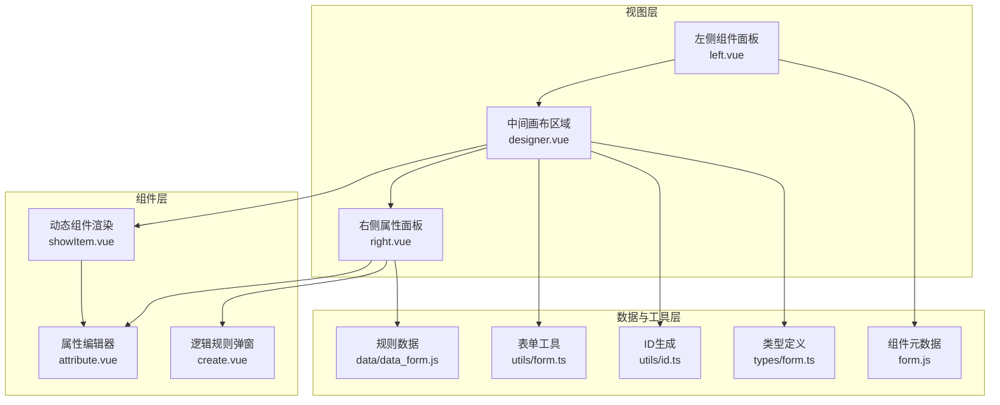
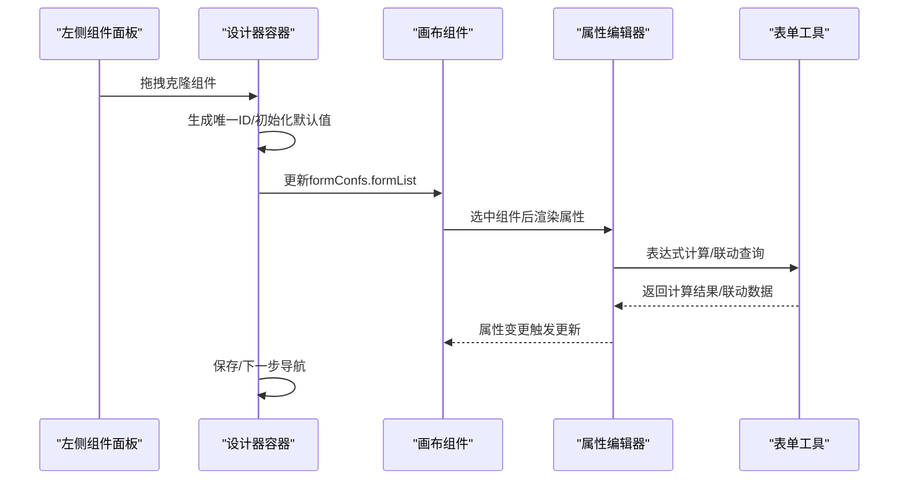
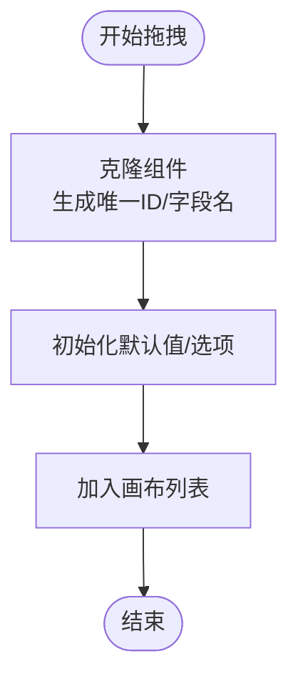
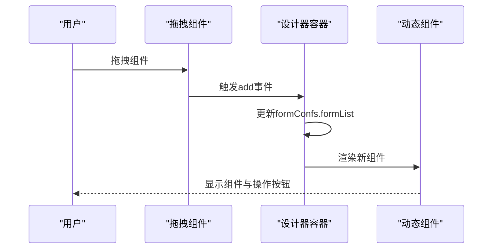
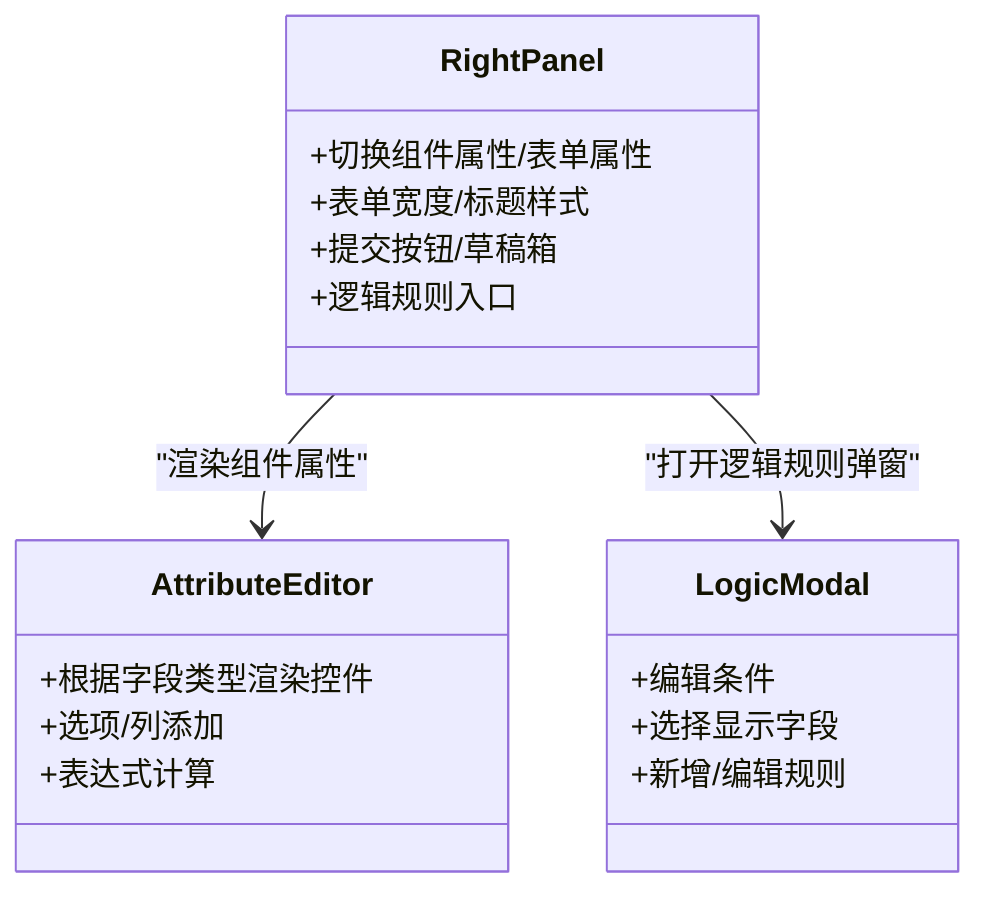
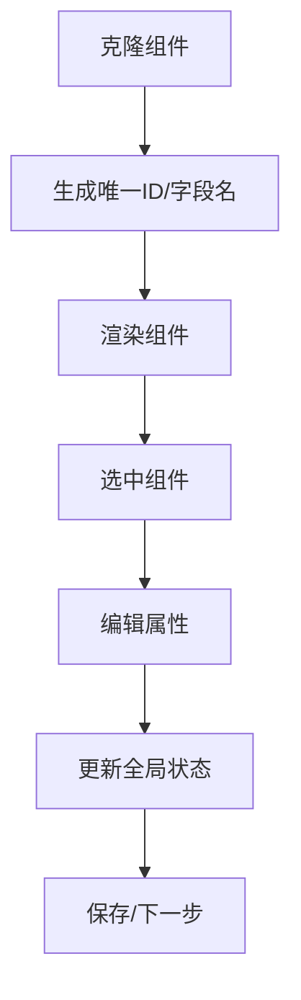
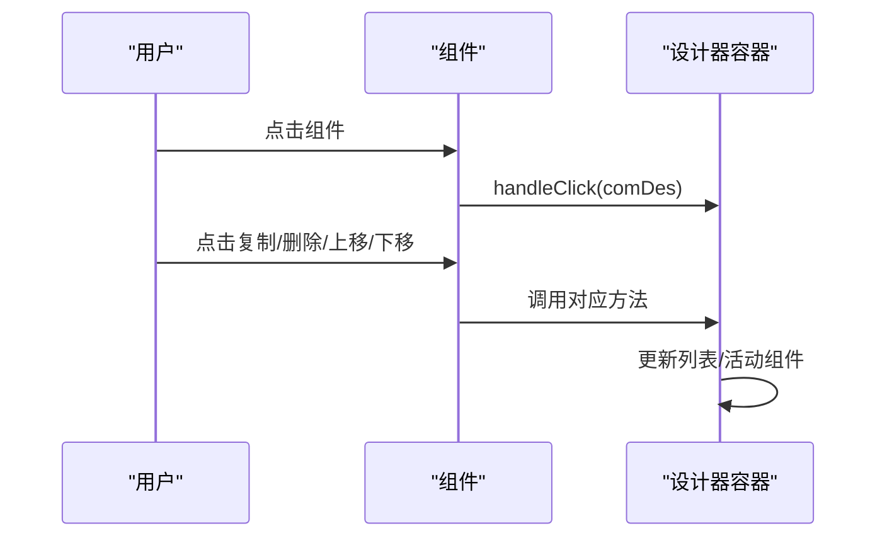
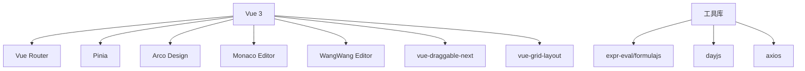

# 表单设计器架构

<cite>
**本文档引用的文件**
- [designer.vue](file://src/views/form/designer.vue)
- [left.vue](file://src/views/form/left.vue)
- [right.vue](file://src/views/form/right.vue)
- [showItem.vue](file://src/components/showItem/showItem.vue)
- [attribute.vue](file://src/views/form/components/attribute.vue)
- [create.vue](file://src/views/form/components/create.vue)
- [form.ts](file://src/types/form.ts)
- [form.js](file://src/data/form.js)
- [form.ts（工具）](file://src/utils/form.ts)
- [id.ts](file://src/utils/id.ts)
- [data_form.js](file://src/data/data_form.js)
- [qInput.vue](file://src/components/showItem/qInput.vue)
- [qRow.vue](file://src/components/showItem/qRow.vue)
- [package.json](file://package.json)
</cite>

## 目录
1. [简介](#简介)
2. [项目结构](#项目结构)
3. [核心组件](#核心组件)
4. [架构总览](#架构总览)
5. [详细组件分析](#详细组件分析)
6. [依赖关系分析](#依赖关系分析)
7. [性能考虑](#性能考虑)
8. [故障排除指南](#故障排除指南)
9. [结论](#结论)
10. [附录](#附录)

## 简介
本项目是一个基于 Vue 3 的可视化表单设计器，采用左右中三栏布局：左侧为组件面板，中间为画布区域，右侧为属性面板。通过拖拽式组件添加、组件层级管理、表单属性配置与逻辑规则编辑，实现所见即所得的表单设计体验。系统支持组件选择、复制、删除、排序等交互，具备数据流驱动的属性绑定与表达式计算能力，并提供扩展点以支持自定义组件集成。

## 项目结构
- 视图层
  - 左侧组件面板：展示可拖拽的基础组件集合，支持克隆并生成唯一标识。
  - 中间画布区域：渲染表单结构，支持拖拽排序与组件操作按钮。
  - 右侧属性面板：组件属性配置与表单属性设置，支持逻辑规则弹窗编辑。
- 组件层
  - 动态组件渲染：根据组件类型动态渲染具体输入控件。
  - 属性编辑器：按字段类型提供对应的编辑控件（输入框、选择器、开关、富文本等）。
- 数据与工具层
  - 组件元数据：定义组件类型、默认属性、属性列表与方法模板。
  - 表单工具：负责表单数据的序列化、反序列化、联动查询、表达式求值与子表单处理。
  - ID 生成：提供 UUID 与短 ID 生成策略，确保组件唯一性。
- 类型定义
  - FormConfs：表单配置接口，包含表单宽度、标题样式、提交按钮、草稿箱等全局属性。
  - Appdes、FlowInfo：应用与流程相关类型定义。

**图表来源**
- [designer.vue:1-444](file://src/views/form/designer.vue#L1-L444)
- [left.vue:1-106](file://src/views/form/left.vue#L1-L106)
- [right.vue:1-217](file://src/views/form/right.vue#L1-L217)
- [showItem.vue:1-196](file://src/components/showItem/showItem.vue#L1-L196)
- [attribute.vue:1-294](file://src/views/form/components/attribute.vue#L1-L294)
- [create.vue:1-476](file://src/views/form/components/create.vue#L1-L476)
- [form.js:1-800](file://src/data/form.js#L1-L800)
- [form.ts（工具）:1-800](file://src/utils/form.ts#L1-L800)
- [id.ts:1-26](file://src/utils/id.ts#L1-L26)
- [form.ts:12-24](file://src/types/form.ts#L12-L24)
- [data_form.js:1-200](file://src/data/data_form.js#L1-L200)

**章节来源**
- [designer.vue:1-444](file://src/views/form/designer.vue#L1-L444)
- [left.vue:1-106](file://src/views/form/left.vue#L1-L106)
- [right.vue:1-217](file://src/views/form/right.vue#L1-L217)
- [form.ts:12-24](file://src/types/form.ts#L12-L24)

## 核心组件
- 设计器容器（designer.vue）
  - 负责全局状态管理（表单配置、活动组件、部门树）、拖拽事件处理、组件复制/删除/排序、表单校验与保存。
  - 使用 provide/inject 在父子组件间传递操作方法与状态。
- 左侧面板（left.vue）
  - 定义组件分类与列表，使用 vue-draggable-next 实现从面板到画布的克隆拖拽。
  - 克隆时生成唯一 ID 并初始化默认值与选项。
- 画布组件（showItem.vue）
  - 将 comDes 渲染为具体组件，支持编辑态下的操作按钮（上移、下移、复制、删除）。
  - 通过注入的方法与父级交互，实现组件级操作。
- 右侧面板（right.vue）
  - 切换“组件属性”和“表单属性”，提供表单宽度、标题样式、提交按钮、草稿箱等全局配置。
  - 支持打开逻辑规则弹窗，收集条件与显示字段。
- 属性编辑器（attribute.vue）
  - 根据字段类型渲染对应控件，支持选项添加、列添加、表达式计算、数据源选择等。
  - 监听表达式变化，实时计算默认值并回写。
- 逻辑规则弹窗（create.vue）
  - 编辑复杂条件（字段、比较符、取值），以及显示字段集合。
  - 支持编辑现有规则与新增规则，提交时进行格式化与校验。

**章节来源**
- [designer.vue:67-287](file://src/views/form/designer.vue#L67-L287)
- [left.vue:26-56](file://src/views/form/left.vue#L26-L56)
- [showItem.vue:48-104](file://src/components/showItem/showItem.vue#L48-L104)
- [right.vue:102-135](file://src/views/form/right.vue#L102-L135)
- [attribute.vue:110-252](file://src/views/form/components/attribute.vue#L110-L252)
- [create.vue:139-345](file://src/views/form/components/create.vue#L139-L345)

## 架构总览
表单设计器采用“容器-组件-工具”分层架构：
- 容器层：designer.vue 作为根容器，统一调度拖拽、状态、保存与下一步导航。
- 组件层：left.vue、showItem.vue、right.vue、attribute.vue、create.vue 各司其职，通过 props 与 provide/inject 通信。
- 工具层：utils/form.ts 提供表单数据转换、联动查询、表达式计算、子表单处理；id.ts 提供唯一 ID 生成；data/form.js 定义组件元数据与默认属性；data_form.js 定义规则比较符与默认值集合。

**图表来源**
- [designer.vue:84-177](file://src/views/form/designer.vue#L84-L177)
- [left.vue:51-55](file://src/views/form/left.vue#L51-L55)
- [showItem.vue:75-103](file://src/components/showItem/showItem.vue#L75-L103)
- [attribute.vue:164-180](file://src/views/form/components/attribute.vue#L164-L180)
- [form.ts（工具）:602-722](file://src/utils/form.ts#L602-L722)

## 详细组件分析

### 左侧组件面板（拖拽与克隆）
- 功能要点
  - 分类展示组件列表，使用 group.pull='clone' 实现从面板到画布的克隆拖拽。
  - 克隆时调用 cloneComponent，生成唯一 ID、字段名与默认选项。
  - 支持 ROW、SUBFORM、TITLE、SPLIT_LINE 等特殊组件的处理。
- 关键实现路径
  - 组件克隆与 ID 生成：[left.vue:51-55](file://src/views/form/left.vue#L51-L55)，[id.ts:7-14](file://src/utils/id.ts#L7-L14)
  - 组件元数据定义：[form.js:23-800](file://src/data/form.js#L23-L800)

**图表来源**
- [left.vue:51-55](file://src/views/form/left.vue#L51-L55)
- [id.ts:7-14](file://src/utils/id.ts#L7-L14)
- [form.js:23-800](file://src/data/form.js#L23-L800)

**章节来源**
- [left.vue:26-56](file://src/views/form/left.vue#L26-L56)
- [form.js:23-800](file://src/data/form.js#L23-L800)
- [id.ts:7-14](file://src/utils/id.ts#L7-L14)

### 中间画布区域（拖拽排序与组件渲染）
- 功能要点
  - 使用 draggable 对 formList 进行拖拽排序，支持跨容器移动（由左侧克隆进入）。
  - 通过 showItem.vue 动态渲染组件，编辑态显示操作按钮（上移、下移、复制、删除）。
  - 支持 ROW 内部列的拖拽排序。
- 关键实现路径
  - 拖拽与排序：[designer.vue:11-30](file://src/views/form/designer.vue#L11-L30)，[showItem.vue:13-14](file://src/components/showItem/showItem.vue#L13-L14)
  - ROW 内部拖拽：[qRow.vue:3-8](file://src/components/showItem/qRow.vue#L3-L8)

**图表来源**
- [designer.vue:11-30](file://src/views/form/designer.vue#L11-L30)
- [showItem.vue:13-14](file://src/components/showItem/showItem.vue#L13-L14)
- [qRow.vue:3-8](file://src/components/showItem/qRow.vue#L3-L8)

**章节来源**
- [designer.vue:11-30](file://src/views/form/designer.vue#L11-L30)
- [showItem.vue:48-104](file://src/components/showItem/showItem.vue#L48-L104)
- [qRow.vue:12-24](file://src/components/showItem/qRow.vue#L12-L24)

### 右侧属性面板（组件属性与表单属性）
- 功能要点
  - 组件属性：根据 activeForm.props 字段类型渲染对应控件，支持选项添加、列添加、表达式计算等。
  - 表单属性：控制表单宽度（固定/百分比）、标题样式（左/上/隐藏）、提交按钮、草稿箱、逻辑规则入口。
  - 逻辑规则弹窗：收集条件与显示字段，支持编辑与新增。
- 关键实现路径
  - 属性切换与表单属性：[right.vue:7-98](file://src/views/form/right.vue#L7-L98)
  - 逻辑规则弹窗：[create.vue:139-345](file://src/views/form/components/create.vue#L139-L345)
  - 属性编辑器：[attribute.vue:110-252](file://src/views/form/components/attribute.vue#L110-L252)

**图表来源**
- [right.vue:7-98](file://src/views/form/right.vue#L7-L98)
- [attribute.vue:110-252](file://src/views/form/components/attribute.vue#L110-L252)
- [create.vue:139-345](file://src/views/form/components/create.vue#L139-L345)

**章节来源**
- [right.vue:102-135](file://src/views/form/right.vue#L102-L135)
- [attribute.vue:164-180](file://src/views/form/components/attribute.vue#L164-L180)
- [create.vue:245-275](file://src/views/form/components/create.vue#L245-L275)

### 数据流与状态管理
- 状态存储
  - 全局表单配置：formConfs（宽度、标题样式、提交按钮、草稿箱、逻辑规则等）。
  - 活动组件：activeForm（当前选中的组件）。
  - 部门树：deptLists（用于用户/部门选择组件的数据源）。
- 数据流
  - 组件克隆与 ID 生成：left.vue -> designer.vue -> showItem.vue。
  - 属性变更：attribute.vue -> provide/inject -> designer.vue -> utils/form.ts。
  - 表单提交：designer.vue -> utils/form.ts -> API。
- 关键实现路径
  - provide/inject 通信：[designer.vue:286](file://src/views/form/designer.vue#L286)
  - 表单工具函数：[form.ts（工具）:578-722](file://src/utils/form.ts#L578-L722)
  - 类型定义：[form.ts:12-24](file://src/types/form.ts#L12-L24)

**图表来源**
- [designer.vue:286](file://src/views/form/designer.vue#L286)
- [form.ts（工具）:578-722](file://src/utils/form.ts#L578-L722)
- [form.ts:12-24](file://src/types/form.ts#L12-L24)

**章节来源**
- [designer.vue:96-113](file://src/views/form/designer.vue#L96-L113)
- [form.ts（工具）:578-722](file://src/utils/form.ts#L578-L722)
- [form.ts:12-24](file://src/types/form.ts#L12-L24)

### 组件交互模式
- 组件选择
  - 点击组件高亮边框，激活右侧属性面板对应项。
- 复制
  - 生成新 ID/字段名，递归处理子组件与选项值，保持数据一致性。
- 删除
  - 从列表移除，重置活动组件。
- 排序
  - 上移/下移交换相邻索引位置，保持活动组件选中状态。
- 关键实现路径
  - 选择/复制/删除/排序：[designer.vue:178-282](file://src/views/form/designer.vue#L178-L282)
  - 组件内按钮交互：[showItem.vue:75-103](file://src/components/showItem/showItem.vue#L75-L103)

**图表来源**
- [showItem.vue:75-103](file://src/components/showItem/showItem.vue#L75-L103)
- [designer.vue:178-282](file://src/views/form/designer.vue#L178-L282)

**章节来源**
- [showItem.vue:48-104](file://src/components/showItem/showItem.vue#L48-L104)
- [designer.vue:178-282](file://src/views/form/designer.vue#L178-L282)

### 扩展点与自定义组件集成
- 扩展点
  - 组件元数据扩展：在 data/form.js 中新增组件类型、默认属性与属性列表。
  - 自定义组件注册：在 showItem.vue 中通过动态组件渲染，确保 props 结构一致。
  - 表单工具扩展：在 utils/form.ts 中增加新的数据处理逻辑（如新增组件类型的序列化/反序列化）。
- 集成最佳实践
  - 统一字段命名：id、props.field、props.value。
  - 选项值唯一性：使用 nanoid 生成选项值，避免冲突。
  - 表达式与联动：在组件元数据中预留 expressionValue/method 字段，便于表达式计算与联动查询。
  - 关键实现路径
    - 组件元数据：[form.js:23-800](file://src/data/form.js#L23-L800)
    - ID 生成：[id.ts:7-14](file://src/utils/id.ts#L7-L14)
    - 表单工具：[form.ts（工具）:578-722](file://src/utils/form.ts#L578-L722)

**章节来源**
- [form.js:23-800](file://src/data/form.js#L23-L800)
- [id.ts:7-14](file://src/utils/id.ts#L7-L14)
- [form.ts（工具）:578-722](file://src/utils/form.ts#L578-L722)

## 依赖关系分析
- 前端框架与库
  - Vue 3、Vue Router、Pinia（状态管理）、Arco Design（UI 组件库）、Monaco Editor（代码编辑）、WangWang Editor（富文本）。
- 拖拽与布局
  - vue-draggable-next：实现拖拽排序与跨容器克隆。
  - vue-grid-layout：网格布局支持（在部分组件中使用）。
- 工具与算法
  - expr-eval/formulajs：表达式计算。
  - dayjs：日期时间处理。
  - axios：HTTP 请求封装。
- 关键依赖路径
  - 依赖清单：[package.json:13-44](file://package.json#L13-L44)

**图表来源**
- [package.json:13-44](file://package.json#L13-L44)

**章节来源**
- [package.json:13-44](file://package.json#L13-L44)

## 性能考虑
- 渲染优化
  - 使用 v-for 渲染组件列表，确保 key 唯一（使用生成的 ID）。
  - 按需渲染：仅在选中组件时渲染属性编辑器，减少不必要的 DOM 更新。
- 拖拽性能
  - 设置合理的动画时间（animation=340），避免过长导致卡顿。
  - 克隆时一次性生成 ID 与默认值，减少后续变更成本。
- 数据处理
  - 表单工具中的联动查询与表达式计算采用异步处理，避免阻塞主线程。
  - 对于大量选项的组件，建议延迟加载或虚拟滚动（如后续扩展）。

## 故障排除指南
- 组件无法拖拽
  - 检查 draggable 的 group 配置与 draggable 选择器是否正确。
  - 确认 provide/inject 的方法是否正确注入到子组件。
- 属性编辑无效
  - 检查 attribute.vue 中字段类型与渲染控件是否匹配。
  - 确认表达式计算是否抛出异常，必要时在 try/catch 中捕获错误。
- 子表单数据异常
  - 检查子表单的字段名与 ID 生成逻辑，确保唯一性。
  - 确认 utils/form.ts 中的子表单序列化/反序列化逻辑是否正确。
- 关键实现路径
  - 拖拽与注入：[designer.vue:286](file://src/views/form/designer.vue#L286)
  - 属性编辑器：[attribute.vue:91-103](file://src/views/form/components/attribute.vue#L91-L103)
  - 子表单处理：[form.ts（工具）:267-293](file://src/utils/form.ts#L267-L293)

**章节来源**
- [designer.vue:286](file://src/views/form/designer.vue#L286)
- [attribute.vue:91-103](file://src/views/form/components/attribute.vue#L91-L103)
- [form.ts（工具）:267-293](file://src/utils/form.ts#L267-L293)

## 结论
该表单设计器通过清晰的三层架构与完善的组件交互机制，实现了可视化的表单设计体验。左侧组件面板提供丰富的可拖拽组件，中间画布支持灵活的布局与排序，右侧属性面板覆盖了组件与表单级别的配置需求。配合强大的表单工具链与扩展点，系统具备良好的可维护性与可扩展性，能够满足复杂业务场景下的表单设计需求。

## 附录
- 组件类型与默认属性参考：[form.js:23-800](file://src/data/form.js#L23-L800)
- 表单配置接口：[form.ts:12-24](file://src/types/form.ts#L12-L24)
- 表单工具函数：[form.ts（工具）:578-722](file://src/utils/form.ts#L578-L722)
- ID 生成策略：[id.ts:7-14](file://src/utils/id.ts#L7-L14)
- 规则数据与比较符：[data_form.js:1-200](file://src/data/data_form.js#L1-200)