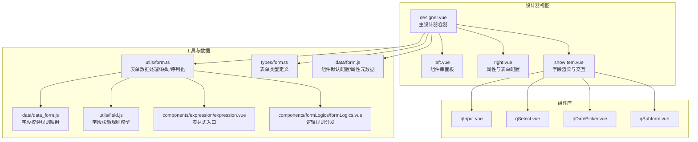
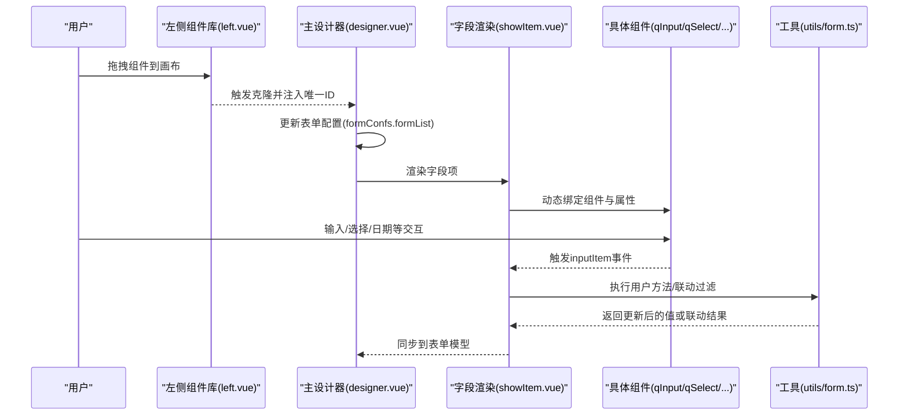
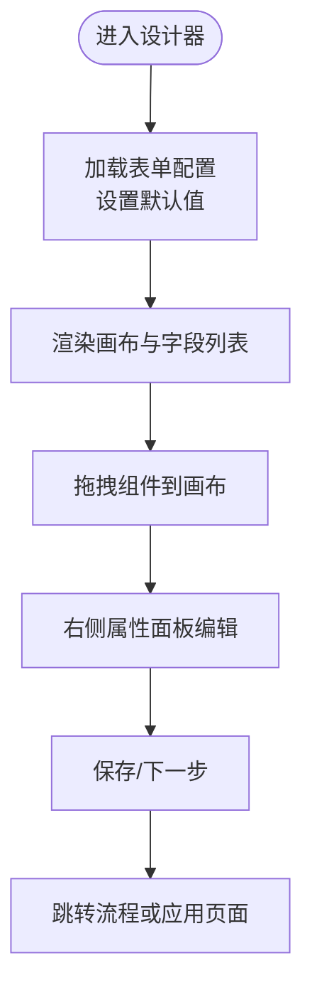
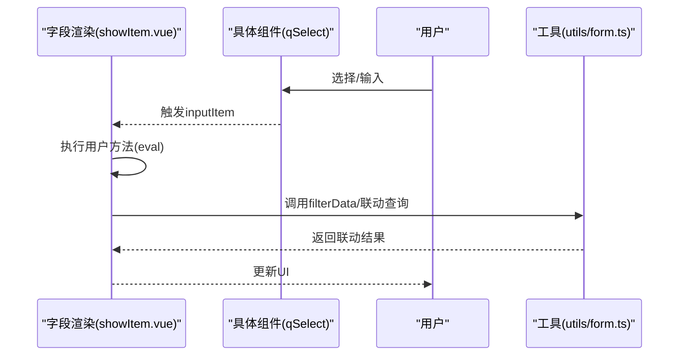
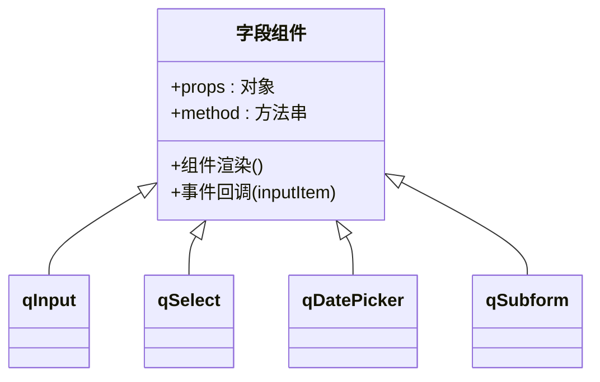
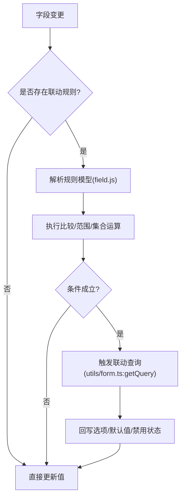
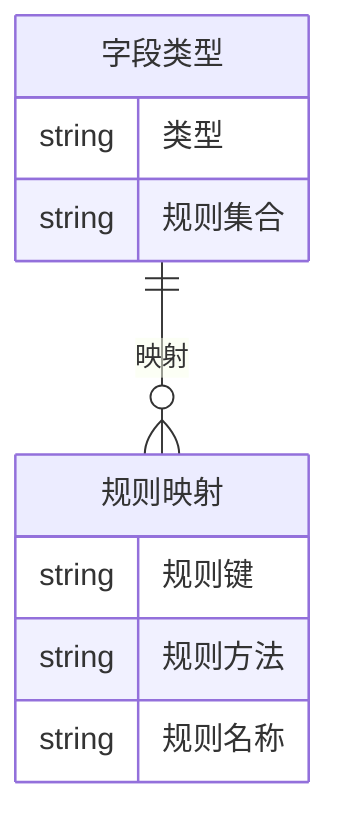
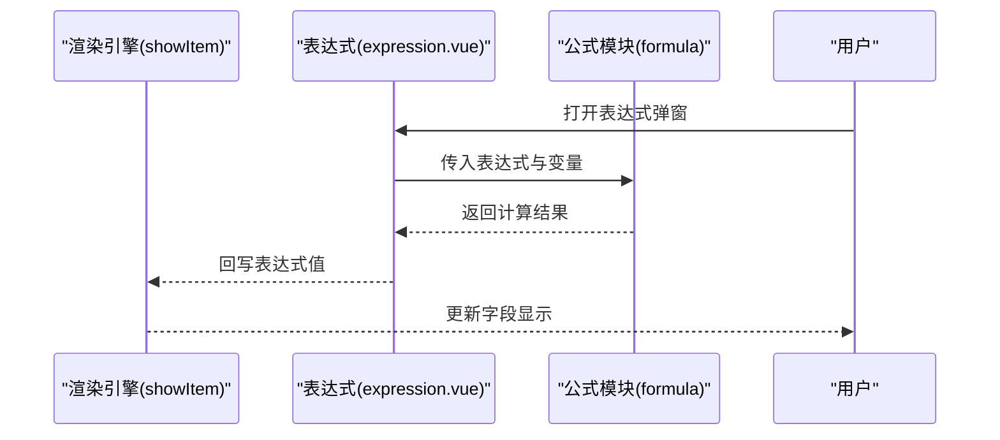
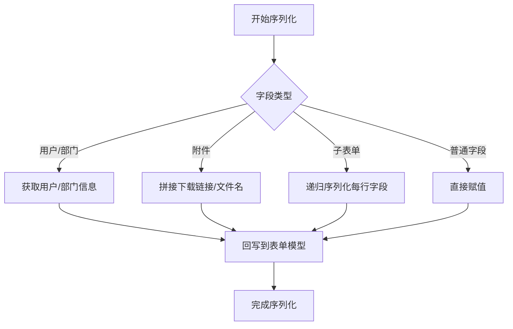
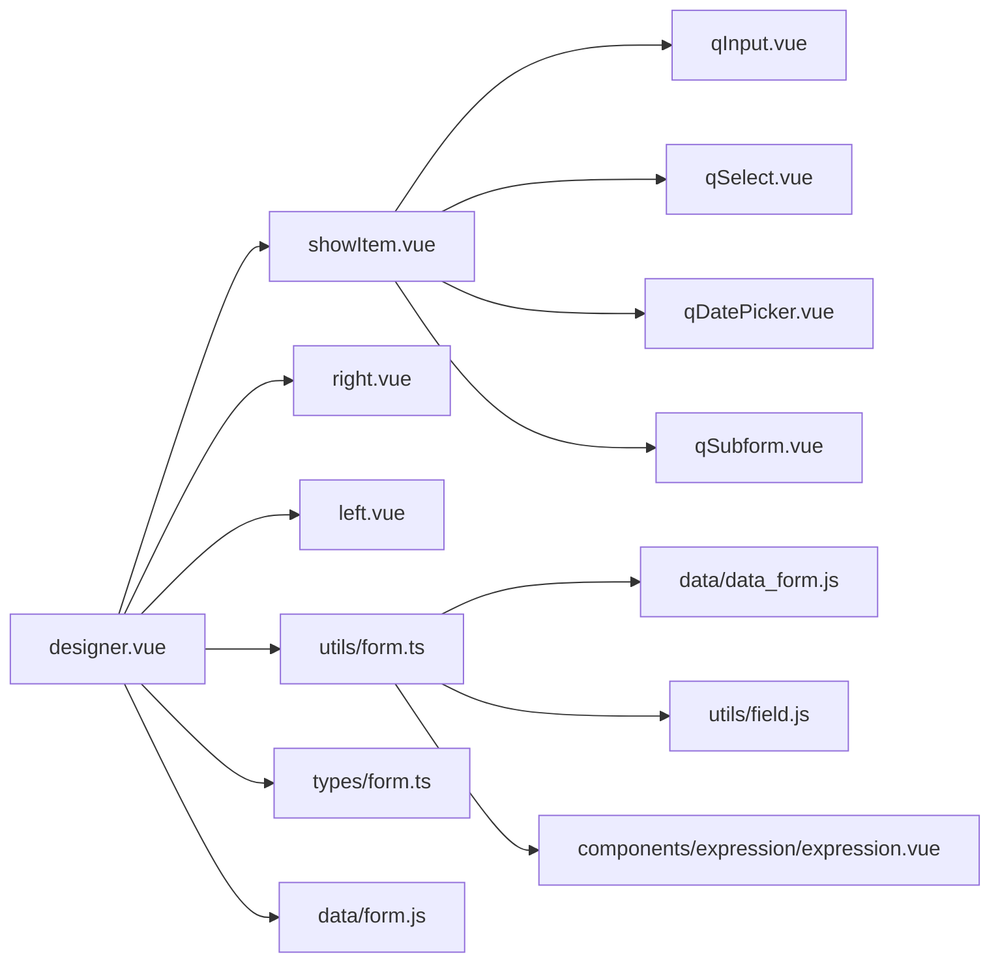

# 表单设计系统

<cite>
**本文引用的文件**
- [designer.vue](file://src/views/form/designer.vue)
- [showItem.vue](file://src/components/showItem/showItem.vue)
- [form.ts](file://src/types/form.ts)
- [form.ts](file://src/utils/form.ts)
- [form.js](file://src/data/form.js)
- [formLogics.vue](file://src/components/formLogics/formLogics.vue)
- [expression.vue](file://src/components/expression/expression.vue)
- [field.js](file://src/utils/field.js)
- [left.vue](file://src/views/form/left.vue)
- [right.vue](file://src/views/form/right.vue)
- [qInput.vue](file://src/components/showItem/qInput.vue)
- [qSelect.vue](file://src/components/showItem/qSelect.vue)
- [qDatePicker.vue](file://src/components/showItem/qDatePicker.vue)
- [qSubform.vue](file://src/components/showItem/qSubform.vue)
- [data_form.js](file://src/data/data_form.js)
</cite>

## 目录
1. [引言](#引言)
2. [项目结构](#项目结构)
3. [核心组件](#核心组件)
4. [架构总览](#架构总览)
5. [详细组件分析](#详细组件分析)
6. [依赖关系分析](#依赖关系分析)
7. [性能考量](#性能考量)
8. [故障排查指南](#故障排查指南)
9. [结论](#结论)
10. [附录](#附录)

## 引言
本文件面向“表单设计系统”的使用者与开发者，系统性阐述可视化表单设计器的架构与实现原理，覆盖字段组件库、布局系统、表单验证、表单逻辑、渲染引擎、表达式计算与字段联动等核心能力，并提供最佳实践与性能优化建议，帮助读者快速理解并高效使用该系统。

## 项目结构
该表单设计系统采用前端单页应用（Vue 3 + TypeScript）实现，围绕“设计器视图 + 组件库 + 工具集 + 类型约束”组织代码。整体分为三大部分：
- 设计器视图：负责拖拽、编辑、预览与保存
- 组件库：通用字段组件与复合容器（如子表单）
- 工具与数据：字段类型系统、表单工具方法、表达式与校验规则

图表来源
- [designer.vue:1-444](file://src/views/form/designer.vue#L1-L444)
- [left.vue:1-106](file://src/views/form/left.vue#L1-L106)
- [right.vue:1-217](file://src/views/form/right.vue#L1-L217)
- [showItem.vue:1-196](file://src/components/showItem/showItem.vue#L1-L196)
- [qInput.vue:1-21](file://src/components/showItem/qInput.vue#L1-L21)
- [qSelect.vue:1-34](file://src/components/showItem/qSelect.vue#L1-L34)
- [qDatePicker.vue:1-31](file://src/components/showItem/qDatePicker.vue#L1-L31)
- [qSubform.vue:1-433](file://src/components/showItem/qSubform.vue#L1-L433)
- [form.ts:1-800](file://src/utils/form.ts#L1-L800)
- [form.ts:1-45](file://src/types/form.ts#L1-L45)
- [form.js:1-800](file://src/data/form.js#L1-L800)
- [data_form.js:1-800](file://src/data/data_form.js#L1-L800)
- [field.js:1-207](file://src/utils/field.js#L1-L207)
- [expression.vue:1-131](file://src/components/expression/expression.vue#L1-L131)
- [formLogics.vue:1-35](file://src/components/formLogics/formLogics.vue#L1-L35)

章节来源
- [designer.vue:1-444](file://src/views/form/designer.vue#L1-L444)
- [left.vue:1-106](file://src/views/form/left.vue#L1-L106)
- [right.vue:1-217](file://src/views/form/right.vue#L1-L217)

## 核心组件
- 主设计器容器：承载画布、底部操作区、右侧属性面板，负责表单配置持久化与流程推进
- 字段渲染器：根据字段类型动态渲染组件，统一处理事件回调与联动触发
- 组件库：涵盖输入、选择、日期、附件、图片、子表单等常用字段
- 工具集：表单数据转换、联动查询、表达式计算、字段联动规则模型
- 类型系统：统一约束表单配置、字段属性与逻辑规则的数据结构

章节来源
- [designer.vue:67-287](file://src/views/form/designer.vue#L67-L287)
- [showItem.vue:48-104](file://src/components/showItem/showItem.vue#L48-L104)
- [form.ts:12-24](file://src/types/form.ts#L12-L24)

## 架构总览
系统采用“配置驱动 + 渲染引擎 + 事件驱动”的架构：
- 配置驱动：通过 form.js 中的组件默认配置与属性元数据，生成可拖拽字段与属性面板
- 渲染引擎：showItem.vue 动态渲染具体字段组件，支持编辑态与预览态切换
- 事件驱动：字段变更时触发 inputItem，执行用户自定义方法与联动过滤
- 工具链：utils/form.ts 负责数据格式化、联动查询、表达式求值与提交序列化

图表来源
- [left.vue:35-55](file://src/views/form/left.vue#L35-L55)
- [designer.vue:87-113](file://src/views/form/designer.vue#L87-L113)
- [showItem.vue:91-103](file://src/components/showItem/showItem.vue#L91-L103)
- [form.ts:602-722](file://src/utils/form.ts#L602-L722)

## 详细组件分析

### 设计器容器（主设计器）
- 负责画布区域、底部操作区、右侧属性面板的布局与交互
- 提供表单配置持久化、保存与下一步流程推进
- 维护表单模型与活动字段状态，提供上下文注入给子组件

图表来源
- [designer.vue:87-177](file://src/views/form/designer.vue#L87-L177)

章节来源
- [designer.vue:67-287](file://src/views/form/designer.vue#L67-L287)

### 字段渲染器（showItem）
- 动态渲染字段组件，区分编辑态与预览态
- 统一处理字段点击、复制、删除、上下移动等操作
- 在字段变更时触发 inputItem，执行用户自定义方法与联动过滤

图表来源
- [showItem.vue:91-103](file://src/components/showItem/showItem.vue#L91-L103)
- [qSelect.vue:13-24](file://src/components/showItem/qSelect.vue#L13-L24)

章节来源
- [showItem.vue:48-104](file://src/components/showItem/showItem.vue#L48-L104)

### 字段组件库
- 输入类：单行文本、多行文本、数字输入等
- 选择类：单选、多选、下拉、多选下拉
- 时间类：日期、时间、日期区间、时间区间
- 媒体类：附件、图片
- 容器类：子表单（支持行内字段编排与行级增删）

图表来源
- [qInput.vue:1-21](file://src/components/showItem/qInput.vue#L1-L21)
- [qSelect.vue:1-34](file://src/components/showItem/qSelect.vue#L1-L34)
- [qDatePicker.vue:1-31](file://src/components/showItem/qDatePicker.vue#L1-L31)
- [qSubform.vue:1-433](file://src/components/showItem/qSubform.vue#L1-L433)

章节来源
- [qInput.vue:1-21](file://src/components/showItem/qInput.vue#L1-L21)
- [qSelect.vue:1-34](file://src/components/showItem/qSelect.vue#L1-L34)
- [qDatePicker.vue:1-31](file://src/components/showItem/qDatePicker.vue#L1-L31)
- [qSubform.vue:1-433](file://src/components/showItem/qSubform.vue#L1-L433)

### 表单逻辑与联动
- 表单逻辑规则分发：按字段类型路由到对应逻辑组件
- 字段联动规则模型：基于符号与比较器判断条件成立与否
- 联动查询：根据条件字段变化，调用后端接口返回选项或值

图表来源
- [formLogics.vue:1-35](file://src/components/formLogics/formLogics.vue#L1-L35)
- [field.js:1-207](file://src/utils/field.js#L1-L207)
- [form.ts:602-722](file://src/utils/form.ts#L602-L722)

章节来源
- [formLogics.vue:1-35](file://src/components/formLogics/formLogics.vue#L1-L35)
- [field.js:1-207](file://src/utils/field.js#L1-L207)
- [form.ts:602-722](file://src/utils/form.ts#L602-L722)

### 表单验证与规则映射
- 不同字段类型对应不同的校验规则集合（字符串、数值、日期、数组等）
- 规则映射由 data_form.js 提供，支持自定义与内置规则
- 表单提交时进行序列化与值规范化

图表来源
- [data_form.js:596-768](file://src/data/data_form.js#L596-L768)

章节来源
- [data_form.js:1-800](file://src/data/data_form.js#L1-L800)

### 表单渲染引擎与表达式计算
- 渲染引擎：通过 showItem.vue 的动态组件机制渲染字段
- 表达式入口：expression.vue 提供表达式弹窗与变量选择
- 计算引擎：公式模块（formula）负责表达式求值与回写

图表来源
- [expression.vue:86-102](file://src/components/expression/expression.vue#L86-L102)
- [form.ts:723-800](file://src/utils/form.ts#L723-L800)

章节来源
- [expression.vue:1-131](file://src/components/expression/expression.vue#L1-L131)
- [form.ts:723-800](file://src/utils/form.ts#L723-L800)

### 数据处理与序列化
- 表单数据格式化：支持多选、用户/部门、附件、子表单等复杂结构
- 联动查询：根据条件字段变化，异步获取选项或默认值
- 提交流程：将复杂结构序列化为后端可接受的格式

图表来源
- [form.ts:346-577](file://src/utils/form.ts#L346-L577)

章节来源
- [form.ts:346-577](file://src/utils/form.ts#L346-L577)

## 依赖关系分析
- 组件间依赖：designer.vue 依赖 showItem.vue 与右侧属性面板；showItem.vue 依赖具体字段组件
- 工具依赖：utils/form.ts 依赖 data_form.js、field.js、expression 入口
- 类型依赖：types/form.ts 为全局表单配置与逻辑提供类型约束

图表来源
- [designer.vue:67-287](file://src/views/form/designer.vue#L67-L287)
- [showItem.vue:48-104](file://src/components/showItem/showItem.vue#L48-L104)
- [form.ts:1-800](file://src/utils/form.ts#L1-L800)
- [data_form.js:1-800](file://src/data/data_form.js#L1-L800)
- [field.js:1-207](file://src/utils/field.js#L1-L207)
- [expression.vue:1-131](file://src/components/expression/expression.vue#L1-L131)
- [form.ts:1-45](file://src/types/form.ts#L1-L45)
- [form.js:1-800](file://src/data/form.js#L1-L800)

章节来源
- [designer.vue:67-287](file://src/views/form/designer.vue#L67-L287)
- [form.ts:1-800](file://src/utils/form.ts#L1-L800)

## 性能考量
- 渲染优化
  - 使用虚拟滚动与懒加载：对长列表字段（如子表单行）采用按需渲染
  - 减少不必要的响应式更新：对高频字段变更使用节流/防抖
- 数据处理优化
  - 联动查询延迟执行：仅在条件字段稳定后再发起请求
  - 批量更新：合并多次字段变更，减少重复计算
- 表达式与规则
  - 缓存表达式结果：对相同输入缓存计算结果
  - 简化规则：避免复杂嵌套条件，优先使用简单规则组合
- 存储与持久化
  - 本地缓存：对频繁修改的表单配置进行本地缓存，降低网络压力
  - 分片保存：大表单拆分保存，避免一次性提交过大数据

## 故障排查指南
- 字段联动无效
  - 检查字段联动规则是否正确配置（符号、比较器、字段引用）
  - 确认条件字段值已稳定再触发联动
  - 查看工具方法中 getQuery 的调用是否成功返回数据
- 表单提交失败
  - 核对字段类型与序列化逻辑，确保复杂结构被正确序列化
  - 检查用户/部门/附件等特殊字段的值是否符合预期
- 表达式不生效
  - 确认表达式入口已正确回写值
  - 检查公式模块的计算逻辑与变量引用
- 子表单异常
  - 确认子表单字段不允许拖入布局容器（行、列、标题、分割线、子表单）
  - 检查子表单行的唯一ID生成与字段ID映射

章节来源
- [qSubform.vue:142-175](file://src/components/showItem/qSubform.vue#L142-L175)
- [form.ts:452-577](file://src/utils/form.ts#L452-L577)
- [expression.vue:86-102](file://src/components/expression/expression.vue#L86-L102)

## 结论
该表单设计系统以“配置驱动 + 渲染引擎 + 事件驱动”为核心，结合完善的字段组件库、联动规则模型与表达式计算能力，提供了高扩展性的可视化表单设计体验。通过合理的数据处理与序列化策略，系统在复杂业务场景下仍能保持良好的性能与稳定性。建议在实际使用中遵循最佳实践，持续优化规则与表达式，以获得更佳的开发与使用体验。

## 附录
- 最佳实践
  - 将复杂逻辑拆分为多个简单规则，便于维护与调试
  - 对高频字段使用缓存与批量更新，减少重复计算
  - 表单提交前进行本地校验与序列化，提升用户体验
- 性能优化建议
  - 对长列表字段启用虚拟滚动与懒加载
  - 合理使用节流/防抖，避免频繁触发联动与表达式计算
  - 对大表单采用分片保存与增量更新策略