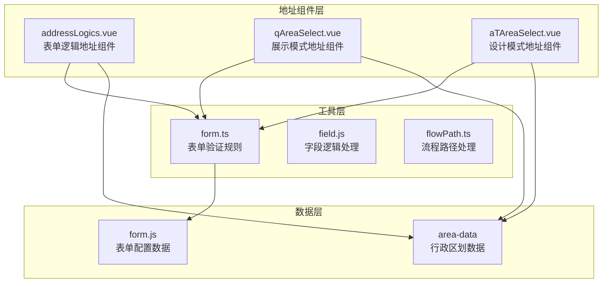
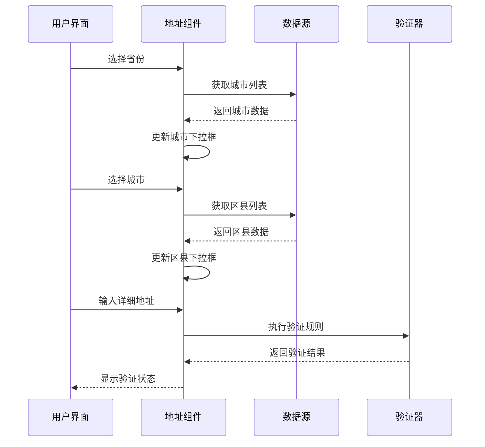
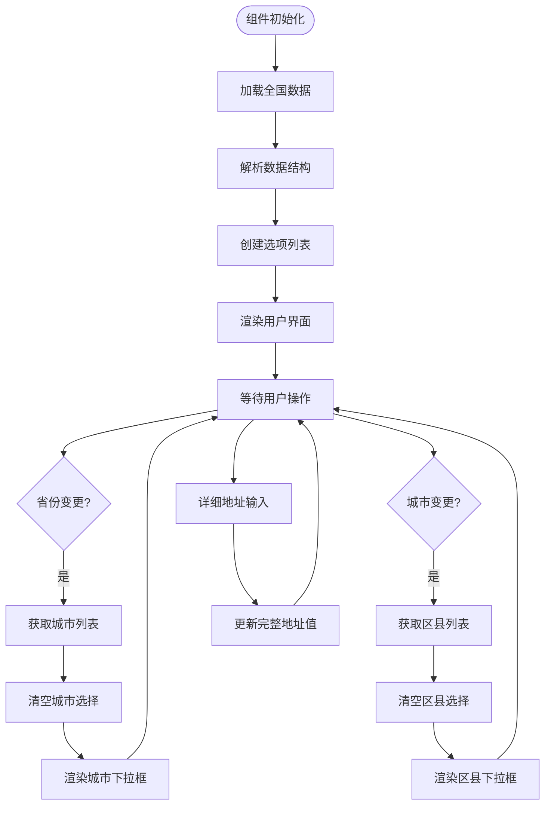
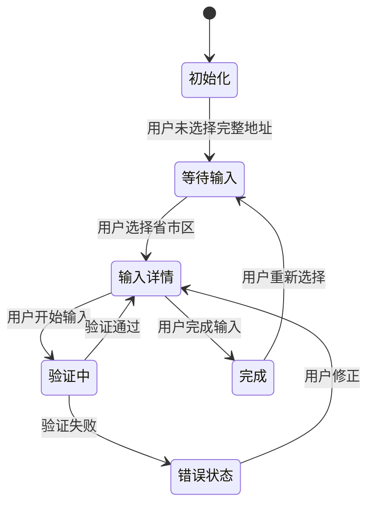
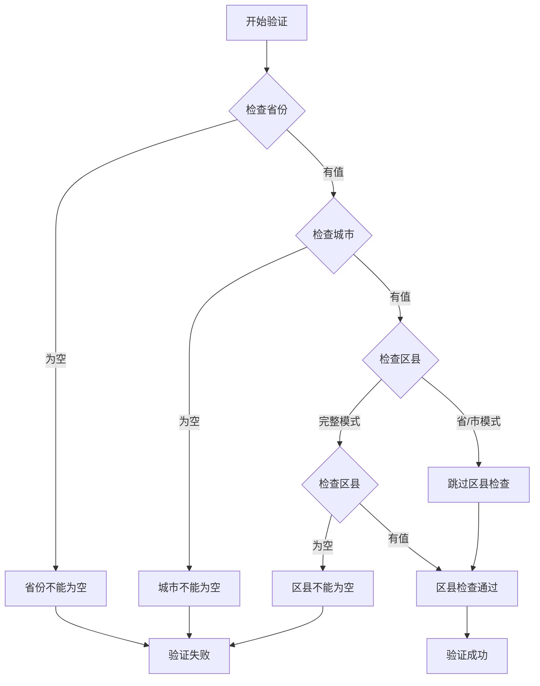
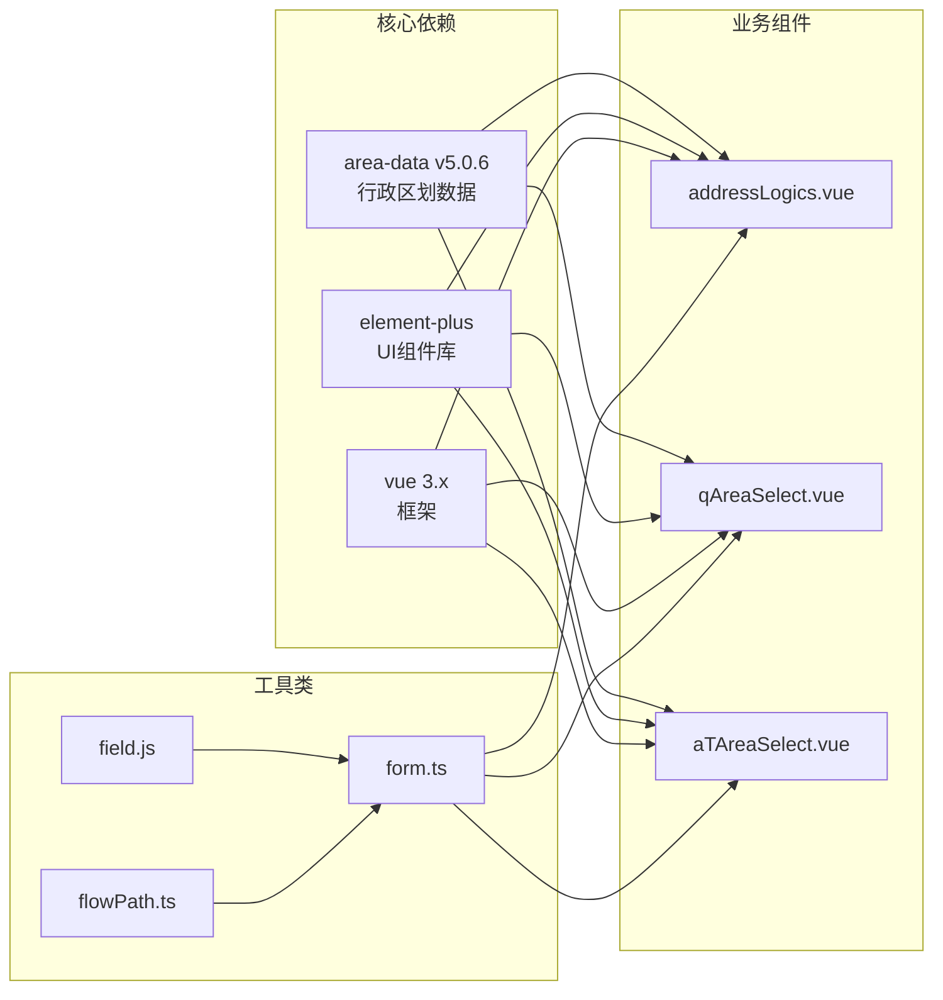
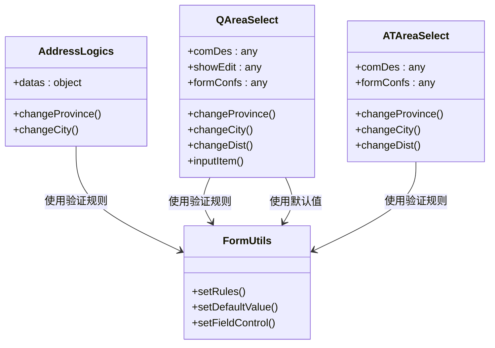

# 地址字段逻辑

<cite>
**本文档引用的文件**
- [addressLogics.vue](file://src/components/formLogics/addressLogics.vue)
- [qAreaSelect.vue](file://src/components/showItem/qAreaSelect.vue)
- [aTAreaSelect.vue](file://src/components/showItem/aTAreaSelect.vue)
- [form.ts](file://src/utils/form.ts)
- [form.js](file://src/data/form.js)
- [field.js](file://src/utils/field.js)
- [flowPath.ts](file://src/utils/flowPath.ts)
- [package.json](file://package.json)
</cite>

## 目录
1. [简介](#简介)
2. [项目结构](#项目结构)
3. [核心组件](#核心组件)
4. [架构概览](#架构概览)
5. [详细组件分析](#详细组件分析)
6. [依赖分析](#依赖分析)
7. [性能考虑](#性能考虑)
8. [故障排除指南](#故障排除指南)
9. [结论](#结论)

## 简介

本文件专门阐述系统中地址字段逻辑的实现机制，包括省市区三级联动、地址详情输入、邮编验证等核心功能。该实现基于 `area-data` 库提供完整的中国行政区划数据，支持多种展示模式和验证规则，为不同业务场景提供灵活的地址选择解决方案。

## 项目结构

地址字段逻辑主要分布在以下模块中：

**图表来源**
- [addressLogics.vue:1-65](file://src/components/formLogics/addressLogics.vue#L1-L65)
- [qAreaSelect.vue:1-148](file://src/components/showItem/qAreaSelect.vue#L1-L148)
- [aTAreaSelect.vue:1-127](file://src/components/showItem/aTAreaSelect.vue#L1-L127)

**章节来源**
- [addressLogics.vue:1-65](file://src/components/formLogics/addressLogics.vue#L1-L65)
- [qAreaSelect.vue:1-148](file://src/components/showItem/qAreaSelect.vue#L1-L148)
- [aTAreaSelect.vue:1-127](file://src/components/showItem/aTAreaSelect.vue#L1-L127)

## 核心组件

### 地址数据结构

地址字段采用统一的数据结构，支持多种精度级别的选择：

| 字段 | 类型 | 描述 | 必填 |
|------|------|------|------|
| prov | string | 省份代码 | 否 |
| city | string | 城市代码 | 否 |
| dist | string | 区县代码 | 否 |
| det | string | 详细地址 | 否 |

### 组件类型对比

| 组件 | 模式 | 主要用途 | 特性 |
|------|------|----------|------|
| addressLogics | 表单逻辑 | 动态表单逻辑 | 简化版三级联动 |
| qAreaSelect | 展示模式 | 表单展示 | 完整功能实现 |
| aTAreaSelect | 设计模式 | 表单设计器 | 设计时使用 |

**章节来源**
- [form.js:1753-1793](file://src/data/form.js#L1753-L1793)
- [qAreaSelect.vue:32-36](file://src/components/showItem/qAreaSelect.vue#L32-L36)
- [aTAreaSelect.vue:32-35](file://src/components/showItem/aTAreaSelect.vue#L32-L35)

## 架构概览

地址字段逻辑采用分层架构设计，确保数据一致性与用户体验的平衡：

**图表来源**
- [qAreaSelect.vue:65-118](file://src/components/showItem/qAreaSelect.vue#L65-L118)
- [form.ts:1108-1127](file://src/utils/form.ts#L1108-L1127)

## 详细组件分析

### 省市区三级联动实现

#### 数据加载机制

组件通过 `area-data` 库提供的 `pcaa` 方法获取完整的行政区划数据：

**图表来源**
- [qAreaSelect.vue:30-31](file://src/components/showItem/qAreaSelect.vue#L30-L31)
- [qAreaSelect.vue:65-118](file://src/components/showItem/qAreaSelect.vue#L65-L118)

#### 级联关系管理

组件维护严格的级联关系，确保数据一致性：

| 级联层级 | 触发条件 | 清空范围 | 更新内容 |
|----------|----------|----------|----------|
| 省级 | 选择新省份 | 城市、区县、详细地址 | 城市列表 |
| 市级 | 选择新城市 | 区县、详细地址 | 区县列表 |
| 区县级 | 选择新区县 | 详细地址 | 无 |

**章节来源**
- [qAreaSelect.vue:65-118](file://src/components/showItem/qAreaSelect.vue#L65-L118)
- [aTAreaSelect.vue:64-113](file://src/components/showItem/aTAreaSelect.vue#L64-L113)

### 地址详情输入功能

#### 输入控制机制

详细地址输入采用智能控制策略：

**图表来源**
- [qAreaSelect.vue:17-21](file://src/components/showItem/qAreaSelect.vue#L17-L21)
- [qAreaSelect.vue:122-134](file://src/components/showItem/qAreaSelect.vue#L122-L134)

#### 文本限制与格式控制

详细地址支持最大100字符限制，提供字数统计功能：

- 最大长度：100字符
- 支持字数统计显示
- 实时字符计数
- 清晰的输入反馈

**章节来源**
- [qAreaSelect.vue:17-21](file://src/components/showItem/qAreaSelect.vue#L17-L21)
- [qAreaSelect.vue:122-134](file://src/components/showItem/qAreaSelect.vue#L122-L134)

### 邮编验证逻辑

#### 验证规则实现

系统针对地址字段实现了严格的验证规则：

**图表来源**
- [form.ts:1108-1127](file://src/utils/form.ts#L1108-L1127)

#### 验证规则配置

验证规则根据不同的地区精度级别动态调整：

| 地区精度 | 验证要求 | 错误消息 |
|----------|----------|----------|
| 省/市/区县/详细地址 | 省、市、区县、详细地址均需填写 | 对应字段不能为空 |
| 省/市/区县 | 省、市、区县需填写 | 对应字段不能为空 |
| 省/市 | 仅省、市需填写 | 对应字段不能为空 |

**章节来源**
- [form.ts:1108-1127](file://src/utils/form.ts#L1108-L1127)
- [form.js:1814-1818](file://src/data/form.js#L1814-L1818)

### 组件配置选项

#### 地区精度设置

系统提供三种地区精度级别供用户选择：

| 精度级别 | 选项值 | 显示内容 |
|----------|--------|----------|
| 完整地址 | prov-city-dist-det | 省/市/区县/详细地址 |
| 区县地址 | prov-city-dist | 省/市/区县 |
| 省市地址 | prov-city | 省/市 |

#### 其他配置选项

| 配置项 | 类型 | 默认值 | 描述 |
|--------|------|--------|------|
| required | boolean | true | 是否必填 |
| disabled | boolean | false | 是否禁用 |
| readonly | boolean | false | 是否只读 |
| visible | boolean | true | 是否显示 |
| allowClear | boolean | true | 是否允许清空 |
| showWordLimit | boolean | false | 是否显示字数统计 |
| maxLength | number | 100 | 最大字符数 |

**章节来源**
- [form.js:1814-1818](file://src/data/form.js#L1814-L1818)
- [form.js:1768-1787](file://src/data/form.js#L1768-L1787)

## 依赖分析

### 外部依赖关系

地址字段逻辑依赖于以下关键外部库：

**图表来源**
- [package.json:20](file://package.json#L20)
- [package.json:28](file://package.json#L28)
- [package.json:37](file://package.json#L37)

### 内部依赖关系

组件间的依赖关系体现了清晰的职责分离：

**图表来源**
- [addressLogics.vue:19-54](file://src/components/formLogics/addressLogics.vue#L19-L54)
- [qAreaSelect.vue:24-134](file://src/components/showItem/qAreaSelect.vue#L24-L134)
- [aTAreaSelect.vue:24-113](file://src/components/showItem/aTAreaSelect.vue#L24-L113)

**章节来源**
- [package.json:13-44](file://package.json#L13-L44)
- [addressLogics.vue:19-54](file://src/components/formLogics/addressLogics.vue#L19-L54)

## 性能考虑

### 数据加载优化

系统采用按需加载策略，避免一次性加载所有行政区划数据：

- **延迟加载**：仅在用户展开下拉框时才加载对应层级的数据
- **缓存机制**：已加载的地区数据会被缓存，避免重复请求
- **内存优化**：组件销毁时自动清理数据引用

### 渲染性能优化

- **虚拟滚动**：对于大量选项的情况，采用虚拟滚动技术
- **防抖处理**：输入事件采用防抖机制，减少不必要的重渲染
- **响应式更新**：使用Vue 3的响应式系统，精确控制更新范围

### 用户体验优化

- **加载指示**：数据加载时显示加载状态
- **错误处理**：网络异常时提供友好的错误提示
- **回退机制**：数据加载失败时提供基本功能

## 故障排除指南

### 常见问题及解决方案

#### 地区数据加载失败

**问题现象**：下拉框显示为空或加载缓慢

**可能原因**：
- 网络连接异常
- `area-data` 库版本不兼容
- 浏览器缓存问题

**解决步骤**：
1. 检查网络连接状态
2. 验证 `area-data` 库版本
3. 清除浏览器缓存
4. 重启应用

#### 级联功能异常

**问题现象**：选择省份后城市列表不更新

**可能原因**：
- 数据结构不匹配
- 事件绑定错误
- 状态管理问题

**解决步骤**：
1. 检查 `pcaa` 数据结构
2. 验证事件监听器
3. 查看组件状态更新
4. 检查控制台错误日志

#### 验证规则失效

**问题现象**：地址验证不生效或报错

**可能原因**：
- 验证规则配置错误
- 数据格式不正确
- 逻辑判断条件问题

**解决步骤**：
1. 检查验证规则配置
2. 验证数据格式
3. 调试逻辑判断
4. 查看错误堆栈

**章节来源**
- [form.ts:1108-1127](file://src/utils/form.ts#L1108-L1127)
- [qAreaSelect.vue:122-134](file://src/components/showItem/qAreaSelect.vue#L122-L134)

## 结论

地址字段逻辑实现了完整的省市区三级联动功能，具备以下特点：

### 技术优势
- **数据完整性**：基于权威的 `area-data` 库，确保行政区划数据准确
- **用户体验**：流畅的级联交互和智能的输入控制
- **扩展性强**：支持多种精度级别和自定义配置
- **性能优化**：合理的数据加载和渲染策略

### 应用价值
- **业务适配**：满足不同业务场景对地址精度的要求
- **开发效率**：标准化的组件接口，降低开发成本
- **维护便利**：清晰的代码结构和完善的错误处理

### 发展方向
- **国际化支持**：扩展到其他国家和地区的地址格式
- **智能补全**：集成地址智能识别和补全功能
- **移动端优化**：针对移动设备的特殊交互需求进行优化

该实现为复杂业务系统中的地址管理提供了可靠的技术基础，既保证了功能的完整性，又兼顾了性能和用户体验的平衡。