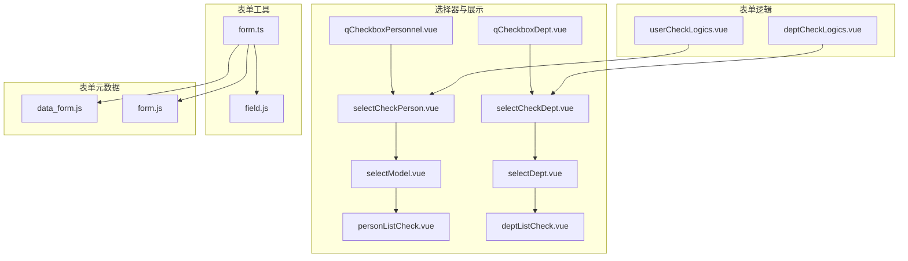
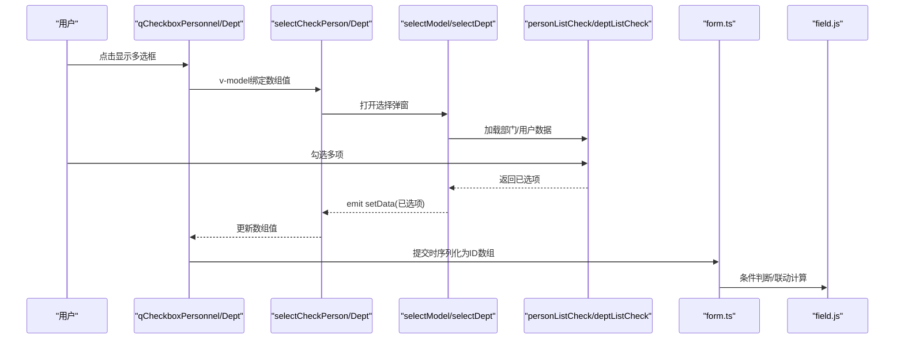
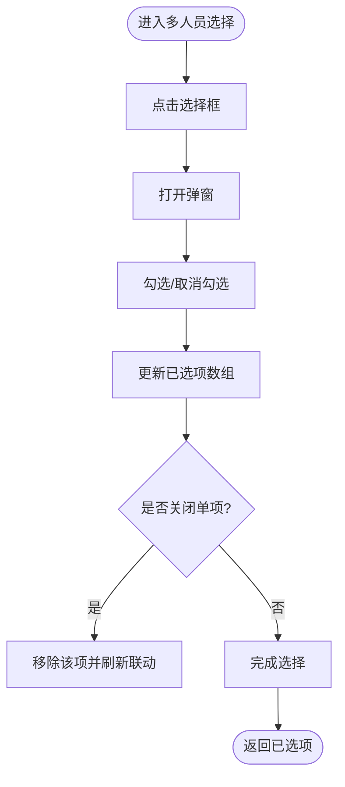
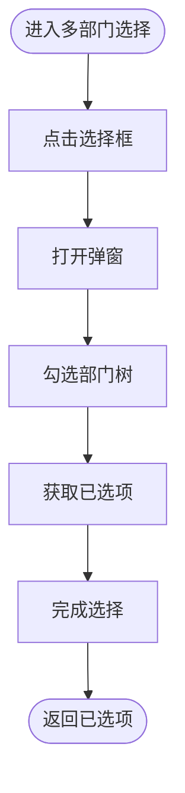
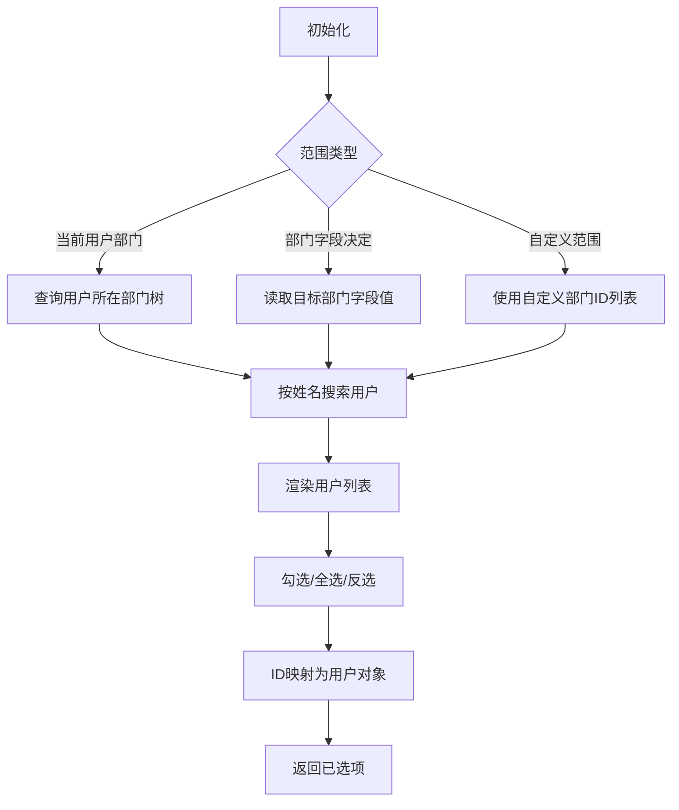
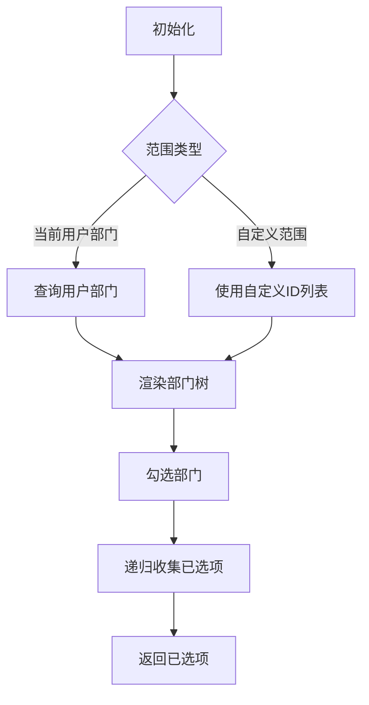
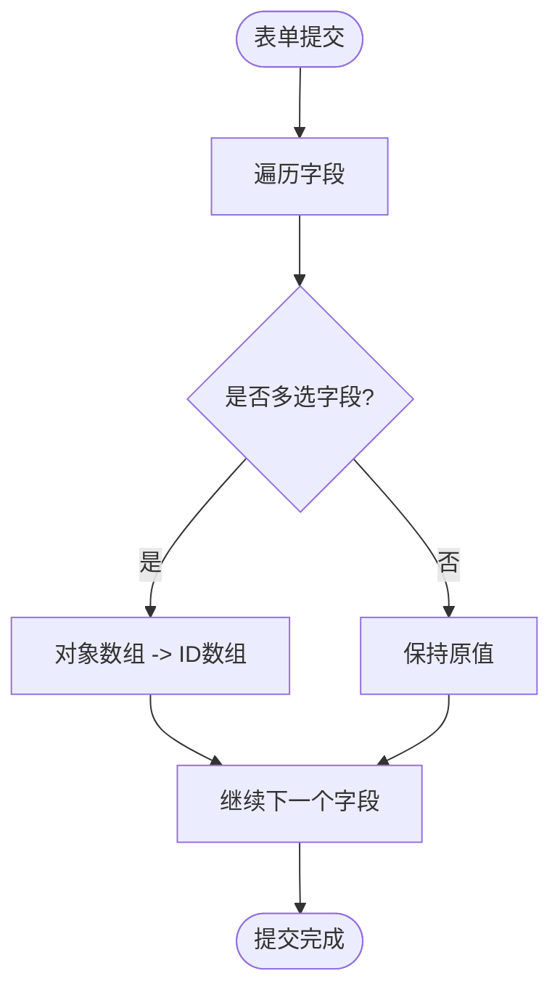
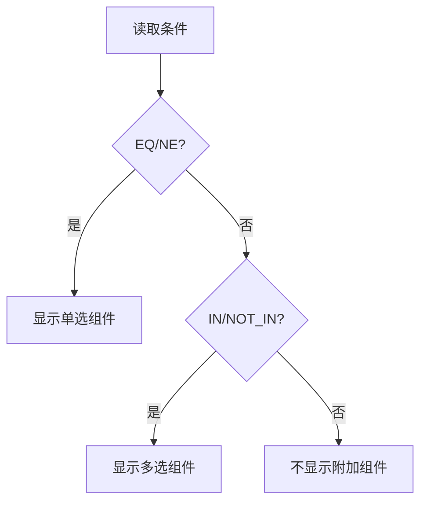
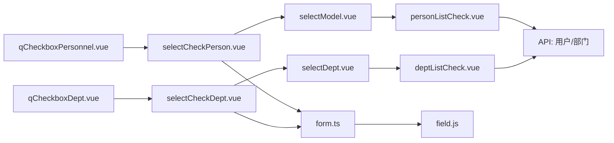

# 多选字段逻辑

<cite>
**本文引用的文件**
- [selectCheckPerson.vue](file://src/components/selectPerson/selectCheckPerson.vue)
- [selectCheckDept.vue](file://src/components/selectPerson/selectCheckDept.vue)
- [personListCheck.vue](file://src/components/selectPerson/components/personListCheck.vue)
- [deptListCheck.vue](file://src/components/selectPerson/components/deptListCheck.vue)
- [selectModel.vue](file://src/components/selectPerson/components/selectModel.vue)
- [selectDept.vue](file://src/components/selectPerson/components/selectDept.vue)
- [qCheckboxPersonnel.vue](file://src/components/showItem/qCheckboxPersonnel.vue)
- [qCheckboxDept.vue](file://src/components/showItem/qCheckboxDept.vue)
- [userCheckLogics.vue](file://src/components/formLogics/userCheckLogics.vue)
- [deptCheckLogics.vue](file://src/components/formLogics/deptCheckLogics.vue)
- [form.ts](file://src/utils/form.ts)
- [field.js](file://src/utils/field.js)
- [data_form.js](file://src/data/data_form.js)
- [form.js](file://src/data/form.js)
</cite>

## 目录
1. [引言](#引言)
2. [项目结构](#项目结构)
3. [核心组件](#核心组件)
4. [架构总览](#架构总览)
5. [详细组件分析](#详细组件分析)
6. [依赖关系分析](#依赖关系分析)
7. [性能考量](#性能考量)
8. [故障排查指南](#故障排查指南)
9. [结论](#结论)
10. [附录](#附录)

## 引言
本文件系统性梳理“多选字段”在组织管理与审批流程中的实现逻辑，覆盖多部门选择、多人员选择的勾选控制、数量限制、去重处理、结果汇总，以及与单选字段的切换、批量操作支持、联动更新等机制。文档以代码为依据，配合可视化图示，帮助开发者与产品人员快速理解并正确配置多选字段。

## 项目结构
围绕多选字段的关键目录与文件如下：
- 选择器与展示层：selectPerson 目录下的多选组件与弹窗模型
- 表单工具与规则：utils 下的表单序列化/反序列化、字段规则计算
- 表单元数据：data 下的表单字段定义与默认值处理
- 表单逻辑：formLogics 下的条件联动组件

**图表来源**
- [selectCheckPerson.vue:1-117](file://src/components/selectPerson/selectCheckPerson.vue#L1-L117)
- [selectCheckDept.vue:1-118](file://src/components/selectPerson/selectCheckDept.vue#L1-L118)
- [selectModel.vue:1-81](file://src/components/selectPerson/components/selectModel.vue#L1-L81)
- [selectDept.vue:1-92](file://src/components/selectPerson/components/selectDept.vue#L1-L92)
- [personListCheck.vue:1-272](file://src/components/selectPerson/components/personListCheck.vue#L1-L272)
- [deptListCheck.vue:1-86](file://src/components/selectPerson/components/deptListCheck.vue#L1-L86)
- [qCheckboxPersonnel.vue:1-20](file://src/components/showItem/qCheckboxPersonnel.vue#L1-L20)
- [qCheckboxDept.vue:1-20](file://src/components/showItem/qCheckboxDept.vue#L1-L20)
- [form.ts:899-1085](file://src/utils/form.ts#L899-L1085)
- [field.js:1-207](file://src/utils/field.js#L1-L207)
- [data_form.js:813-840](file://src/data/data_form.js#L813-L840)
- [form.js:2263-2300](file://src/data/form.js#L2263-L2300)

**章节来源**
- [selectCheckPerson.vue:1-117](file://src/components/selectPerson/selectCheckPerson.vue#L1-L117)
- [selectCheckDept.vue:1-118](file://src/components/selectPerson/selectCheckDept.vue#L1-L118)
- [selectModel.vue:1-81](file://src/components/selectPerson/components/selectModel.vue#L1-L81)
- [selectDept.vue:1-92](file://src/components/selectPerson/components/selectDept.vue#L1-L92)
- [personListCheck.vue:1-272](file://src/components/selectPerson/components/personListCheck.vue#L1-L272)
- [deptListCheck.vue:1-86](file://src/components/selectPerson/components/deptListCheck.vue#L1-L86)
- [qCheckboxPersonnel.vue:1-20](file://src/components/showItem/qCheckboxPersonnel.vue#L1-L20)
- [qCheckboxDept.vue:1-20](file://src/components/showItem/qCheckboxDept.vue#L1-L20)
- [form.ts:899-1085](file://src/utils/form.ts#L899-L1085)
- [field.js:1-207](file://src/utils/field.js#L1-L207)
- [data_form.js:813-840](file://src/data/data_form.js#L813-L840)
- [form.js:2263-2300](file://src/data/form.js#L2263-L2300)

## 核心组件
- 多人员选择器：selectCheckPerson.vue
  - 负责渲染标签式已选项、占位文案、触发弹窗选择；通过 v-model 双向绑定数组值；支持移除单项与联动刷新。
- 多部门选择器：selectCheckDept.vue
  - 功能与多人员选择器一致，面向部门树形多选。
- 人员列表选择：personListCheck.vue
  - 提供左侧部门树、右侧用户列表与全选/反选；支持按部门筛选、按姓名检索；维护已选项集合与全选状态。
- 部门列表选择：deptListCheck.vue
  - 基于树形结构的多选，支持父子节点严格关联；提供获取已选项、清空、回填等接口。
- 选择弹窗模型：selectModel.vue、selectDept.vue
  - 封装弹窗与提交流程，负责将子组件选择结果回传父组件。
- 展示组件：qCheckboxPersonnel.vue、qCheckboxDept.vue
  - 在只读或展示态使用，直接绑定 comDes.props.value。

**章节来源**
- [selectCheckPerson.vue:1-117](file://src/components/selectPerson/selectCheckPerson.vue#L1-L117)
- [selectCheckDept.vue:1-118](file://src/components/selectPerson/selectCheckDept.vue#L1-L118)
- [personListCheck.vue:1-272](file://src/components/selectPerson/components/personListCheck.vue#L1-L272)
- [deptListCheck.vue:1-86](file://src/components/selectPerson/components/deptListCheck.vue#L1-L86)
- [selectModel.vue:1-81](file://src/components/selectPerson/components/selectModel.vue#L1-L81)
- [selectDept.vue:1-92](file://src/components/selectPerson/components/selectDept.vue#L1-L92)
- [qCheckboxPersonnel.vue:1-20](file://src/components/showItem/qCheckboxPersonnel.vue#L1-L20)
- [qCheckboxDept.vue:1-20](file://src/components/showItem/qCheckboxDept.vue#L1-L20)

## 架构总览
多选字段从“输入选择”到“表单提交”的关键路径如下：

**图表来源**
- [qCheckboxPersonnel.vue:1-20](file://src/components/showItem/qCheckboxPersonnel.vue#L1-L20)
- [qCheckboxDept.vue:1-20](file://src/components/showItem/qCheckboxDept.vue#L1-L20)
- [selectCheckPerson.vue:1-117](file://src/components/selectPerson/selectCheckPerson.vue#L1-L117)
- [selectCheckDept.vue:1-118](file://src/components/selectPerson/selectCheckDept.vue#L1-L118)
- [selectModel.vue:1-81](file://src/components/selectPerson/components/selectModel.vue#L1-L81)
- [selectDept.vue:1-92](file://src/components/selectPerson/components/selectDept.vue#L1-L92)
- [personListCheck.vue:1-272](file://src/components/selectPerson/components/personListCheck.vue#L1-L272)
- [deptListCheck.vue:1-86](file://src/components/selectPerson/components/deptListCheck.vue#L1-L86)
- [form.ts:452-577](file://src/utils/form.ts#L452-L577)
- [field.js:1-207](file://src/utils/field.js#L1-L207)

## 详细组件分析

### 多人员选择器（selectCheckPerson）
- 勾选控制
  - 使用标签展示已选项，超过阈值显示“+剩余数”，支持点击关闭移除单项。
  - 通过 v-model 双向绑定数组值，emit 更新事件。
- 数量限制与去重
  - 列表侧通过 a-checkbox-group 的 v-model 控制已选项数组，天然去重（基于唯一ID）。
  - 全选/反选逻辑根据用户列表长度动态计算半选状态。
- 结果汇总
  - setData 回传已选项对象数组，供上层表单使用。
- 联动更新
  - 关闭单项或设置数据后，调用 provide 的 filterData 进行联动刷新。

**图表来源**
- [selectCheckPerson.vue:1-117](file://src/components/selectPerson/selectCheckPerson.vue#L1-L117)
- [personListCheck.vue:144-206](file://src/components/selectPerson/components/personListCheck.vue#L144-L206)

**章节来源**
- [selectCheckPerson.vue:1-117](file://src/components/selectPerson/selectCheckPerson.vue#L1-L117)
- [personListCheck.vue:144-206](file://src/components/selectPerson/components/personListCheck.vue#L144-L206)

### 多部门选择器（selectCheckDept）
- 勾选控制
  - 部门树形多选，父子节点严格关联；提供获取/清空/回填接口。
- 数量限制与去重
  - 已选项数组通过 check-strictly 保证唯一性；回填时 setData 同步到树勾选状态。
- 结果汇总
  - getDeptData 返回已选项对象数组，供上层表单使用。
- 联动更新
  - 设置数据后调用 provide 的 filterData 进行联动刷新。

**图表来源**
- [selectCheckDept.vue:1-118](file://src/components/selectPerson/selectCheckDept.vue#L1-L118)
- [deptListCheck.vue:21-75](file://src/components/selectPerson/components/deptListCheck.vue#L21-L75)

**章节来源**
- [selectCheckDept.vue:1-118](file://src/components/selectPerson/selectCheckDept.vue#L1-L118)
- [deptListCheck.vue:21-75](file://src/components/selectPerson/components/deptListCheck.vue#L21-L75)

### 人员列表选择（personListCheck）
- 可选范围
  - 支持三种范围来源：当前用户所在部门、由某部门字段决定、自定义范围。
  - 当范围为“由部门字段决定”时，若对应字段为空会提示先填写该字段。
- 勾选控制
  - 左侧部门树选择后，右侧用户列表按部门过滤；支持按姓名搜索。
  - 全选/反选与半选状态根据用户列表长度动态计算。
- 去重与结果
  - 已选项数组基于用户ID；getData 将ID映射回完整用户对象。
- 批量操作
  - 全选按钮一次性勾选当前页全部用户；支持将已选项回填至外部表单字段。

**图表来源**
- [personListCheck.vue:78-142](file://src/components/selectPerson/components/personListCheck.vue#L78-L142)
- [personListCheck.vue:144-206](file://src/components/selectPerson/components/personListCheck.vue#L144-L206)

**章节来源**
- [personListCheck.vue:78-142](file://src/components/selectPerson/components/personListCheck.vue#L78-L142)
- [personListCheck.vue:144-206](file://src/components/selectPerson/components/personListCheck.vue#L144-L206)

### 部门列表选择（deptListCheck）
- 勾选控制
  - 使用 check-strictly=true 实现父子节点独立勾选；递归遍历树收集已选项。
- 可选范围
  - 支持当前用户主/兼部门、下级部门、自定义范围；根据 comDes.props 选择不同加载策略。
- 结果汇总
  - getDeptData 返回已选项对象数组；clearData 清空状态；setData 支持外部回填。

**图表来源**
- [deptListCheck.vue:37-75](file://src/components/selectPerson/components/deptListCheck.vue#L37-L75)

**章节来源**
- [deptListCheck.vue:37-75](file://src/components/selectPerson/components/deptListCheck.vue#L37-L75)

### 表单工具与规则（form.ts、field.js）
- 提交序列化
  - 对 USER_MULTIPLE/DEPT_MULTIPLE 字段，将对象数组序列化为ID数组，便于后端存储与传输。
- 默认值与校验
  - 针对多选类字段设置默认值为数组，并在规则中声明 required 时校验数组非空。
- 条件判断
  - field.js 提供 in/notIn/collect.* 等多选相关比较逻辑，支持多字段联动判断。

**图表来源**
- [form.ts:452-577](file://src/utils/form.ts#L452-L577)
- [form.ts:1065-1085](file://src/utils/form.ts#L1065-L1085)
- [field.js:78-82](file://src/utils/field.js#L78-L82)

**章节来源**
- [form.ts:452-577](file://src/utils/form.ts#L452-L577)
- [form.ts:1065-1085](file://src/utils/form.ts#L1065-L1085)
- [field.js:78-82](file://src/utils/field.js#L78-L82)

### 表单逻辑联动（userCheckLogics、deptCheckLogics）
- 条件联动
  - 当条件为 EQ/NE 时显示单选组件，IN/NOT_IN 时显示多选组件，实现“单选/多选”的自动切换。
- 默认值与范围
  - 多选逻辑组件内部仍复用 selectCheckPerson/selectCheckDept 的默认值与范围配置。

**图表来源**
- [userCheckLogics.vue:1-23](file://src/components/formLogics/userCheckLogics.vue#L1-L23)
- [deptCheckLogics.vue:1-23](file://src/components/formLogics/deptCheckLogics.vue#L1-L23)

**章节来源**
- [userCheckLogics.vue:1-23](file://src/components/formLogics/userCheckLogics.vue#L1-L23)
- [deptCheckLogics.vue:1-23](file://src/components/formLogics/deptCheckLogics.vue#L1-L23)

## 依赖关系分析
- 组件耦合
  - 展示组件仅依赖选择器；选择器依赖弹窗模型；弹窗模型依赖具体列表组件。
- 数据流
  - 选择器通过 v-model 与弹窗通信；列表组件通过 getData/setData 与弹窗交互；最终汇聚到表单工具进行序列化。
- 外部依赖
  - 人员/部门数据来源于 API；条件判断依赖 field.js；默认值与校验依赖 data_form.js 与 form.ts。

**图表来源**
- [qCheckboxPersonnel.vue:1-20](file://src/components/showItem/qCheckboxPersonnel.vue#L1-L20)
- [qCheckboxDept.vue:1-20](file://src/components/showItem/qCheckboxDept.vue#L1-L20)
- [selectCheckPerson.vue:1-117](file://src/components/selectPerson/selectCheckPerson.vue#L1-L117)
- [selectCheckDept.vue:1-118](file://src/components/selectPerson/selectCheckDept.vue#L1-L118)
- [selectModel.vue:1-81](file://src/components/selectPerson/components/selectModel.vue#L1-L81)
- [selectDept.vue:1-92](file://src/components/selectPerson/components/selectDept.vue#L1-L92)
- [personListCheck.vue:1-272](file://src/components/selectPerson/components/personListCheck.vue#L1-L272)
- [deptListCheck.vue:1-86](file://src/components/selectPerson/components/deptListCheck.vue#L1-L86)
- [form.ts:452-577](file://src/utils/form.ts#L452-L577)
- [field.js:1-207](file://src/utils/field.js#L1-L207)

**章节来源**
- [qCheckboxPersonnel.vue:1-20](file://src/components/showItem/qCheckboxPersonnel.vue#L1-L20)
- [qCheckboxDept.vue:1-20](file://src/components/showItem/qCheckboxDept.vue#L1-L20)
- [selectCheckPerson.vue:1-117](file://src/components/selectPerson/selectCheckPerson.vue#L1-L117)
- [selectCheckDept.vue:1-118](file://src/components/selectPerson/selectCheckDept.vue#L1-L118)
- [selectModel.vue:1-81](file://src/components/selectPerson/components/selectModel.vue#L1-L81)
- [selectDept.vue:1-92](file://src/components/selectPerson/components/selectDept.vue#L1-L92)
- [personListCheck.vue:1-272](file://src/components/selectPerson/components/personListCheck.vue#L1-L272)
- [deptListCheck.vue:1-86](file://src/components/selectPerson/components/deptListCheck.vue#L1-L86)
- [form.ts:452-577](file://src/utils/form.ts#L452-L577)
- [field.js:1-207](file://src/utils/field.js#L1-L207)

## 性能考量
- 列表渲染
  - 用户列表采用虚拟列表属性，提升大数据量下的滚动性能。
- 数据获取
  - 部门树与用户列表按需加载，避免一次性拉取全量数据。
- 勾选状态
  - 全选/半选状态基于当前页用户数量计算，减少不必要的 DOM 操作。
- 序列化与提交
  - 多选字段在提交阶段统一转换为ID数组，降低网络传输体积。

[本节为通用建议，无需特定文件引用]

## 故障排查指南
- 多选字段未生效
  - 检查 comDes.props.value 是否为数组且非空；确认 v-model 绑定是否正确。
  - 查看 selectCheckPerson/Dept 的 setData 调用链路是否被拦截（如 disabled）。
- 无法选择或勾选异常
  - 确认 personListCheck 的范围配置是否正确；当范围为“部门字段决定”时，确保目标字段已填写。
  - 检查 deptListCheck 的 check-strictly 与父子节点状态是否一致。
- 提交后ID缺失
  - 核对 form.ts 的提交序列化逻辑，确认 USER_MULTIPLE/DEPT_MULTIPLE 字段已转换为ID数组。
- 联动不更新
  - 确保调用了 provide 的 filterData 或 setForms 接口，以便触发其他字段的条件联动。

**章节来源**
- [selectCheckPerson.vue:48-67](file://src/components/selectPerson/selectCheckPerson.vue#L48-L67)
- [selectCheckDept.vue:47-66](file://src/components/selectPerson/selectCheckDept.vue#L47-L66)
- [personListCheck.vue:78-142](file://src/components/selectPerson/components/personListCheck.vue#L78-L142)
- [deptListCheck.vue:21-75](file://src/components/selectPerson/components/deptListCheck.vue#L21-L75)
- [form.ts:452-577](file://src/utils/form.ts#L452-L577)

## 结论
多选字段通过“展示组件 + 选择器 + 弹窗模型 + 列表组件”的分层设计，实现了灵活的勾选控制、范围限定、去重与结果汇总。结合表单工具的序列化与规则引擎，能够稳定支撑组织管理与审批流程中的复杂场景。建议在实际落地时重点关注范围配置、默认值与校验规则、以及联动刷新的时机。

[本节为总结，无需特定文件引用]

## 附录

### 多选字段与单选切换逻辑
- 条件联动组件根据条件类型自动切换单选或多选：
  - EQ/NE：单选
  - IN/NOT_IN：多选
- 适用于人员与部门两类字段。

**章节来源**
- [userCheckLogics.vue:1-23](file://src/components/formLogics/userCheckLogics.vue#L1-L23)
- [deptCheckLogics.vue:1-23](file://src/components/formLogics/deptCheckLogics.vue#L1-L23)

### 批量操作支持
- 全选/反选：在人员列表中提供全选按钮，一键勾选当前页全部用户。
- 批量回填：deptListCheck 的 setData 支持外部回填已选项，实现批量赋值。

**章节来源**
- [personListCheck.vue:144-160](file://src/components/selectPerson/components/personListCheck.vue#L144-L160)
- [deptListCheck.vue:69-72](file://src/components/selectPerson/components/deptListCheck.vue#L69-L72)

### 选择结果的联动更新
- 关闭单项或设置数据后，调用 provide 的 filterData/setForms，触发其他字段的条件联动与刷新。

**章节来源**
- [selectCheckPerson.vue:50-67](file://src/components/selectPerson/selectCheckPerson.vue#L50-L67)
- [selectCheckDept.vue:47-66](file://src/components/selectPerson/selectCheckDept.vue#L47-L66)
- [personListCheck.vue:172-193](file://src/components/selectPerson/components/personListCheck.vue#L172-L193)
- [deptListCheck.vue:69-75](file://src/components/selectPerson/components/deptListCheck.vue#L69-L75)

### 组织管理与审批流程的应用示例
- 组织管理
  - 多部门选择：用于设置用户的多个部门归属，支持“当前用户部门/下级部门/自定义范围”。
  - 多人员选择：用于设置审批人/抄送人等，支持按部门筛选与姓名搜索。
- 审批流程
  - 条件联动：当审批类型为“多人审批”时，IN/NOT_IN 自动切换为多选；当为“指定审批”时切换为单选。
  - 默认值：根据当前用户所在部门或上级部门自动填充候选人员/部门。

**章节来源**
- [deptListCheck.vue:37-53](file://src/components/selectPerson/components/deptListCheck.vue#L37-L53)
- [personListCheck.vue:78-128](file://src/components/selectPerson/components/personListCheck.vue#L78-L128)
- [userCheckLogics.vue:1-23](file://src/components/formLogics/userCheckLogics.vue#L1-L23)
- [deptCheckLogics.vue:1-23](file://src/components/formLogics/deptCheckLogics.vue#L1-L23)
- [form.js:2290-2300](file://src/data/form.js#L2290-L2300)