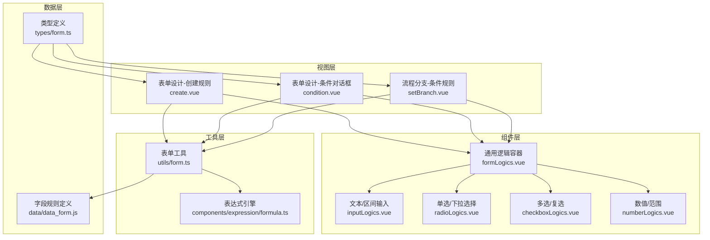
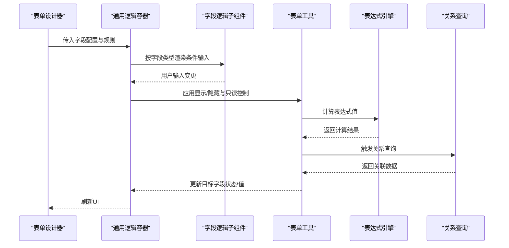
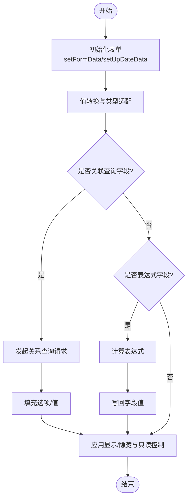
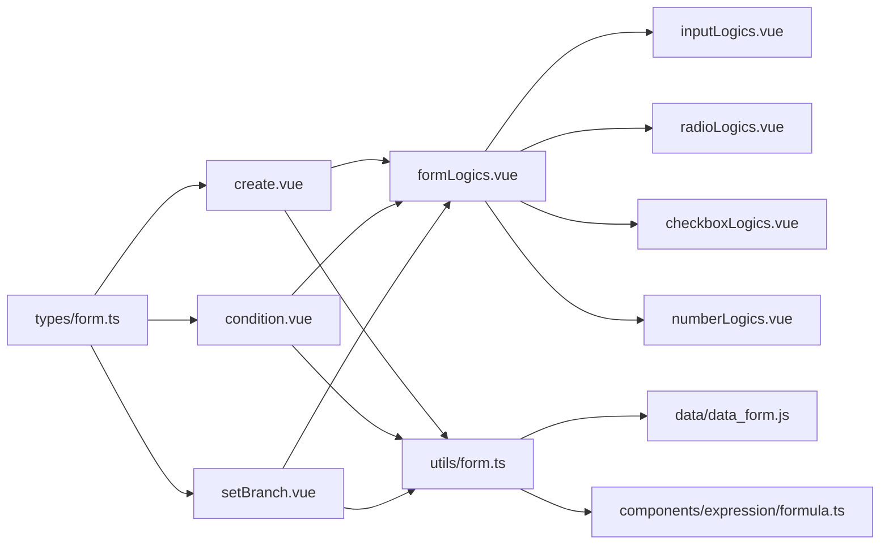

# 表单逻辑系统

<cite>
**本文档引用的文件**
- [src/components/formLogics/formLogics.vue](file://src/components/formLogics/formLogics.vue)
- [src/components/formLogics/inputLogics.vue](file://src/components/formLogics/inputLogics.vue)
- [src/components/formLogics/radioLogics.vue](file://src/components/formLogics/radioLogics.vue)
- [src/components/formLogics/checkboxLogics.vue](file://src/components/formLogics/checkboxLogics.vue)
- [src/components/formLogics/numberLogics.vue](file://src/components/formLogics/numberLogics.vue)
- [src/utils/form.ts](file://src/utils/form.ts)
- [src/views/form/components/create.vue](file://src/views/form/components/create.vue)
- [src/views/form/components/condition.vue](file://src/views/form/components/condition.vue)
- [src/views/flowPath/components/setBranch.vue](file://src/views/flowPath/components/setBranch.vue)
- [src/data/data_form.js](file://src/data/data_form.js)
- [src/components/expression/formula.ts](file://src/components/expression/formula.ts)
- [src/types/form.ts](file://src/types/form.ts)
</cite>

## 目录
1. [简介](#简介)
2. [项目结构](#项目结构)
3. [核心组件](#核心组件)
4. [架构总览](#架构总览)
5. [详细组件分析](#详细组件分析)
6. [依赖分析](#依赖分析)
7. [性能考虑](#性能考虑)
8. [故障排查指南](#故障排查指南)
9. [结论](#结论)
10. [附录](#附录)

## 简介
本文件系统性梳理了该代码库中的“表单逻辑系统”，涵盖字段间逻辑关系的配置与运行机制，包括字段显示/隐藏、只读/可编辑控制、字段值联动更新等。文档从架构、数据流、处理逻辑、依赖关系、性能与调试等方面进行深入分析，并提供复杂业务场景的实现思路与最佳实践。

## 项目结构
围绕表单逻辑系统的关键目录与文件如下：
- 视图层（表单设计器与流程分支配置）：用于构建与展示逻辑规则
- 工具层（表单工具与表达式引擎）：负责表单渲染、值转换、关系查询、表达式计算
- 组件层（字段逻辑子组件）：按字段类型提供条件输入控件
- 数据层（字段规则定义）：提供各类字段的比较规则与默认值

图表来源
- [src/views/form/components/create.vue](file://src/views/form/components/create.vue)
- [src/views/form/components/condition.vue](file://src/views/form/components/condition.vue)
- [src/views/flowPath/components/setBranch.vue](file://src/views/flowPath/components/setBranch.vue)
- [src/components/formLogics/formLogics.vue](file://src/components/formLogics/formLogics.vue)
- [src/utils/form.ts](file://src/utils/form.ts)
- [src/components/expression/formula.ts](file://src/components/expression/formula.ts)
- [src/data/data_form.js](file://src/data/data_form.js)
- [src/types/form.ts](file://src/types/form.ts)

章节来源
- [src/views/form/components/create.vue](file://src/views/form/components/create.vue)
- [src/views/form/components/condition.vue](file://src/views/form/components/condition.vue)
- [src/views/flowPath/components/setBranch.vue](file://src/views/flowPath/components/setBranch.vue)
- [src/components/formLogics/formLogics.vue](file://src/components/formLogics/formLogics.vue)
- [src/utils/form.ts](file://src/utils/form.ts)
- [src/components/expression/formula.ts](file://src/components/expression/formula.ts)
- [src/data/data_form.js](file://src/data/data_form.js)
- [src/types/form.ts](file://src/types/form.ts)

## 核心组件
- 通用逻辑容器：根据字段类型动态渲染对应的条件输入子组件，支持显示/隐藏、只读控制、联动更新等。
- 字段逻辑子组件：按字段类型提供条件输入控件，如文本输入、数值范围、单选/多选等。
- 表单工具：负责表单初始化、值转换、关系查询、表达式计算、字段控制应用等。
- 表达式引擎：基于表达式解析器，提供函数注册与变量访问能力，支持在规则中使用表达式。
- 字段规则定义：为不同字段类型提供比较规则集合与默认值映射。
- 类型定义：统一表单配置与流程节点配置的数据结构。

章节来源
- [src/components/formLogics/formLogics.vue](file://src/components/formLogics/formLogics.vue)
- [src/components/formLogics/inputLogics.vue](file://src/components/formLogics/inputLogics.vue)
- [src/components/formLogics/radioLogics.vue](file://src/components/formLogics/radioLogics.vue)
- [src/components/formLogics/checkboxLogics.vue](file://src/components/formLogics/checkboxLogics.vue)
- [src/components/formLogics/numberLogics.vue](file://src/components/formLogics/numberLogics.vue)
- [src/utils/form.ts](file://src/utils/form.ts)
- [src/components/expression/formula.ts](file://src/components/expression/formula.ts)
- [src/data/data_form.js](file://src/data/data_form.js)
- [src/types/form.ts](file://src/types/form.ts)

## 架构总览
表单逻辑系统由“配置-渲染-执行”三层构成：
- 配置层：通过表单设计器与流程分支配置界面，生成逻辑规则（字段、条件、取值、联动字段列表）。
- 渲染层：根据字段类型与规则，渲染对应的条件输入控件；同时应用显示/隐藏与只读控制。
- 执行层：在用户交互或数据变化时，按规则计算并更新目标字段状态与值，必要时触发关系查询与表达式计算。

图表来源
- [src/components/formLogics/formLogics.vue](file://src/components/formLogics/formLogics.vue)
- [src/utils/form.ts](file://src/utils/form.ts)
- [src/components/expression/formula.ts](file://src/components/expression/formula.ts)

## 详细组件分析

### 通用逻辑容器（formLogics.vue）
- 功能：根据字段类型动态选择并渲染对应条件输入子组件，支持多种字段类型（文本、数字、日期、时间、地址、用户、部门等）。
- 控制点：通过条件判断决定是否渲染某类子组件；向子组件传递规则数据与部门列表等上下文。

章节来源
- [src/components/formLogics/formLogics.vue](file://src/components/formLogics/formLogics.vue)

### 字段逻辑子组件
- 文本/区间输入（inputLogics.vue）：针对字符串类字段提供相等/不等/包含/不包含等条件输入。
- 单选/下拉选择（radioLogics.vue）：提供单选或多选条件输入，支持选项列表绑定。
- 多选/复选（checkboxLogics.vue）：提供多选项条件输入，支持选项列表绑定。
- 数值/范围（numberLogics.vue）：提供数值比较与范围输入，支持最小/最大值输入。

章节来源
- [src/components/formLogics/inputLogics.vue](file://src/components/formLogics/inputLogics.vue)
- [src/components/formLogics/radioLogics.vue](file://src/components/formLogics/radioLogics.vue)
- [src/components/formLogics/checkboxLogics.vue](file://src/components/formLogics/checkboxLogics.vue)
- [src/components/formLogics/numberLogics.vue](file://src/components/formLogics/numberLogics.vue)

### 表单工具（utils/form.ts）
- 表单初始化与值转换：负责将后端返回的原始数据转换为前端可直接使用的格式，处理用户/部门/附件/子表单等复杂字段类型。
- 关系查询：当字段为关联数据/查询时，根据条件字段值发起请求，动态填充选项或值。
- 表达式计算：当字段为函数标签时，计算表达式并将结果写回字段值。
- 字段控制应用：根据表单逻辑配置，对字段执行显示/隐藏与只读控制。

图表来源
- [src/utils/form.ts](file://src/utils/form.ts)

章节来源
- [src/utils/form.ts](file://src/utils/form.ts)

### 表达式引擎（components/expression/formula.ts）
- 能力：基于表达式解析器，注册常用函数（用户、日期、随机数、通用、字符串、数组、金额、业务函数），提供变量访问接口（获取表单值、子表单值）。
- 使用：在表单逻辑中作为条件或默认值来源，支持复杂业务计算。

章节来源
- [src/components/expression/formula.ts](file://src/components/expression/formula.ts)

### 字段规则定义（data/data_form.js）
- 规则集：为不同字段类型提供比较规则集合（等于、不等于、包含、范围、动态范围等）及默认值映射。
- 值初始化：根据字段类型与规则，初始化条件输入的默认值与可选值列表。

章节来源
- [src/data/data_form.js](file://src/data/data_form.js)

### 类型定义（types/form.ts）
- 结构：统一表单配置（含逻辑规则）、流程节点配置等数据结构，便于前后端一致化开发与校验。

章节来源
- [src/types/form.ts](file://src/types/form.ts)

### 视图层组件

#### 表单设计-创建规则（views/form/components/create.vue）
- 功能：提供表单逻辑规则的可视化配置界面，支持多条规则、规则模式（全部/任一）、字段联动列表。
- 流程：选择字段、选择规则、填写条件值、选择联动字段，最终保存到表单配置中。

章节来源
- [src/views/form/components/create.vue](file://src/views/form/components/create.vue)

#### 表单设计-条件对话框（views/form/components/condition.vue）
- 功能：用于编辑字段级条件（activeForm.props.conditionList），支持字段选择、规则选择、条件值输入。
- 流程：打开对话框 -> 加载字段列表 -> 选择字段 -> 生成规则项 -> 保存到 activeForm。

章节来源
- [src/views/form/components/condition.vue](file://src/views/form/components/condition.vue)

#### 流程分支-条件规则（views/flowPath/components/setBranch.vue）
- 功能：在流程分支中配置条件规则，支持表达式模式与字段规则模式，生成表达式字符串并校验完整性。
- 流程：选择字段/表达式 -> 选择规则 -> 输入值 -> 生成表达式 -> 提交。

章节来源
- [src/views/flowPath/components/setBranch.vue](file://src/views/flowPath/components/setBranch.vue)

## 依赖分析
- 组件耦合：通用逻辑容器与各字段逻辑子组件松耦合，通过字段类型与规则数据驱动渲染。
- 工具依赖：表单工具依赖字段规则定义与表达式引擎；关系查询依赖后端接口。
- 视图依赖：表单设计器与流程分支配置依赖通用逻辑容器与字段规则定义。

图表来源
- [src/views/form/components/create.vue](file://src/views/form/components/create.vue)
- [src/views/form/components/condition.vue](file://src/views/form/components/condition.vue)
- [src/views/flowPath/components/setBranch.vue](file://src/views/flowPath/components/setBranch.vue)
- [src/components/formLogics/formLogics.vue](file://src/components/formLogics/formLogics.vue)
- [src/utils/form.ts](file://src/utils/form.ts)
- [src/data/data_form.js](file://src/data/data_form.js)
- [src/components/expression/formula.ts](file://src/components/expression/formula.ts)
- [src/types/form.ts](file://src/types/form.ts)

章节来源
- [src/views/form/components/create.vue](file://src/views/form/components/create.vue)
- [src/views/form/components/condition.vue](file://src/views/form/components/condition.vue)
- [src/views/flowPath/components/setBranch.vue](file://src/views/flowPath/components/setBranch.vue)
- [src/components/formLogics/formLogics.vue](file://src/components/formLogics/formLogics.vue)
- [src/utils/form.ts](file://src/utils/form.ts)
- [src/data/data_form.js](file://src/data/data_form.js)
- [src/components/expression/formula.ts](file://src/components/expression/formula.ts)
- [src/types/form.ts](file://src/types/form.ts)

## 性能考虑
- 渲染优化：通用逻辑容器按需渲染子组件，避免不必要的DOM创建与更新。
- 异步加载：关系查询与远程数据加载采用异步方式，避免阻塞主线程。
- 值转换缓存：对常用字段类型与规则的默认值映射进行缓存，减少重复计算。
- 表达式计算：表达式解析与求值应避免频繁触发，建议在必要时机（如字段值变化）再计算。
- 批量更新：在批量设置表单值时，尽量合并多次更新为一次操作，减少重绘与回流。

## 故障排查指南
- 条件规则未生效
  - 检查规则模式（全部/任一）与字段类型是否匹配。
  - 确认字段是否被设置为条件字段，且联动字段列表不包含自身。
- 关联查询无数据
  - 检查条件字段值是否正确传递至关系查询参数。
  - 确认后端接口返回格式与前端期望一致。
- 表达式报错
  - 检查表达式语法与变量引用是否正确。
  - 确认表达式函数已注册且参数类型匹配。
- 值转换异常
  - 检查字段类型与值格式是否一致（如用户/部门/附件/子表单）。
  - 确认值转换逻辑中对空值与数组的处理。

章节来源
- [src/utils/form.ts](file://src/utils/form.ts)
- [src/components/expression/formula.ts](file://src/components/expression/formula.ts)
- [src/data/data_form.js](file://src/data/data_form.js)

## 结论
该表单逻辑系统通过“配置-渲染-执行”的分层设计，实现了灵活的字段间逻辑控制与联动更新。通用逻辑容器与字段逻辑子组件提供了良好的扩展性；表单工具与表达式引擎支撑了复杂的业务计算与数据转换；字段规则定义与类型定义保证了配置的一致性与可维护性。结合性能优化与调试策略，可在复杂业务场景中稳定运行并持续演进。

## 附录

### 逻辑类型与实现要点
- 条件判断：基于字段类型与规则集合生成条件输入，支持字符串、数值、日期、布尔、枚举、多选等。
- 表达式计算：通过表达式引擎计算函数值，支持变量访问与自定义函数注册。
- 数据转换：针对用户/部门/附件/子表单等复杂类型进行值转换与格式化。
- 事件触发：在字段值变化时触发关系查询与表达式计算，实时更新目标字段状态与值。

章节来源
- [src/utils/form.ts](file://src/utils/form.ts)
- [src/components/expression/formula.ts](file://src/components/expression/formula.ts)
- [src/data/data_form.js](file://src/data/data_form.js)