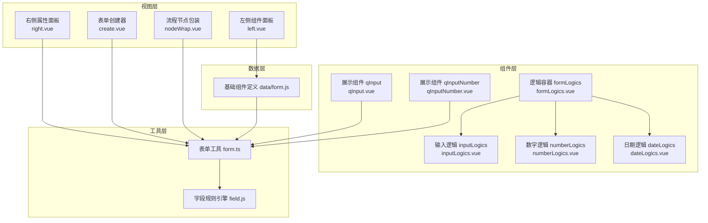
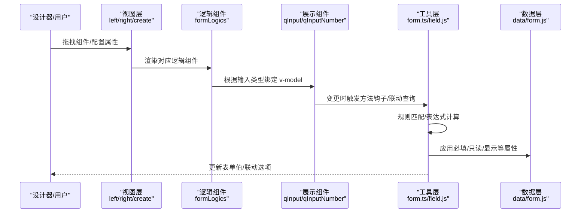
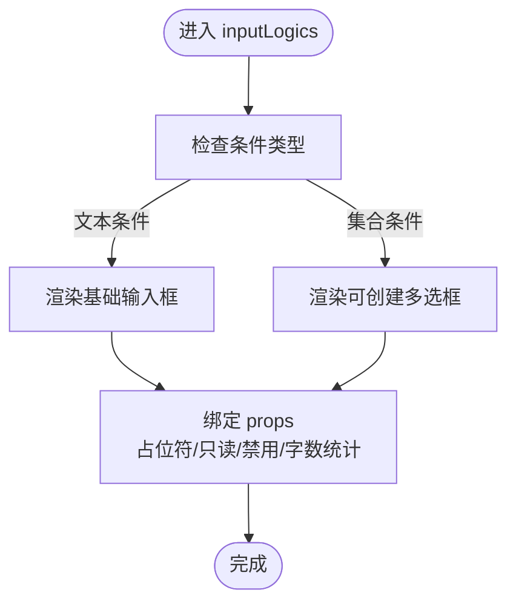
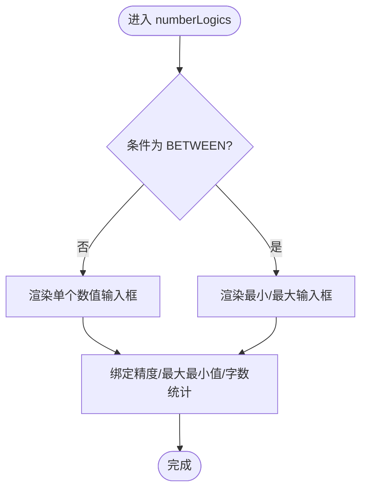
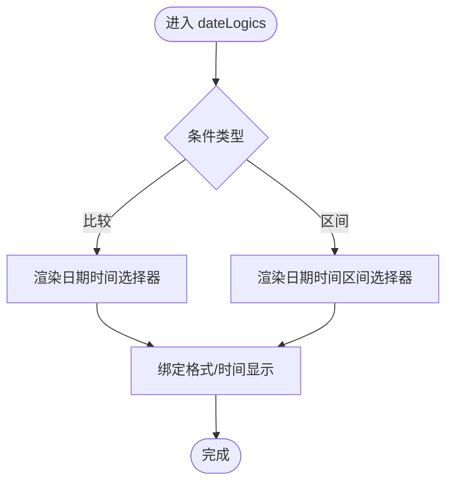
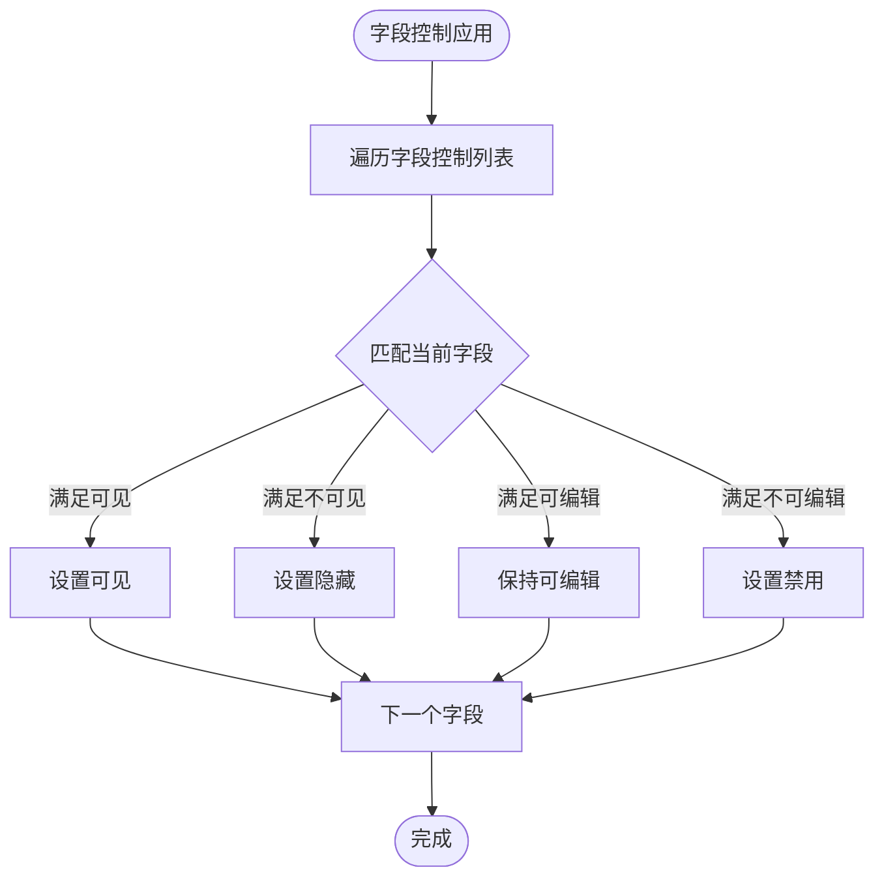
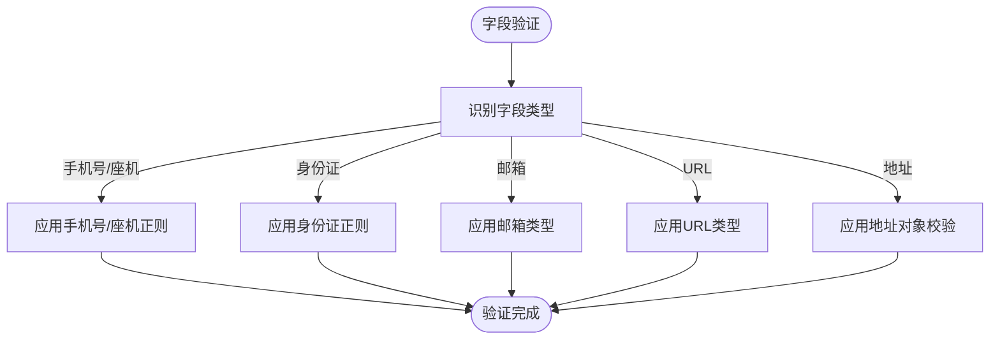
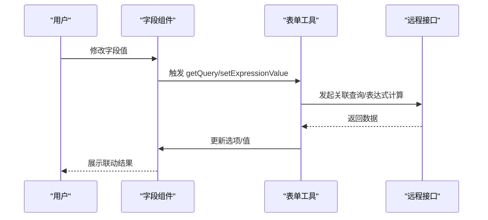
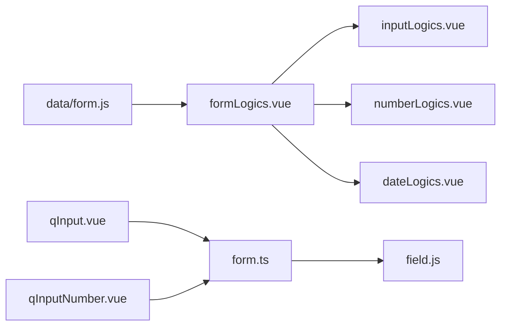

# 输入字段逻辑

<cite>
**本文引用的文件**
- [src/components/formLogics/inputLogics.vue](file://src/components/formLogics/inputLogics.vue)
- [src/components/formLogics/dateLogics.vue](file://src/components/formLogics/dateLogics.vue)
- [src/components/formLogics/numberLogics.vue](file://src/components/formLogics/numberLogics.vue)
- [src/components/showItem/qInput.vue](file://src/components/showItem/qInput.vue)
- [src/components/showItem/qInputNumber.vue](file://src/components/showItem/qInputNumber.vue)
- [src/utils/field.js](file://src/utils/field.js)
- [src/utils/form.ts](file://src/utils/form.ts)
- [src/data/form.js](file://src/data/form.js)
- [src/views/form/left.vue](file://src/views/form/left.vue)
- [src/views/form/right.vue](file://src/views/form/right.vue)
- [src/views/form/components/create.vue](file://src/views/form/components/create.vue)
- [src/views/flowPath/components/nodeWrap.vue](file://src/views/flowPath/components/nodeWrap.vue)
</cite>

## 目录
1. [简介](#简介)
2. [项目结构](#项目结构)
3. [核心组件](#核心组件)
4. [架构总览](#架构总览)
5. [详细组件分析](#详细组件分析)
6. [依赖关系分析](#依赖关系分析)
7. [性能考量](#性能考量)
8. [故障排查指南](#故障排查指南)
9. [结论](#结论)
10. [附录](#附录)

## 简介
本文件系统性梳理输入字段逻辑的设计与实现，覆盖文本输入、数字输入、日期时间等基础输入类型的配置与行为；解释字段显示/隐藏条件、只读状态控制、必填验证、格式化规则；阐述字段间联动逻辑、数据校验规则与事件触发时机；并提供常见业务场景（如身份证号自动计算年龄、手机号格式验证、日期范围限制）的配置示例与性能优化、调试方法。

## 项目结构
围绕输入字段逻辑的关键目录与文件如下：
- 组件层：展示组件与逻辑组件分离，分别负责渲染与条件控制
  - 展示组件：qInput、qInputNumber 等
  - 逻辑组件：formLogics 及其子组件 inputLogics、numberLogics、dateLogics
- 工具层：字段规则引擎 field.js、表单工具 form.ts
- 数据层：基础组件定义 data/form.js
- 视图层：表单设计器左右面板与创建器，以及流程节点包装组件

图表来源
- [src/views/form/left.vue:1-106](file://src/views/form/left.vue#L1-L106)
- [src/views/form/right.vue:1-200](file://src/views/form/right.vue#L1-L200)
- [src/views/form/components/create.vue:143-190](file://src/views/form/components/create.vue#L143-L190)
- [src/views/flowPath/components/nodeWrap.vue:207-218](file://src/views/flowPath/components/nodeWrap.vue#L207-L218)
- [src/components/formLogics/formLogics.vue:1-35](file://src/components/formLogics/formLogics.vue#L1-L35)
- [src/components/formLogics/inputLogics.vue:1-28](file://src/components/formLogics/inputLogics.vue#L1-L28)
- [src/components/formLogics/numberLogics.vue:1-50](file://src/components/formLogics/numberLogics.vue#L1-L50)
- [src/components/formLogics/dateLogics.vue:1-45](file://src/components/formLogics/dateLogics.vue#L1-L45)
- [src/components/showItem/qInput.vue:1-21](file://src/components/showItem/qInput.vue#L1-L21)
- [src/components/showItem/qInputNumber.vue:1-31](file://src/components/showItem/qInputNumber.vue#L1-L31)
- [src/utils/field.js:1-207](file://src/utils/field.js#L1-L207)
- [src/utils/form.ts:1-800](file://src/utils/form.ts#L1-L800)
- [src/data/form.js:1-800](file://src/data/form.js#L1-L800)

章节来源
- [src/views/form/left.vue:1-106](file://src/views/form/left.vue#L1-L106)
- [src/views/form/right.vue:1-200](file://src/views/form/right.vue#L1-L200)
- [src/views/form/components/create.vue:143-190](file://src/views/form/components/create.vue#L143-L190)
- [src/views/flowPath/components/nodeWrap.vue:207-218](file://src/views/flowPath/components/nodeWrap.vue#L207-L218)
- [src/components/formLogics/formLogics.vue:1-35](file://src/components/formLogics/formLogics.vue#L1-L35)
- [src/components/formLogics/inputLogics.vue:1-28](file://src/components/formLogics/inputLogics.vue#L1-L28)
- [src/components/formLogics/numberLogics.vue:1-50](file://src/components/formLogics/numberLogics.vue#L1-L50)
- [src/components/formLogics/dateLogics.vue:1-45](file://src/components/formLogics/dateLogics.vue#L1-L45)
- [src/components/showItem/qInput.vue:1-21](file://src/components/showItem/qInput.vue#L1-L21)
- [src/components/showItem/qInputNumber.vue:1-31](file://src/components/showItem/qInputNumber.vue#L1-L31)
- [src/utils/field.js:1-207](file://src/utils/field.js#L1-L207)
- [src/utils/form.ts:1-800](file://src/utils/form.ts#L1-L800)
- [src/data/form.js:1-800](file://src/data/form.js#L1-L800)

## 核心组件
- 展示组件
  - 文本输入：qInput 负责渲染基础文本输入，支持占位符、只读、禁用、字数统计等属性
  - 数字输入：qInputNumber 负责数值输入，支持精度、最大最小值、字数统计，并在变更时触发方法钩子
- 逻辑组件
  - formLogics 作为统一入口，根据输入类型动态渲染对应逻辑组件
  - inputLogics：基于条件渲染文本或可创建的多选输入
  - numberLogics：单值输入或区间输入（最小/最大）
  - dateLogics：日期时间选择或日期区间选择
- 工具与数据
  - field.js 提供字段规则匹配引擎（字符串包含、数值范围、空值判断、时间范围等）
  - form.ts 提供表单初始化、赋值、提交、表达式计算、联动查询等能力
  - data/form.js 定义基础组件属性（必填、默认值、占位符、最大长度、精度、联动等）

章节来源
- [src/components/showItem/qInput.vue:1-21](file://src/components/showItem/qInput.vue#L1-L21)
- [src/components/showItem/qInputNumber.vue:1-31](file://src/components/showItem/qInputNumber.vue#L1-L31)
- [src/components/formLogics/formLogics.vue:1-35](file://src/components/formLogics/formLogics.vue#L1-L35)
- [src/components/formLogics/inputLogics.vue:1-28](file://src/components/formLogics/inputLogics.vue#L1-L28)
- [src/components/formLogics/numberLogics.vue:1-50](file://src/components/formLogics/numberLogics.vue#L1-L50)
- [src/components/formLogics/dateLogics.vue:1-45](file://src/components/formLogics/dateLogics.vue#L1-L45)
- [src/utils/field.js:1-207](file://src/utils/field.js#L1-L207)
- [src/utils/form.ts:1-800](file://src/utils/form.ts#L1-L800)
- [src/data/form.js:1-800](file://src/data/form.js#L1-L800)

## 架构总览
输入字段逻辑由“视图层”驱动“组件层”，通过“工具层”完成规则匹配与联动，最终落于“数据层”的组件定义与表单配置。

图表来源
- [src/views/form/left.vue:1-106](file://src/views/form/left.vue#L1-L106)
- [src/views/form/right.vue:1-200](file://src/views/form/right.vue#L1-L200)
- [src/views/form/components/create.vue:143-190](file://src/views/form/components/create.vue#L143-L190)
- [src/components/formLogics/formLogics.vue:1-35](file://src/components/formLogics/formLogics.vue#L1-L35)
- [src/components/showItem/qInput.vue:1-21](file://src/components/showItem/qInput.vue#L1-L21)
- [src/components/showItem/qInputNumber.vue:1-31](file://src/components/showItem/qInputNumber.vue#L1-L31)
- [src/utils/form.ts:1-800](file://src/utils/form.ts#L1-L800)
- [src/utils/field.js:1-207](file://src/utils/field.js#L1-L207)
- [src/data/form.js:1-800](file://src/data/form.js#L1-L800)

## 详细组件分析

### 文本输入逻辑
- 渲染策略
  - 当条件为“非空/不为空/等于/不等于/包含/不包含”时，使用基础输入框
  - 其他条件（如 IN/NOT_IN）时，使用可创建的多选输入
- 属性映射
  - 占位符、只读、禁用、字数统计、最大长度等来自组件 props
- 方法钩子
  - 数字输入组件在变更时可执行自定义方法（eval），用于联动或计算

图表来源
- [src/components/formLogics/inputLogics.vue:1-28](file://src/components/formLogics/inputLogics.vue#L1-L28)
- [src/components/showItem/qInput.vue:1-21](file://src/components/showItem/qInput.vue#L1-L21)
- [src/components/showItem/qInputNumber.vue:1-31](file://src/components/showItem/qInputNumber.vue#L1-L31)

章节来源
- [src/components/formLogics/inputLogics.vue:1-28](file://src/components/formLogics/inputLogics.vue#L1-L28)
- [src/components/showItem/qInput.vue:1-21](file://src/components/showItem/qInput.vue#L1-L21)
- [src/components/showItem/qInputNumber.vue:1-31](file://src/components/showItem/qInputNumber.vue#L1-L31)

### 数字输入逻辑
- 渲染策略
  - 单值输入：当条件为“非空/不为空/比较类”时，使用数值输入框
  - 区间输入：当条件为“区间 BETWEEN”时，渲染最小/最大两个数值输入框
- 属性与事件
  - 支持精度、最大最小值、字数统计
  - 变更时触发方法钩子（eval），便于联动计算

图表来源
- [src/components/formLogics/numberLogics.vue:1-50](file://src/components/formLogics/numberLogics.vue#L1-L50)
- [src/components/showItem/qInputNumber.vue:1-31](file://src/components/showItem/qInputNumber.vue#L1-L31)

章节来源
- [src/components/formLogics/numberLogics.vue:1-50](file://src/components/formLogics/numberLogics.vue#L1-L50)
- [src/components/showItem/qInputNumber.vue:1-31](file://src/components/showItem/qInputNumber.vue#L1-L31)

### 日期时间输入逻辑
- 渲染策略
  - 比较类条件（GE/LE/NE/EQ）：渲染带时间的选择器
  - 区间条件（BETWEEN）：渲染日期时间区间选择器
- 属性与事件
  - 支持时间格式化、区间选择

图表来源
- [src/components/formLogics/dateLogics.vue:1-45](file://src/components/formLogics/dateLogics.vue#L1-L45)

章节来源
- [src/components/formLogics/dateLogics.vue:1-45](file://src/components/formLogics/dateLogics.vue#L1-L45)

### 字段显示/隐藏与只读控制
- 字段控制应用
  - 通过表单逻辑配置（字段控制）对字段进行显示/隐藏与只读控制
  - 当满足条件时，字段可见且可编辑；否则隐藏或禁用
- 实现要点
  - 逻辑条件中包含“view（可见）/edit（可编辑）”维度
  - 对应字段的 props.disabled 根据 edit 状态设置

图表来源
- [src/utils/form.ts:899-936](file://src/utils/form.ts#L899-L936)

章节来源
- [src/utils/form.ts:899-936](file://src/utils/form.ts#L899-L936)

### 必填验证与格式化规则
- 必填与格式验证
  - 不同输入类型（手机号、身份证、邮箱、URL、地址）具有内置规则
  - 地址类型需校验省/市等子项完整性
- 规则来源
  - 规则定义来源于表单工具中的规则构建逻辑

图表来源
- [src/utils/form.ts:1085-1119](file://src/utils/form.ts#L1085-L1119)

章节来源
- [src/utils/form.ts:1085-1119](file://src/utils/form.ts#L1085-L1119)

### 字段间联动逻辑
- 关联查询
  - 当字段值变化时，触发关联查询（RELATION_QUERY/RELATION_DATA），动态填充选项或值
  - 查询参数从表单上下文抽取，按条件列表组装
- 表达式计算
  - 支持表达式函数计算，将结果写回字段值
- 事件时机
  - 变更事件（如数字输入的 change）、延迟触发（setTimeout）确保异步数据加载后更新

图表来源
- [src/utils/form.ts:602-722](file://src/utils/form.ts#L602-L722)
- [src/utils/form.ts:723-800](file://src/utils/form.ts#L723-L800)
- [src/components/showItem/qInputNumber.vue:12-22](file://src/components/showItem/qInputNumber.vue#L12-L22)

章节来源
- [src/utils/form.ts:602-722](file://src/utils/form.ts#L602-L722)
- [src/utils/form.ts:723-800](file://src/utils/form.ts#L723-L800)
- [src/components/showItem/qInputNumber.vue:12-22](file://src/components/showItem/qInputNumber.vue#L12-L22)

### 常见业务场景配置示例
- 身份证号自动计算年龄
  - 在身份证字段变更时，通过方法钩子（eval）读取值并计算出生日期，再计算年龄并写入目标字段
  - 参考路径：[src/components/showItem/qInputNumber.vue:12-22](file://src/components/showItem/qInputNumber.vue#L12-L22)
- 手机号格式验证
  - 使用内置手机号规则，结合必填与格式校验
  - 参考路径：[src/utils/form.ts:1085-1119](file://src/utils/form.ts#L1085-L1119)
- 日期范围限制
  - 使用日期区间组件，结合规则引擎的时间范围判断
  - 参考路径：[src/components/formLogics/dateLogics.vue:15-20](file://src/components/formLogics/dateLogics.vue#L15-L20)、[src/utils/field.js:86-122](file://src/utils/field.js#L86-L122)

章节来源
- [src/components/showItem/qInputNumber.vue:12-22](file://src/components/showItem/qInputNumber.vue#L12-L22)
- [src/utils/form.ts:1085-1119](file://src/utils/form.ts#L1085-L1119)
- [src/components/formLogics/dateLogics.vue:15-20](file://src/components/formLogics/dateLogics.vue#L15-L20)
- [src/utils/field.js:86-122](file://src/utils/field.js#L86-L122)

## 依赖关系分析
- 组件耦合
  - formLogics 作为统一入口，按输入类型分发到具体逻辑组件，降低耦合度
  - 展示组件与工具层解耦，通过 props 与方法钩子交互
- 规则引擎
  - field.js 提供通用规则匹配，被表单工具复用
- 数据驱动
  - data/form.js 定义组件属性与默认值，驱动表单渲染与校验

图表来源
- [src/data/form.js:1-800](file://src/data/form.js#L1-L800)
- [src/components/formLogics/formLogics.vue:1-35](file://src/components/formLogics/formLogics.vue#L1-L35)
- [src/components/formLogics/inputLogics.vue:1-28](file://src/components/formLogics/inputLogics.vue#L1-L28)
- [src/components/formLogics/numberLogics.vue:1-50](file://src/components/formLogics/numberLogics.vue#L1-L50)
- [src/components/formLogics/dateLogics.vue:1-45](file://src/components/formLogics/dateLogics.vue#L1-L45)
- [src/components/showItem/qInput.vue:1-21](file://src/components/showItem/qInput.vue#L1-L21)
- [src/components/showItem/qInputNumber.vue:1-31](file://src/components/showItem/qInputNumber.vue#L1-L31)
- [src/utils/form.ts:1-800](file://src/utils/form.ts#L1-L800)
- [src/utils/field.js:1-207](file://src/utils/field.js#L1-L207)

章节来源
- [src/data/form.js:1-800](file://src/data/form.js#L1-L800)
- [src/components/formLogics/formLogics.vue:1-35](file://src/components/formLogics/formLogics.vue#L1-L35)
- [src/components/formLogics/inputLogics.vue:1-28](file://src/components/formLogics/inputLogics.vue#L1-L28)
- [src/components/formLogics/numberLogics.vue:1-50](file://src/components/formLogics/numberLogics.vue#L1-L50)
- [src/components/formLogics/dateLogics.vue:1-45](file://src/components/formLogics/dateLogics.vue#L1-L45)
- [src/components/showItem/qInput.vue:1-21](file://src/components/showItem/qInput.vue#L1-L21)
- [src/components/showItem/qInputNumber.vue:1-31](file://src/components/showItem/qInputNumber.vue#L1-L31)
- [src/utils/form.ts:1-800](file://src/utils/form.ts#L1-L800)
- [src/utils/field.js:1-207](file://src/utils/field.js#L1-L207)

## 性能考量
- 异步与延迟
  - 关联查询与表达式计算采用延迟触发（setTimeout），避免阻塞主线程
- 规则匹配
  - 规则引擎采用简单分支与快速判断，减少复杂度
- 渲染优化
  - 条件渲染仅在必要时创建组件实例，减少 DOM 开销
- 建议
  - 控制联动层级与数量，避免过多异步请求叠加
  - 合理设置字数统计与精度，避免频繁重排

[本节为通用指导，无需列出章节来源]

## 故障排查指南
- 字段未显示/隐藏
  - 检查字段控制配置中的“view/edit”字段编码是否匹配
  - 参考路径：[src/utils/form.ts:899-936](file://src/utils/form.ts#L899-L936)
- 联动未生效
  - 确认关联查询的条件字段编码与表单上下文一致
  - 检查方法钩子（eval）是否抛出异常
  - 参考路径：[src/utils/form.ts:602-722](file://src/utils/form.ts#L602-L722)、[src/components/showItem/qInputNumber.vue:12-22](file://src/components/showItem/qInputNumber.vue#L12-L22)
- 校验失败
  - 核对字段类型对应的内置规则是否正确
  - 参考路径：[src/utils/form.ts:1085-1119](file://src/utils/form.ts#L1085-L1119)
- 日期范围异常
  - 检查规则引擎的时间范围判断逻辑
  - 参考路径：[src/utils/field.js:86-122](file://src/utils/field.js#L86-L122)

章节来源
- [src/utils/form.ts:899-936](file://src/utils/form.ts#L899-L936)
- [src/utils/form.ts:602-722](file://src/utils/form.ts#L602-L722)
- [src/components/showItem/qInputNumber.vue:12-22](file://src/components/showItem/qInputNumber.vue#L12-L22)
- [src/utils/form.ts:1085-1119](file://src/utils/form.ts#L1085-L1119)
- [src/utils/field.js:86-122](file://src/utils/field.js#L86-L122)

## 结论
输入字段逻辑通过“展示组件 + 逻辑组件 + 工具层 + 数据层”的分层设计，实现了灵活的字段渲染、联动、校验与格式化。借助规则引擎与表单工具，开发者可以以较低成本实现复杂的业务场景；同时，合理的异步与延迟策略保证了良好的用户体验。

[本节为总结性内容，无需列出章节来源]

## 附录
- 表单设计器入口
  - 左侧组件面板：拖拽组件
  - 右侧属性面板：配置字段属性与逻辑
  - 创建器：生成与保存表单逻辑
  - 流程节点包装：在流程中应用字段控制
- 参考路径
  - [src/views/form/left.vue:1-106](file://src/views/form/left.vue#L1-L106)
  - [src/views/form/right.vue:1-200](file://src/views/form/right.vue#L1-L200)
  - [src/views/form/components/create.vue:143-190](file://src/views/form/components/create.vue#L143-L190)
  - [src/views/flowPath/components/nodeWrap.vue:207-218](file://src/views/flowPath/components/nodeWrap.vue#L207-L218)

章节来源
- [src/views/form/left.vue:1-106](file://src/views/form/left.vue#L1-L106)
- [src/views/form/right.vue:1-200](file://src/views/form/right.vue#L1-L200)
- [src/views/form/components/create.vue:143-190](file://src/views/form/components/create.vue#L143-L190)
- [src/views/flowPath/components/nodeWrap.vue:207-218](file://src/views/flowPath/components/nodeWrap.vue#L207-L218)