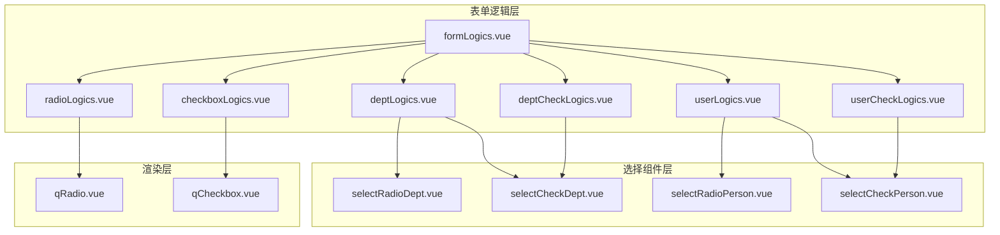
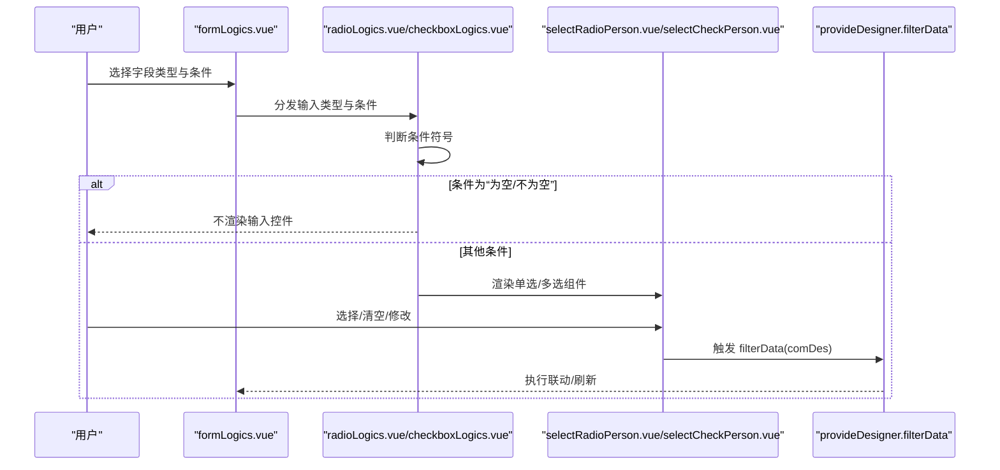
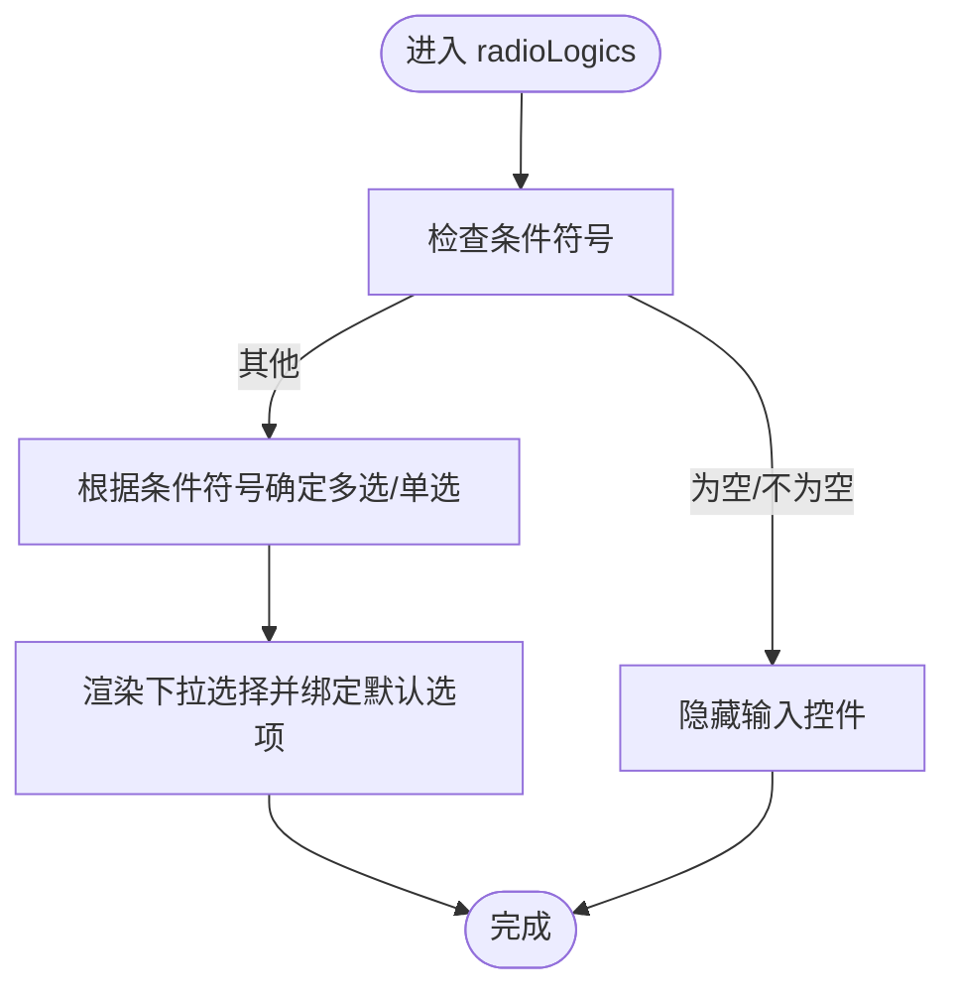
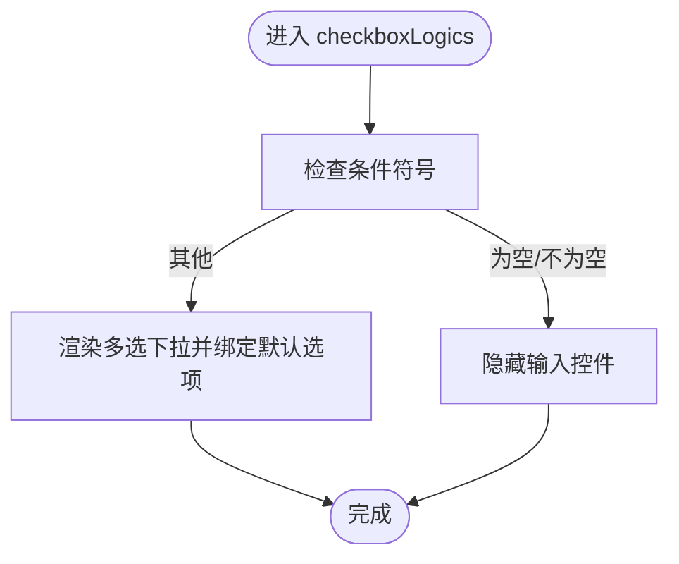
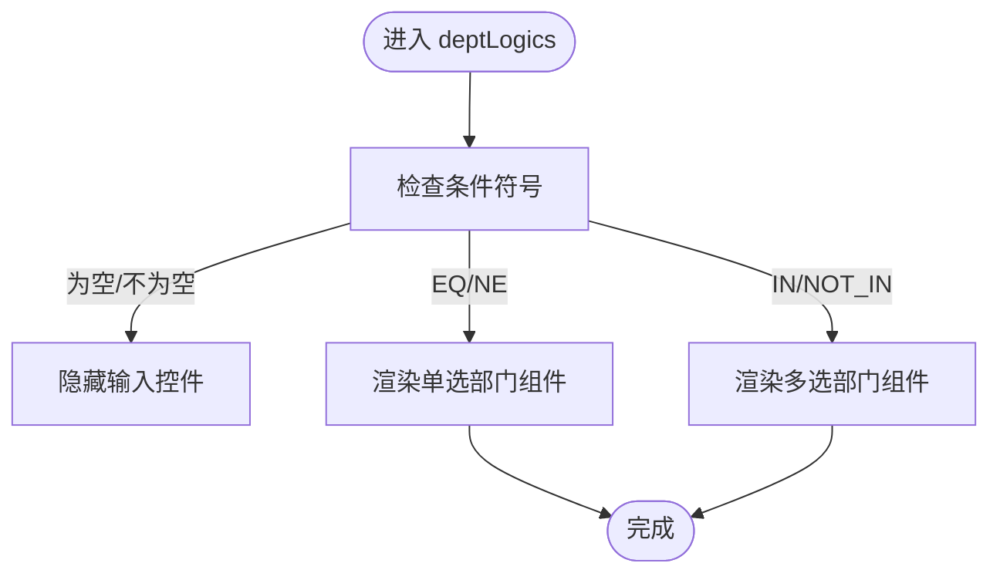
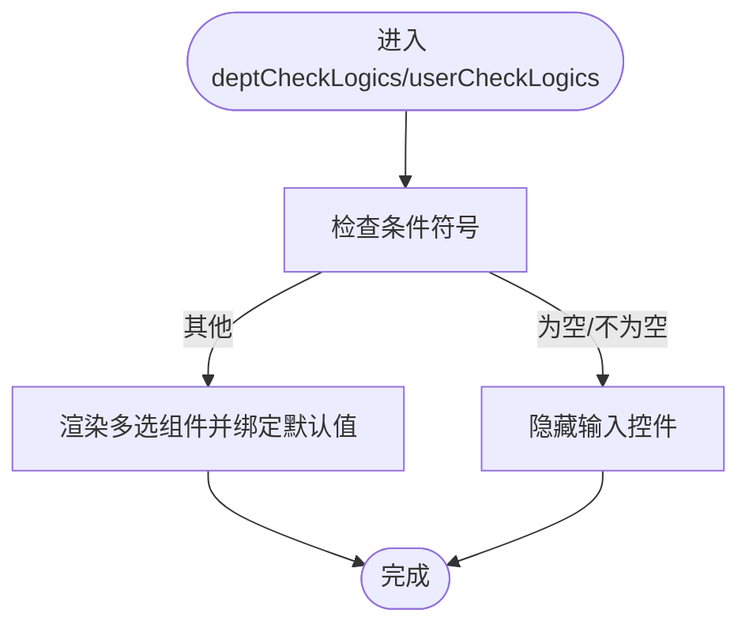
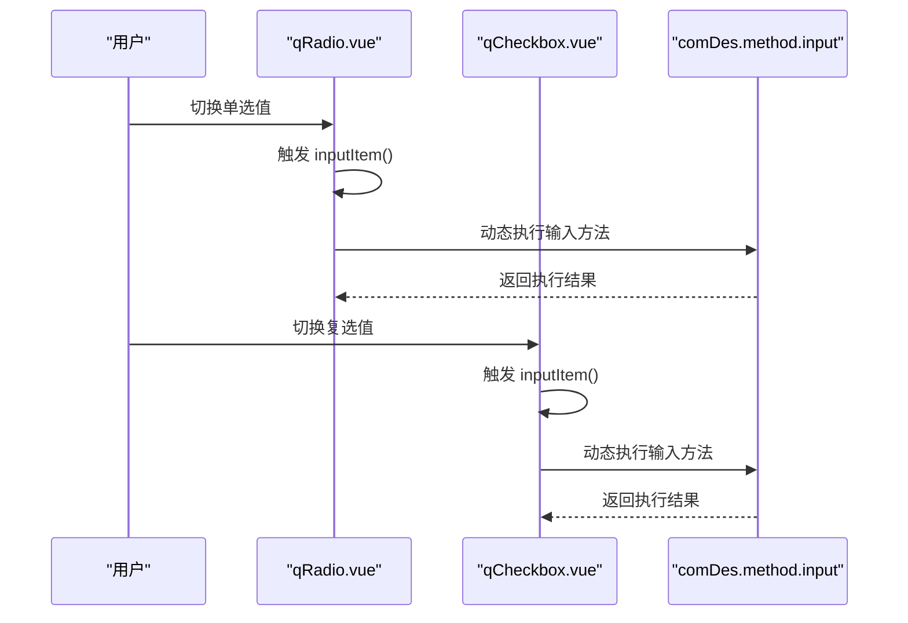
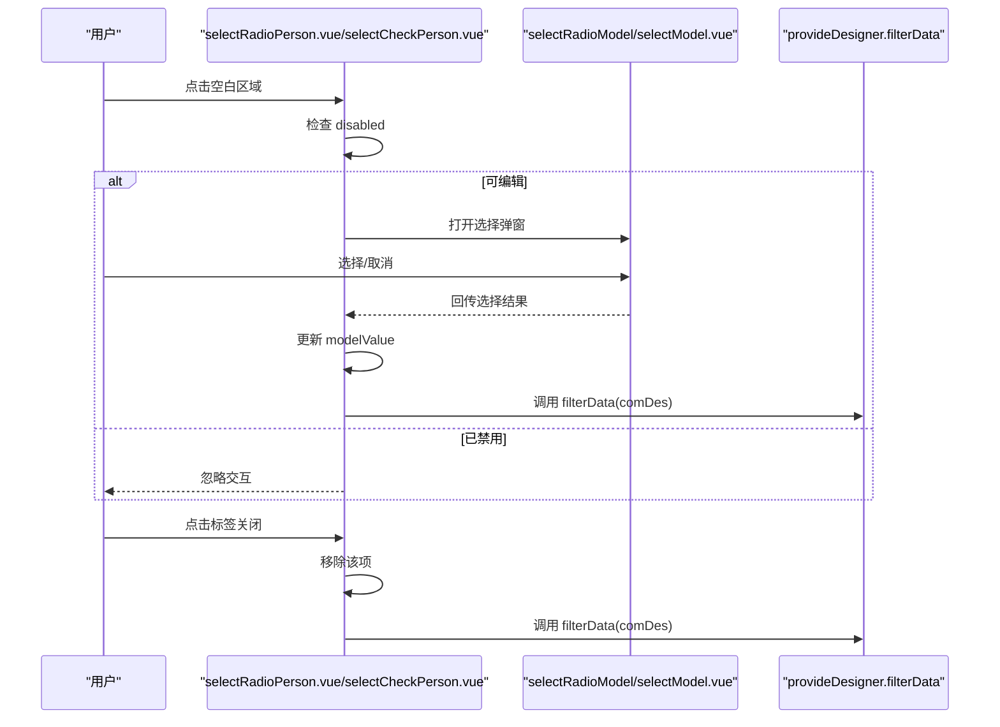
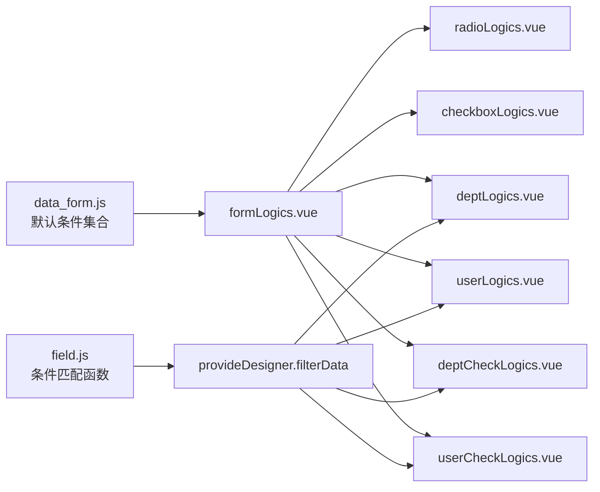

# 选择字段逻辑

<cite>
**本文引用的文件**
- [radioLogics.vue](file://src/components/formLogics/radioLogics.vue)
- [checkboxLogics.vue](file://src/components/formLogics/checkboxLogics.vue)
- [deptLogics.vue](file://src/components/formLogics/deptLogics.vue)
- [userLogics.vue](file://src/components/formLogics/userLogics.vue)
- [deptCheckLogics.vue](file://src/components/formLogics/deptCheckLogics.vue)
- [userCheckLogics.vue](file://src/components/formLogics/userCheckLogics.vue)
- [formLogics.vue](file://src/components/formLogics/formLogics.vue)
- [selectRadioDept.vue](file://src/components/selectPerson/selectRadioDept.vue)
- [selectCheckDept.vue](file://src/components/selectPerson/selectCheckDept.vue)
- [selectRadioPerson.vue](file://src/components/selectPerson/selectRadioPerson.vue)
- [selectCheckPerson.vue](file://src/components/selectPerson/selectCheckPerson.vue)
- [qRadio.vue](file://src/components/showItem/qRadio.vue)
- [qCheckbox.vue](file://src/components/showItem/qCheckbox.vue)
- [field.js](file://src/utils/field.js)
- [data_form.js](file://src/data/data_form.js)
- [form.ts](file://src/types/form.ts)
</cite>

## 目录
1. [简介](#简介)
2. [项目结构](#项目结构)
3. [核心组件](#核心组件)
4. [架构总览](#架构总览)
5. [详细组件分析](#详细组件分析)
6. [依赖关系分析](#依赖关系分析)
7. [性能考量](#性能考量)
8. [故障排查指南](#故障排查指南)
9. [结论](#结论)
10. [附录](#附录)

## 简介
本文件系统性梳理“选择字段逻辑”的设计与实现，覆盖单选按钮、复选框、下拉选择等基础选择类字段，以及部门选择、用户选择等组织架构相关字段的特殊逻辑。重点解释以下能力：
- 条件联动：根据条件符号（如等于、不等于、包含、不包含、为空、不为空等）动态切换渲染形态与行为
- 禁用控制：通过全局注入的状态机制实现字段禁用
- 默认值设置：基于数据模型的默认值绑定与回显
- 多选限制：通过条件与组件形态控制单选/多选
- 组织架构字段：部门/用户的单选/多选交互、标签化展示、清空与联动刷新
- 复杂场景：级联选择、动态选项加载、选择结果联动（通过统一的过滤器回调）

## 项目结构
围绕“选择字段逻辑”，主要涉及三层：
- 表单逻辑层：按输入类型与条件符号分发到具体组件
- 选择组件层：单选/多选、部门/用户选择的具体交互实现
- 渲染层：基础单选/复选框的事件与方法钩子

图表来源
- [formLogics.vue:1-35](file://src/components/formLogics/formLogics.vue#L1-L35)
- [radioLogics.vue:1-27](file://src/components/formLogics/radioLogics.vue#L1-L27)
- [checkboxLogics.vue:1-27](file://src/components/formLogics/checkboxLogics.vue#L1-L27)
- [deptLogics.vue:1-25](file://src/components/formLogics/deptLogics.vue#L1-L25)
- [userLogics.vue:1-24](file://src/components/formLogics/userLogics.vue#L1-L24)
- [deptCheckLogics.vue:1-23](file://src/components/formLogics/deptCheckLogics.vue#L1-L23)
- [userCheckLogics.vue:1-23](file://src/components/formLogics/userCheckLogics.vue#L1-L23)
- [selectRadioDept.vue:1-119](file://src/components/selectPerson/selectRadioDept.vue#L1-L119)
- [selectCheckDept.vue:1-118](file://src/components/selectPerson/selectCheckDept.vue#L1-L118)
- [selectRadioPerson.vue:1-127](file://src/components/selectPerson/selectRadioPerson.vue#L1-L127)
- [selectCheckPerson.vue:1-117](file://src/components/selectPerson/selectCheckPerson.vue#L1-L117)
- [qRadio.vue:1-33](file://src/components/showItem/qRadio.vue#L1-L33)
- [qCheckbox.vue:1-33](file://src/components/showItem/qCheckbox.vue#L1-L33)

章节来源
- [formLogics.vue:1-35](file://src/components/formLogics/formLogics.vue#L1-L35)

## 核心组件
- 表单逻辑分发器：根据字段输入类型与条件符号，选择对应的逻辑组件
- 基础渲染组件：单选/复选框的基础渲染与事件触发
- 组织架构选择组件：部门/用户的单选/多选交互，支持标签化展示与清空

章节来源
- [formLogics.vue:1-35](file://src/components/formLogics/formLogics.vue#L1-L35)
- [qRadio.vue:1-33](file://src/components/showItem/qRadio.vue#L1-L33)
- [qCheckbox.vue:1-33](file://src/components/showItem/qCheckbox.vue#L1-L33)

## 架构总览
选择字段逻辑遵循“条件符号驱动的形态切换”原则：
- 当条件为“为空/不为空”时，隐藏输入控件，仅保留条件显示
- 其他条件下，根据字段类型与条件符号决定单选或多选形态
- 组织架构字段（部门/用户）根据条件符号选择单选或复选模式，并通过弹窗/模型组件进行选择

图表来源
- [formLogics.vue:1-35](file://src/components/formLogics/formLogics.vue#L1-L35)
- [radioLogics.vue:1-27](file://src/components/formLogics/radioLogics.vue#L1-L27)
- [checkboxLogics.vue:1-27](file://src/components/formLogics/checkboxLogics.vue#L1-L27)
- [selectRadioPerson.vue:1-127](file://src/components/selectPerson/selectRadioPerson.vue#L1-L127)
- [selectCheckPerson.vue:1-117](file://src/components/selectPerson/selectCheckPerson.vue#L1-L117)

## 详细组件分析

### 单选按钮逻辑（radioLogics）
- 形态控制：当条件为“为空/不为空”时不渲染输入控件；否则根据条件符号决定是否多选
- 选项来源：从默认选项数组中生成下拉项
- 交互要点：支持清空与多选形态切换

图表来源
- [radioLogics.vue:1-27](file://src/components/formLogics/radioLogics.vue#L1-L27)

章节来源
- [radioLogics.vue:1-27](file://src/components/formLogics/radioLogics.vue#L1-L27)

### 复选框逻辑（checkboxLogics）
- 形态控制：始终以多选形态渲染
- 选项来源：从默认选项数组中生成下拉项
- 交互要点：支持清空与多选

图表来源
- [checkboxLogics.vue:1-27](file://src/components/formLogics/checkboxLogics.vue#L1-L27)

章节来源
- [checkboxLogics.vue:1-27](file://src/components/formLogics/checkboxLogics.vue#L1-L27)

### 部门选择逻辑（deptLogics）
- 形态控制：根据条件符号选择单选或复选模式
- 交互要点：使用部门列表作为数据源，支持标签化展示与清空

图表来源
- [deptLogics.vue:1-25](file://src/components/formLogics/deptLogics.vue#L1-L25)

章节来源
- [deptLogics.vue:1-25](file://src/components/formLogics/deptLogics.vue#L1-L25)

### 用户选择逻辑（userLogics）
- 形态控制：根据条件符号选择单选或复选模式
- 交互要点：使用部门列表作为数据源，支持标签化展示与清空

图表来源
- [userLogics.vue:1-24](file://src/components/formLogics/userLogics.vue#L1-L24)

章节来源
- [userLogics.vue:1-24](file://src/components/formLogics/userLogics.vue#L1-L24)

### 部门/用户多选逻辑（deptCheckLogics/userCheckLogics）
- 形态控制：始终以多选形态渲染
- 交互要点：使用部门列表作为数据源，支持标签化展示与清空

图表来源
- [deptCheckLogics.vue:1-23](file://src/components/formLogics/deptCheckLogics.vue#L1-L23)
- [userCheckLogics.vue:1-23](file://src/components/formLogics/userCheckLogics.vue#L1-L23)

章节来源
- [deptCheckLogics.vue:1-23](file://src/components/formLogics/deptCheckLogics.vue#L1-L23)
- [userCheckLogics.vue:1-23](file://src/components/formLogics/userCheckLogics.vue#L1-L23)

### 单选/复选渲染组件（qRadio/qCheckbox）
- 事件触发：在值变化时触发输入方法钩子
- 方法执行：通过方法配置中的输入脚本进行扩展逻辑（注意：存在动态执行风险）

图表来源
- [qRadio.vue:1-33](file://src/components/showItem/qRadio.vue#L1-L33)
- [qCheckbox.vue:1-33](file://src/components/showItem/qCheckbox.vue#L1-L33)

章节来源
- [qRadio.vue:1-33](file://src/components/showItem/qRadio.vue#L1-L33)
- [qCheckbox.vue:1-33](file://src/components/showItem/qCheckbox.vue#L1-L33)

### 组织架构选择组件（部门/用户）
- 标签化展示：最多展示前若干个已选项，超出部分以“+N”形式提示
- 清空操作：点击关闭图标移除对应标签，并触发过滤器刷新
- 弹窗选择：点击空白区域打开选择弹窗，确认后更新已选项并触发过滤器刷新
- 禁用控制：通过注入状态判断是否允许交互

图表来源
- [selectRadioPerson.vue:1-127](file://src/components/selectPerson/selectRadioPerson.vue#L1-L127)
- [selectCheckPerson.vue:1-117](file://src/components/selectPerson/selectCheckPerson.vue#L1-L117)
- [selectRadioDept.vue:1-119](file://src/components/selectPerson/selectRadioDept.vue#L1-L119)
- [selectCheckDept.vue:1-118](file://src/components/selectPerson/selectCheckDept.vue#L1-L118)

章节来源
- [selectRadioPerson.vue:1-127](file://src/components/selectPerson/selectRadioPerson.vue#L1-L127)
- [selectCheckPerson.vue:1-117](file://src/components/selectPerson/selectCheckPerson.vue#L1-L117)
- [selectRadioDept.vue:1-119](file://src/components/selectPerson/selectRadioDept.vue#L1-L119)
- [selectCheckDept.vue:1-118](file://src/components/selectPerson/selectCheckDept.vue#L1-L118)

## 依赖关系分析
- 条件符号与默认选项
  - 字段类型与默认条件集合由数据定义文件提供，涵盖数值、字符串、时间戳、布尔等类型
  - 条件符号包括等于、不等于、包含、不包含、范围、为空、不为空、动态范围等
- 逻辑组件与渲染组件
  - 表单逻辑组件负责根据输入类型与条件符号选择渲染组件
  - 渲染组件负责事件触发与方法执行
- 组织架构组件
  - 通过注入的过滤器回调实现联动刷新
  - 支持禁用控制与标签化展示

图表来源
- [data_form.js:456-594](file://src/data/data_form.js#L456-L594)
- [field.js:1-207](file://src/utils/field.js#L1-L207)
- [formLogics.vue:1-35](file://src/components/formLogics/formLogics.vue#L1-L35)

章节来源
- [data_form.js:456-594](file://src/data/data_form.js#L456-L594)
- [field.js:1-207](file://src/utils/field.js#L1-L207)
- [formLogics.vue:1-35](file://src/components/formLogics/formLogics.vue#L1-L35)

## 性能考量
- 渲染优化
  - 使用计算属性与 v-model 双向绑定，减少不必要的重渲染
  - 标签化展示仅渲染前若干项，避免长列表带来的性能压力
- 事件处理
  - 在值变化时触发过滤器刷新，建议在高频变更场景中考虑节流/防抖
- 数据加载
  - 组织架构数据建议按需加载，避免一次性渲染大量节点

## 故障排查指南
- 条件符号无效
  - 检查字段类型与默认条件集合是否匹配
  - 确认条件符号是否在默认集合中定义
- 输入控件未渲染
  - 确认条件符号是否为“为空/不为空”
  - 检查表单逻辑组件的条件分支
- 选择结果未联动
  - 确认组件是否正确调用过滤器回调
  - 检查注入状态是否可用
- 禁用状态异常
  - 检查 comDes.props.disabled 是否被正确传递
  - 确认交互逻辑中对禁用状态的判断

章节来源
- [formLogics.vue:1-35](file://src/components/formLogics/formLogics.vue#L1-L35)
- [selectRadioPerson.vue:1-127](file://src/components/selectPerson/selectRadioPerson.vue#L1-L127)
- [selectCheckPerson.vue:1-117](file://src/components/selectPerson/selectCheckPerson.vue#L1-L117)

## 结论
该选择字段逻辑体系以“条件符号驱动”为核心，结合组织架构字段的特殊交互，实现了灵活的单选/多选、禁用控制、默认值绑定与联动刷新。通过清晰的组件分层与统一的过滤器回调，能够支撑复杂的业务场景，如级联选择、动态选项加载与选择结果联动。

## 附录

### 配置语法与最佳实践
- 条件符号
  - 数值：等于、不等于、大于、小于、大于等于、小于等于、范围、为空、不为空
  - 字符串：等于、不等于、包含、不包含、等于其中之一、不等于其中之一
  - 时间戳：等于、不等于、大于等于、小于等于、范围、动态范围、为空、不为空
  - 布尔：任意满足、全部满足、任一满足、集合相等、集合不等、集合包含、集合不包含
- 最佳实践
  - 明确字段类型与默认条件集合，确保条件符号可选且语义清晰
  - 对高频变更的联动场景使用节流/防抖
  - 组织架构字段优先采用标签化展示与弹窗选择，提升交互效率
  - 动态执行方法时注意安全与错误捕获

章节来源
- [data_form.js:456-594](file://src/data/data_form.js#L456-L594)
- [field.js:1-207](file://src/utils/field.js#L1-L207)
- [form.ts:12-24](file://src/types/form.ts#L12-L24)