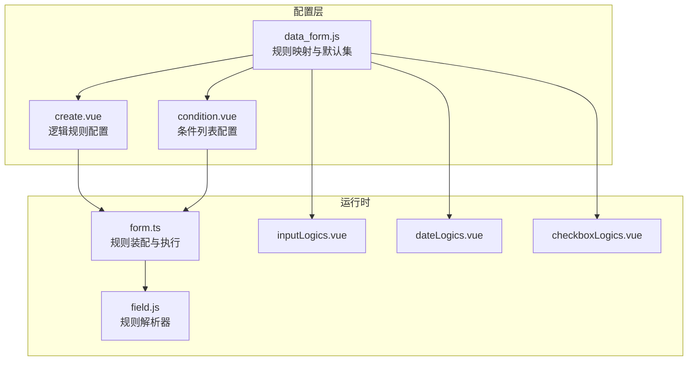
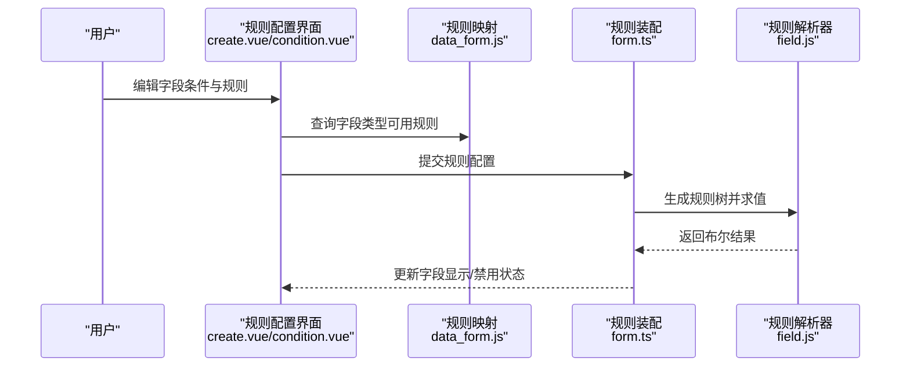
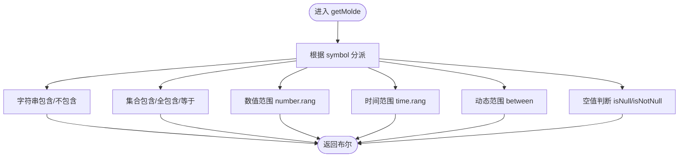
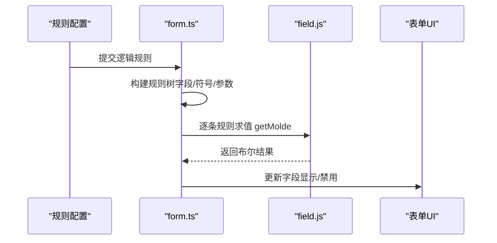
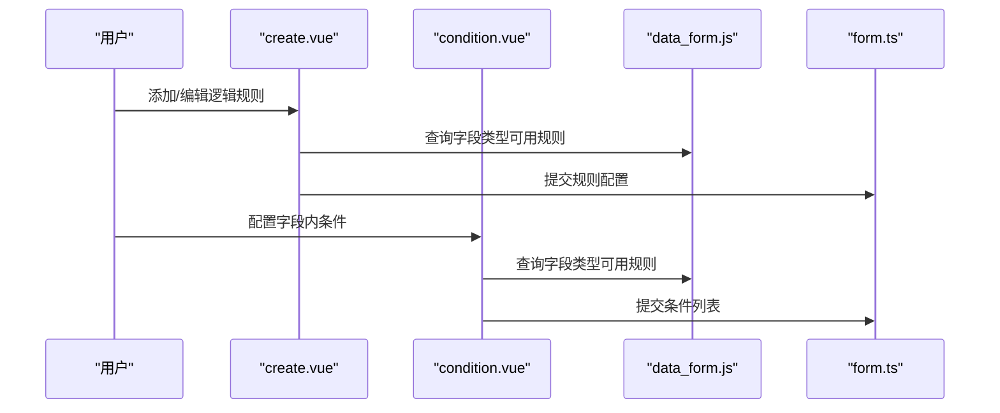
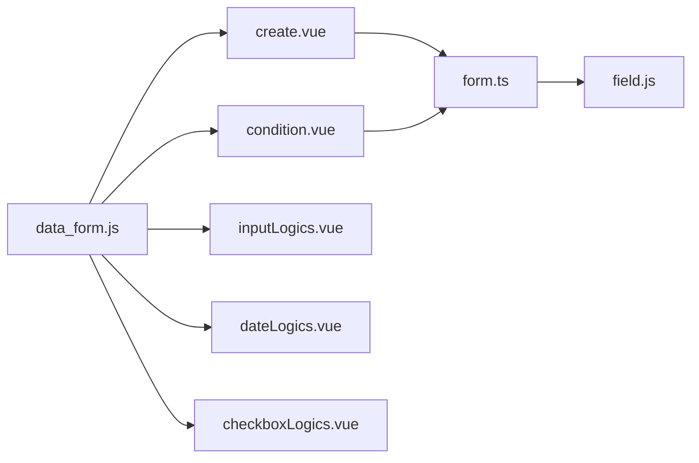

# 表单验证系统

<cite>
**本文档引用的文件**
- [field.js](file://src/utils/field.js)
- [form.ts](file://src/utils/form.ts)
- [data_form.js](file://src/data/data_form.js)
- [create.vue](file://src/views/form/components/create.vue)
- [condition.vue](file://src/views/form/components/condition.vue)
- [inputLogics.vue](file://src/components/formLogics/inputLogics.vue)
- [dateLogics.vue](file://src/components/formLogics/dateLogics.vue)
- [checkboxLogics.vue](file://src/components/formLogics/checkboxLogics.vue)
</cite>

## 目录
1. [简介](#简介)
2. [项目结构](#项目结构)
3. [核心组件](#核心组件)
4. [架构总览](#架构总览)
5. [详细组件分析](#详细组件分析)
6. [依赖关系分析](#依赖关系分析)
7. [性能考虑](#性能考虑)
8. [故障排查指南](#故障排查指南)
9. [结论](#结论)
10. [附录](#附录)

## 简介
本文件面向“表单验证系统”的设计与实现，聚焦于以下目标：
- 解释表单验证的实现机制：内置验证规则、自定义验证函数、异步验证处理
- 覆盖常见验证场景：必填、格式、范围、条件（联动）验证
- 说明验证规则配置方式、错误消息定制、验证时机控制
- 提供复杂验证示例：字段联动、跨字段、动态规则
- 给出性能优化建议与最佳实践

该系统以“规则驱动 + 运行时求值”为核心思想，通过统一的规则模型与解析器对不同字段类型进行匹配与校验，并支持基于表达式与外部数据源的异步联动。

## 项目结构
围绕表单验证的关键模块分布如下：
- 规则定义与映射：data_form.js 定义各字段类型的可用规则集合与显示标签
- 规则解析与执行：field.js 提供统一的规则解析器，按符号执行比较/集合/时间等判断
- 表单逻辑装配：form.ts 将规则转换为可执行的逻辑树，并在运行时评估
- 可视化配置界面：create.vue、condition.vue 提供规则编辑与预览
- 规则输入控件：inputLogics.vue、dateLogics.vue、checkboxLogics.vue 根据规则类型渲染输入组件
- 验证时机与集成：在表单渲染、字段变更、提交阶段触发校验

图表来源
- [data_form.js:1-840](file://src/data/data_form.js#L1-L840)
- [create.vue:1-476](file://src/views/form/components/create.vue#L1-L476)
- [condition.vue:1-347](file://src/views/form/components/condition.vue#L1-L347)
- [form.ts:1-1341](file://src/utils/form.ts#L1-L1341)
- [field.js:1-207](file://src/utils/field.js#L1-L207)
- [inputLogics.vue:1-28](file://src/components/formLogics/inputLogics.vue#L1-L28)
- [dateLogics.vue:1-45](file://src/components/formLogics/dateLogics.vue#L1-L45)
- [checkboxLogics.vue:1-27](file://src/components/formLogics/checkboxLogics.vue#L1-L27)

章节来源
- [data_form.js:1-840](file://src/data/data_form.js#L1-L840)
- [create.vue:1-476](file://src/views/form/components/create.vue#L1-L476)
- [condition.vue:1-347](file://src/views/form/components/condition.vue#L1-L347)
- [form.ts:1-1341](file://src/utils/form.ts#L1-L1341)
- [field.js:1-207](file://src/utils/field.js#L1-L207)
- [inputLogics.vue:1-28](file://src/components/formLogics/inputLogics.vue#L1-L28)
- [dateLogics.vue:1-45](file://src/components/formLogics/dateLogics.vue#L1-L45)
- [checkboxLogics.vue:1-27](file://src/components/formLogics/checkboxLogics.vue#L1-L27)

## 核心组件
- 规则映射与默认集（data_form.js）
  - 按字段类型返回可用规则集合，包含符号、显示名称、方法名等
  - 支持文本、数字、日期、时间、地址、人员/部门等多类型
- 规则解析器（field.js）
  - 统一的 getMolde(rule) 执行引擎，支持字符串包含、集合包含、数值范围、时间范围、动态范围等
  - 对象/空值判断、相等/不等、大小比较等
- 规则装配与执行（form.ts）
  - 将配置规则转换为内部逻辑树，按 and/or 逻辑组合
  - 在字段变更、查询联动、表达式计算后触发评估
- 规则配置界面（create.vue、condition.vue）
  - 提供可视化规则编辑、预览与保存
  - 动态渲染对应规则的输入控件
- 输入控件（inputLogics.vue、dateLogics.vue、checkboxLogics.vue）
  - 根据规则类型渲染输入框、日期选择器、多选框等

章节来源
- [data_form.js:740-800](file://src/data/data_form.js#L740-L800)
- [field.js:3-184](file://src/utils/field.js#L3-L184)
- [form.ts:918-972](file://src/utils/form.ts#L918-L972)
- [create.vue:139-344](file://src/views/form/components/create.vue#L139-L344)
- [condition.vue:55-177](file://src/views/form/components/condition.vue#L55-L177)
- [inputLogics.vue:1-28](file://src/components/formLogics/inputLogics.vue#L1-L28)
- [dateLogics.vue:1-45](file://src/components/formLogics/dateLogics.vue#L1-L45)
- [checkboxLogics.vue:1-27](file://src/components/formLogics/checkboxLogics.vue#L1-L27)

## 架构总览
系统采用“配置即规则”的架构，规则由配置层生成，运行时由装配器转换为可执行逻辑，解析器负责逐条规则的求值，最终影响表单字段的显示/禁用/校验状态。

图表来源
- [create.vue:139-344](file://src/views/form/components/create.vue#L139-L344)
- [condition.vue:55-177](file://src/views/form/components/condition.vue#L55-L177)
- [data_form.js:740-800](file://src/data/data_form.js#L740-L800)
- [form.ts:918-972](file://src/utils/form.ts#L918-L972)
- [field.js:3-184](file://src/utils/field.js#L3-L184)

## 详细组件分析

### 规则映射与默认集（data_form.js）
- 设计要点
  - 按字段类型返回默认规则集合，包含符号、显示名称、方法名
  - 支持文本包含/不包含、相等/不等、集合包含/全包含、范围、空值判断、时间范围、动态范围等
- 关键能力
  - 类型到规则集的映射函数，用于配置界面渲染与规则筛选
  - 数组/对象/时间等特殊类型的规则差异处理
- 典型使用
  - create.vue/condition.vue 在选择字段后调用映射函数获取可用规则
  - inputLogics/dateLogics/checkboxLogics 根据规则类型渲染输入控件

章节来源
- [data_form.js:1-840](file://src/data/data_form.js#L1-L840)

### 规则解析器（field.js）
- 设计要点
  - 统一入口 getMolde(rule)，根据 symbol 分派到具体判断逻辑
  - 支持字符串包含/不包含、集合包含/全包含、数值范围、时间范围、动态范围、空值判断等
- 关键算法
  - 字符串包含：双向包含检测
  - 集合包含：IsInArray 辅助判断
  - 时间范围：checkAuditTime 交换起止时间后判断
  - 动态范围：按天/月/年回溯当前时间判断
- 性能与健壮性
  - 对空值/对象值进行显式分支处理
  - 使用 dayjs 标准化时间格式，避免时区/格式差异

图表来源
- [field.js:3-184](file://src/utils/field.js#L3-L184)

章节来源
- [field.js:1-207](file://src/utils/field.js#L1-L207)

### 规则装配与执行（form.ts）
- 设计要点
  - 将配置规则转换为内部规则树，记录字段、符号、额外参数（input/config/format）
  - 支持 and/or 逻辑组合，逐条求值后聚合
- 关键流程
  - setFormLogics：从配置构建规则树，填充 input/config 值
  - getMolde：逐条规则求值
  - 影响字段显示/禁用：根据评估结果更新 formList
- 异步与联动
  - 结合表达式计算、关联查询、远程数据加载，延迟/去抖后触发评估

图表来源
- [form.ts:918-972](file://src/utils/form.ts#L918-L972)
- [field.js:3-184](file://src/utils/field.js#L3-L184)

章节来源
- [form.ts:822-972](file://src/utils/form.ts#L822-L972)

### 规则配置界面（create.vue、condition.vue）
- 设计要点
  - create.vue：表单级逻辑规则配置，支持多条件 and/or、字段显示列表
  - condition.vue：字段内条件列表配置，支持跨字段比较
- 交互特性
  - 动态渲染输入控件（inputLogics/dateLogics/checkboxLogics）
  - 规则类型切换时重置值并重新映射
  - 保存前将复杂规则（如 DYNAMIC_BETWEEN/BETWEEN）标准化

图表来源
- [create.vue:139-344](file://src/views/form/components/create.vue#L139-L344)
- [condition.vue:55-177](file://src/views/form/components/condition.vue#L55-L177)
- [data_form.js:740-800](file://src/data/data_form.js#L740-L800)
- [form.ts:918-972](file://src/utils/form.ts#L918-L972)

章节来源
- [create.vue:1-476](file://src/views/form/components/create.vue#L1-L476)
- [condition.vue:1-347](file://src/views/form/components/condition.vue#L1-L347)

### 输入控件（inputLogics.vue、dateLogics.vue、checkboxLogics.vue）
- 设计要点
  - inputLogics：根据规则类型渲染输入框或可创建的多选
  - dateLogics：根据规则类型渲染日期/时间选择器或范围选择器
  - checkboxLogics：根据默认选项渲染多选下拉
- 与规则映射的关系
  - 依据 data_form.js 中的规则类型决定渲染形态
  - 默认值/格式等来自字段配置

章节来源
- [inputLogics.vue:1-28](file://src/components/formLogics/inputLogics.vue#L1-L28)
- [dateLogics.vue:1-45](file://src/components/formLogics/dateLogics.vue#L1-L45)
- [checkboxLogics.vue:1-27](file://src/components/formLogics/checkboxLogics.vue#L1-L27)

## 依赖关系分析
- 组件耦合
  - data_form.js 为配置层提供规则映射，被 create.vue/condition.vue 引用
  - form.ts 依赖 field.js 执行规则求值，并与 UI 状态联动
  - 输入控件依赖 data_form.js 的规则映射进行渲染
- 外部依赖
  - dayjs 用于时间标准化
  - 表单组件库（如 @arco-design/web-vue）用于 UI 渲染与交互

图表来源
- [data_form.js:1-840](file://src/data/data_form.js#L1-L840)
- [create.vue:139-344](file://src/views/form/components/create.vue#L139-L344)
- [condition.vue:55-177](file://src/views/form/components/condition.vue#L55-L177)
- [form.ts:1-1341](file://src/utils/form.ts#L1-L1341)
- [field.js:1-207](file://src/utils/field.js#L1-L207)
- [inputLogics.vue:1-28](file://src/components/formLogics/inputLogics.vue#L1-L28)
- [dateLogics.vue:1-45](file://src/components/formLogics/dateLogics.vue#L1-L45)
- [checkboxLogics.vue:1-27](file://src/components/formLogics/checkboxLogics.vue#L1-L27)

章节来源
- [data_form.js:1-840](file://src/data/data_form.js#L1-L840)
- [form.ts:1-1341](file://src/utils/form.ts#L1-L1341)
- [field.js:1-207](file://src/utils/field.js#L1-L207)

## 性能考虑
- 规则求值批量化
  - 将多条规则求值合并为数组后批量处理，减少重复计算
- 去抖与节流
  - 在字段变更、表达式计算、关联查询后使用去抖策略，避免频繁重算
- 时间标准化
  - 使用 dayjs 统一时间格式，减少比较成本
- 渲染优化
  - 仅在必要时更新字段显示/禁用状态，避免全量重渲染
- 异步加载
  - 对远程数据与表达式计算采用异步处理，避免阻塞主线程

## 故障排查指南
- 常见问题
  - 规则不生效：检查规则符号与字段类型是否匹配；确认规则树构建是否正确
  - 时间范围异常：核对起止时间顺序与格式，确保使用 dayjs 标准化
  - 动态范围无效：确认 DYNAMIC_BETWEEN 的类型与数值映射是否正确
  - 集合包含不准确：检查 IsInArray 实现与输入/配置数组格式
- 排查步骤
  - 在规则装配阶段打印规则树，核对字段、符号、参数
  - 在解析器中增加日志，定位具体失败的规则
  - 在 UI 层观察字段显示/禁用状态变化，确认评估结果

章节来源
- [field.js:187-207](file://src/utils/field.js#L187-L207)
- [form.ts:918-972](file://src/utils/form.ts#L918-L972)

## 结论
本表单验证系统通过“规则映射 + 规则装配 + 规则解析”的分层设计，实现了对多字段类型、多规则类型的统一支持。其可视化配置与动态规则能力，使得复杂业务场景下的字段联动与跨字段验证得以高效落地。配合异步处理与性能优化策略，系统可在保证灵活性的同时维持良好的用户体验。

## 附录

### 验证场景与规则对照
- 必填验证：利用空值判断规则（IS_NULL/NOT_NULL）
- 格式验证：字符串包含/不包含、正则类规则（如 ID 卡号、邮箱、URL）
- 范围验证：数值范围（BETWEEN）、时间范围（time.rang）、动态范围（DYNAMIC_BETWEEN）
- 条件验证：字段间比较（EQ/NE/GT/LT/GE/LE），集合包含（IN/NOT_IN/ALL_LIKE）

章节来源
- [data_form.js:596-800](file://src/data/data_form.js#L596-L800)
- [field.js:3-184](file://src/utils/field.js#L3-L184)
- [form.ts:918-972](file://src/utils/form.ts#L918-L972)