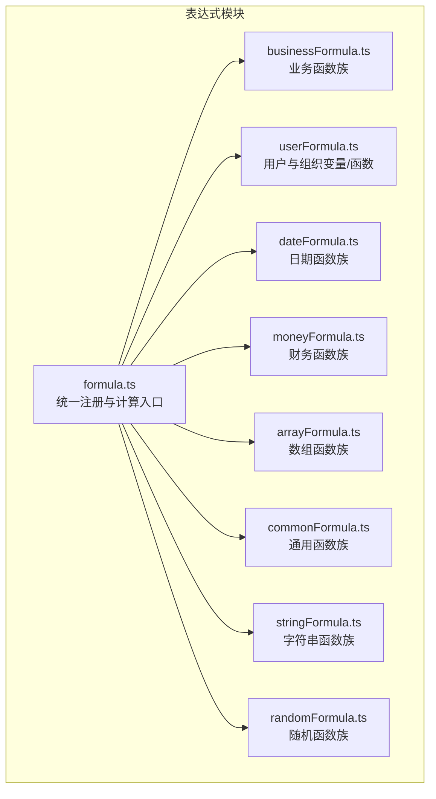
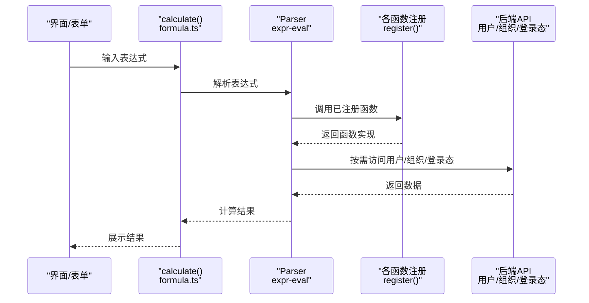
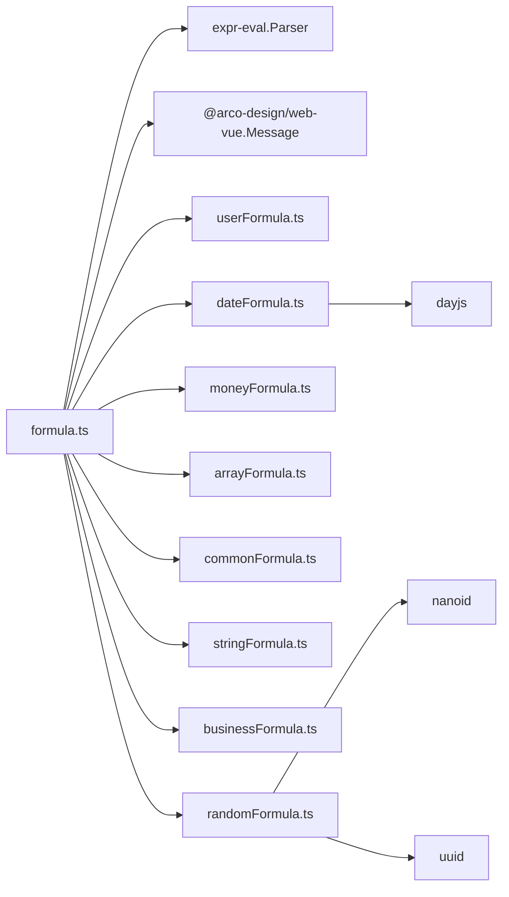
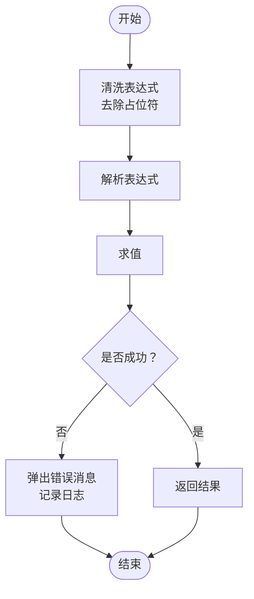

# 业务公式库

<cite>
**本文引用的文件**
- [businessFormula.ts](file://src/components/expression/formula/businessFormula.ts)
- [arrayFormula.ts](file://src/components/expression/formula/arrayFormula.ts)
- [commonFormula.ts](file://src/components/expression/formula/commonFormula.ts)
- [dateFormula.ts](file://src/components/expression/formula/dateFormula.ts)
- [moneyFormula.ts](file://src/components/expression/formula/moneyFormula.ts)
- [randomFormula.ts](file://src/components/expression/formula/randomFormula.ts)
- [stringFormula.ts](file://src/components/expression/formula/stringFormula.ts)
- [userFormula.ts](file://src/components/expression/formula/userFormula.ts)
- [formula.ts](file://src/components/expression/formula.ts)
- [auth.ts](file://src/utils/auth.ts)
- [form.ts](file://src/utils/form.ts)
</cite>

## 目录
1. [简介](#简介)
2. [项目结构](#项目结构)
3. [核心组件](#核心组件)
4. [架构总览](#架构总览)
5. [详细组件分析](#详细组件分析)
6. [依赖分析](#依赖分析)
7. [性能考虑](#性能考虑)
8. [故障排查指南](#故障排查指南)
9. [结论](#结论)
10. [附录](#附录)

## 简介
本文件系统化梳理并说明业务公式库的设计与实现，覆盖表达式解析器、函数注册机制以及各类业务函数族（财务、统计、日期、字符串、数组、通用、用户与组织、随机等）。重点围绕以下目标展开：
- 明确各业务函数的专业应用场景与计算逻辑
- 说明精度控制与边界条件处理策略
- 提供参数配置与调用方式指引
- 给出典型业务场景下的应用案例与最佳实践

## 项目结构
业务公式库位于表达式模块下，采用“按功能域划分”的文件组织方式，通过统一入口进行函数注册与表达式计算。

图表来源
- [formula.ts:1-96](file://src/components/expression/formula.ts#L1-L96)
- [businessFormula.ts:1-52](file://src/components/expression/formula/businessFormula.ts#L1-L52)
- [userFormula.ts:1-411](file://src/components/expression/formula/userFormula.ts#L1-L411)
- [dateFormula.ts:1-180](file://src/components/expression/formula/dateFormula.ts#L1-L180)
- [moneyFormula.ts:1-189](file://src/components/expression/formula/moneyFormula.ts#L1-L189)
- [arrayFormula.ts:1-95](file://src/components/expression/formula/arrayFormula.ts#L1-L95)
- [commonFormula.ts:1-136](file://src/components/expression/formula/commonFormula.ts#L1-L136)
- [stringFormula.ts:1-127](file://src/components/expression/formula/stringFormula.ts#L1-L127)
- [randomFormula.ts:1-58](file://src/components/expression/formula/randomFormula.ts#L1-L58)

章节来源
- [formula.ts:1-96](file://src/components/expression/formula.ts#L1-L96)

## 核心组件
- 表达式解析器与注册中心：在统一入口完成函数注册与表达式求值，提供表单取值与子表单取值能力。
- 函数族模块：按领域划分，分别提供业务、用户组织、日期、财务、数组、通用、字符串、随机等函数。
- 变量体系：用户变量树形结构，支持扁平映射与父子关系查询，便于在表达式中直接引用。

章节来源
- [formula.ts:1-96](file://src/components/expression/formula.ts#L1-L96)
- [userFormula.ts:114-371](file://src/components/expression/formula/userFormula.ts#L114-L371)

## 架构总览
表达式引擎以“解析器 + 函数注册 + 变量树 + 计算入口”为核心，形成可扩展的公式生态。

图表来源
- [formula.ts:15-95](file://src/components/expression/formula.ts#L15-L95)
- [userFormula.ts:401-410](file://src/components/expression/formula/userFormula.ts#L401-L410)
- [auth.ts:1-20](file://src/utils/auth.ts#L1-L20)

章节来源
- [formula.ts:1-96](file://src/components/expression/formula.ts#L1-L96)

## 详细组件分析

### 业务函数族（businessFormula.ts）
- 功能定位：提供业务场景常用函数，当前包含“部门负责人”函数族。
- 当前实现：提供获取当前用户部门负责人的函数，并支持按属性（id、username、nickname）返回对应值。
- 应用场景：审批流中自动带出部门负责人、通知与抄送默认值填充等。
- 参数与返回：
  - 参数：属性选择（可选），默认返回昵称；支持传入 id、username、nickname。
  - 返回：字符串（逗号分隔的多值）。
- 边界与精度：
  - 若后端返回为空或异常，返回空字符串。
  - 值以逗号连接，便于后续在表达式中进一步处理。
- 注册与调用：
  - 在统一入口完成注册，可在表达式中以函数形式调用。

章节来源
- [businessFormula.ts:12-25](file://src/components/expression/formula/businessFormula.ts#L12-L25)
- [businessFormula.ts:27-47](file://src/components/expression/formula/businessFormula.ts#L27-L47)
- [businessFormula.ts:49-51](file://src/components/expression/formula/businessFormula.ts#L49-L51)

### 用户与组织变量（userFormula.ts）
- 功能定位：提供当前用户及其角色、部门、岗位等变量树，支持主岗/兼岗区分。
- 关键变量：
  - 当前用户：ID、昵称、用户名、邮箱、手机号、性别、是否部门负责人（含主/兼）。
  - 角色：ID、名称（多值以逗号连接）。
  - 部门：ID、名称、是否负责人（主/兼）。
  - 岗位：ID、名称（主/兼）。
- 计算逻辑：
  - 读取本地存储的用户信息作为基础数据源。
  - 部门/岗位/角色通过API异步获取，返回值以逗号连接。
  - 是否负责人通过部门列表过滤 leader 字段判断。
- 边界与精度：
  - 本地用户信息缺失时，对应变量返回空字符串。
  - 异步API失败时，返回空字符串。
- 实用工具：
  - 扁平化变量树为 Map，便于快速查找。
  - 支持向上递归查询父节点链路。

章节来源
- [userFormula.ts:19-44](file://src/components/expression/formula/userFormula.ts#L19-L44)
- [userFormula.ts:46-49](file://src/components/expression/formula/userFormula.ts#L46-L49)
- [userFormula.ts:52-62](file://src/components/expression/formula/userFormula.ts#L52-L62)
- [userFormula.ts:65-88](file://src/components/expression/formula/userFormula.ts#L65-L88)
- [userFormula.ts:90-112](file://src/components/expression/formula/userFormula.ts#L90-L112)
- [userFormula.ts:114-371](file://src/components/expression/formula/userFormula.ts#L114-L371)
- [userFormula.ts:373-399](file://src/components/expression/formula/userFormula.ts#L373-L399)
- [userFormula.ts:401-410](file://src/components/expression/formula/userFormula.ts#L401-L410)

### 日期函数族（dateFormula.ts）
- 功能定位：提供当前日期时间、日期、时间、时间差、区间时间差等函数。
- 关键函数：
  - 获取当前日期时间：支持多种格式模板。
  - 获取当前日期/时间：标准化输出。
  - 时间差：支持毫秒、秒、分钟、小时、天、周、月、年等单位。
  - 区间时间差：接收区间对象，计算指定单位的时间差。
- 计算逻辑与精度：
  - 使用日期解析器统一处理输入，兼容多种字符串格式。
  - 单位换算基于毫秒常量表，结果保留两位小数。
  - 非法时间输入返回空字符串，避免抛错。
- 边界与精度：
  - 非法/空输入返回空字符串。
  - 字符串解析兼容 ISO 与常见格式，非法格式返回空字符串。

章节来源
- [dateFormula.ts:13-17](file://src/components/expression/formula/dateFormula.ts#L13-L17)
- [dateFormula.ts:19-25](file://src/components/expression/formula/dateFormula.ts#L19-L25)
- [dateFormula.ts:27-33](file://src/components/expression/formula/dateFormula.ts#L27-L33)
- [dateFormula.ts:47-59](file://src/components/expression/formula/dateFormula.ts#L47-L59)
- [dateFormula.ts:61-71](file://src/components/expression/formula/dateFormula.ts#L61-L71)
- [dateFormula.ts:73-147](file://src/components/expression/formula/dateFormula.ts#L73-L147)
- [dateFormula.ts:158-179](file://src/components/expression/formula/dateFormula.ts#L158-L179)
- [dateFormula.ts:150-156](file://src/components/expression/formula/dateFormula.ts#L150-L156)

### 财务函数族（moneyFormula.ts）
- 功能定位：提供金额中文大写、数值求和、平均值、字符串转数字等财务相关函数。
- 关键函数：
  - 金额大写：将阿拉伯数字金额转换为中文大写（元、角、分），含零的规范处理。
  - 求和：支持数字、字符串与数组混合输入，无效值按0计。
  - 平均值：支持混合输入，无效值过滤后计算平均值，空数组返回0。
  - 数字格式化：字符串转数字并保留两位小数，非法输入返回0。
- 计算逻辑与精度：
  - 金额大写：整数部分按位级处理，单位序列与“万/亿”处理，末尾“零元”优化为“整”。
  - 求和/平均值：扁平化处理多维输入，NaN按0或忽略处理。
  - 数字格式化：使用固定两位小数，非法输入兜底为0。
- 边界与精度：
  - 金额范围限制在合理区间，超出范围返回提示文本。
  - 空数组求平均值返回0（可根据业务调整）。
  - 字符串转数字失败返回0。

章节来源
- [moneyFormula.ts:39-83](file://src/components/expression/formula/moneyFormula.ts#L39-L83)
- [moneyFormula.ts:85-91](file://src/components/expression/formula/moneyFormula.ts#L85-L91)
- [moneyFormula.ts:93-106](file://src/components/expression/formula/moneyFormula.ts#L93-L106)
- [moneyFormula.ts:108-121](file://src/components/expression/formula/moneyFormula.ts#L108-L121)
- [moneyFormula.ts:123-181](file://src/components/expression/formula/moneyFormula.ts#L123-L181)
- [moneyFormula.ts:183-188](file://src/components/expression/formula/moneyFormula.ts#L183-L188)

### 数组函数族（arrayFormula.ts）
- 功能定位：提供数组包含判断（任一/全部）等函数。
- 关键函数：
  - 包含任一：目标数组中是否存在任一匹配元素。
  - 包含全部：目标数组中是否包含所有匹配元素。
- 输入处理：
  - 支持数组、类数组、JSON字符串、逗号分隔字符串等多种输入形态，统一转换为数组。
  - 空输入返回false。
- 计算逻辑与精度：
  - 使用 includes 与 some/every 组合实现，短路求值。
- 边界与精度：
  - 空数组或空目标返回false。
  - 类型转换失败时按空数组处理。

章节来源
- [arrayFormula.ts:12-19](file://src/components/expression/formula/arrayFormula.ts#L12-L19)
- [arrayFormula.ts:21-28](file://src/components/expression/formula/arrayFormula.ts#L21-L28)
- [arrayFormula.ts:30-64](file://src/components/expression/formula/arrayFormula.ts#L30-L64)
- [arrayFormula.ts:71-94](file://src/components/expression/formula/arrayFormula.ts#L71-L94)
- [arrayFormula.ts:66-69](file://src/components/expression/formula/arrayFormula.ts#L66-L69)

### 通用函数族（commonFormula.ts）
- 功能定位：提供通用判断与分支逻辑函数。
- 关键函数：
  - 为空判断：对undefined、null、空字符串、空数组等进行统一判定。
  - 非空判断：为空判断取反。
  - 匹配返回：根据布尔条件返回不同值。
  - 全满足/任意满足：对多个条件进行聚合判断。
- 计算逻辑与精度：
  - 条件解析采用布尔转换，支持异步参数解析。
  - 全满足短路求值，任意满足短路求值。
- 边界与精度：
  - 空字符串与空数组视为“空”。

章节来源
- [commonFormula.ts:12-20](file://src/components/expression/formula/commonFormula.ts#L12-L20)
- [commonFormula.ts:22-25](file://src/components/expression/formula/commonFormula.ts#L22-L25)
- [commonFormula.ts:27-33](file://src/components/expression/formula/commonFormula.ts#L27-L33)
- [commonFormula.ts:35-43](file://src/components/expression/formula/commonFormula.ts#L35-L43)
- [commonFormula.ts:44-52](file://src/components/expression/formula/commonFormula.ts#L44-L52)
- [commonFormula.ts:54-127](file://src/components/expression/formula/commonFormula.ts#L54-L127)
- [commonFormula.ts:129-135](file://src/components/expression/formula/commonFormula.ts#L129-L135)

### 字符串函数族（stringFormula.ts）
- 功能定位：提供字符串转换、比较、拼接、拆分等函数。
- 关键函数：
  - 转换：将任意类型安全转换为字符串（日期、数组、对象、空值等均有处理）。
  - 等于：严格相等比较。
  - 拼接：多参数拼接。
  - 拆分：按分隔符拆分为数组。
- 计算逻辑与精度：
  - 对象转换使用 JSON 序列化，失败回退 toString。
  - 空值转换为特定字符串以便表达式识别。
- 边界与精度：
  - 分隔符为空或被拆分字符串为空时返回空数组。

章节来源
- [stringFormula.ts:12-37](file://src/components/expression/formula/stringFormula.ts#L12-L37)
- [stringFormula.ts:39-43](file://src/components/expression/formula/stringFormula.ts#L39-L43)
- [stringFormula.ts:45-47](file://src/components/expression/formula/stringFormula.ts#L45-L47)
- [stringFormula.ts:49-56](file://src/components/expression/formula/stringFormula.ts#L49-L56)
- [stringFormula.ts:58-119](file://src/components/expression/formula/stringFormula.ts#L58-L119)
- [stringFormula.ts:121-126](file://src/components/expression/formula/stringFormula.ts#L121-L126)

### 随机函数族（randomFormula.ts）
- 功能定位：提供唯一标识生成函数。
- 关键函数：
  - UUID：基于 UUID 库生成标准 UUID。
  - NanoID：基于 NanoID 库生成短 ID。
- 计算逻辑与精度：
  - 直接调用第三方库生成，保证唯一性与可读性。
- 边界与精度：
  - 无特殊边界处理，遵循库默认行为。

章节来源
- [randomFormula.ts:14-20](file://src/components/expression/formula/randomFormula.ts#L14-L20)
- [randomFormula.ts:22-51](file://src/components/expression/formula/randomFormula.ts#L22-L51)
- [randomFormula.ts:54-57](file://src/components/expression/formula/randomFormula.ts#L54-L57)

### 表达式计算入口（formula.ts）
- 功能定位：统一注册所有函数族，提供表达式计算入口，并注入表单取值与子表单取值能力。
- 关键点：
  - 注册顺序决定函数优先级与可用性。
  - 注入 getFormValue 与 getSubFormValue 用于从表单配置与数据中取值。
  - 计算前对表达式进行清洗（去除特定占位符），并捕获解析错误。
- 错误处理：
  - 解析失败弹出消息并记录日志。

章节来源
- [formula.ts:15-24](file://src/components/expression/formula.ts#L15-L24)
- [formula.ts:27-63](file://src/components/expression/formula.ts#L27-L63)
- [formula.ts:84-95](file://src/components/expression/formula.ts#L84-L95)

## 依赖分析
- 外部依赖：expr-eval（表达式解析）、dayjs（日期处理）、nanoid/uuid（唯一标识）、Arco Design（消息提示）。
- 内部依赖：用户变量树依赖本地存储与后端 API；日期函数依赖日期解析器；财务函数依赖数值处理与格式化。
- 注册依赖：统一入口集中注册，避免循环依赖与遗漏。

图表来源
- [formula.ts:1-13](file://src/components/expression/formula.ts#L1-L13)
- [dateFormula.ts:1-2](file://src/components/expression/formula/dateFormula.ts#L1-L2)
- [randomFormula.ts:1-3](file://src/components/expression/formula/randomFormula.ts#L1-L3)

章节来源
- [formula.ts:1-96](file://src/components/expression/formula.ts#L1-L96)

## 性能考虑
- 异步函数：用户与组织相关函数均为异步，建议在表达式中尽量减少不必要的重复调用，必要时缓存结果。
- 数组与字符串处理：数组函数会进行数组转换与遍历，输入规模较大时注意避免在高频触发场景中频繁调用。
- 日期解析：日期函数对字符串进行解析与校验，建议传入标准格式以减少解析成本。
- 数值计算：财务函数对数值进行扁平化与聚合，建议在表达式中避免过深嵌套与超大数组。

## 故障排查指南
- 表达式解析错误：计算入口捕获异常并提示错误，检查表达式语法与函数名拼写。
- 空值与异常：通用函数族提供“为空判断”，可配合“匹配返回”进行兜底。
- 日期输入异常：日期函数对非法输入返回空字符串，检查输入格式与合法性。
- 财务函数异常：金额大写对越界与非法输入有保护，检查输入范围与格式。
- 用户/组织取值失败：用户变量依赖本地存储与后端 API，检查登录态与接口返回。

章节来源
- [formula.ts:84-95](file://src/components/expression/formula.ts#L84-L95)
- [commonFormula.ts:12-20](file://src/components/expression/formula/commonFormula.ts#L12-L20)
- [dateFormula.ts:158-179](file://src/components/expression/formula/dateFormula.ts#L158-L179)
- [moneyFormula.ts:42-44](file://src/components/expression/formula/moneyFormula.ts#L42-L44)
- [auth.ts:1-20](file://src/utils/auth.ts#L1-L20)

## 结论
业务公式库通过清晰的功能域划分与统一的注册/计算入口，构建了可扩展、易维护的表达式生态。当前已覆盖用户组织、日期、财务、数组、通用、字符串与随机等关键领域，能够满足大多数业务场景下的公式化需求。建议在实际使用中结合边界条件与性能考量，合理设计表达式与调用策略。

## 附录

### 表达式计算流程（代码级）

图表来源
- [formula.ts:84-95](file://src/components/expression/formula.ts#L84-L95)