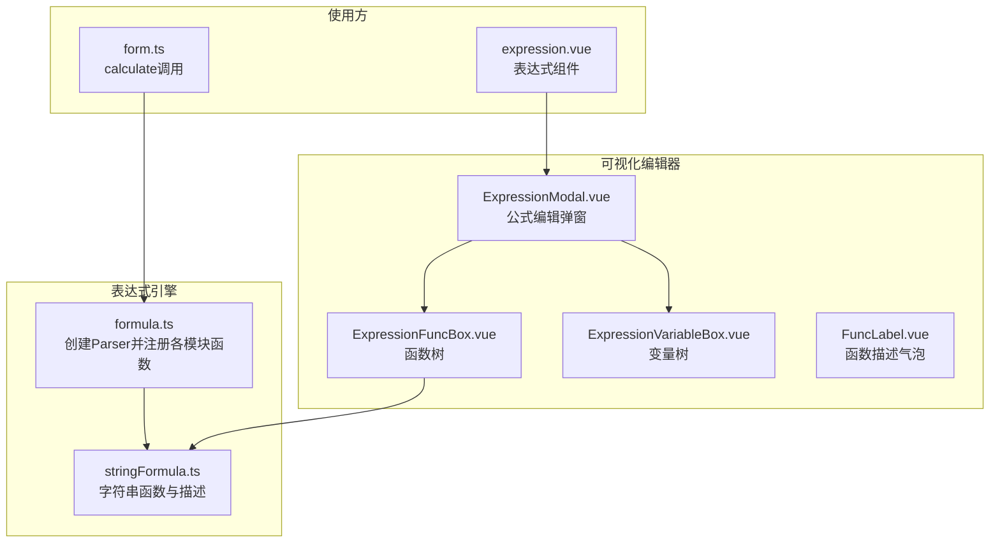
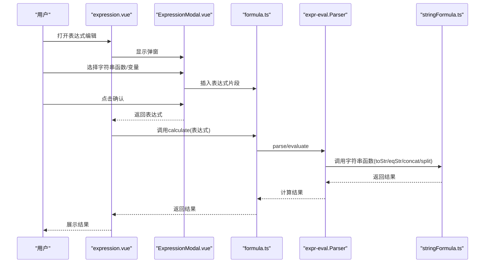
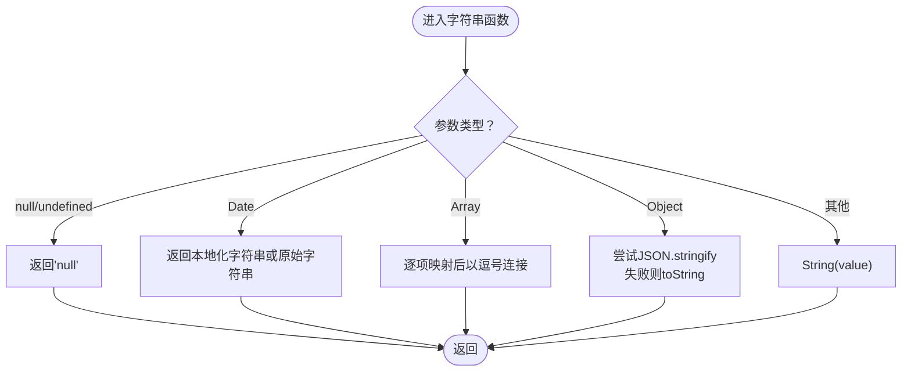
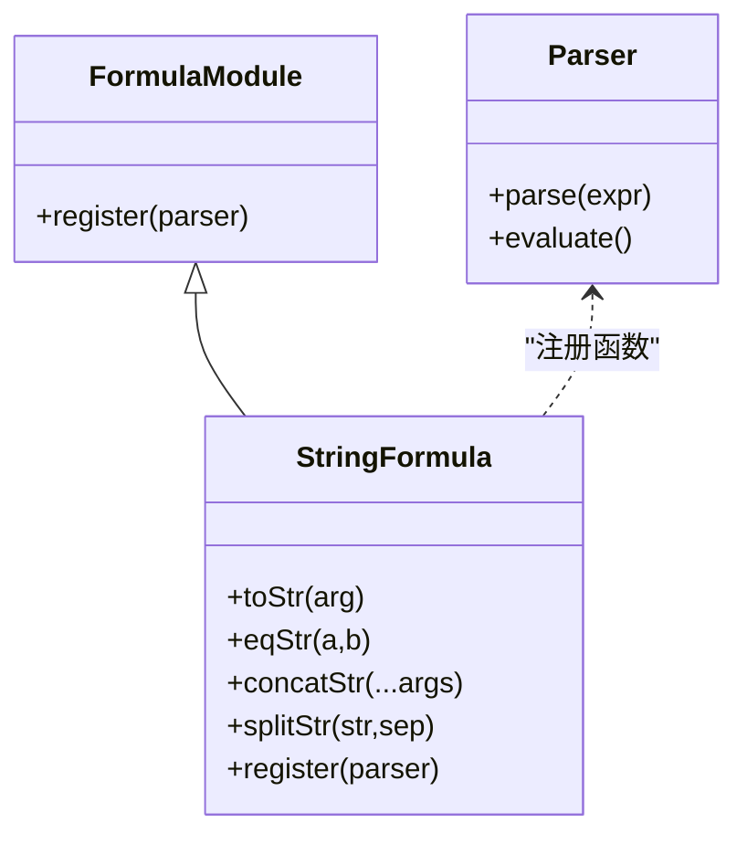
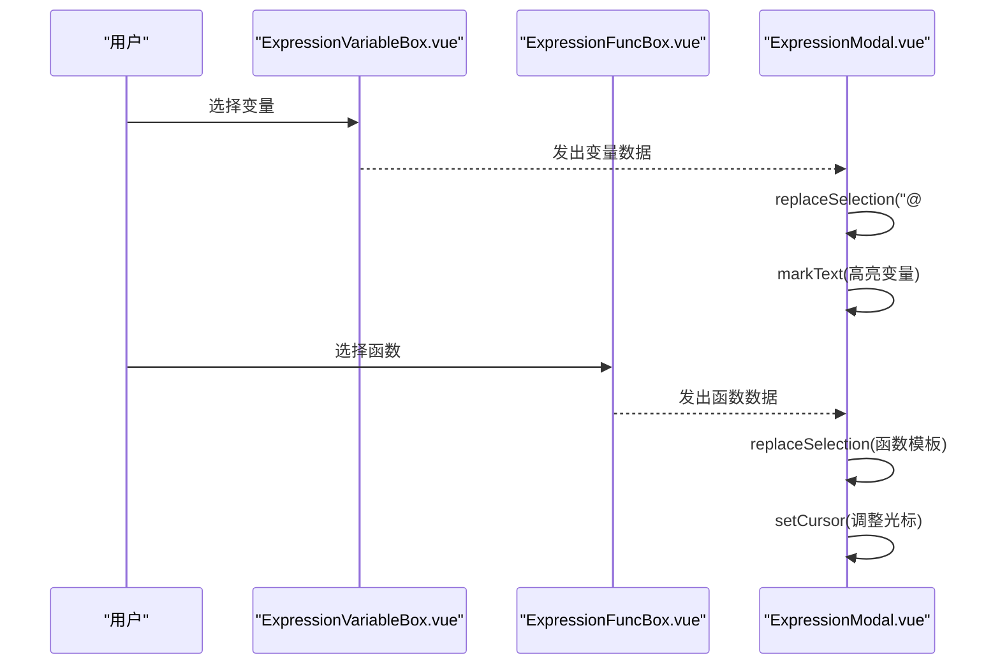
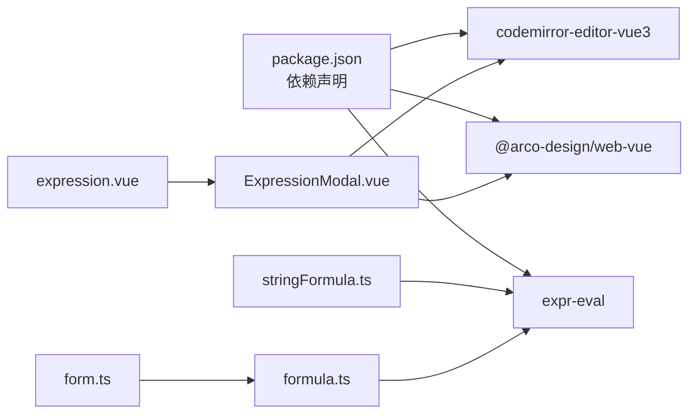

# 字符串处理公式

<cite>
**本文引用的文件**
- [stringFormula.ts](file://src/components/expression/formula/stringFormula.ts)
- [formula.ts](file://src/components/expression/formula.ts)
- [expression.vue](file://src/components/expression/expression.vue)
- [ExpressionModal.vue](file://src/components/expression/components/ExpressionModal.vue)
- [ExpressionFuncBox.vue](file://src/components/expression/components/ExpressionFuncBox.vue)
- [ExpressionVariableBox.vue](file://src/components/expression/components/ExpressionVariableBox.vue)
- [FuncLabel.vue](file://src/components/expression/components/FuncLabel.vue)
- [form.ts](file://src/utils/form.ts)
- [package.json](file://package.json)
</cite>

## 目录
1. [简介](#简介)
2. [项目结构](#项目结构)
3. [核心组件](#核心组件)
4. [架构总览](#架构总览)
5. [详细组件分析](#详细组件分析)
6. [依赖关系分析](#依赖关系分析)
7. [性能考虑](#性能考虑)
8. [故障排查指南](#故障排查指南)
9. [结论](#结论)
10. [附录](#附录)

## 简介
本文件系统性梳理并说明表达式引擎中的字符串处理公式模块，重点覆盖以下方面：
- 字符串基础操作：转换、比较、拼接、拆分
- 表达式计算与注册机制
- 编码与字符集支持、Unicode 兼容性
- 性能优化与异步处理策略
- 国际化与多语言文本处理最佳实践
- 前端可视化编辑器与交互流程

该模块基于 expr-eval 解析器扩展，通过统一的注册机制将字符串函数暴露给表达式引擎，并在前端提供可视化函数选择与变量插入能力。

## 项目结构
字符串处理公式相关的核心文件组织如下：
- 表达式引擎入口与注册：formula.ts
- 字符串函数定义与注册：stringFormula.ts
- 可视化表达式编辑器：ExpressionModal.vue、ExpressionFuncBox.vue、ExpressionVariableBox.vue、FuncLabel.vue
- 表达式组件封装：expression.vue
- 表达式计算调用：form.ts 中对 calculate 的使用
- 依赖声明：package.json

**图表来源**
- [formula.ts:15-25](file://src/components/expression/formula.ts#L15-L25)
- [stringFormula.ts:58-127](file://src/components/expression/formula/stringFormula.ts#L58-L127)
- [ExpressionModal.vue:1-298](file://src/components/expression/components/ExpressionModal.vue#L1-L298)
- [ExpressionFuncBox.vue:53-61](file://src/components/expression/components/ExpressionFuncBox.vue#L53-L61)
- [ExpressionVariableBox.vue:50-98](file://src/components/expression/components/ExpressionVariableBox.vue#L50-L98)
- [expression.vue:28-32](file://src/components/expression/expression.vue#L28-L32)
- [form.ts:723-734](file://src/utils/form.ts#L723-L734)

**章节来源**
- [formula.ts:15-25](file://src/components/expression/formula.ts#L15-L25)
- [stringFormula.ts:58-127](file://src/components/expression/formula/stringFormula.ts#L58-L127)
- [ExpressionModal.vue:1-298](file://src/components/expression/components/ExpressionModal.vue#L1-L298)
- [ExpressionFuncBox.vue:53-61](file://src/components/expression/components/ExpressionFuncBox.vue#L53-L61)
- [ExpressionVariableBox.vue:50-98](file://src/components/expression/components/ExpressionVariableBox.vue#L50-L98)
- [expression.vue:28-32](file://src/components/expression/expression.vue#L28-L32)
- [form.ts:723-734](file://src/utils/form.ts#L723-L734)

## 核心组件
- 字符串函数集合：提供“转换”“等于”“拼接”“拆分”四个函数，并以统一的 ExpressionFunc 结构描述其用途、参数、返回值与示例。
- 表达式解析器：通过 Parser 创建并注册字符串函数，同时注入表单变量读取函数。
- 可视化编辑器：提供函数树与变量树，支持搜索、高亮与插入到编辑器。
- 使用入口：在业务逻辑中调用 calculate 执行表达式，从而触发字符串函数的执行。

**章节来源**
- [stringFormula.ts:58-127](file://src/components/expression/formula/stringFormula.ts#L58-L127)
- [formula.ts:15-25](file://src/components/expression/formula.ts#L15-L25)
- [ExpressionFuncBox.vue:53-61](file://src/components/expression/components/ExpressionFuncBox.vue#L53-L61)
- [ExpressionVariableBox.vue:50-98](file://src/components/expression/components/ExpressionVariableBox.vue#L50-L98)
- [form.ts:723-734](file://src/utils/form.ts#L723-L734)

## 架构总览
表达式计算的整体流程如下：

**图表来源**
- [expression.vue:86-102](file://src/components/expression/expression.vue#L86-L102)
- [ExpressionModal.vue:176-187](file://src/components/expression/components/ExpressionModal.vue#L176-L187)
- [formula.ts:84-95](file://src/components/expression/formula.ts#L84-L95)
- [stringFormula.ts:121-127](file://src/components/expression/formula/stringFormula.ts#L121-L127)

## 详细组件分析

### 字符串函数模块（stringFormula.ts）
- 函数注册
  - 注册 toStr、eqStr、concat、split 到解析器函数命名空间。
  - 通过 register(parser) 将函数暴露给表达式引擎。
- 函数行为
  - toStr：支持 null/undefined、Date、数组、对象与普通值的字符串化；对象采用 JSON 序列化，失败回退为 toString。
  - eqStr：对两个参数进行严格相等比较。
  - concatStr：并发等待所有参数完成，统一转为字符串后拼接。
  - splitStr：按指定分隔符拆分字符串，若任一参数为空则返回空数组。
- 描述与文档
  - 每个函数均提供 HTML 形式的描述块，包含说明、用法、参数、返回值与示例，便于在前端展示。

**图表来源**
- [stringFormula.ts:12-37](file://src/components/expression/formula/stringFormula.ts#L12-L37)

**章节来源**
- [stringFormula.ts:12-56](file://src/components/expression/formula/stringFormula.ts#L12-L56)
- [stringFormula.ts:58-127](file://src/components/expression/formula/stringFormula.ts#L58-L127)

### 表达式引擎与注册（formula.ts）
- 创建 Parser 实例并依次注册各模块函数（用户、日期、随机、通用、字符串、数组、金额、业务）。
- 注入 getFormValue 与 getSubFormValue 两个变量读取函数，用于从表单配置中取值。
- 提供 calculate(expression)：预处理表达式（移除特定标记）、解析并求值，异常时提示错误。

**图表来源**
- [formula.ts:15-25](file://src/components/expression/formula.ts#L15-L25)
- [stringFormula.ts:121-127](file://src/components/expression/formula/stringFormula.ts#L121-L127)

**章节来源**
- [formula.ts:15-25](file://src/components/expression/formula.ts#L15-L25)
- [formula.ts:84-95](file://src/components/expression/formula.ts#L84-L95)

### 可视化编辑器（ExpressionModal.vue）
- 功能概览
  - 左侧变量区：动态构建表单变量树，支持子表单字段。
  - 中部函数区：聚合通用、日期、金额、字符串、数组、随机、业务函数树。
  - 右侧编辑区：基于 CodeMirror 的 JavaScript 模式编辑器，支持插入变量与函数片段。
- 关键交互
  - choose：根据选择类型插入变量或函数片段。
  - onReady：初始化时将已存在的变量占位符还原为可识别的标记并高亮显示。
  - markVariable/markFunc：对插入内容进行 DOM 包装与光标定位。

**图表来源**
- [ExpressionVariableBox.vue:107-123](file://src/components/expression/components/ExpressionVariableBox.vue#L107-L123)
- [ExpressionFuncBox.vue:69-79](file://src/components/expression/components/ExpressionFuncBox.vue#L69-L79)
- [ExpressionModal.vue:115-139](file://src/components/expression/components/ExpressionModal.vue#L115-L139)
- [ExpressionModal.vue:141-168](file://src/components/expression/components/ExpressionModal.vue#L141-L168)

**章节来源**
- [ExpressionModal.vue:57-139](file://src/components/expression/components/ExpressionModal.vue#L57-L139)
- [ExpressionVariableBox.vue:50-98](file://src/components/expression/components/ExpressionVariableBox.vue#L50-L98)
- [ExpressionFuncBox.vue:53-61](file://src/components/expression/components/ExpressionFuncBox.vue#L53-L61)

### 表达式组件封装（expression.vue）
- 提供表达式输入框与标签展示，支持清空与更新事件。
- 打开表达式编辑器时传递当前值与标签，编辑完成后回填。

**章节来源**
- [expression.vue:56-102](file://src/components/expression/expression.vue#L56-L102)

### 使用入口（form.ts）
- 在表单渲染与联动场景中，当字段类型为“函数”时，调用 calculate 执行表达式并设置默认值。
- 通过 getFormValue/getSubFormValue 读取表单与子表单字段值，作为表达式输入。

**章节来源**
- [form.ts:723-734](file://src/utils/form.ts#L723-L734)
- [formula.ts:27-63](file://src/components/expression/formula.ts#L27-L63)

## 依赖关系分析
- 运行时依赖
  - expr-eval：表达式解析与求值
  - codemirror-editor-vue3：代码编辑器
  - @arco-design/web-vue：UI 组件库（树、下拉、标签等）
- 内部依赖
  - 字符串函数模块依赖 expr-eval 的 Parser 接口进行函数注册。
  - 可视化编辑器依赖表达式引擎提供的函数与变量树。
  - 使用方通过 calculate 统一调用表达式引擎。

**图表来源**
- [package.json:30-31](file://package.json#L30-L31)
- [package.json:23-24](file://package.json#L23-L24)
- [package.json:46-47](file://package.json#L46-L47)
- [stringFormula.ts](file://src/components/expression/formula/stringFormula.ts#L1)
- [formula.ts](file://src/components/expression/formula.ts#L1)
- [ExpressionModal.vue:47-48](file://src/components/expression/components/ExpressionModal.vue#L47-L48)

**章节来源**
- [package.json:13-44](file://package.json#L13-L44)

## 性能考虑
- 异步与并发
  - 字符串函数普遍采用 async/await，确保对 Promise 参数的正确处理。
  - concatStr 使用 Promise.all 并发等待所有参数完成，提升多参数拼接效率。
- 序列化与回退
  - 对象序列化失败时回退至 toString，避免因循环引用导致崩溃。
- 渲染与交互
  - 变量高亮通过 markText 原子替换 DOM 节点，减少重排。
  - 搜索采用递归过滤，复杂度与节点数量线性相关，建议控制变量树规模。

**章节来源**
- [stringFormula.ts:12-37](file://src/components/expression/formula/stringFormula.ts#L12-L37)
- [stringFormula.ts:45-47](file://src/components/expression/formula/stringFormula.ts#L45-L47)
- [ExpressionModal.vue:141-168](file://src/components/expression/components/ExpressionModal.vue#L141-L168)

## 故障排查指南
- 表达式解析错误
  - 现象：调用 calculate 抛出异常并提示“表达式解析错误”
  - 排查：检查表达式语法、函数名是否正确注册、变量占位符是否完整
  - 参考：[formula.ts:84-95](file://src/components/expression/formula.ts#L84-L95)
- 变量未识别
  - 现象：插入变量后无法被解析
  - 排查：确认变量占位符格式与 onReady 的替换逻辑一致；检查变量树构建是否正确
  - 参考：[ExpressionModal.vue:78-113](file://src/components/expression/components/ExpressionModal.vue#L78-L113)
- 字符串函数行为异常
  - 现象：toStr 对象序列化失败、eqStr 比较不一致、split 返回空数组
  - 排查：确认传入参数类型；检查对象是否存在循环引用；验证分隔符非空
  - 参考：[stringFormula.ts:12-37](file://src/components/expression/formula/stringFormula.ts#L12-L37), [stringFormula.ts:49-56](file://src/components/expression/formula/stringFormula.ts#L49-L56)

**章节来源**
- [formula.ts:84-95](file://src/components/expression/formula.ts#L84-L95)
- [ExpressionModal.vue:78-113](file://src/components/expression/components/ExpressionModal.vue#L78-L113)
- [stringFormula.ts:12-37](file://src/components/expression/formula/stringFormula.ts#L12-L37)
- [stringFormula.ts:49-56](file://src/components/expression/formula/stringFormula.ts#L49-L56)

## 结论
字符串处理公式模块以清晰的函数边界与统一的注册机制，为表达式引擎提供了稳定的基础字符串能力。配合可视化编辑器，实现了从函数选择、变量插入到表达式求值的完整闭环。在实际使用中，应关注参数类型与异常回退、并发处理与渲染性能，并结合国际化与多语言需求做好字符集与编码一致性管理。

## 附录

### 字符串函数一览
- 转换 toStr(arg)
  - 输入：任意类型（含 Promise）
  - 输出：字符串
  - 特性：对 null/undefined 返回固定字符串；Date 使用本地化字符串；数组以逗号连接；对象尝试 JSON 序列化，失败回退 toString
- 等于 eqStr(a, b)
  - 输入：两个字符串
  - 输出：布尔
  - 特性：严格相等比较
- 拼接 concatStr(...args)
  - 输入：多个字符串或 Promise
  - 输出：拼接后的字符串
  - 特性：并发等待所有参数完成，统一转为字符串后拼接
- 拆分 splitStr(str, sep)
  - 输入：字符串与分隔符
  - 输出：字符串数组
  - 特性：任一参数为空返回空数组

**章节来源**
- [stringFormula.ts:12-56](file://src/components/expression/formula/stringFormula.ts#L12-L56)

### 国际化与多语言最佳实践
- 字符集与编码
  - 使用 UTF-8 保存源码与资源，确保中文、Emoji 等 Unicode 字符正确显示与处理
- 日期与时间
  - toStr 对 Date 的本地化输出依赖运行环境区域设置，建议在服务端统一格式化后再传入表达式
- 正则与模板
  - 当前模块未内置正则与模板引擎函数；如需复杂文本处理，可在业务层预处理或引入专用库并在表达式中调用
- 多语言文案
  - 函数描述与示例采用 HTML 文本，建议在国际化方案中维护不同语言版本的描述块

**章节来源**
- [stringFormula.ts:19-21](file://src/components/expression/formula/stringFormula.ts#L19-L21)
- [FuncLabel.vue:34-50](file://src/components/expression/components/FuncLabel.vue#L34-L50)