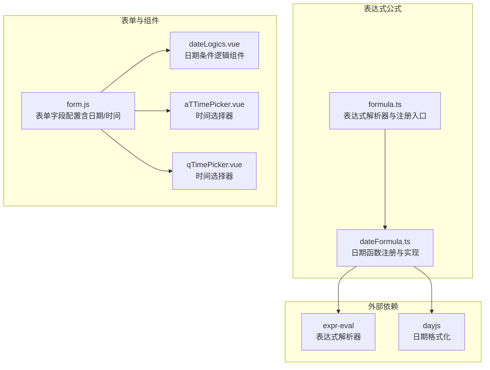
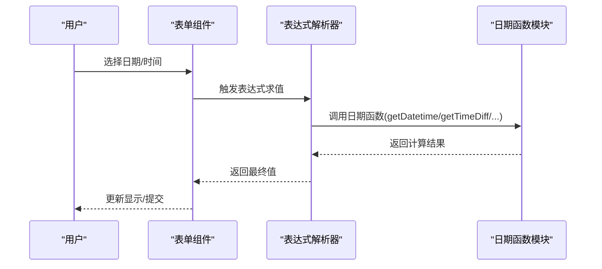
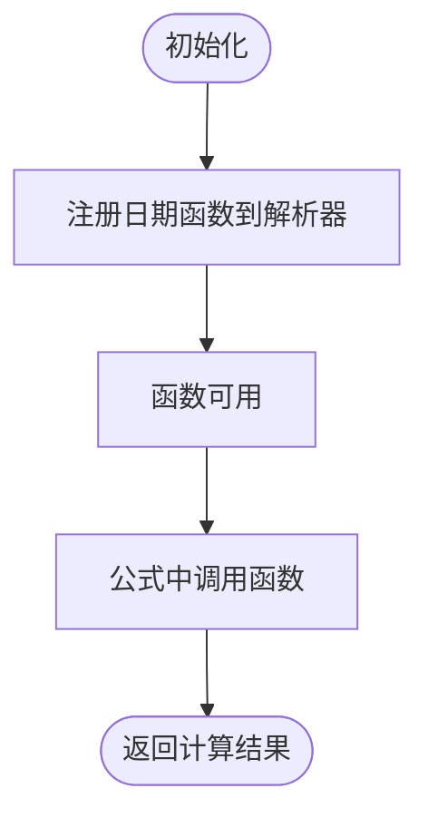
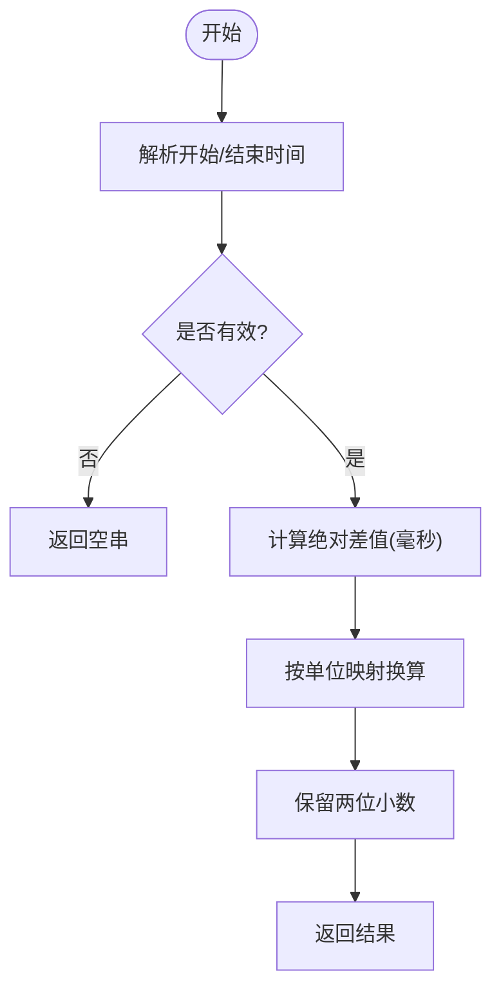
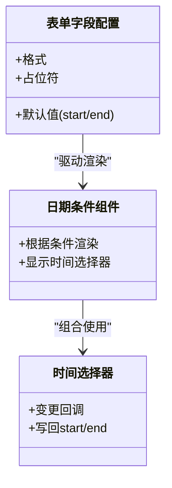
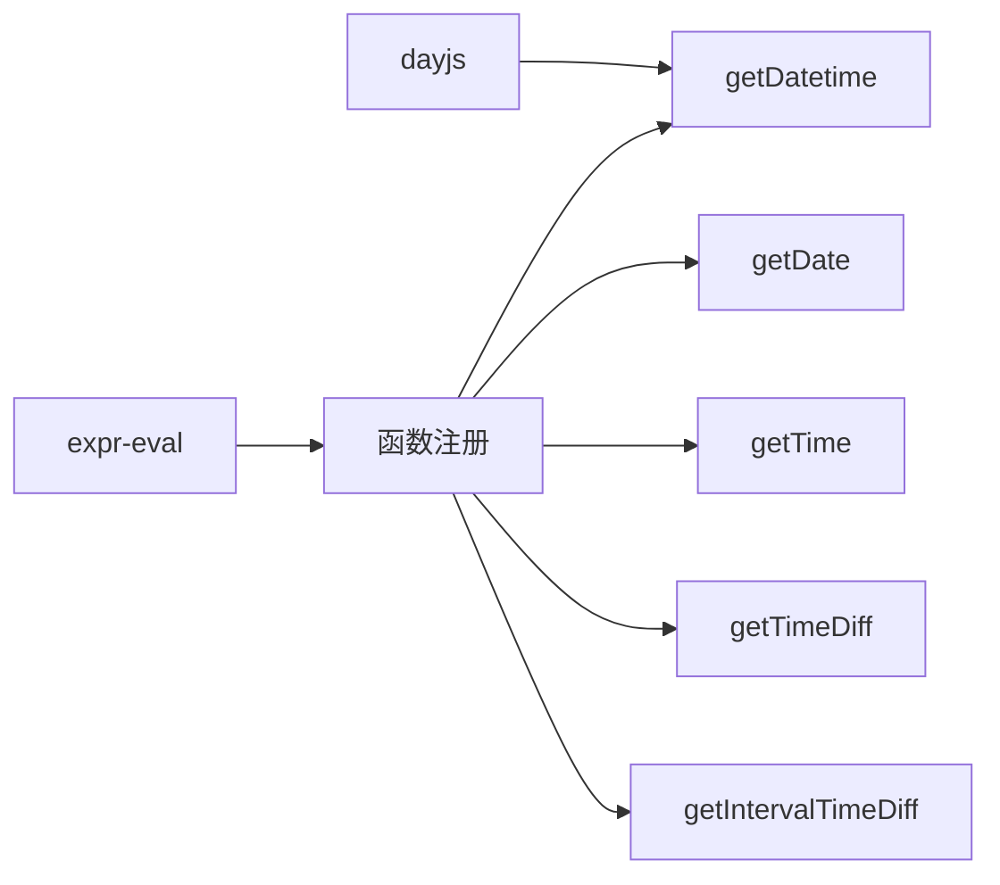

# 日期时间公式

<cite>
**本文引用的文件**
- [dateFormula.ts](file://src/components/expression/formula/dateFormula.ts)
- [formula.ts](file://src/components/expression/formula.ts)
- [form.js](file://src/data/form.js)
- [dateLogics.vue](file://src/components/formLogics/dateLogics.vue)
- [aTTimePicker.vue](file://src/components/showItem/aTTimePicker.vue)
- [qTimePicker.vue](file://src/components/showItem/qTimePicker.vue)
- [package.json](file://package.json)
- [form.ts](file://src/utils/form.ts)
</cite>

## 目录
1. [简介](#简介)
2. [项目结构](#项目结构)
3. [核心组件](#核心组件)
4. [架构总览](#架构总览)
5. [详细组件分析](#详细组件分析)
6. [依赖关系分析](#依赖关系分析)
7. [性能考量](#性能考量)
8. [故障排查指南](#故障排查指南)
9. [结论](#结论)
10. [附录](#附录)

## 简介
本文件系统性梳理并说明表达式引擎中的日期时间公式模块，重点覆盖以下方面：
- 日期计算：当前日期时间获取、日期格式化、时间差计算、区间时间差计算
- 时间单位换算：毫秒、秒、分钟、小时、天、周、月、年
- 输入输出格式：字符串与Date对象兼容、ISO/本地格式解析
- 错误处理：无效日期输入的容错策略
- 集成方式：表达式解析器注册、表单字段联动、范围选择器交互
- 国际化与跨时区建议：基于浏览器本地时区的现状与最佳实践

## 项目结构
日期时间公式位于表达式公式子模块中，通过统一的表达式解析器进行注册与调用；同时与表单配置、范围选择器组件协同工作。

**图表来源**
- [formula.ts:15-24](file://src/components/expression/formula.ts#L15-L24)
- [dateFormula.ts:13-179](file://src/components/expression/formula/dateFormula.ts#L13-L179)
- [form.js:1431-1537](file://src/data/form.js#L1431-L1537)
- [dateLogics.vue:1-45](file://src/components/formLogics/dateLogics.vue#L1-L45)
- [aTTimePicker.vue:1-48](file://src/components/showItem/aTTimePicker.vue#L1-L48)
- [qTimePicker.vue:1-49](file://src/components/showItem/qTimePicker.vue#L1-L49)

**章节来源**
- [formula.ts:15-24](file://src/components/expression/formula.ts#L15-L24)
- [dateFormula.ts:13-179](file://src/components/expression/formula/dateFormula.ts#L13-L179)
- [form.js:1431-1537](file://src/data/form.js#L1431-L1537)

## 核心组件
- 表达式解析器注册：在初始化阶段将日期函数注册到解析器命名空间，供公式文本直接调用。
- 日期函数集合：提供当前日期时间、当前日期、当前时间、时间差、区间时间差等函数。
- 输入规范化：统一将字符串与Date对象转换为可比较的Date实例，并对无效输入返回空串。
- 单位换算：内置毫秒到年的时间单位映射，用于不同粒度的时间差计算。

**章节来源**
- [formula.ts:15-24](file://src/components/expression/formula.ts#L15-L24)
- [dateFormula.ts:13-179](file://src/components/expression/formula/dateFormula.ts#L13-L179)

## 架构总览
表达式引擎在启动时完成函数注册，表单字段在渲染时根据配置决定展示日期/时间选择器，并在用户输入或联动触发时，通过表达式计算更新目标字段值。

**图表来源**
- [formula.ts:84-95](file://src/components/expression/formula.ts#L84-L95)
- [dateFormula.ts:150-156](file://src/components/expression/formula/dateFormula.ts#L150-L156)

## 详细组件分析

### 日期函数注册与导出
- 注册点：在表达式解析器初始化时，将日期函数批量注册到解析器函数命名空间。
- 导出结构：导出函数集合与函数描述树，便于表达式面板展示与帮助说明。

**图表来源**
- [formula.ts:17-24](file://src/components/expression/formula.ts#L17-L24)
- [dateFormula.ts:150-156](file://src/components/expression/formula/dateFormula.ts#L150-L156)

**章节来源**
- [formula.ts:17-24](file://src/components/expression/formula.ts#L17-L24)
- [dateFormula.ts:73-148](file://src/components/expression/formula/dateFormula.ts#L73-L148)

### 当前日期时间获取
- 函数：获取当前日期时间，默认格式为“年-月-日 时:分:秒”，支持传入自定义格式。
- 实现要点：内部使用日期格式化库进行格式化，格式占位符做兼容替换。
- 输出：字符串格式的当前时间。

**章节来源**
- [dateFormula.ts:13-17](file://src/components/expression/formula/dateFormula.ts#L13-L17)

### 当前日期与当前时间
- 函数：分别返回“年-月-日”和“时:分:秒”的字符串。
- 实现要点：基于浏览器本地时间，自动补零到两位。
- 输出：字符串格式的日期或时间。

**章节来源**
- [dateFormula.ts:19-33](file://src/components/expression/formula/dateFormula.ts#L19-L33)

### 时间差计算
- 函数：计算两个时间点之间的差值，支持单位为毫秒、秒、分钟、小时、天、周、月、年。
- 输入规范：支持Date对象与常见字符串格式（含ISO），内部统一转换为Date对象。
- 计算逻辑：取绝对值差，按单位映射换算，保留两位小数。
- 输出：数值型时间差；若任一输入无效则返回空串。

**图表来源**
- [dateFormula.ts:47-59](file://src/components/expression/formula/dateFormula.ts#L47-L59)
- [dateFormula.ts:35-45](file://src/components/expression/formula/dateFormula.ts#L35-L45)

**章节来源**
- [dateFormula.ts:47-59](file://src/components/expression/formula/dateFormula.ts#L47-L59)
- [dateFormula.ts:35-45](file://src/components/expression/formula/dateFormula.ts#L35-L45)

### 区间时间差计算
- 函数：接收一个包含开始/结束时间的对象或JSON字符串，内部解析后复用时间差计算逻辑。
- 输入规范：支持字符串形式的区间对象，自动JSON解析。
- 输出：数值型时间差；若输入为空或解析失败返回空串。

**章节来源**
- [dateFormula.ts:61-71](file://src/components/expression/formula/dateFormula.ts#L61-L71)

### 输入规范化与错误处理
- 统一转换：将Date对象与字符串转换为Date实例，避免直接操作原始值。
- 字符串兼容：兼容常见日期字符串与ISO格式，去除T与Z字符以适配本地解析。
- 有效性校验：NaN即视为无效，返回空串；不抛异常，保证表达式执行稳定性。

**章节来源**
- [dateFormula.ts:158-179](file://src/components/expression/formula/dateFormula.ts#L158-L179)

### 表单字段与组件集成
- 表单配置：日期范围、时间等字段在表单配置中声明格式与默认值，支持“开始/结束”键结构。
- 条件逻辑：日期条件组件根据条件类型动态渲染日期选择器或范围选择器。
- 选择器组件：时间选择器在用户变更时写回默认值或value结构，供表达式读取。

**图表来源**
- [form.js:1431-1537](file://src/data/form.js#L1431-L1537)
- [dateLogics.vue:1-45](file://src/components/formLogics/dateLogics.vue#L1-L45)
- [aTTimePicker.vue:1-48](file://src/components/showItem/aTTimePicker.vue#L1-L48)
- [qTimePicker.vue:1-49](file://src/components/showItem/qTimePicker.vue#L1-L49)

**章节来源**
- [form.js:1431-1537](file://src/data/form.js#L1431-L1537)
- [dateLogics.vue:1-45](file://src/components/formLogics/dateLogics.vue#L1-L45)
- [aTTimePicker.vue:1-48](file://src/components/showItem/aTTimePicker.vue#L1-L48)
- [qTimePicker.vue:1-49](file://src/components/showItem/qTimePicker.vue#L1-L49)

## 依赖关系分析
- 表达式解析器：负责解析公式文本并调用已注册函数。
- 日期格式化库：用于格式化当前时间与自定义格式。
- 日期函数模块：提供具体日期时间计算能力，并向解析器注册。

**图表来源**
- [formula.ts:15-24](file://src/components/expression/formula.ts#L15-L24)
- [dateFormula.ts:13-179](file://src/components/expression/formula/dateFormula.ts#L13-L179)
- [package.json:30](file://package.json#L30)
- [package.json:26](file://package.json#L26)

**章节来源**
- [formula.ts:15-24](file://src/components/expression/formula.ts#L15-L24)
- [dateFormula.ts:13-179](file://src/components/expression/formula/dateFormula.ts#L13-L179)
- [package.json:30](file://package.json#L30)
- [package.json:26](file://package.json#L26)

## 性能考量
- 解析与格式化：当前实现使用字符串替换与格式化库，开销较低，适合表单场景。
- 单位换算：采用常量映射，时间复杂度为O(1)，性能稳定。
- 建议：在大量计算或高频更新场景下，可考虑缓存中间结果或减少不必要的重复解析。

## 故障排查指南
- 表达式报错：检查公式语法与函数名拼写，确认已在初始化阶段完成注册。
- 日期无效：确认输入为Date对象或符合解析的字符串格式；避免传入非标准格式导致解析失败。
- 结果为空串：当输入无效或解析失败时会返回空串，需在业务侧进行兜底处理。
- 表单联动：确认字段配置的格式与默认值结构正确，确保选择器组件能正确写回start/end。

**章节来源**
- [formula.ts:84-95](file://src/components/expression/formula.ts#L84-L95)
- [dateFormula.ts:158-179](file://src/components/expression/formula/dateFormula.ts#L158-L179)

## 结论
该日期时间公式模块提供了简洁而实用的日期计算能力，通过表达式解析器无缝集成到表单体系中。其设计强调易用性与稳定性，对常见输入具备良好兼容性。在需要更复杂的时区与时令处理时，建议结合外部库或在上层业务层进行二次封装。

## 附录

### 函数清单与说明
- getDatetime(format?)：获取当前日期时间，支持自定义格式。
- getDate()：获取当前日期（年-月-日）。
- getTime()：获取当前时间（时:分:秒）。
- getTimeDiff(startDate, endDate, unit)：计算两时间点差值，unit可选毫秒、秒、分钟、小时、天、周、月、年。
- getIntervalTimeDiff(intervalDate, unit)：计算区间(start/end)的差值，支持字符串JSON输入。

**章节来源**
- [dateFormula.ts:73-148](file://src/components/expression/formula/dateFormula.ts#L73-L148)

### 输入输出格式对照
- 输入格式
  - Date对象：直接使用
  - 字符串：支持“年-月-日 时:分:秒”、“年-月-日”等常见格式，内部兼容ISO格式
- 输出格式
  - 日期时间：字符串，遵循格式参数
  - 日期：字符串“年-月-日”
  - 时间：字符串“时:分:秒”
  - 时间差：数值（保留两位小数）

**章节来源**
- [dateFormula.ts:13-17](file://src/components/expression/formula/dateFormula.ts#L13-L17)
- [dateFormula.ts:19-33](file://src/components/expression/formula/dateFormula.ts#L19-L33)
- [dateFormula.ts:47-59](file://src/components/expression/formula/dateFormula.ts#L47-L59)
- [dateFormula.ts:61-71](file://src/components/expression/formula/dateFormula.ts#L61-L71)

### 国际化与跨时区最佳实践
- 浏览器本地时区：当前实现基于浏览器本地时间，不涉及显式时区转换。
- 建议：
  - 若需严格时区控制，应在上层业务或服务端进行时区转换后再传入表达式。
  - 对于展示，建议在前端统一转换为用户期望的时区与本地格式。
  - 对于法定节假日与工作日计算，建议引入专门的日历库并在业务层维护节假日列表。