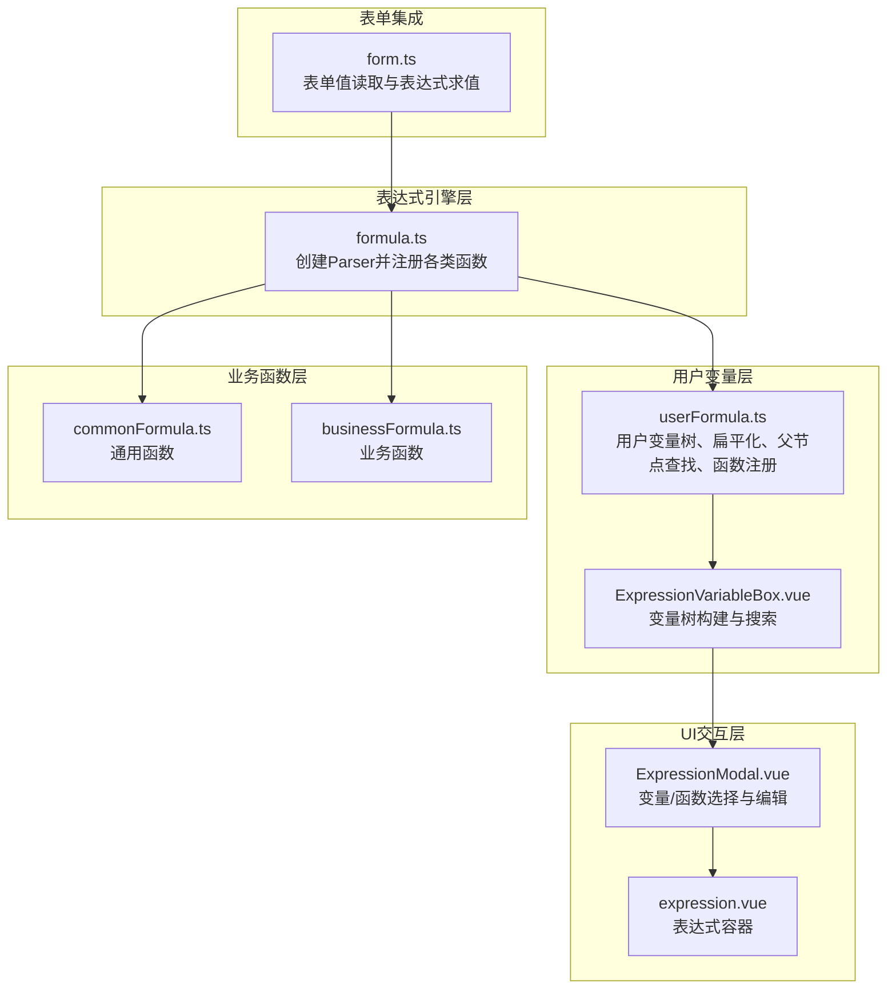
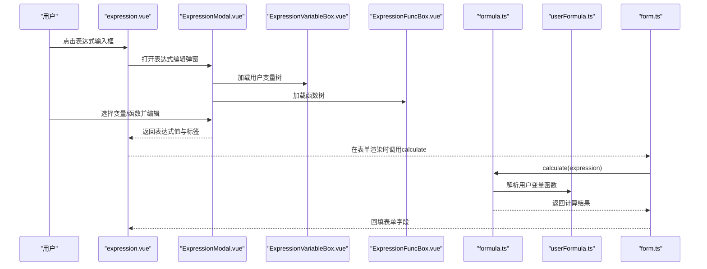
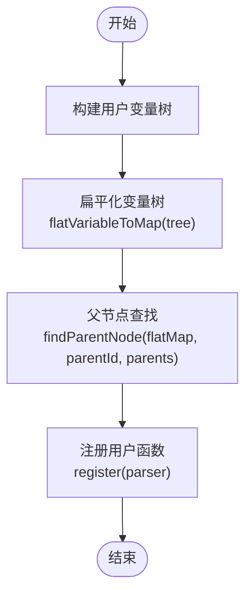
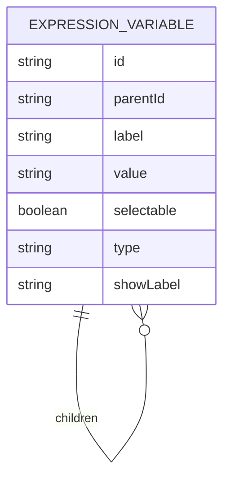
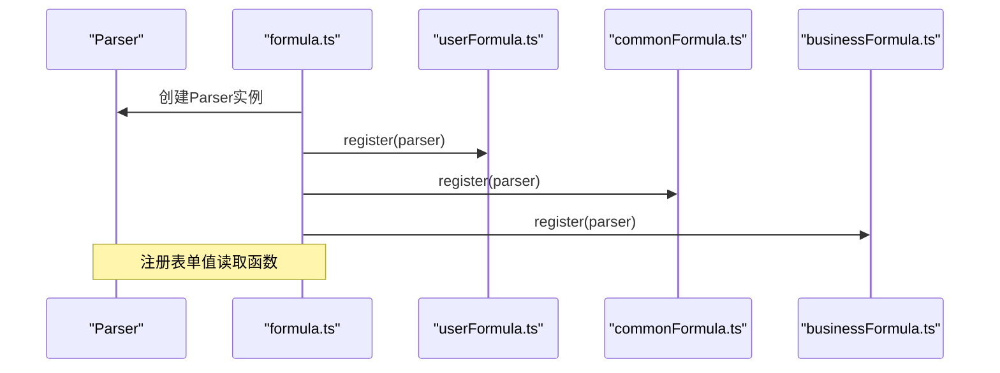
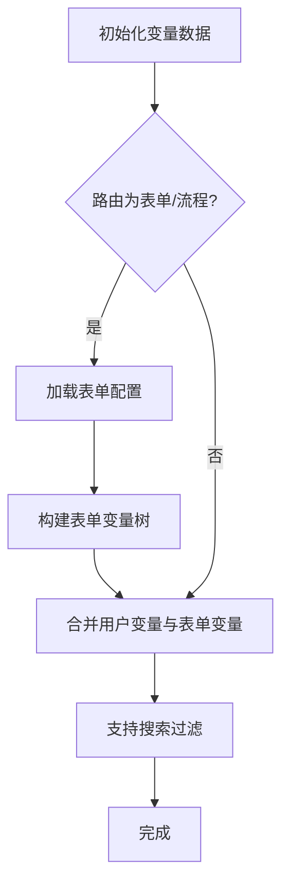
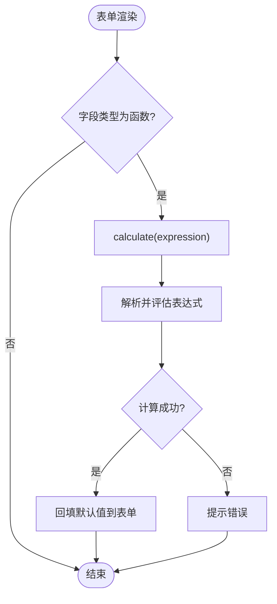
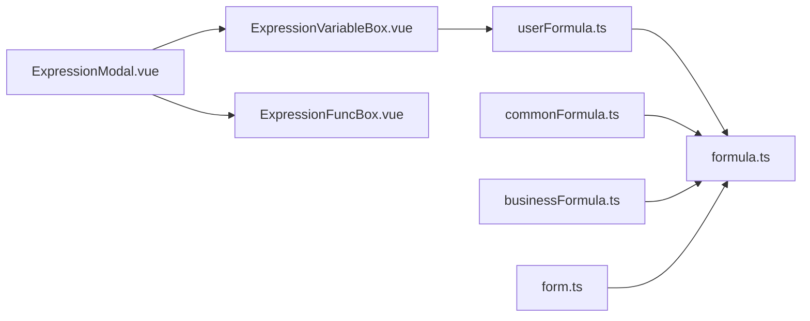

# 用户自定义公式

<cite>
**本文档引用的文件**
- [userFormula.ts](file://src/components/expression/formula/userFormula.ts)
- [formula.ts](file://src/components/expression/formula.ts)
- [expression.vue](file://src/components/expression/expression.vue)
- [ExpressionVariableBox.vue](file://src/components/expression/components/ExpressionVariableBox.vue)
- [ExpressionModal.vue](file://src/components/expression/components/ExpressionModal.vue)
- [ExpressionFuncBox.vue](file://src/components/expression/components/ExpressionFuncBox.vue)
- [commonFormula.ts](file://src/components/expression/formula/commonFormula.ts)
- [businessFormula.ts](file://src/components/expression/formula/businessFormula.ts)
- [form.ts](file://src/utils/form.ts)
</cite>

## 目录
1. [简介](#简介)
2. [项目结构](#项目结构)
3. [核心组件](#核心组件)
4. [架构总览](#架构总览)
5. [详细组件分析](#详细组件分析)
6. [依赖关系分析](#依赖关系分析)
7. [性能考虑](#性能考虑)
8. [故障排除指南](#故障排除指南)
9. [结论](#结论)
10. [附录](#附录)

## 简介
本文件面向需要开发和使用用户自定义公式的开发者与业务人员，系统性阐述用户变量处理机制（父节点查找、变量扁平化、用户变量注册）、用户自定义函数的开发流程（函数定义、参数传递、返回值处理、错误处理），以及作用域管理、命名规范、调试方法与复杂业务场景的最佳实践。内容基于仓库中的表达式引擎与用户变量体系，确保读者能够快速上手并安全扩展。

## 项目结构
表达式与用户变量相关的核心模块分布如下：
- 表达式引擎与函数注册：formula.ts
- 用户变量与函数实现：userFormula.ts
- 变量选择器与表单变量构建：ExpressionVariableBox.vue
- 函数选择器：ExpressionFuncBox.vue
- 表达式编辑弹窗：ExpressionModal.vue
- 表达式容器组件：expression.vue
- 表单工具函数：form.ts

图表来源
- [formula.ts:1-96](file://src/components/expression/formula.ts#L1-L96)
- [userFormula.ts:1-411](file://src/components/expression/formula/userFormula.ts#L1-L411)
- [ExpressionVariableBox.vue:1-171](file://src/components/expression/components/ExpressionVariableBox.vue#L1-L171)
- [ExpressionModal.vue:1-298](file://src/components/expression/components/ExpressionModal.vue#L1-L298)
- [expression.vue:1-131](file://src/components/expression/expression.vue#L1-L131)
- [commonFormula.ts:1-136](file://src/components/expression/formula/commonFormula.ts#L1-L136)
- [businessFormula.ts:1-52](file://src/components/expression/formula/businessFormula.ts#L1-L52)
- [form.ts:1-800](file://src/utils/form.ts#L1-L800)

章节来源
- [formula.ts:1-96](file://src/components/expression/formula.ts#L1-L96)
- [userFormula.ts:1-411](file://src/components/expression/formula/userFormula.ts#L1-L411)

## 核心组件
- 表达式引擎与函数注册：负责创建表达式解析器并统一注册各类函数（用户变量函数、日期、随机、通用、字符串、数组、金钱、业务函数）。
- 用户变量与函数：提供“当前用户”及其角色、部门、职位等变量树，并通过扁平化与父节点查找支持变量层级导航；同时注册用户相关函数到解析器。
- 变量选择器：动态构建变量树（含表单字段变量），支持搜索与父子联动。
- 函数选择器：聚合通用与业务函数，支持搜索与预览帮助信息。
- 表达式编辑弹窗：提供可视化编辑界面，支持变量占位符标记与函数插入。
- 表达式容器：作为表单控件承载表达式值与标签，触发弹窗进行编辑。
- 表单集成：在表单渲染时计算表达式值并回填到表单字段。

章节来源
- [formula.ts:1-96](file://src/components/expression/formula.ts#L1-L96)
- [userFormula.ts:1-411](file://src/components/expression/formula/userFormula.ts#L1-L411)
- [ExpressionVariableBox.vue:1-171](file://src/components/expression/components/ExpressionVariableBox.vue#L1-L171)
- [ExpressionFuncBox.vue:1-108](file://src/components/expression/components/ExpressionFuncBox.vue#L1-L108)
- [ExpressionModal.vue:1-298](file://src/components/expression/components/ExpressionModal.vue#L1-L298)
- [expression.vue:1-131](file://src/components/expression/expression.vue#L1-L131)
- [form.ts:723-733](file://src/utils/form.ts#L723-L733)

## 架构总览
表达式系统采用“函数注册 + 变量树 + UI编辑 + 表单求值”的分层架构。用户变量树由用户变量模块提供，变量选择器将其与表单变量合并构建完整变量树；函数选择器提供通用与业务函数；表达式编辑弹窗负责可视化拼装；最终通过表达式引擎求值并在表单中应用。

图表来源
- [expression.vue:86-102](file://src/components/expression/expression.vue#L86-L102)
- [ExpressionModal.vue:57-187](file://src/components/expression/components/ExpressionModal.vue#L57-L187)
- [ExpressionVariableBox.vue:50-98](file://src/components/expression/components/ExpressionVariableBox.vue#L50-L98)
- [ExpressionFuncBox.vue:53-61](file://src/components/expression/components/ExpressionFuncBox.vue#L53-L61)
- [formula.ts:84-95](file://src/components/expression/formula.ts#L84-L95)
- [userFormula.ts:401-410](file://src/components/expression/formula/userFormula.ts#L401-L410)
- [form.ts:723-733](file://src/utils/form.ts#L723-L733)

## 详细组件分析

### 用户变量处理机制
用户变量处理机制围绕用户变量树展开，包含以下关键能力：
- 用户变量树：以“当前用户”为根节点，下设用户属性、角色、部门、主要部门、兼任部门、职位、主要职位、兼任职位等分支。
- 扁平化：将嵌套的变量树转换为以id为键的Map，便于快速定位与遍历。
- 父节点查找：从任意节点向上递归查找父节点链，用于生成变量路径标签。
- 用户变量注册：将用户相关函数注册到表达式解析器，使公式可直接调用。

图表来源
- [userFormula.ts:114-371](file://src/components/expression/formula/userFormula.ts#L114-L371)
- [userFormula.ts:373-386](file://src/components/expression/formula/userFormula.ts#L373-L386)
- [userFormula.ts:388-399](file://src/components/expression/formula/userFormula.ts#L388-L399)
- [userFormula.ts:401-410](file://src/components/expression/formula/userFormula.ts#L401-L410)

章节来源
- [userFormula.ts:114-371](file://src/components/expression/formula/userFormula.ts#L114-L371)
- [userFormula.ts:373-399](file://src/components/expression/formula/userFormula.ts#L373-L399)
- [userFormula.ts:401-410](file://src/components/expression/formula/userFormula.ts#L401-L410)

### 用户变量树结构与数据模型
用户变量树采用统一的数据模型，包含标识、父标识、显示标签、值（可为表达式）、类型、是否可选、子节点等字段。该模型既支持变量节点，也支持函数节点，便于统一处理。

图表来源
- [userFormula.ts:9-18](file://src/components/expression/formula/userFormula.ts#L9-L18)
- [formula.ts:65-73](file://src/components/expression/formula.ts#L65-L73)

章节来源
- [userFormula.ts:9-18](file://src/components/expression/formula/userFormula.ts#L9-L18)
- [formula.ts:65-73](file://src/components/expression/formula.ts#L65-L73)

### 表达式引擎与函数注册
表达式引擎使用第三方解析库创建Parser实例，并将用户变量函数、日期函数、随机函数、通用函数、字符串函数、数组函数、金钱函数、业务函数逐一注册到解析器的functions命名空间。此外，还提供表单值与子表单值读取函数，供变量表达式使用。

图表来源
- [formula.ts:15-24](file://src/components/expression/formula.ts#L15-L24)
- [formula.ts:27-63](file://src/components/expression/formula.ts#L27-L63)
- [userFormula.ts:401-410](file://src/components/expression/formula/userFormula.ts#L401-L410)
- [commonFormula.ts:129-135](file://src/components/expression/formula/commonFormula.ts#L129-L135)
- [businessFormula.ts:49-51](file://src/components/expression/formula/businessFormula.ts#L49-L51)

章节来源
- [formula.ts:1-96](file://src/components/expression/formula.ts#L1-L96)

### 变量选择器与表单变量构建
变量选择器在表单设计页面动态构建变量树，将“当前用户”变量与表单字段变量合并，形成完整的变量集合。表单变量通过表单ID与字段ID拼接成表达式，实现对表单值的引用。

图表来源
- [ExpressionVariableBox.vue:50-98](file://src/components/expression/components/ExpressionVariableBox.vue#L50-L98)
- [ExpressionVariableBox.vue:125-145](file://src/components/expression/components/ExpressionVariableBox.vue#L125-L145)

章节来源
- [ExpressionVariableBox.vue:1-171](file://src/components/expression/components/ExpressionVariableBox.vue#L1-L171)
- [form.ts:1-800](file://src/utils/form.ts#L1-L800)

### 表达式编辑弹窗与可视化
表达式编辑弹窗提供三栏布局：左侧变量列表、中间函数列表、右侧编辑区。用户可将变量占位符插入编辑区，并自动高亮显示变量标签；函数可直接插入模板表达式。保存后将表达式值与标签回传给表达式容器。

```mermaid
sequenceDiagram
participant U as "用户"
participant EM as "ExpressionModal.vue"
participant EVB as "ExpressionVariableBox.vue"
participant EF as "ExpressionFuncBox.vue"
U->>EM : 打开弹窗
EM->>EVB : 加载变量树
EM->>EF : 加载函数树
U->>EM : 选择变量/函数
EM->>EM : 插入占位符/模板
U->>EM : 确认保存
EM-->>U : 返回表达式值与标签
```

图表来源
- [ExpressionModal.vue:11-33](file://src/components/expression/components/ExpressionModal.vue#L11-L33)
- [ExpressionModal.vue:115-139](file://src/components/expression/components/ExpressionModal.vue#L115-L139)
- [ExpressionVariableBox.vue:107-123](file://src/components/expression/components/ExpressionVariableBox.vue#L107-L123)
- [ExpressionFuncBox.vue:69-79](file://src/components/expression/components/ExpressionFuncBox.vue#L69-L79)

章节来源
- [ExpressionModal.vue:1-298](file://src/components/expression/components/ExpressionModal.vue#L1-L298)
- [ExpressionVariableBox.vue:1-171](file://src/components/expression/components/ExpressionVariableBox.vue#L1-L171)
- [ExpressionFuncBox.vue:1-108](file://src/components/expression/components/ExpressionFuncBox.vue#L1-L108)

### 表达式求值与回填
表单渲染阶段，当字段类型为“函数”时，系统调用表达式求值函数计算默认值，并将结果回填到表单字段。求值过程会去除特殊占位符，解析并评估表达式，异常时给出提示。

图表来源
- [form.ts:723-733](file://src/utils/form.ts#L723-L733)
- [formula.ts:84-95](file://src/components/expression/formula.ts#L84-L95)

章节来源
- [form.ts:723-733](file://src/utils/form.ts#L723-L733)
- [formula.ts:84-95](file://src/components/expression/formula.ts#L84-L95)

## 依赖关系分析
- 表达式引擎依赖于用户变量模块与各功能函数模块，统一注册到Parser。
- 变量选择器依赖用户变量树与表单工具函数，动态构建变量树。
- 表达式编辑弹窗依赖变量选择器与函数选择器，提供可视化编辑体验。
- 表单集成依赖表达式引擎，实现表达式求值与回填。

图表来源
- [formula.ts:5-24](file://src/components/expression/formula.ts#L5-L24)
- [userFormula.ts:1-411](file://src/components/expression/formula/userFormula.ts#L1-L411)
- [commonFormula.ts:1-136](file://src/components/expression/formula/commonFormula.ts#L1-L136)
- [businessFormula.ts:1-52](file://src/components/expression/formula/businessFormula.ts#L1-L52)
- [ExpressionVariableBox.vue:1-171](file://src/components/expression/components/ExpressionVariableBox.vue#L1-L171)
- [ExpressionModal.vue:1-298](file://src/components/expression/components/ExpressionModal.vue#L1-L298)
- [ExpressionFuncBox.vue:1-108](file://src/components/expression/components/ExpressionFuncBox.vue#L1-L108)
- [form.ts:1-800](file://src/utils/form.ts#L1-L800)

章节来源
- [formula.ts:1-96](file://src/components/expression/formula.ts#L1-L96)

## 性能考虑
- 变量树扁平化：通过Map存储变量节点，避免深度遍历带来的重复查询成本。
- 异步函数：用户变量与业务函数多为异步，注意在表达式求值时等待Promise解析，避免阻塞UI线程。
- 搜索优化：变量与函数树的搜索采用递归过滤，建议在大数据量时限制展示范围或增加索引。
- 表达式求值：表达式解析与评估应尽量避免复杂嵌套，减少计算时间。

## 故障排除指南
- 表达式解析错误：当表达式语法错误或变量未找到时，求值函数会捕获异常并提示错误信息。检查表达式语法、变量占位符是否正确、函数是否已注册。
- 变量不可用：确认变量已在变量树中存在且类型为variable；检查扁平化与父节点查找逻辑是否正确。
- 函数未识别：确认函数已在对应模块中定义并注册到Parser；检查函数名与调用方式是否一致。
- 表单值读取失败：确认表单ID与字段ID正确，且表单配置已加载；检查表单值读取函数的实现。

章节来源
- [formula.ts:84-95](file://src/components/expression/formula.ts#L84-L95)
- [ExpressionVariableBox.vue:147-162](file://src/components/expression/components/ExpressionVariableBox.vue#L147-L162)

## 结论
用户自定义公式体系通过清晰的分层架构与完善的工具链，实现了从变量构建、函数注册、可视化编辑到表达式求值与回填的完整闭环。遵循本文档的作用域管理、命名规范与调试方法，可高效开发并维护复杂的业务公式。

## 附录

### 用户自定义函数开发流程
- 函数定义：在对应模块中定义函数，支持同步与异步两种形式。异步函数需等待Promise解析后再返回结果。
- 参数传递：函数参数可为字面量或变量表达式；在函数内部对参数进行await解析，确保值的正确性。
- 返回值处理：返回值应为表达式引擎可识别的类型；如需字符串拼接，确保输出格式符合预期。
- 错误处理：在函数内部进行必要的校验与异常捕获，避免抛出未处理异常影响表达式求值。
- 函数注册：将函数注册到Parser的functions命名空间，确保表达式可调用。

章节来源
- [commonFormula.ts:12-52](file://src/components/expression/formula/commonFormula.ts#L12-L52)
- [businessFormula.ts:12-25](file://src/components/expression/formula/businessFormula.ts#L12-L25)
- [formula.ts:15-24](file://src/components/expression/formula.ts#L15-L24)

### 用户变量的作用域管理与命名规范
- 作用域管理：用户变量树以“当前用户”为根，按属性、角色、部门、职位等维度组织；变量值为表达式字符串，可在表达式中被引用。
- 命名规范：变量id建议采用层级编码规则，便于父节点查找与路径生成；变量label用于显示，showLabel用于组合路径标签。
- 父节点查找：通过扁平化Map与递归查找实现，确保路径标签的准确性。
- 变量注册：将用户变量函数注册到解析器，使表达式可直接调用用户相关函数。

章节来源
- [userFormula.ts:114-371](file://src/components/expression/formula/userFormula.ts#L114-L371)
- [userFormula.ts:373-399](file://src/components/expression/formula/userFormula.ts#L373-L399)
- [userFormula.ts:401-410](file://src/components/expression/formula/userFormula.ts#L401-L410)

### 调试方法
- 表达式编辑：在表达式编辑弹窗中插入变量占位符与函数模板，实时查看高亮效果与标签提示。
- 控制台日志：在函数内部添加日志输出，观察参数与返回值；在表达式求值处捕获异常并记录错误信息。
- 单元测试：为关键函数编写单元测试，覆盖正常与异常场景，确保函数稳定性。
- 表单验证：在表单渲染阶段验证表达式求值结果，确保默认值正确回填。

章节来源
- [ExpressionModal.vue:141-168](file://src/components/expression/components/ExpressionModal.vue#L141-L168)
- [formula.ts:84-95](file://src/components/expression/formula.ts#L84-L95)

### 复杂业务场景下的自定义函数开发案例与最佳实践
- 场景一：跨表单字段联动计算
  - 实现思路：在变量表达式中引用其他表单字段值，结合通用函数进行条件判断与数值运算。
  - 最佳实践：确保字段ID正确、值类型一致；对空值进行判空处理。
- 场景二：部门负责人信息提取
  - 实现思路：使用业务函数获取部门负责人信息，支持按属性（id、username、nickname）返回。
  - 最佳实践：对返回值进行逗号分隔处理，适配多负责人场景。
- 场景三：异步数据处理
  - 实现思路：函数内部发起API请求，解析响应后返回所需值；注意异步等待与错误处理。
  - 最佳实践：在函数外层进行异常捕获，避免影响表达式整体求值。

章节来源
- [businessFormula.ts:12-25](file://src/components/expression/formula/businessFormula.ts#L12-L25)
- [commonFormula.ts:12-52](file://src/components/expression/formula/commonFormula.ts#L12-L52)
- [ExpressionVariableBox.vue:70-98](file://src/components/expression/components/ExpressionVariableBox.vue#L70-L98)