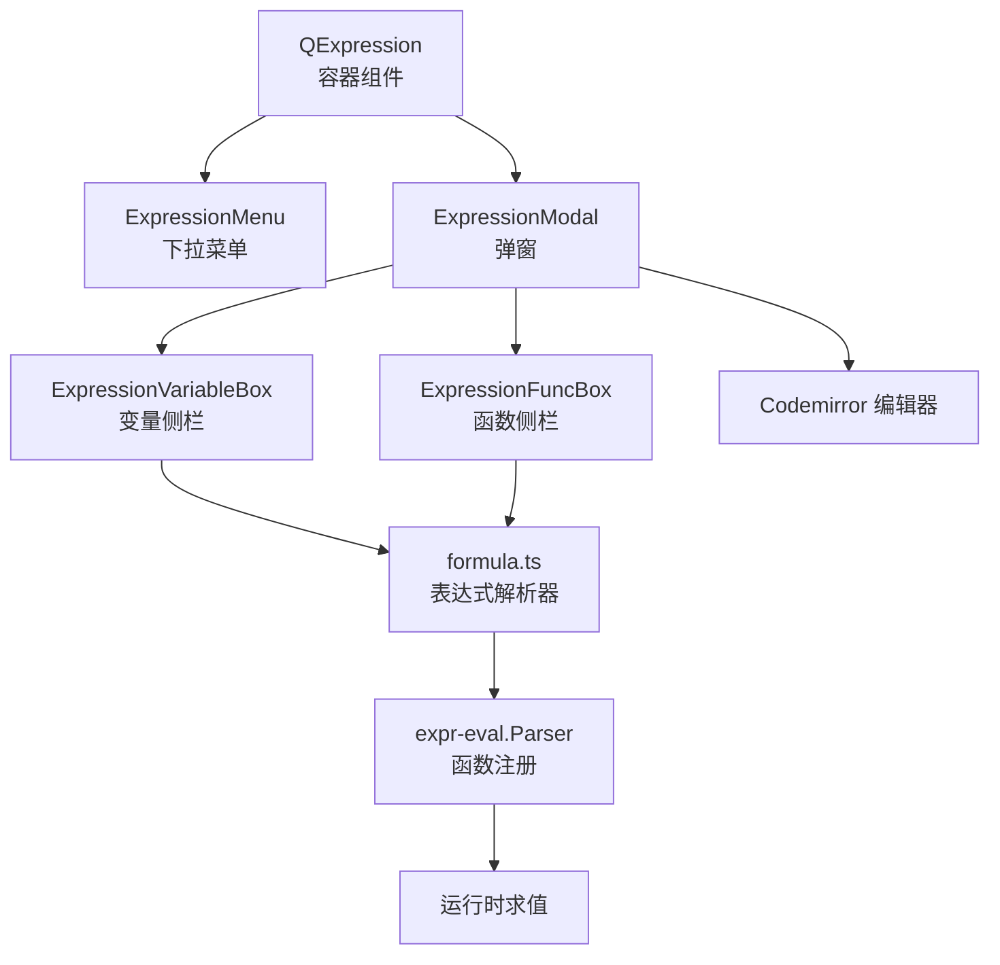
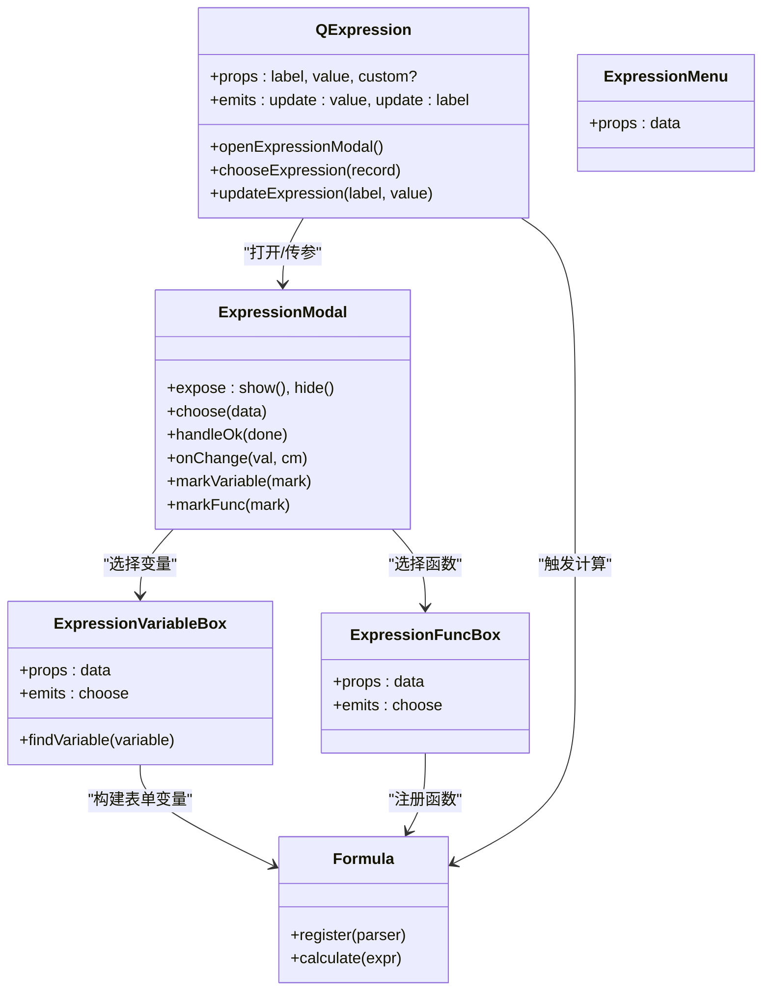
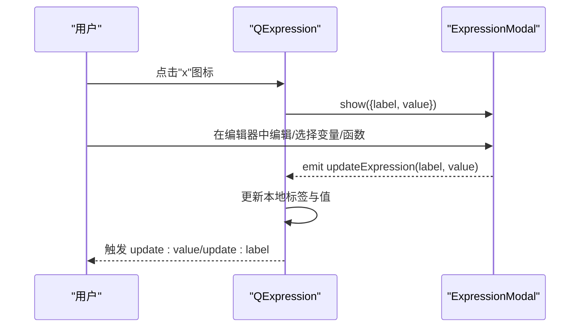
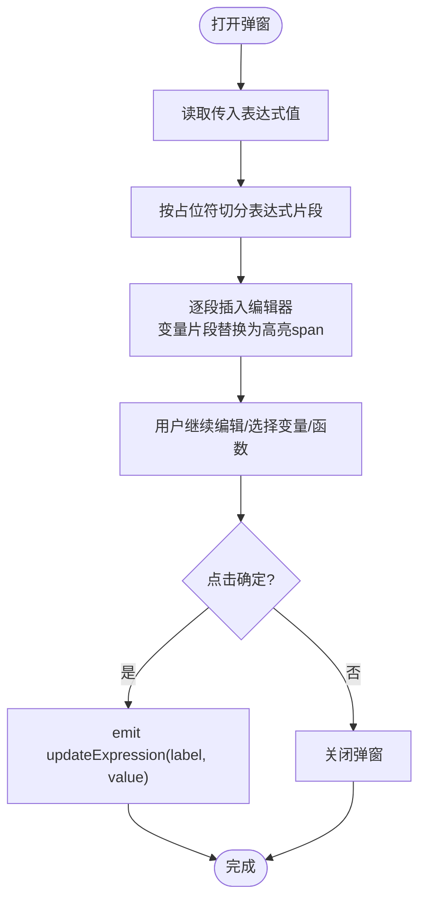
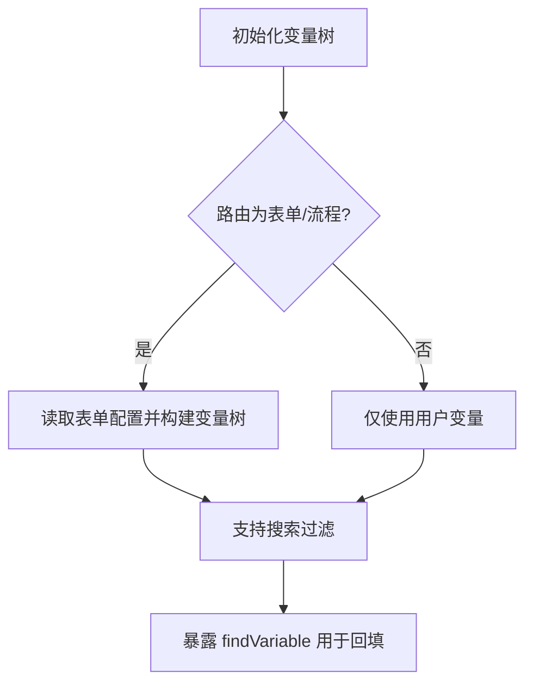
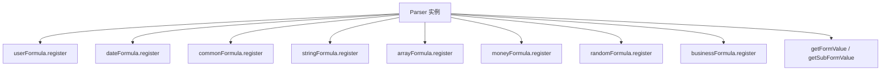
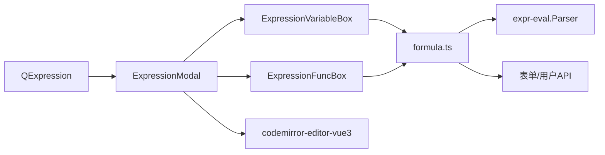

# 表达式引擎核心

<cite>
**本文引用的文件**   
- [expression.vue](file://src/components/expression/expression.vue)
- [expressionMenu.ts](file://src/components/expression/expressionMenu.ts)
- [formula.ts](file://src/components/expression/formula.ts)
- [ExpressionModal.vue](file://src/components/expression/components/ExpressionModal.vue)
- [ExpressionMenu.vue](file://src/components/expression/components/ExpressionMenu.vue)
- [ExpressionFuncBox.vue](file://src/components/expression/components/ExpressionFuncBox.vue)
- [ExpressionVariableBox.vue](file://src/components/expression/components/ExpressionVariableBox.vue)
- [FuncLabel.vue](file://src/components/expression/components/FuncLabel.vue)
- [userFormula.ts](file://src/components/expression/formula/userFormula.ts)
- [dateFormula.ts](file://src/components/expression/formula/dateFormula.ts)
- [commonFormula.ts](file://src/components/expression/formula/commonFormula.ts)
- [arrayFormula.ts](file://src/components/expression/formula/arrayFormula.ts)
- [stringFormula.ts](file://src/components/expression/formula/stringFormula.ts)
- [moneyFormula.ts](file://src/components/expression/formula/moneyFormula.ts)
- [randomFormula.ts](file://src/components/expression/formula/randomFormula.ts)
- [businessFormula.ts](file://src/components/expression/formula/businessFormula.ts)
</cite>

## 目录
1. [简介](#简介)
2. [项目结构](#项目结构)
3. [核心组件](#核心组件)
4. [架构总览](#架构总览)
5. [详细组件分析](#详细组件分析)
6. [依赖关系分析](#依赖关系分析)
7. [性能考量](#性能考量)
8. [故障排查指南](#故障排查指南)
9. [结论](#结论)
10. [附录](#附录)

## 简介
本文件系统性梳理表达式引擎的核心组件与实现，覆盖以下目标：
- 解释表达式组件的整体架构设计，包括 ExpressionModal 弹窗组件、ExpressionMenu 下拉菜单、ExpressionFuncBox 函数盒子、ExpressionVariableBox 变量盒子等核心 UI 组件的功能与交互逻辑。
- 说明表达式组件的属性配置、事件处理机制、数据绑定方式。
- 解释表达式编辑器的工作流程，从打开弹窗到生成最终表达式值的完整过程。
- 提供组件使用示例、自定义配置选项与样式定制方法。

## 项目结构
表达式引擎位于 src/components/expression 目录下，采用“容器组件 + 子组件 + 公式注册”的分层组织方式：
- 容器组件：expression.vue，负责承载标签展示、输入框、下拉菜单与弹窗的协调。
- 弹窗与编辑区：ExpressionModal.vue，内含变量侧栏、函数侧栏与代码编辑器。
- 选择器：ExpressionMenu.vue、ExpressionFuncBox.vue、ExpressionVariableBox.vue、FuncLabel.vue。
- 公式体系：formula.ts 注册各类函数；各功能域公式文件（如 userFormula.ts、dateFormula.ts 等）提供具体函数与数据源。

图表来源
- [expression.vue:1-131](file://src/components/expression/expression.vue#L1-L131)
- [ExpressionModal.vue:1-298](file://src/components/expression/components/ExpressionModal.vue#L1-L298)
- [formula.ts:1-96](file://src/components/expression/formula.ts#L1-L96)

章节来源
- [expression.vue:1-131](file://src/components/expression/expression.vue#L1-L131)
- [formula.ts:1-96](file://src/components/expression/formula.ts#L1-L96)

## 核心组件
- QExpression（expression.vue）
  - 功能：提供“表达式选择 + 输入框 + 标签 + 弹窗”的一体化入口，支持通过下拉菜单快速插入变量或函数，或通过弹窗进行复杂表达式编辑。
  - 关键点：内部维护 label/value 的响应式状态，暴露 update:value 与 update:label 事件；点击“x”图标打开弹窗；下拉菜单选择后直接更新标签与值。
- ExpressionModal（ExpressionModal.vue）
  - 功能：弹窗式表达式编辑器，左侧变量与函数列表，右侧 JavaScript 风格编辑器，支持占位符标记与变量高亮。
  - 关键点：暴露 show/hide 暴露方法；编辑器变更时同步 value；确认时触发 updateExpression 事件。
- ExpressionVariableBox（ExpressionVariableBox.vue）
  - 功能：变量树形选择器，支持搜索；在特定路由场景下动态注入表单字段变量。
  - 关键点：构建表单变量树、子表单变量树；支持搜索过滤；对外暴露 findVariable 以辅助回填。
- ExpressionFuncBox（ExpressionFuncBox.vue）
  - 功能：函数树形选择器，按类别聚合（通用、日期、财务、字符串、数组、随机、业务），支持搜索过滤。
  - 关键点：组合多类函数集合；对外 emit choose 事件。
- ExpressionMenu（ExpressionMenu.vue）
  - 功能：递归渲染的下拉菜单，支持多级嵌套。
  - 关键点：通过 data 属性递归渲染子菜单；支持 hover 展开。
- FuncLabel（FuncLabel.vue）
  - 功能：函数项标题渲染，支持带描述气泡提示。
- 公式注册（formula.ts 与各领域公式文件）
  - 功能：集中注册表达式解析器函数，并提供表单取值与子表单取值能力。
  - 关键点：注册 getFormValue/getSubFormValue；各领域函数通过 register 方法挂载到解析器。

章节来源
- [expression.vue:47-103](file://src/components/expression/expression.vue#L47-L103)
- [ExpressionModal.vue:45-192](file://src/components/expression/components/ExpressionModal.vue#L45-L192)
- [ExpressionVariableBox.vue:38-171](file://src/components/expression/components/ExpressionVariableBox.vue#L38-L171)
- [ExpressionFuncBox.vue:35-108](file://src/components/expression/components/ExpressionFuncBox.vue#L35-L108)
- [ExpressionMenu.vue:22-45](file://src/components/expression/components/ExpressionMenu.vue#L22-L45)
- [FuncLabel.vue:13-51](file://src/components/expression/components/FuncLabel.vue#L13-L51)
- [formula.ts:15-96](file://src/components/expression/formula.ts#L15-L96)

## 架构总览
表达式引擎采用“容器 + 弹窗 + 选择器 + 解析器”的分层架构：
- 容器组件负责 UI 协调与事件转发；
- 弹窗组件承载变量/函数选择与编辑器；
- 选择器组件提供搜索与树形导航；
- 解析器负责函数注册与表达式求值。

图表来源
- [expression.vue:47-103](file://src/components/expression/expression.vue#L47-L103)
- [ExpressionModal.vue:45-192](file://src/components/expression/components/ExpressionModal.vue#L45-L192)
- [ExpressionVariableBox.vue:38-171](file://src/components/expression/components/ExpressionVariableBox.vue#L38-L171)
- [ExpressionFuncBox.vue:35-108](file://src/components/expression/components/ExpressionFuncBox.vue#L35-L108)
- [formula.ts:15-96](file://src/components/expression/formula.ts#L15-L96)

## 详细组件分析

### QExpression（容器组件）
- 属性
  - label: 显示标签文本
  - value: 当前表达式值
  - custom?: 自定义开关（可选）
- 事件
  - update:value: 值变更时向上抛出
  - update:label: 标签变更时向上抛出
- 交互逻辑
  - 点击“x”图标打开 ExpressionModal，并传入当前 label/value。
  - 下拉菜单选择变量或函数时，直接更新标签与值。
  - 清空输入框时，同时清空标签与值并触发事件。

图表来源
- [expression.vue:86-102](file://src/components/expression/expression.vue#L86-L102)
- [ExpressionModal.vue:57-66](file://src/components/expression/components/ExpressionModal.vue#L57-L66)
- [ExpressionModal.vue:176-187](file://src/components/expression/components/ExpressionModal.vue#L176-L187)

章节来源
- [expression.vue:47-103](file://src/components/expression/expression.vue#L47-L103)

### ExpressionModal（弹窗编辑器）
- 功能要点
  - 左侧变量与函数面板，右侧编辑器区域。
  - 支持占位符标记与变量高亮（exp-variable 样式）。
  - 打开时根据传入的表达式值进行占位符回填与高亮。
  - 确认时将当前编辑器内容与标签回传给父组件。
- 数据绑定
  - 使用 reactive 对象保存 label/value，双向绑定至编辑器与面板。
- 事件
  - choose: 由变量/函数面板触发，向编辑器插入占位符或函数。
  - updateExpression: 确认时向上抛出最终结果。

图表来源
- [ExpressionModal.vue:77-113](file://src/components/expression/components/ExpressionModal.vue#L77-L113)
- [ExpressionModal.vue:115-139](file://src/components/expression/components/ExpressionModal.vue#L115-L139)
- [ExpressionModal.vue:176-187](file://src/components/expression/components/ExpressionModal.vue#L176-L187)

章节来源
- [ExpressionModal.vue:45-192](file://src/components/expression/components/ExpressionModal.vue#L45-L192)

### ExpressionVariableBox（变量侧栏）
- 功能要点
  - 支持搜索过滤；在特定路由场景下动态注入表单字段变量与子表单变量。
  - 将变量树扁平化，便于查找与回填。
- 关键实现
  - 构建表单变量树：getFormValue('formId','fieldId')
  - 构建子表单变量树：getSubFormValue('formId','subFormId','fieldId')

图表来源
- [ExpressionVariableBox.vue:50-98](file://src/components/expression/components/ExpressionVariableBox.vue#L50-L98)
- [ExpressionVariableBox.vue:100-145](file://src/components/expression/components/ExpressionVariableBox.vue#L100-L145)
- [ExpressionVariableBox.vue:147-164](file://src/components/expression/components/ExpressionVariableBox.vue#L147-L164)

章节来源
- [ExpressionVariableBox.vue:38-171](file://src/components/expression/components/ExpressionVariableBox.vue#L38-L171)

### ExpressionFuncBox（函数侧栏）
- 功能要点
  - 聚合多类函数：通用、日期、财务、字符串、数组、随机、业务。
  - 支持搜索过滤，递归保留命中节点。
- 事件
  - choose: 向编辑器插入函数调用。

章节来源
- [ExpressionFuncBox.vue:35-108](file://src/components/expression/components/ExpressionFuncBox.vue#L35-L108)

### ExpressionMenu（下拉菜单）
- 功能要点
  - 递归渲染多级菜单；支持 hover 展开。
  - 作为 QExpression 的下拉入口，提供变量/函数快捷插入。

章节来源
- [ExpressionMenu.vue:22-45](file://src/components/expression/components/ExpressionMenu.vue#L22-L45)
- [expressionMenu.ts:1-101](file://src/components/expression/expressionMenu.ts#L1-L101)

### FuncLabel（函数标签）
- 功能要点
  - 支持带描述的气泡提示，增强函数使用说明。

章节来源
- [FuncLabel.vue:13-51](file://src/components/expression/components/FuncLabel.vue#L13-L51)

### 公式体系（formula.ts 与各领域公式）
- 解析器与注册
  - 初始化 expr-eval.Parser，并注册各领域函数。
  - 注册 getFormValue/getSubFormValue 以访问表单与子表单字段值。
- 各领域函数
  - 用户：getCurrentUser、getUserRole、getUserDept、getUserPost 等。
  - 日期：getDatetime、getDate、getTime、getTimeDiff、getIntervalTimeDiff。
  - 通用：isNull、isNotNull、match、matchAll、matchAny。
  - 字符串：toStr、eqStr、concat、splitStr。
  - 数组：includeAny、includeAll。
  - 财务：toChinese、sum、avg、toNumber。
  - 随机：generateUuid、generateNanoid。
  - 业务：getUserDeptLeader。

图表来源
- [formula.ts:15-24](file://src/components/expression/formula.ts#L15-L24)
- [userFormula.ts:401-410](file://src/components/expression/formula/userFormula.ts#L401-L410)
- [dateFormula.ts:150-156](file://src/components/expression/formula/dateFormula.ts#L150-L156)
- [commonFormula.ts:129-135](file://src/components/expression/formula/commonFormula.ts#L129-L135)
- [stringFormula.ts:121-126](file://src/components/expression/formula/stringFormula.ts#L121-L126)
- [arrayFormula.ts:66-69](file://src/components/expression/formula/arrayFormula.ts#L66-L69)
- [moneyFormula.ts:183-188](file://src/components/expression/formula/moneyFormula.ts#L183-L188)
- [randomFormula.ts:54-57](file://src/components/expression/formula/randomFormula.ts#L54-L57)
- [businessFormula.ts:49-51](file://src/components/expression/formula/businessFormula.ts#L49-L51)

章节来源
- [formula.ts:15-96](file://src/components/expression/formula.ts#L15-L96)
- [userFormula.ts:19-44](file://src/components/expression/formula/userFormula.ts#L19-L44)
- [dateFormula.ts:13-33](file://src/components/expression/formula/dateFormula.ts#L13-L33)
- [commonFormula.ts:12-52](file://src/components/expression/formula/commonFormula.ts#L12-L52)
- [stringFormula.ts:12-56](file://src/components/expression/formula/stringFormula.ts#L12-L56)
- [arrayFormula.ts:12-28](file://src/components/expression/formula/arrayFormula.ts#L12-L28)
- [moneyFormula.ts:39-121](file://src/components/expression/formula/moneyFormula.ts#L39-L121)
- [randomFormula.ts:14-20](file://src/components/expression/formula/randomFormula.ts#L14-L20)
- [businessFormula.ts:12-25](file://src/components/expression/formula/businessFormula.ts#L12-L25)

## 依赖关系分析
- 组件耦合
  - QExpression 与 ExpressionModal 通过 show/hide 与 updateExpression 事件解耦。
  - ExpressionModal 与 ExpressionVariableBox/ExpressionFuncBox 通过 choose 事件解耦。
  - ExpressionVariableBox 与 Formula 通过 getFormValue/getSubFormValue 间接耦合。
- 外部依赖
  - expr-eval：表达式解析与函数注册。
  - codemirror-editor-vue3：编辑器。
  - dayjs、nanoid、uuid：日期与随机数工具。
  - @arco-design/web-vue：下拉、树形、标签等 UI 组件库。

图表来源
- [expression.vue:35-41](file://src/components/expression/expression.vue#L35-L41)
- [ExpressionModal.vue:37-39](file://src/components/expression/components/ExpressionModal.vue#L37-L39)
- [formula.ts:1-13](file://src/components/expression/formula.ts#L1-L13)

章节来源
- [expression.vue:35-41](file://src/components/expression/expression.vue#L35-L41)
- [ExpressionModal.vue:37-39](file://src/components/expression/components/ExpressionModal.vue#L37-L39)
- [formula.ts:1-13](file://src/components/expression/formula.ts#L1-L13)

## 性能考量
- 表达式求值
  - 使用 expr-eval 的 parse/evaluate 流程，建议在输入稳定后再触发计算，避免频繁重算。
  - 对于异步函数（如用户/部门/岗位信息），注意并发与缓存策略，减少重复请求。
- 编辑器渲染
  - 大量变量高亮时，尽量批量插入而非逐字符替换，降低 DOM 重排。
- 搜索过滤
  - 变量/函数树搜索采用递归过滤，建议对静态数据做一次预处理，减少重复遍历。

## 故障排查指南
- 表达式解析错误
  - 现象：计算时报错并弹出消息提示。
  - 排查：检查表达式语法、函数名是否正确注册、变量占位符是否完整。
  - 参考路径：[formula.ts:84-95](file://src/components/expression/formula.ts#L84-L95)
- 变量未找到
  - 现象：回填占位符后无法高亮或取值为空。
  - 排查：确认 findVariable 返回值、变量值是否与占位符一致。
  - 参考路径：[ExpressionVariableBox.vue:147-164](file://src/components/expression/components/ExpressionVariableBox.vue#L147-L164)
- 表单取值为空
  - 现象：getFormValue/getSubFormValue 返回空。
  - 排查：确认路由参数 id 是否正确、表单配置是否存在、字段 id 是否匹配。
  - 参考路径：[formula.ts:27-63](file://src/components/expression/formula.ts#L27-L63)

章节来源
- [formula.ts:84-95](file://src/components/expression/formula.ts#L84-L95)
- [ExpressionVariableBox.vue:147-164](file://src/components/expression/components/ExpressionVariableBox.vue#L147-L164)
- [formula.ts:27-63](file://src/components/expression/formula.ts#L27-L63)

## 结论
表达式引擎通过清晰的分层设计与模块化函数注册，实现了“可视化选择 + 文本编辑 + 动态取值”的一体化体验。容器组件与弹窗组件解耦良好，公式体系易于扩展，适合在表单与流程场景中灵活使用。

## 附录

### 使用示例（步骤说明）
- 在表单中引入 QExpression，设置 label 与 value 初始值。
- 点击“x”图标打开 ExpressionModal，在变量/函数侧栏选择所需项，或直接在编辑器中编写表达式。
- 确认后，QExpression 会触发 update:value 与 update:label，父组件据此更新数据。

### 自定义配置选项
- 自定义函数
  - 在对应领域文件（如自定义 commonFormula.ts）中新增函数并导出 register 方法，然后在 formula.ts 中引入并注册。
  - 参考路径：[formula.ts:17-24](file://src/components/expression/formula.ts#L17-L24)
- 自定义变量
  - 在 ExpressionVariableBox 中扩展变量树构建逻辑，或在路由场景下动态注入新变量。
  - 参考路径：[ExpressionVariableBox.vue:50-98](file://src/components/expression/components/ExpressionVariableBox.vue#L50-L98)

### 样式定制方法
- 编辑器主题与高亮
  - 通过 Codemirror 配置项与 SCSS 样式覆盖，定制行号、光标、背景与变量高亮样式。
  - 参考路径：[ExpressionModal.vue:69-75](file://src/components/expression/components/ExpressionModal.vue#L69-L75), [ExpressionModal.vue:256-296](file://src/components/expression/components/ExpressionModal.vue#L256-L296)
- 下拉菜单与树形节点
  - 调整 ExpressionMenu 与 ExpressionFuncBox 的样式，控制宽度、悬停背景与节点层级样式。
  - 参考路径：[ExpressionMenu.vue:38-44](file://src/components/expression/components/ExpressionMenu.vue#L38-L44), [ExpressionFuncBox.vue:1-33](file://src/components/expression/components/ExpressionFuncBox.vue#L1-L33)