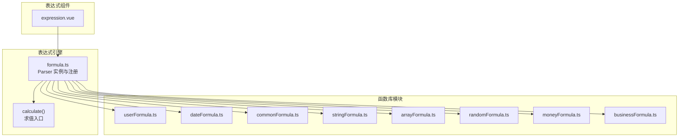
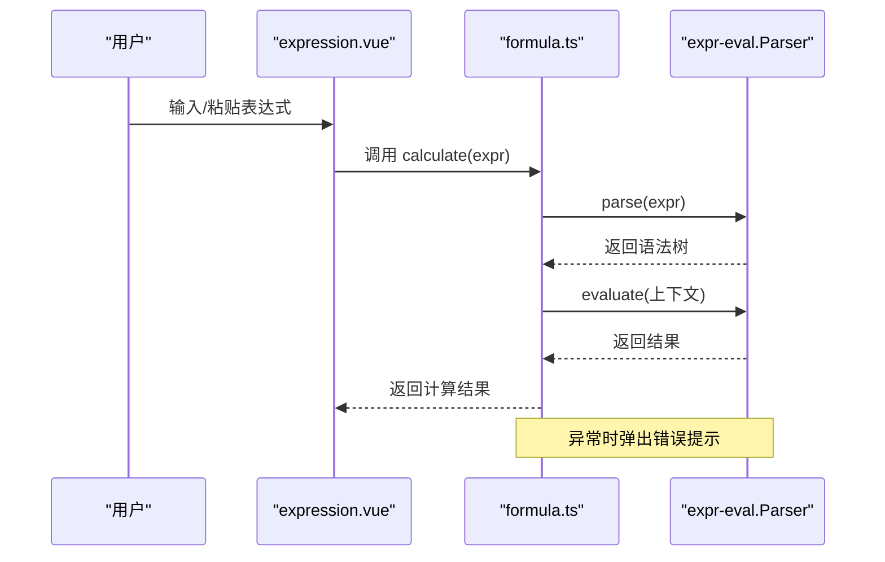
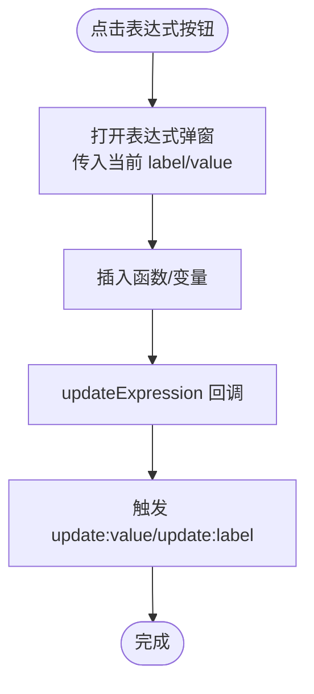
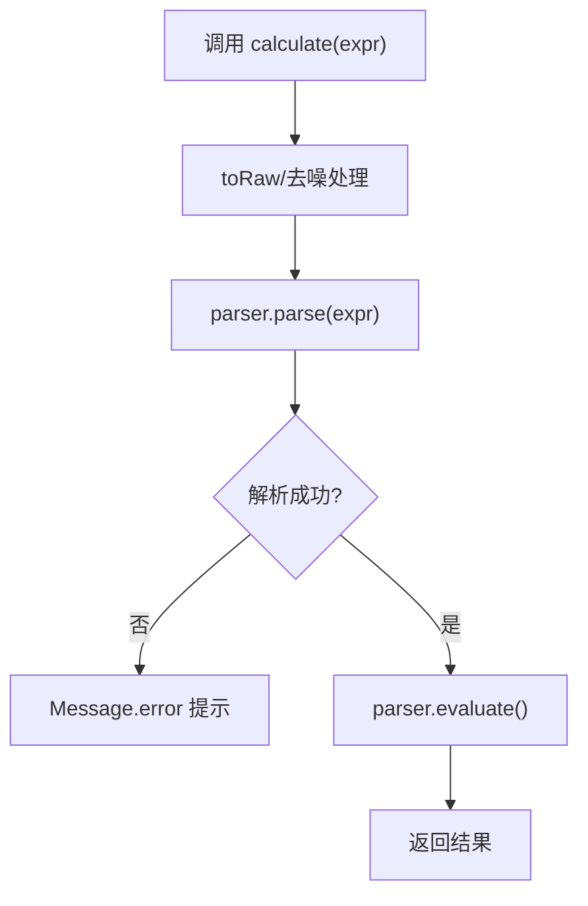
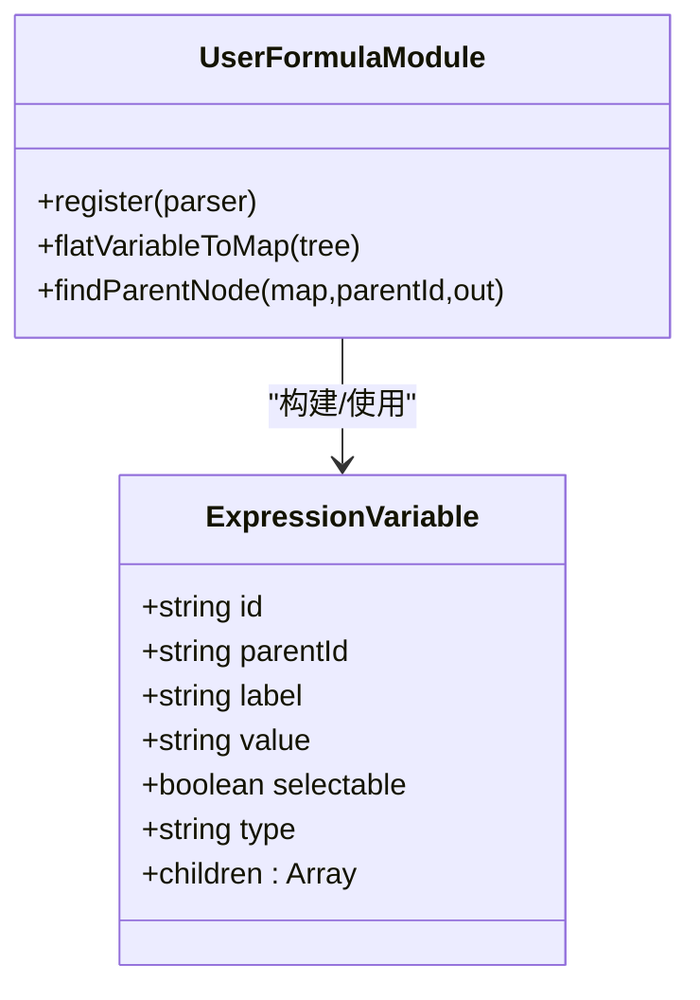
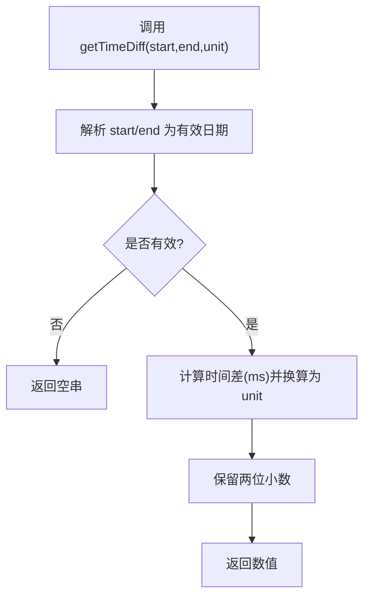
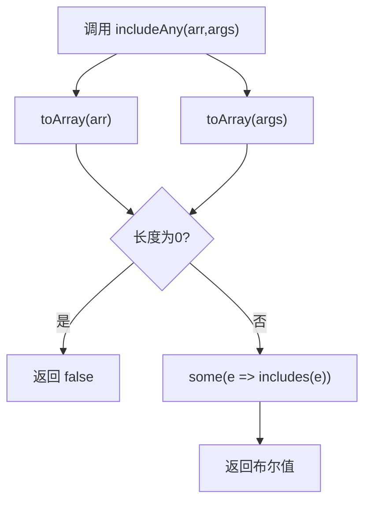
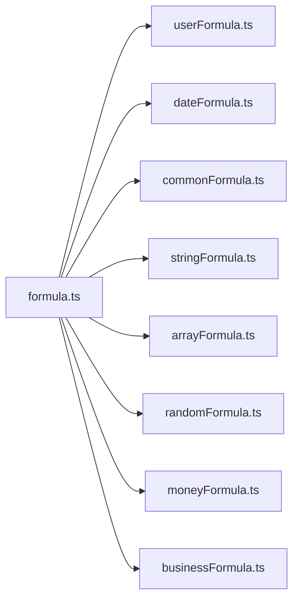

# 表达式系统

<cite>
**本文引用的文件**
- [expression.vue](file://src/components/expression/expression.vue)
- [formula.ts](file://src/components/expression/formula.ts)
- [userFormula.ts](file://src/components/expression/formula/userFormula.ts)
- [dateFormula.ts](file://src/components/expression/formula/dateFormula.ts)
- [commonFormula.ts](file://src/components/expression/formula/commonFormula.ts)
- [stringFormula.ts](file://src/components/expression/formula/stringFormula.ts)
- [arrayFormula.ts](file://src/components/expression/formula/arrayFormula.ts)
- [randomFormula.ts](file://src/components/expression/formula/randomFormula.ts)
- [moneyFormula.ts](file://src/components/expression/formula/moneyFormula.ts)
- [businessFormula.ts](file://src/components/expression/formula/businessFormula.ts)
</cite>

## 目录
1. [简介](#简介)
2. [项目结构](#项目结构)
3. [核心组件](#核心组件)
4. [架构总览](#架构总览)
5. [详细组件分析](#详细组件分析)
6. [依赖关系分析](#依赖关系分析)
7. [性能考虑](#性能考虑)
8. [故障排查指南](#故障排查指南)
9. [结论](#结论)
10. [附录](#附录)

## 简介
本文件系统性阐述表达式系统的设计与实现，覆盖表达式解析、语法树构建、求值算法、内置函数库、用户自定义函数开发与注册、参数传递规则、复杂表达式示例、性能优化与错误处理等主题。该系统基于 expr-eval 解析器，结合 Vue 组件化 UI，提供可视化函数选择与变量插入能力，并通过统一的注册机制扩展函数生态。

## 项目结构
表达式系统位于 src/components/expression 目录下，采用“UI 组件 + 函数库 + 注册入口”的分层组织：
- UI 层：expression.vue 提供表达式输入框、标签展示、函数弹窗与变量选择。
- 解析与求值：formula.ts 创建并配置 Parser，集中注册各类函数，提供 calculate 求值入口。
- 函数库：按功能域划分模块，每个模块负责一组函数的实现与注册。
- 变量与菜单：通过 userFormula.ts 构建变量树，配合 ExpressionMenu/ExpressionModal 提供可视化插入。

图表来源
- [expression.vue:1-131](file://src/components/expression/expression.vue#L1-L131)
- [formula.ts:1-96](file://src/components/expression/formula.ts#L1-L96)
- [userFormula.ts:1-411](file://src/components/expression/formula/userFormula.ts#L1-L411)
- [dateFormula.ts:1-180](file://src/components/expression/formula/dateFormula.ts#L1-L180)
- [commonFormula.ts:1-136](file://src/components/expression/formula/commonFormula.ts#L1-L136)
- [stringFormula.ts:1-127](file://src/components/expression/formula/stringFormula.ts#L1-L127)
- [arrayFormula.ts:1-95](file://src/components/expression/formula/arrayFormula.ts#L1-L95)
- [randomFormula.ts:1-58](file://src/components/expression/formula/randomFormula.ts#L1-L58)
- [moneyFormula.ts:1-189](file://src/components/expression/formula/moneyFormula.ts#L1-L189)
- [businessFormula.ts:1-52](file://src/components/expression/formula/businessFormula.ts#L1-L52)

章节来源
- [expression.vue:1-131](file://src/components/expression/expression.vue#L1-L131)
- [formula.ts:1-96](file://src/components/expression/formula.ts#L1-L96)

## 核心组件
- 表达式输入组件：提供输入框、标签显示、清空与更新事件；打开表达式弹窗以插入函数与变量。
- 表达式引擎：封装 expr-eval 的 Parser，集中注册各函数库，并提供 calculate 入口。
- 函数库：按领域拆分，统一通过 register(parser) 注册到 Parser.functions。
- 变量体系：userFormula.ts 定义变量树，提供扁平映射与父子查找工具。

章节来源
- [expression.vue:47-103](file://src/components/expression/expression.vue#L47-L103)
- [formula.ts:15-24](file://src/components/expression/formula.ts#L15-L24)
- [userFormula.ts:114-131](file://src/components/expression/formula/userFormula.ts#L114-L131)

## 架构总览
表达式系统采用“解析器 + 函数注册 + UI 插件化”的架构：
- 解析器初始化：在 formula.ts 中创建 Parser 实例，并依次调用各模块的 register(parser)。
- 函数注册：各函数库导出 register(parser) 方法，将函数挂载到 parser.functions 上。
- 求值流程：调用 calculate(expression)，对表达式进行 parse -> evaluate，异常时统一提示。

图表来源
- [formula.ts:84-95](file://src/components/expression/formula.ts#L84-L95)

章节来源
- [formula.ts:15-24](file://src/components/expression/formula.ts#L15-L24)
- [formula.ts:84-95](file://src/components/expression/formula.ts#L84-L95)

## 详细组件分析

### 表达式输入组件（expression.vue）
- 功能要点
  - 渲染表达式输入框与标签，支持清空与更新事件。
  - 打开 ExpressionModal 插入函数与变量，回填 label/value。
  - 支持从菜单选择变量，自动设置 showLabel 与 value。
- 关键交互
  - openExpressionModal：传入当前 label/value，打开弹窗。
  - updateExpression：接收弹窗回调，触发 update:value 与 update:label。
  - chooseExpression：菜单选择变量时，设置 label/value 并触发更新。

图表来源
- [expression.vue:86-102](file://src/components/expression/expression.vue#L86-L102)

章节来源
- [expression.vue:47-103](file://src/components/expression/expression.vue#L47-L103)

### 表达式引擎与求值（formula.ts）
- 初始化与注册
  - 创建 Parser 实例。
  - 依次调用 user/date/random/common/string/array/money/business 的 register(parser)。
  - 注册表单取值函数：getFormValue、getSubFormValue。
- 求值入口 calculate
  - 去除特殊标记后解析表达式，evaluate 返回结果。
  - 异常捕获并提示“表达式解析错误”。

图表来源
- [formula.ts:84-95](file://src/components/expression/formula.ts#L84-L95)

章节来源
- [formula.ts:15-24](file://src/components/expression/formula.ts#L15-L24)
- [formula.ts:27-63](file://src/components/expression/formula.ts#L27-L63)
- [formula.ts:84-95](file://src/components/expression/formula.ts#L84-L95)

### 用户自定义函数与变量（userFormula.ts）
- 变量树结构
  - 当前用户根节点，包含用户信息、角色、部门、主要/兼任部门、职位等分支。
  - 每个叶子节点提供 showLabel 与 value（函数调用字符串）。
- 工具方法
  - flatVariableToMap：将树扁平化为 Map，便于快速定位。
  - findParentNode：根据父 ID 递归向上查找父节点链。
- 函数注册
  - getCurrentUser、getUserRole、getUserDept、getUserPost 等函数注册到 parser.functions。

图表来源
- [userFormula.ts:9-18](file://src/components/expression/formula/userFormula.ts#L9-L18)
- [userFormula.ts:114-371](file://src/components/expression/formula/userFormula.ts#L114-L371)
- [userFormula.ts:373-399](file://src/components/expression/formula/userFormula.ts#L373-L399)
- [userFormula.ts:401-410](file://src/components/expression/formula/userFormula.ts#L401-L410)

章节来源
- [userFormula.ts:114-371](file://src/components/expression/formula/userFormula.ts#L114-L371)
- [userFormula.ts:373-399](file://src/components/expression/formula/userFormula.ts#L373-L399)
- [userFormula.ts:401-410](file://src/components/expression/formula/userFormula.ts#L401-L410)

### 日期函数库（dateFormula.ts）
- 提供函数
  - 获取当前日期时间、日期、时间。
  - 计算时间差（支持多种单位）与区间时间差。
- 注册
  - 将 getDatetime、getDate、getTime、getTimeDiff、getIntervalTimeDiff 注册到 parser.functions。

图表来源
- [dateFormula.ts:47-71](file://src/components/expression/formula/dateFormula.ts#L47-L71)
- [dateFormula.ts:158-179](file://src/components/expression/formula/dateFormula.ts#L158-L179)

章节来源
- [dateFormula.ts:13-17](file://src/components/expression/formula/dateFormula.ts#L13-L17)
- [dateFormula.ts:47-71](file://src/components/expression/formula/dateFormula.ts#L47-L71)
- [dateFormula.ts:150-156](file://src/components/expression/formula/dateFormula.ts#L150-L156)

### 通用函数库（commonFormula.ts）
- 提供函数
  - isNull/isNotNull：判断空值。
  - match：三元条件返回。
  - matchAll/matchAny：多条件与/或判断。
- 注册
  - 将 isNull、isNotNull、match、matchAll、matchAny 注册到 parser.functions。

章节来源
- [commonFormula.ts:12-52](file://src/components/expression/formula/commonFormula.ts#L12-L52)
- [commonFormula.ts:129-135](file://src/components/expression/formula/commonFormula.ts#L129-L135)

### 字符串函数库（stringFormula.ts）
- 提供函数
  - toStr：将任意值转换为字符串（含数组、对象、日期）。
  - eqStr：字符串相等比较。
  - concat：拼接多个字符串。
  - splitStr：按分隔符拆分为数组。
- 注册
  - 将 toStr、eqStr、concat、splitStr 注册到 parser.functions。

章节来源
- [stringFormula.ts:12-56](file://src/components/expression/formula/stringFormula.ts#L12-L56)
- [stringFormula.ts:121-126](file://src/components/expression/formula/stringFormula.ts#L121-L126)

### 数组函数库（arrayFormula.ts）
- 提供函数
  - includeAny：目标数组中是否包含源数组任一元素。
  - includeAll：目标数组中是否包含源数组全部元素。
- 注册
  - 将 includeAny、includeAll 注册到 parser.functions。
- 辅助
  - toArray：统一将输入转换为数组（兼容字符串、类数组、对象等）。

图表来源
- [arrayFormula.ts:12-28](file://src/components/expression/formula/arrayFormula.ts#L12-L28)
- [arrayFormula.ts:71-94](file://src/components/expression/formula/arrayFormula.ts#L71-L94)

章节来源
- [arrayFormula.ts:12-68](file://src/components/expression/formula/arrayFormula.ts#L12-L68)
- [arrayFormula.ts:71-94](file://src/components/expression/formula/arrayFormula.ts#L71-L94)

### 随机函数库（randomFormula.ts）
- 提供函数
  - generateUuid：生成 UUID。
  - generateNanoid：生成 NanoID（可选长度）。
- 注册
  - 将 generateUuid、generateNanoid 注册到 parser.functions。

章节来源
- [randomFormula.ts:14-20](file://src/components/expression/formula/randomFormula.ts#L14-L20)
- [randomFormula.ts:54-57](file://src/components/expression/formula/randomFormula.ts#L54-L57)

### 财务函数库（moneyFormula.ts）
- 提供函数
  - toChinese：将数字转换为中文大写金额（支持元、角、分）。
  - sum：多数字/数组求和（字符串与数组自动展开）。
  - avg：多数字/数组求平均值（过滤无效值）。
  - toNumber：字符串转数字并保留两位小数。
- 注册
  - 将 toChinese、sum、avg、toNumber 注册到 parser.functions。

章节来源
- [moneyFormula.ts:39-83](file://src/components/expression/formula/moneyFormula.ts#L39-L83)
- [moneyFormula.ts:85-121](file://src/components/expression/formula/moneyFormula.ts#L85-L121)
- [moneyFormula.ts:183-188](file://src/components/expression/formula/moneyFormula.ts#L183-L188)

### 业务函数库（businessFormula.ts）
- 提供函数
  - getUserDeptLeader：获取当前用户所在部门的负责人信息（id/username/nickname）。
- 注册
  - 将 getUserDeptLeader 注册到 parser.functions。

章节来源
- [businessFormula.ts:12-25](file://src/components/expression/formula/businessFormula.ts#L12-L25)
- [businessFormula.ts:49-51](file://src/components/expression/formula/businessFormula.ts#L49-L51)

## 依赖关系分析
- 模块耦合
  - formula.ts 作为中心枢纽，聚合所有函数库的注册。
  - 各函数库内部相互独立，仅通过 Parser 接口耦合。
- 外部依赖
  - expr-eval：表达式解析与求值。
  - dayjs：日期格式化与计算。
  - uuid、nanoid：唯一标识生成。
  - @arco-design/web-vue：消息提示（错误提示）。
- 可能的循环依赖
  - 当前结构为单向依赖（formula.ts -> 各函数库），无循环依赖风险。

图表来源
- [formula.ts:5-12](file://src/components/expression/formula.ts#L5-L12)

章节来源
- [formula.ts:5-12](file://src/components/expression/formula.ts#L5-L12)

## 性能考虑
- 解析与求值
  - 使用 expr-eval 的 Parser 缓存语法树，重复表达式可复用解析结果（建议在应用侧缓存已解析表达式）。
- 异步函数
  - 用户与业务函数多为异步，注意在表达式中合理组合 await，避免阻塞 UI。
- 参数预处理
  - 对数组/字符串/类数组输入统一通过 toArray 等工具规范化，减少分支判断成本。
- 大数与精度
  - 财务计算使用 toFixed 与过滤无效值策略，避免 NaN 传播。
- 日期处理
  - 使用 dayjs 统一格式化与计算，减少跨平台差异。

## 故障排查指南
- 表达式解析错误
  - 现象：调用 calculate 抛错并弹出“表达式解析错误”。
  - 排查：检查表达式语法、括号匹配、函数名拼写、参数数量与类型。
- 函数未找到
  - 现象：运行时报函数不存在。
  - 排查：确认对应函数库的 register(parser) 已被调用；检查函数名大小写与拼写。
- 变量/字段取值为空
  - 现象：getFormValue/getSubFormValue 返回空。
  - 排查：确认表单 ID、字段 ID 正确；确认字段 props.value 存在且非空。
- 异步函数未等待
  - 现象：表达式中使用异步函数但返回 Promise。
  - 排查：确保表达式中正确使用 await 或在 UI 层等待 Promise 完成后再参与计算。
- 错误提示
  - 系统通过消息组件提示错误，可在控制台查看具体堆栈信息以便定位。

章节来源
- [formula.ts:91-94](file://src/components/expression/formula.ts#L91-L94)

## 结论
该表达式系统以 expr-eval 为核心，通过模块化的函数库与统一的注册机制，实现了从解析、求值到 UI 插件化的完整闭环。系统具备良好的扩展性与可维护性，适合在表单与工作流场景中灵活使用。建议在生产环境中结合缓存与异步处理策略进一步提升性能与稳定性。

## 附录

### 内置函数一览（按模块）
- 用户与业务
  - getCurrentUser、getUserRole、getUserDept、getUserMainDept、getUserPartDept、getUserPost、getUserMainPost、getUserPartPost、getUserDeptLeader
- 日期
  - getDatetime、getDate、getTime、getTimeDiff、getIntervalTimeDiff
- 通用
  - isNull、isNotNull、match、matchAll、matchAny
- 字符串
  - toStr、eqStr、concat、splitStr
- 数组
  - includeAny、includeAll、toArray
- 随机
  - generateUuid、generateNanoid
- 财务
  - toChinese、sum、avg、toNumber

章节来源
- [userFormula.ts:401-410](file://src/components/expression/formula/userFormula.ts#L401-L410)
- [dateFormula.ts:150-156](file://src/components/expression/formula/dateFormula.ts#L150-L156)
- [commonFormula.ts:129-135](file://src/components/expression/formula/commonFormula.ts#L129-L135)
- [stringFormula.ts:121-126](file://src/components/expression/formula/stringFormula.ts#L121-L126)
- [arrayFormula.ts:66-68](file://src/components/expression/formula/arrayFormula.ts#L66-L68)
- [randomFormula.ts:54-57](file://src/components/expression/formula/randomFormula.ts#L54-L57)
- [moneyFormula.ts:183-188](file://src/components/expression/formula/moneyFormula.ts#L183-L188)

### 自定义函数开发步骤
- 新增函数文件
  - 在 formula 目录新增模块文件，实现函数与 register(parser)。
- 注册函数
  - 在 formula.ts 中引入并调用新模块的 register(parser)。
- 在 UI 中使用
  - 若需在表达式弹窗中展示，可在对应模块的 ExpressionFunc 结构中添加描述项。
- 测试与验证
  - 在表达式中调用新函数，观察返回值与异常提示。

章节来源
- [formula.ts:5-12](file://src/components/expression/formula.ts#L5-L12)
- [formula.ts:15-24](file://src/components/expression/formula.ts#L15-L24)

### 复杂表达式示例（思路与路径）
- 嵌套计算
  - 示例思路：使用括号与函数组合，如将字符串转数字后参与 sum/avg。
  - 参考路径：[moneyFormula.ts:85-121](file://src/components/expression/formula/moneyFormula.ts#L85-L121)
- 条件表达式
  - 示例思路：使用 match/matchAll/matchAny 组合 isNull/isNotNull。
  - 参考路径：[commonFormula.ts:27-52](file://src/components/expression/formula/commonFormula.ts#L27-L52)
- 数组操作
  - 示例思路：includeAny/includeAll 与 splitStr/concatStr 组合。
  - 参考路径：[arrayFormula.ts:12-68](file://src/components/expression/formula/arrayFormula.ts#L12-L68)