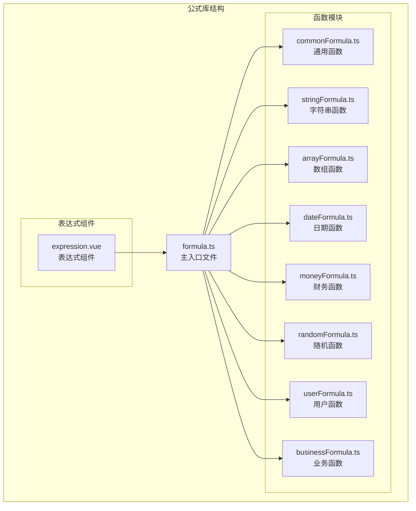
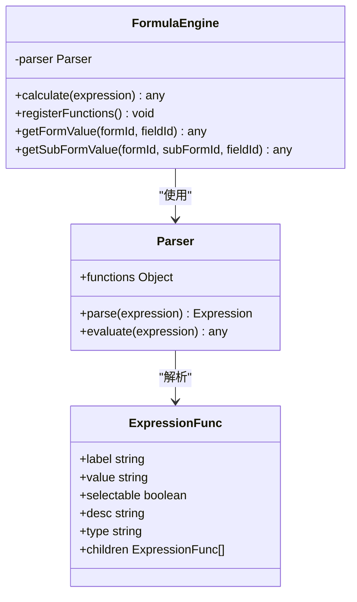
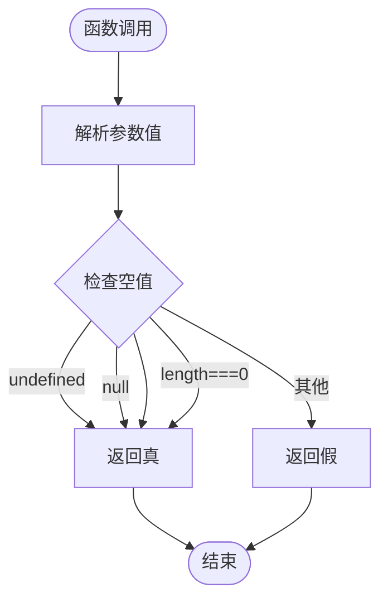
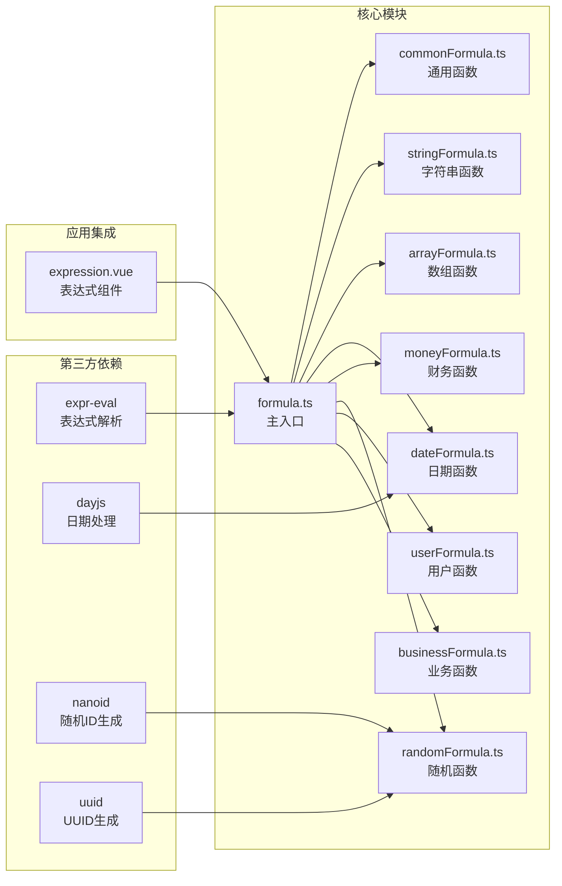

# 通用公式库

<cite>
**本文档引用的文件**
- [commonFormula.ts](file://src/components/expression/formula/commonFormula.ts)
- [formula.ts](file://src/components/expression/formula.ts)
- [stringFormula.ts](file://src/components/expression/formula/stringFormula.ts)
- [arrayFormula.ts](file://src/components/expression/formula/arrayFormula.ts)
- [dateFormula.ts](file://src/components/expression/formula/dateFormula.ts)
- [moneyFormula.ts](file://src/components/expression/formula/moneyFormula.ts)
- [randomFormula.ts](file://src/components/expression/formula/randomFormula.ts)
- [userFormula.ts](file://src/components/expression/formula/userFormula.ts)
- [businessFormula.ts](file://src/components/expression/formula/businessFormula.ts)
- [expression.vue](file://src/components/expression/expression.vue)
</cite>

## 目录
1. [简介](#简介)
2. [项目结构](#项目结构)
3. [核心组件](#核心组件)
4. [架构概览](#架构概览)
5. [详细组件分析](#详细组件分析)
6. [依赖关系分析](#依赖关系分析)
7. [性能考虑](#性能考虑)
8. [故障排除指南](#故障排除指南)
9. [结论](#结论)

## 简介

通用公式库是工作台系统中的核心表达式计算引擎，提供了丰富的数学运算、字符串处理、逻辑判断、日期处理、财务计算等功能。该库基于 expr-eval 解析器构建，支持动态注册各种自定义函数，并通过统一的接口为表单设计器和表达式编辑器提供强大的公式计算能力。

该库采用模块化设计，将不同类型的函数按功能分类组织，包括通用函数、字符串函数、数组函数、日期函数、财务函数、随机函数、用户函数和业务函数等。每个模块都提供了完整的函数注册机制和文档描述。

## 项目结构

通用公式库位于 `src/components/expression/formula/` 目录下，采用按功能分类的模块化组织方式：



**图表来源**
- [formula.ts:1-25](file://src/components/expression/formula.ts#L1-L25)
- [commonFormula.ts:1-136](file://src/components/expression/formula/commonFormula.ts#L1-L136)

**章节来源**
- [formula.ts:1-25](file://src/components/expression/formula.ts#L1-L25)
- [commonFormula.ts:1-136](file://src/components/expression/formula/commonFormula.ts#L1-L136)

## 核心组件

### 表达式解析器

表达式解析器是整个公式库的核心，基于 expr-eval 库构建，负责解析和执行各种数学表达式和自定义函数。



**图表来源**
- [formula.ts:15-24](file://src/components/expression/formula.ts#L15-L24)
- [formula.ts:84-95](file://src/components/expression/formula.ts#L84-L95)

### 函数注册机制

每个函数模块都实现了统一的注册接口，通过 `register(parser)` 方法将自定义函数添加到解析器中。

**章节来源**
- [formula.ts:15-24](file://src/components/expression/formula.ts#L15-L24)
- [commonFormula.ts:129-135](file://src/components/expression/formula/commonFormula.ts#L129-L135)

## 架构概览

通用公式库采用分层架构设计，从底层的表达式解析到上层的功能模块，形成了清晰的层次结构：

```mermaid
graph TD
subgraph "用户界面层"
UI[表达式组件<br/>expression.vue]
end
subgraph "应用逻辑层"
Engine[公式引擎<br/>formula.ts]
Calc[计算服务<br/>calculate()]
end
subgraph "功能模块层"
Common[通用函数模块]
String[字符串函数模块]
Array[数组函数模块]
Date[日期函数模块]
Money[财务函数模块]
Random[随机函数模块]
User[用户函数模块]
Business[业务函数模块]
end
subgraph "数据访问层"
FormAPI[表单API]
UserAPI[用户API]
DeptAPI[部门API]
end
UI --> Engine
Engine --> Calc
Calc --> Common
Calc --> String
Calc --> Array
Calc --> Date
Calc --> Money
Calc --> Random
Calc --> User
Calc --> Business
User --> UserAPI
Business --> DeptAPI
Engine --> FormAPI
```

**图表来源**
- [expression.vue:1-131](file://src/components/expression/expression.vue#L1-L131)
- [formula.ts:1-96](file://src/components/expression/formula.ts#L1-L96)

## 详细组件分析

### 通用函数模块

通用函数模块提供了基础的逻辑判断和空值处理功能，是表达式计算的基础工具。

#### 空值判断函数



**图表来源**
- [commonFormula.ts:12-25](file://src/components/expression/formula/commonFormula.ts#L12-L25)

##### isNull 函数
- **语法**: `isNull(参数)`
- **参数类型**: 任意类型
- **返回值类型**: 布尔值
- **功能**: 判断参数是否为空（undefined、null、空字符串、空数组）
- **使用示例**: `isNull('')` 返回真

##### isNotNull 函数
- **语法**: `isNotNull(参数)`
- **参数类型**: 任意类型
- **返回值类型**: 布尔值
- **功能**: 判断参数是否不为空
- **使用示例**: `isNotNull('test')` 返回真

**章节来源**
- [commonFormula.ts:12-25](file://src/components/expression/formula/commonFormula.ts#L12-L25)

#### 条件判断函数

##### match 函数
- **语法**: `match(条件, 真返回, 假返回)`
- **参数类型**: 条件（任意类型），真返回（任意类型），假返回（任意类型）
- **返回值类型**: 任意类型
- **功能**: 根据条件真假返回对应的值
- **使用示例**: `match(1==1, '真', '假')` 返回 '真'

##### matchAll 函数
- **语法**: `matchAll(条件1, 条件2, ...)`
- **参数类型**: 可变数量的条件（任意类型）
- **返回值类型**: 布尔值
- **功能**: 所有条件都满足时返回真
- **使用示例**: `matchAll(1==1, 2==2)` 返回 真

##### matchAny 函数
- **语法**: `matchAny(条件1, 条件2, ...)`
- **参数类型**: 可变数量的条件（任意类型）
- **返回值类型**: 布尔值
- **功能**: 任意一个条件满足时返回真
- **使用示例**: `matchAny(1==1, 2==3)` 返回 真

**章节来源**
- [commonFormula.ts:27-52](file://src/components/expression/formula/commonFormula.ts#L27-L52)

### 字符串函数模块

字符串函数模块提供了丰富的字符串处理功能，支持多种数据类型的转换和字符串操作。

#### 字符串转换函数

##### toStr 函数
- **语法**: `toStr(参数)`
- **参数类型**: 任意类型
- **返回值类型**: 字符串
- **功能**: 将任意类型转换为字符串
- **特殊处理**:
  - null/undefined 转换为 "null"
  - Date 对象转换为本地化字符串
  - 数组转换为逗号分隔的字符串
  - 对象转换为 JSON 字符串
- **使用示例**: `toStr([1,2,3])` 返回 "1,2,3"

**章节来源**
- [stringFormula.ts:12-37](file://src/components/expression/formula/stringFormula.ts#L12-L37)

#### 字符串比较函数

##### eqStr 函数
- **语法**: `eqStr(字符串1, 字符串2)`
- **参数类型**: 字符串类型
- **返回值类型**: 布尔值
- **功能**: 比较两个字符串是否相等
- **使用示例**: `eqStr('hello', 'hello')` 返回 真

**章节来源**
- [stringFormula.ts:39-43](file://src/components/expression/formula/stringFormula.ts#L39-L43)

#### 字符串连接函数

##### concatStr 函数
- **语法**: `concatStr(字符串1, 字符串2, ...)`
- **参数类型**: 可变数量的字符串参数
- **返回值类型**: 字符串
- **功能**: 连接多个字符串
- **使用示例**: `concatStr('Hello', ' ', 'World')` 返回 "Hello World"

**章节来源**
- [stringFormula.ts:45-47](file://src/components/expression/formula/stringFormula.ts#L45-L47)

#### 字符串分割函数

##### splitStr 函数
- **语法**: `splitStr(字符串, 分隔符)`
- **参数类型**: 字符串类型
- **返回值类型**: 数组
- **功能**: 将字符串按指定分隔符分割为数组
- **使用示例**: `splitStr('1,2,3', ',')` 返回 ['1', '2', '3']

**章节来源**
- [stringFormula.ts:49-56](file://src/components/expression/formula/stringFormula.ts#L49-L56)

### 数组函数模块

数组函数模块提供了数组元素的包含性检查功能，支持灵活的数组操作。

#### 数组包含性函数

##### includeAny 函数
- **语法**: `includeAny(数组, 匹配值)`
- **参数类型**: 数组，匹配值（可以是单个值或数组）
- **返回值类型**: 布尔值
- **功能**: 检查数组是否包含任意一个匹配值
- **使用示例**: `includeAny(['a','b','c'], ['b','d'])` 返回 真

##### includeAll 函数
- **语法**: `includeAll(数组, 匹配值)`
- **参数类型**: 数组，匹配值（可以是单个值或数组）
- **返回值类型**: 布尔值
- **功能**: 检查数组是否包含所有匹配值
- **使用示例**: `includeAll(['a','b','c'], ['a','b'])` 返回 真

**章节来源**
- [arrayFormula.ts:12-28](file://src/components/expression/formula/arrayFormula.ts#L12-L28)

### 日期函数模块

日期函数模块提供了丰富的日期时间处理功能，支持多种日期格式和时间计算。

#### 时间获取函数

##### getDatetime 函数
- **语法**: `getDatetime(格式)`
- **参数类型**: 格式字符串（可选）
- **返回值类型**: 字符串
- **功能**: 获取当前日期时间
- **支持格式**: 
  - yyyy-MM-dd HH:mm:ss
  - yyyy-MM-dd HH:mm
  - yyyy-MM-dd
  - yyyy-MM
- **使用示例**: `getDatetime('yyyy-MM-dd')` 返回 "2025-12-01"

##### getDate 函数
- **语法**: `getDate()`
- **参数类型**: 无
- **返回值类型**: 字符串
- **功能**: 获取当前日期
- **使用示例**: `getDate()` 返回 "2025-12-01"

##### getTime 函数
- **语法**: `getTime()`
- **参数类型**: 无
- **返回值类型**: 字符串
- **功能**: 获取当前时间
- **使用示例**: `getTime()` 返回 "14:30:45"

**章节来源**
- [dateFormula.ts:13-33](file://src/components/expression/formula/dateFormula.ts#L13-L33)

#### 时间计算函数

##### getTimeDiff 函数
- **语法**: `getTimeDiff(开始时间, 结束时间, 单位)`
- **参数类型**: 开始时间（日期对象或字符串），结束时间（日期对象或字符串），单位（时间单位）
- **返回值类型**: 数字
- **支持单位**: ms（毫秒）、s（秒）、min（分钟）、h（小时）、d（天）、w（周）、m（月）、y（年）
- **功能**: 计算两个时间点之间的差值
- **使用示例**: `getTimeDiff('2025-12-01', '2025-12-02', 'd')` 返回 1

##### getIntervalTimeDiff 函数
- **语法**: `getIntervalTimeDiff(区间时间, 单位)`
- **参数类型**: 区间时间（对象或JSON字符串），单位（时间单位）
- **返回值类型**: 数字
- **功能**: 计算时间区间内的差值
- **使用示例**: `getIntervalTimeDiff({"start":"2025-12-01","end":"2025-12-02"}, 'd')` 返回 1

**章节来源**
- [dateFormula.ts:47-71](file://src/components/expression/formula/dateFormula.ts#L47-L71)

### 财务函数模块

财务函数模块提供了专业的财务计算功能，包括金额转换和统计计算。

#### 金额转换函数

##### toChinese 函数
- **语法**: `toChinese(数字)`
- **参数类型**: 数字类型
- **返回值类型**: 字符串
- **功能**: 将阿拉伯数字转换为中文大写金额
- **范围限制**: 0 到 999999999999.99
- **使用示例**: `toChinese(300.25)` 返回 "叁佰元贰角伍分"

**章节来源**
- [moneyFormula.ts:39-83](file://src/components/expression/formula/moneyFormula.ts#L39-L83)

#### 统计计算函数

##### sum 函数
- **语法**: `sum(数字1, 数字2, ...)`
- **参数类型**: 可变数量的数字参数（支持字符串和数组）
- **返回值类型**: 数字
- **功能**: 计算多个数字的总和
- **特点**: 自动过滤无效值，支持数组扁平化
- **使用示例**: `sum(1, 2, 3)` 返回 6

##### avg 函数
- **语法**: `avg(数字1, 数字2, ...)`
- **参数类型**: 可变数量的数字参数（支持字符串和数组）
- **返回值类型**: 数字
- **功能**: 计算多个数字的平均值
- **特点**: 自动过滤无效值，空数组返回 0
- **使用示例**: `avg(1, 2, 3)` 返回 2

##### toNumber 函数
- **语法**: `toNumber(字符串)`
- **参数类型**: 字符串类型
- **返回值类型**: 字符串（保留两位小数）
- **功能**: 将字符串转换为数字并格式化
- **使用示例**: `toNumber('300.25')` 返回 "300.25"

**章节来源**
- [moneyFormula.ts:85-121](file://src/components/expression/formula/moneyFormula.ts#L85-L121)

### 随机函数模块

随机函数模块提供了多种随机标识符生成功能。

#### 标识符生成函数

##### generateUUid 函数
- **语法**: `generateUuid()`
- **参数类型**: 无
- **返回值类型**: 字符串
- **功能**: 生成 UUID 格式的唯一标识符
- **使用示例**: `generateUuid()` 返回 "cb8fb521-f6cf-4f7d-9286-53dab493e86b"

##### generateNanoid 函数
- **语法**: `generateNanoid(长度)`
- **参数类型**: 长度（可选）
- **返回值类型**: 字符串
- **功能**: 生成 NanoID 格式的唯一标识符
- **使用示例**: `generateNanoid()` 返回 "mjWnlBn5AbR9UduDf2j0J"

**章节来源**
- [randomFormula.ts:14-20](file://src/components/expression/formula/randomFormula.ts#L14-L20)

### 用户函数模块

用户函数模块提供了与用户信息相关的查询功能。

#### 用户信息查询函数

##### getCurrentUser 函数
- **语法**: `getCurrentUser(属性)`
- **参数类型**: 属性名称（字符串）
- **返回值类型**: 任意类型
- **支持属性**:
  - id: 用户ID
  - nickname: 昵称
  - username: 用户名
  - email: 邮箱
  - phone: 手机号
  - sex: 性别
  - isLeader: 是否部门负责人
  - isMainLeader: 是否主要部门负责人
  - isPartLeader: 是否兼任部门负责人
- **使用示例**: `getCurrentUser('username')` 返回 "admin"

##### getUserRole 函数
- **语法**: `getUserRole(属性)`
- **参数类型**: 属性名称（字符串）
- **返回值类型**: 字符串
- **支持属性**:
  - id: 角色ID列表（逗号分隔）
  - name: 角色名称列表（逗号分隔）
- **使用示例**: `getUserRole('name')` 返回 "管理员,普通用户"

##### getUserDept 函数
- **语法**: `getUserDept(属性)`
- **参数类型**: 属性名称（字符串）
- **返回值类型**: 字符串
- **支持属性**:
  - id: 部门ID列表（逗号分隔）
  - name: 部门名称列表（逗号分隔）
- **使用示例**: `getUserDept('name')` 返回 "技术部,研发部"

**章节来源**
- [userFormula.ts:19-112](file://src/components/expression/formula/userFormula.ts#L19-L112)

### 业务函数模块

业务函数模块提供了与业务流程相关的功能。

#### 部门负责人查询函数

##### getUserDeptLeader 函数
- **语法**: `getUserDeptLeader(属性)`
- **参数类型**: 属性名称（字符串，可选）
- **返回值类型**: 字符串
- **支持属性**:
  - id: 用户ID列表（逗号分隔）
  - username: 用户名列表（逗号分隔）
  - nickname: 昵称列表（逗号分隔）
- **默认属性**: nickname
- **使用示例**: `getUserDeptLeader('nickname')` 返回 "张三,李四"

**章节来源**
- [businessFormula.ts:12-25](file://src/components/expression/formula/businessFormula.ts#L12-L25)

## 依赖关系分析

通用公式库的依赖关系呈现清晰的分层结构，从底层的第三方库到上层的应用逻辑：



**图表来源**
- [formula.ts:1-13](file://src/components/expression/formula.ts#L1-L13)
- [dateFormula.ts:1-3](file://src/components/expression/formula/dateFormula.ts#L1-L3)
- [randomFormula.ts:1-4](file://src/components/expression/formula/randomFormula.ts#L1-L4)

**章节来源**
- [formula.ts:1-13](file://src/components/expression/formula.ts#L1-L13)
- [dateFormula.ts:1-3](file://src/components/expression/formula/dateFormula.ts#L1-L3)
- [randomFormula.ts:1-4](file://src/components/expression/formula/randomFormula.ts#L1-L4)

## 性能考虑

### 异步处理优化

通用公式库大量使用异步函数处理，这在保证功能完整性的同时也带来了性能考量：

1. **Promise 并行处理**: 使用 `Promise.all()` 并行解析多个参数
2. **延迟计算**: 参数值通过 `await` 延迟解析，避免不必要的计算
3. **缓存策略**: 对于重复使用的函数结果，建议在应用层面实现缓存

### 内存管理

1. **数组处理**: 提供 `toArray` 函数统一数组格式，避免内存泄漏
2. **字符串处理**: 使用 `toStr` 函数统一字符串转换，减少内存碎片
3. **对象序列化**: 对象转换使用 JSON 序列化，确保内存安全

### 错误处理

1. **边界值检查**: 所有数值计算都有严格的边界值检查
2. **异常捕获**: 关键操作都有 try-catch 保护
3. **降级处理**: 当输入无效时返回安全的默认值

## 故障排除指南

### 常见问题及解决方案

#### 表达式解析错误

**问题**: 表达式解析失败
**原因**: 语法错误或未知函数
**解决方案**: 
1. 检查表达式语法
2. 确认函数名称正确
3. 验证参数类型

#### 空值处理问题

**问题**: 空值判断不符合预期
**原因**: 对空值的定义理解偏差
**解决方案**:
- `isNull()` 会识别 undefined、null、空字符串、空数组
- 如需严格判断，使用 `isNotNull()` 的否定形式

#### 数组处理异常

**问题**: 数组包含性检查结果异常
**原因**: 数组格式不正确或元素类型不匹配
**解决方案**:
- 确保传入正确的数组格式
- 检查元素的数据类型一致性

#### 日期计算错误

**问题**: 日期差值计算结果异常
**原因**: 日期格式不正确或时区问题
**解决方案**:
- 使用标准日期格式（YYYY-MM-DD）
- 注意时区转换

**章节来源**
- [formula.ts:84-95](file://src/components/expression/formula.ts#L84-L95)

## 结论

通用公式库是一个功能完整、结构清晰的表达式计算引擎，具有以下特点：

1. **模块化设计**: 按功能分类的模块化架构，便于维护和扩展
2. **类型安全**: 完整的 TypeScript 类型定义，提供良好的开发体验
3. **功能丰富**: 涵盖数学运算、字符串处理、逻辑判断、日期处理、财务计算等多个领域
4. **易于使用**: 统一的 API 接口和详细的文档说明
5. **性能优化**: 合理的异步处理和内存管理策略

该库为工作台系统的表单设计器和表达式编辑器提供了强大的技术支持，能够满足各种复杂的业务场景需求。通过合理的使用和扩展，可以进一步提升系统的灵活性和用户体验。