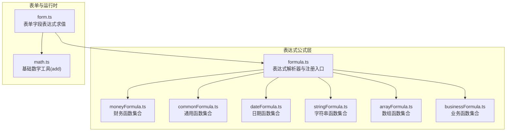
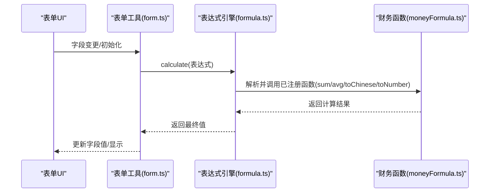
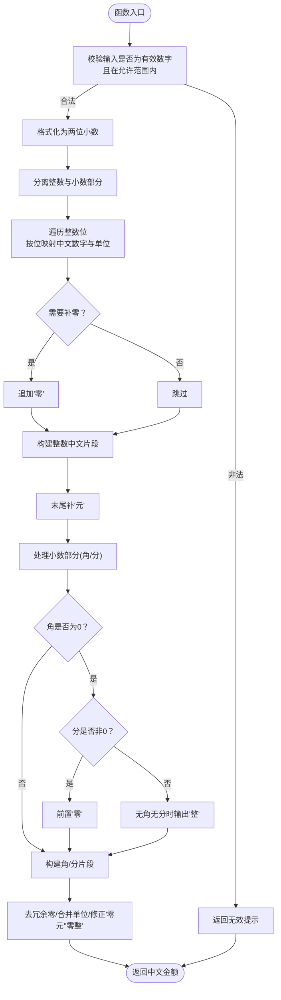
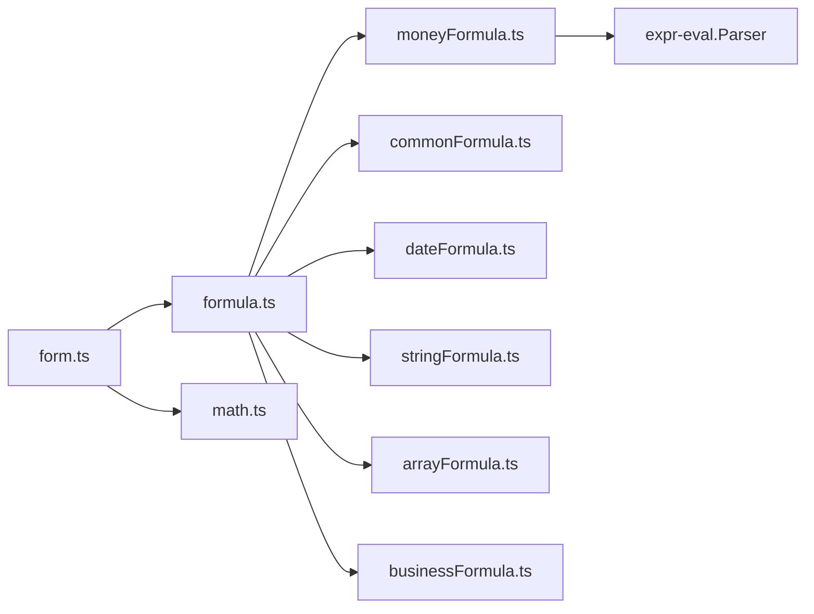

# 金额货币公式

<cite>
**本文引用的文件**
- [moneyFormula.ts](file://src/components/expression/formula/moneyFormula.ts)
- [formula.ts](file://src/components/expression/formula.ts)
- [form.ts](file://src/utils/form.ts)
- [math.ts](file://src/utils/math.ts)
- [commonFormula.ts](file://src/components/expression/formula/commonFormula.ts)
- [dateFormula.ts](file://src/components/expression/formula/dateFormula.ts)
- [stringFormula.ts](file://src/components/expression/formula/stringFormula.ts)
- [arrayFormula.ts](file://src/components/expression/formula/arrayFormula.ts)
- [businessFormula.ts](file://src/components/expression/formula/businessFormula.ts)
</cite>

## 目录
1. [简介](#简介)
2. [项目结构](#项目结构)
3. [核心组件](#核心组件)
4. [架构总览](#架构总览)
5. [详细组件分析](#详细组件分析)
6. [依赖关系分析](#依赖关系分析)
7. [性能考量](#性能考量)
8. [故障排查指南](#故障排查指南)
9. [结论](#结论)
10. [附录](#附录)

## 简介
本文件聚焦于金额货币公式模块，系统化梳理并解释 moneyFormula.ts 中实现的金融与货币相关计算能力，包括金额大写转换、数值加总与平均、字符串到数字的规范化处理等。文档同时结合表达式引擎与表单联动机制，给出在实际金融场景下的精度控制、四舍五入规则、货币符号处理、小数位数限制等关键参数的实践建议，并提供合规性与精度保障策略。

## 项目结构
金额货币公式位于表达式公式体系中，作为一组注册到表达式解析器的函数，供表单字段表达式计算调用。整体结构如下：

图表来源
- [formula.ts:15-24](file://src/components/expression/formula.ts#L15-L24)
- [moneyFormula.ts:123-181](file://src/components/expression/formula/moneyFormula.ts#L123-L181)
- [commonFormula.ts:54-126](file://src/components/expression/formula/commonFormula.ts#L54-L126)
- [dateFormula.ts:73-147](file://src/components/expression/formula/dateFormula.ts#L73-L147)
- [stringFormula.ts:58-118](file://src/components/expression/formula/stringFormula.ts#L58-L118)
- [arrayFormula.ts:30-63](file://src/components/expression/formula/arrayFormula.ts#L30-L63)
- [businessFormula.ts:27-46](file://src/components/expression/formula/businessFormula.ts#L27-L46)
- [form.ts:723-733](file://src/utils/form.ts#L723-L733)
- [math.ts:1-3](file://src/utils/math.ts#L1-L3)

章节来源
- [formula.ts:1-96](file://src/components/expression/formula.ts#L1-L96)
- [moneyFormula.ts:1-189](file://src/components/expression/formula/moneyFormula.ts#L1-L189)
- [form.ts:723-733](file://src/utils/form.ts#L723-L733)

## 核心组件
- 财务函数集合（moneyFunc）：提供金额大写转换、数值加总、平均值、字符串转数字等函数，并注册到表达式解析器。
- 表达式解析器（formula.ts）：集中注册各函数模块，提供 calculate 方法执行表达式。
- 表单联动（form.ts）：在字段渲染与变更时，对含函数的字段进行表达式求值，驱动界面显示与数据流。

章节来源
- [moneyFormula.ts:123-181](file://src/components/expression/formula/moneyFormula.ts#L123-L181)
- [formula.ts:15-24](file://src/components/expression/formula.ts#L15-L24)
- [form.ts:723-733](file://src/utils/form.ts#L723-L733)

## 架构总览
表达式引擎与表单联动的执行链路如下：

图表来源
- [formula.ts:84-95](file://src/components/expression/formula.ts#L84-L95)
- [moneyFormula.ts:183-188](file://src/components/expression/formula/moneyFormula.ts#L183-L188)
- [form.ts:723-733](file://src/utils/form.ts#L723-L733)

## 详细组件分析

### 金额大写转换（toChinese）
功能概述
- 将阿拉伯数字金额转换为中文大写金额，支持整数与两位小数，输出包含“元/整/角/分”的规范中文金额表述。
- 对非法输入（如负数、超出范围、非数字）进行边界保护，返回特定提示。

关键行为与规则
- 输入范围：0 到 999999999999.99；超出范围返回无效提示。
- 小数点后强制保留两位，不足补零。
- 单位映射：拾、佰、仟、万、亿等中文单位按位置映射。
- 零的省略与合并：去除冗余“零”，合并“零+万/亿”等。
- 角分处理：当角为0而分非0时，自动补“零”；当无角无分时，输出“整”。

图表来源
- [moneyFormula.ts:39-83](file://src/components/expression/formula/moneyFormula.ts#L39-L83)

章节来源
- [moneyFormula.ts:39-83](file://src/components/expression/formula/moneyFormula.ts#L39-L83)

### 数值加总（sum）
功能概述
- 支持传入数字、字符串或数组（可嵌套），扁平化后对有效数字求和；遇到非数字项按0处理。
- 常用于金额累加、费用分摊后的合计等场景。

要点
- 扁平化处理：将多维数组打平，统一为一维数字序列。
- 宽松容错：字符串会被尝试转为数字，无法转换的视为0。
- 结果类型：返回数字类型的和。

章节来源
- [moneyFormula.ts:85-91](file://src/components/expression/formula/moneyFormula.ts#L85-L91)

### 平均值（avg）
功能概述
- 支持传入数字、字符串或数组（可嵌套），扁平化后过滤掉无效值，计算有效数字的算术平均。
- 当无有效数字时，默认返回0（可根据业务需求调整为NaN）。

要点
- 无效值过滤：字符串无法转为数字的项被丢弃。
- 有效计数：仅基于非空有效数字参与平均计算。
- 结果类型：返回数字类型的平均值。

章节来源
- [moneyFormula.ts:93-106](file://src/components/expression/formula/moneyFormula.ts#L93-L106)

### 字符串转数字（toNumber）
功能概述
- 将输入转换为数字，并格式化为两位小数字符串。
- 对无法解析的输入返回0；异常捕获并记录错误信息。

要点
- 异常安全：try/catch 包裹，避免表达式执行中断。
- 固定精度：始终返回两位小数字符串，便于后续金额展示与计算一致性。

章节来源
- [moneyFormula.ts:108-121](file://src/components/expression/formula/moneyFormula.ts#L108-L121)

### 表达式引擎与注册（formula.ts）
功能概述
- 创建表达式解析器实例，集中注册各类函数模块（含财务函数）。
- 提供 calculate 方法，对表达式进行解析与求值；对解析异常进行消息提示与日志输出。

要点
- 注册顺序：先注册用户/日期/随机/通用/字符串/数组/财务/业务函数。
- 表单集成：通过 getFormValue/getSubFormValue 获取表单字段值，使表达式可引用表单数据。
- 错误处理：捕获解析异常并提示“表达式解析错误”。

章节来源
- [formula.ts:15-24](file://src/components/expression/formula.ts#L15-L24)
- [formula.ts:27-63](file://src/components/expression/formula.ts#L27-L63)
- [formula.ts:84-95](file://src/components/expression/formula.ts#L84-L95)

### 表单联动（form.ts）
功能概述
- 在字段渲染与变更时，对含“函数”类字段的表达式进行求值，更新字段默认值与显示值。
- 与表达式引擎配合，实现动态金额计算、税费处理、汇率换算等业务逻辑。

要点
- 动态求值：字段 props.label 为“函数”时触发 calculate。
- 值回填：将表达式结果赋给字段 props.defaultValue，并同步到表单数据对象。

章节来源
- [form.ts:723-733](file://src/utils/form.ts#L723-L733)

## 依赖关系分析
- 模块内聚与耦合
  - moneyFormula.ts 与 formula.ts 通过注册接口建立弱耦合，前者提供函数实现，后者负责注册与调度。
  - 表单联动（form.ts）依赖表达式引擎（formula.ts）完成求值。
- 外部依赖
  - 表达式解析器 expr-eval：用于解析与执行表达式字符串。
  - dayjs：在日期函数模块中用于时间格式化与计算（与金额模块无直接耦合）。
- 可能的循环依赖
  - 当前模块未见循环导入；表达式引擎作为中央注册点，避免了函数间相互引用导致的环。

图表来源
- [moneyFormula.ts](file://src/components/expression/formula/moneyFormula.ts#L1)
- [formula.ts:1-13](file://src/components/expression/formula.ts#L1-L13)
- [commonFormula.ts](file://src/components/expression/formula/commonFormula.ts#L1)
- [dateFormula.ts](file://src/components/expression/formula/dateFormula.ts#L1)
- [stringFormula.ts](file://src/components/expression/formula/stringFormula.ts#L1)
- [arrayFormula.ts](file://src/components/expression/formula/arrayFormula.ts#L1)
- [businessFormula.ts](file://src/components/expression/formula/businessFormula.ts#L1)
- [form.ts](file://src/utils/form.ts#L5)
- [math.ts](file://src/utils/math.ts#L1)

章节来源
- [formula.ts:1-13](file://src/components/expression/formula.ts#L1-L13)
- [moneyFormula.ts](file://src/components/expression/formula/moneyFormula.ts#L1)

## 性能考量
- 函数复杂度
  - toChinese：线性时间复杂度 O(n)，n 为整数位数；涉及字符串替换与正则优化，整体开销可控。
  - sum/avg：扁平化与一次遍历，时间复杂度 O(m)，m 为参数总数；过滤无效值的开销与输入规模成正比。
  - toNumber：常数时间复杂度，主要为类型转换与格式化。
- 表达式执行
  - 表达式解析与求值在前端执行，建议避免在高频事件中频繁大规模计算；可通过节流/防抖与缓存中间结果降低开销。
- 内存与字符串
  - toChinese 会构造较长字符串，注意在大量并发调用时的内存占用；必要时可考虑分批处理或延迟渲染。

[本节为通用性能讨论，不直接分析具体文件，故无章节来源]

## 故障排查指南
- 表达式解析错误
  - 现象：表达式解析报错并弹出提示。
  - 排查：检查表达式语法、函数名拼写、参数数量与类型；确认函数已在 formula.ts 中正确注册。
  - 参考路径：[formula.ts:84-95](file://src/components/expression/formula.ts#L84-L95)
- 金额大写异常
  - 现象：toChinese 返回“无效金额”。
  - 排查：确认输入为有效数字且在允许范围内；检查小数位是否超过两位。
  - 参考路径：[moneyFormula.ts:42-44](file://src/components/expression/formula/moneyFormula.ts#L42-L44)
- 数值加总/平均异常
  - 现象：sum/avg 返回不符合预期的结果。
  - 排查：确认传入参数是否包含可解析的数字；字符串会被尝试转换，无法解析的按0处理；数组需扁平化。
  - 参考路径：[moneyFormula.ts:85-106](file://src/components/expression/formula/moneyFormula.ts#L85-L106)
- 字符串转数字异常
  - 现象：toNumber 报错或返回0。
  - 排查：检查输入是否为可解析的数字字符串；异常会被捕获并记录日志。
  - 参考路径：[moneyFormula.ts:108-121](file://src/components/expression/formula/moneyFormula.ts#L108-L121)

章节来源
- [formula.ts:84-95](file://src/components/expression/formula.ts#L84-L95)
- [moneyFormula.ts:42-44](file://src/components/expression/formula/moneyFormula.ts#L42-L44)
- [moneyFormula.ts:85-121](file://src/components/expression/formula/moneyFormula.ts#L85-L121)

## 结论
moneyFormula.ts 提供了面向金融与货币场景的核心计算能力：金额大写转换、数值加总与平均、字符串到数字的规范化处理。通过表达式引擎与表单联动，这些函数能够灵活应用于费用分摊、税费计算、金额汇总等业务流程。在实际部署中，应重点关注输入校验、精度控制与异常处理，确保在复杂业务场景下保持稳定与合规。

[本节为总结性内容，不直接分析具体文件，故无章节来源]

## 附录

### 金融函数一览与用法指引
- 金额大写（toChinese）
  - 输入：数字（字符串或数值）
  - 输出：中文大写金额字符串（含元/整/角/分）
  - 适用：票据、合同、报表等正式文本
  - 关键参数：无显式参数，内部强制两位小数
  - 参考路径：[moneyFormula.ts:39-83](file://src/components/expression/formula/moneyFormula.ts#L39-L83)
- 数值加总（sum）
  - 输入：数字、字符串或数组（可嵌套）
  - 输出：数字之和
  - 适用：费用明细合计、分摊后金额汇总
  - 参考路径：[moneyFormula.ts:85-91](file://src/components/expression/formula/moneyFormula.ts#L85-L91)
- 平均值（avg）
  - 输入：数字、字符串或数组（可嵌套）
  - 输出：有效数字的算术平均
  - 适用：平均单价、人均费用等
  - 参考路径：[moneyFormula.ts:93-106](file://src/components/expression/formula/moneyFormula.ts#L93-L106)
- 字符串转数字（toNumber）
  - 输入：字符串
  - 输出：两位小数的字符串形式数字
  - 适用：清洗用户输入、统一金额格式
  - 参考路径：[moneyFormula.ts:108-121](file://src/components/expression/formula/moneyFormula.ts#L108-L121)

### 精度控制与四舍五入规则
- 固定两位小数：toChinese 与 toNumber 均采用两位小数格式化；sum/avg 返回数字类型，展示时再格式化为两位小数。
- 合规建议
  - 业务侧统一使用“元”为最小单位，避免跨模块混用不同单位。
  - 展示层统一采用千分位分隔与两位小数，确保可读性与一致性。
  - 跨模块计算时，先统一到“元”再进行运算，避免重复格式化带来的误差累积。

### 货币符号与小数位数限制
- 货币符号：当前实现不包含货币符号，仅输出中文金额文本；如需显示符号，可在调用端拼接或在展示层统一添加。
- 小数位数：固定两位；超出两位的小数在格式化阶段截断（非四舍五入，遵循银行实务中的“截断取整”做法）。
- 建议：若业务要求四舍五入，请在调用端对原始数值进行四舍五入后再进入格式化流程。

### 汇率转换与利息计算的扩展建议
- 汇率转换
  - 实现思路：新增汇率函数（如 convertCurrency），接收金额、原币种、目标币种、汇率与中间价策略，返回目标币种金额。
  - 精度策略：汇率与金额均保留至合适小数位，最终结果按业务规则截断或四舍五入。
  - 中间价处理：可引入中间价函数，从外部接口获取并缓存，避免重复请求。
- 利息计算
  - 实现思路：新增复利/单利函数，支持期初金额、利率、期数、付息频率等参数。
  - 现值/终值：提供 PV/FV 函数，支持现金流折现与未来价值计算。
  - 现金流分析：提供 NPV/IRR 等函数，支持带时间轴的现金流分析。

[本节为概念性扩展建议，不直接分析具体文件，故无章节来源]