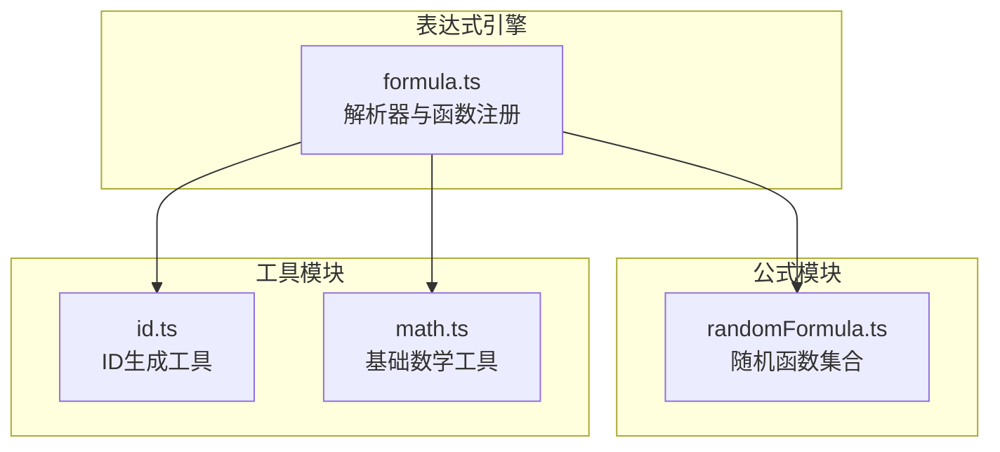
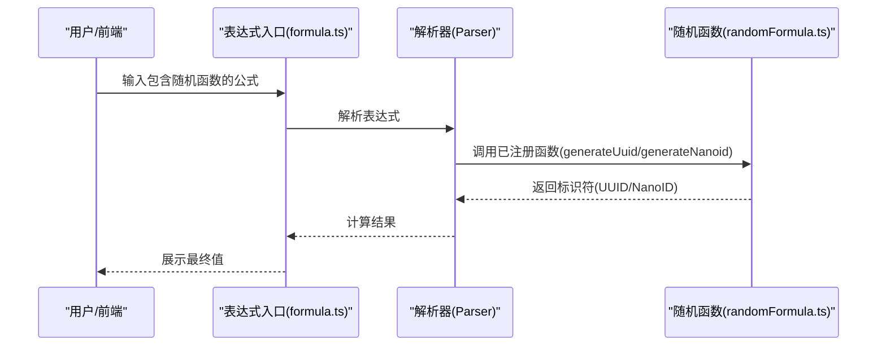
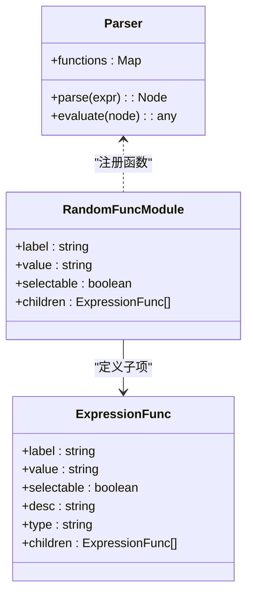
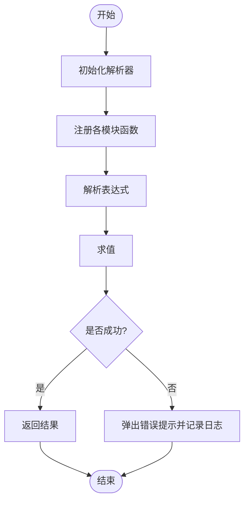
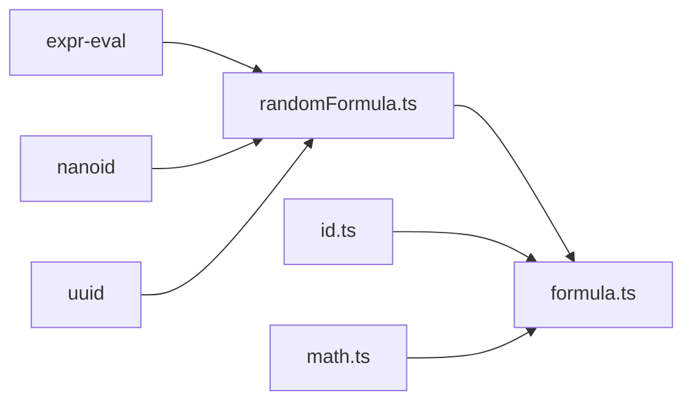

# 随机数公式

<cite>
**本文引用的文件**
- [randomFormula.ts](file://src/components/expression/formula/randomFormula.ts)
- [formula.ts](file://src/components/expression/formula.ts)
- [id.ts](file://src/utils/id.ts)
- [math.ts](file://src/utils/math.ts)
</cite>

## 目录
1. [引言](#引言)
2. [项目结构](#项目结构)
3. [核心组件](#核心组件)
4. [架构总览](#架构总览)
5. [详细组件分析](#详细组件分析)
6. [依赖关系分析](#依赖关系分析)
7. [性能考量](#性能考量)
8. [故障排查指南](#故障排查指南)
9. [结论](#结论)
10. [附录](#附录)

## 引言
本文件围绕表达式引擎中的“随机函数”能力进行系统化说明，重点覆盖以下方面：
- 基础随机能力：UUID 与 NanoID 的生成与注册
- 表达式集成：如何通过表达式解析器在公式中调用这些函数
- 实践建议：种子与算法选择、均匀性与安全性考量、采样与概率分布的扩展路径
- 安全随机数与密码学应用：在本仓库现有实现基础上的安全改进建议

需要特别说明的是：当前仓库中的“随机函数”模块仅提供 UUID 与 NanoID 两类标识符生成能力；并未包含通用伪随机数、真随机数、概率分布（如正态、泊松、贝塔）与统计采样（简单、加权、分层）等高级功能。本文将基于现有实现进行准确描述，并在适用位置给出扩展与实践建议。

## 项目结构
与“随机数公式”直接相关的文件组织如下：
- 表达式公式注册入口：负责将各类函数注册到表达式解析器
- 随机函数模块：提供 UUID 与 NanoID 生成函数及其 UI 描述
- 工具类 ID 生成：提供多种 ID 生成策略（含基于浏览器内置随机源）
- 数学工具：提供基础加法运算（用于演示表达式计算）

图表来源
- [formula.ts:1-96](file://src/components/expression/formula.ts#L1-L96)
- [randomFormula.ts:1-58](file://src/components/expression/formula/randomFormula.ts#L1-L58)
- [id.ts:1-26](file://src/utils/id.ts#L1-L26)
- [math.ts:1-4](file://src/utils/math.ts#L1-L4)

章节来源
- [formula.ts:1-96](file://src/components/expression/formula.ts#L1-L96)
- [randomFormula.ts:1-58](file://src/components/expression/formula/randomFormula.ts#L1-L58)
- [id.ts:1-26](file://src/utils/id.ts#L1-L26)
- [math.ts:1-4](file://src/utils/math.ts#L1-L4)

## 核心组件
- 随机函数集合（randomFunc）：定义了“UUID”和“NanoID”两个函数项，包含函数标签、调用值、类型与说明性描述，供表达式编辑器展示与使用。
- 注册函数（register）：将 generateUuid 与 generateNanoid 绑定到表达式解析器的函数命名空间，使公式可直接调用。
- 表达式入口（formula.ts）：集中注册所有公式模块，包括随机函数模块；同时提供 getFormValue/getSubFormValue 等常用函数。

章节来源
- [randomFormula.ts:22-57](file://src/components/expression/formula/randomFormula.ts#L22-L57)
- [formula.ts:15-24](file://src/components/expression/formula.ts#L15-L24)

## 架构总览
下图展示了表达式解析器与随机函数模块之间的交互关系，以及调用链路：

图表来源
- [formula.ts:15-95](file://src/components/expression/formula.ts#L15-L95)
- [randomFormula.ts:54-57](file://src/components/expression/formula/randomFormula.ts#L54-L57)

章节来源
- [formula.ts:15-95](file://src/components/expression/formula.ts#L15-L95)
- [randomFormula.ts:54-57](file://src/components/expression/formula/randomFormula.ts#L54-L57)

## 详细组件分析

### 随机函数模块（randomFormula.ts）
- 功能定位
  - 提供 UUID 与 NanoID 两种标识符生成函数，并以表达式函数的形式暴露给解析器。
- 接口与数据结构
  - 表达式函数接口（ExpressionFunc）：用于描述函数的标签、值、类型与说明。
  - 随机函数集合（randomFunc）：包含“UUID”和“NanoID”两个条目，每个条目包含标签、调用值、类型与 HTML 描述。
  - 注册函数（register）：将 generateUuid 与 generateNanoid 注册到解析器的函数命名空间。
- 关键实现点
  - UUID 生成：通过外部库生成标准 UUID。
  - NanoID 生成：通过外部库生成短小、URL 友好的标识符，支持可选长度参数。
  - 表达式注册：在解析器初始化阶段完成函数绑定，确保公式中可直接调用。

图表来源
- [randomFormula.ts:5-12](file://src/components/expression/formula/randomFormula.ts#L5-L12)
- [randomFormula.ts:22-57](file://src/components/expression/formula/randomFormula.ts#L22-L57)
- [formula.ts:15-24](file://src/components/expression/formula.ts#L15-L24)

章节来源
- [randomFormula.ts:1-58](file://src/components/expression/formula/randomFormula.ts#L1-L58)

### 表达式入口（formula.ts）
- 职责
  - 初始化表达式解析器，并依次注册各模块函数（包括随机函数模块）。
  - 提供表单字段取值函数（getFormValue、getSubFormValue），便于公式中引用表单数据。
  - 暴露 calculate 方法，统一执行表达式求值。
- 错误处理
  - 对表达式解析异常进行捕获与提示，避免前端崩溃。

图表来源
- [formula.ts:84-95](file://src/components/expression/formula.ts#L84-L95)

章节来源
- [formula.ts:1-96](file://src/components/expression/formula.ts#L1-L96)

### 工具类 ID 生成（id.ts）
- 内容概览
  - 提供多种 ID 生成策略：自定义 UUID 生成、基于 Math.random 的哈希串生成、短 ID（NanoID）生成等。
  - 其中部分实现直接使用浏览器内置随机源（Math.random）。
- 与随机函数模块的关系
  - 该模块与 randomFormula.ts 并行存在，前者侧重通用 ID 生成，后者侧重表达式中的 UUID/NanoID 函数。
  - 若需在表达式中使用基于 Math.random 的 ID 生成，可在表达式入口中进行注册。

章节来源
- [id.ts:1-26](file://src/utils/id.ts#L1-L26)

### 数学工具（math.ts）
- 当前仅提供基础加法运算，用于演示表达式计算流程。
- 在随机数主题下，可作为表达式中数值计算的基础能力之一。

章节来源
- [math.ts:1-4](file://src/utils/math.ts#L1-L4)

## 依赖关系分析
- 外部依赖
  - expr-eval：表达式解析与求值的核心库。
  - nanoid：短 ID 生成库。
  - uuid：标准 UUID 生成库。
- 内部依赖
  - 表达式入口集中注册各模块函数，形成清晰的模块边界与职责划分。
  - 随机函数模块仅依赖外部库与表达式解析器，保持低耦合。

图表来源
- [randomFormula.ts:1-3](file://src/components/expression/formula/randomFormula.ts#L1-L3)
- [formula.ts:1-13](file://src/components/expression/formula.ts#L1-L13)

章节来源
- [randomFormula.ts:1-58](file://src/components/expression/formula/randomFormula.ts#L1-L58)
- [formula.ts:1-24](file://src/components/expression/formula.ts#L1-L24)

## 性能考量
- UUID 与 NanoID 生成
  - 基于外部库的生成通常具备良好的性能与可预测性，适合在表达式中频繁调用。
- 表达式求值
  - 解析与求值过程在入口处统一处理，异常捕获避免阻塞主线程。
- 扩展建议
  - 若未来引入更复杂的随机数需求（如高并发下的高性能随机序列），可在工具层抽象统一的随机源接口，以便替换与优化。

## 故障排查指南
- 表达式解析错误
  - 现象：公式执行时报错并弹出提示。
  - 排查：检查函数名拼写、参数数量与类型、表达式语法。
  - 参考：入口函数对异常的捕获与提示逻辑。
- 随机函数不可用
  - 现象：公式中调用 generateUuid/generateNanoid 报未定义。
  - 排查：确认随机函数模块已在入口处注册；检查注册函数是否正确绑定到解析器。
- 生成结果不符合预期
  - 现象：UUID 或 NanoID 格式异常。
  - 排查：确认外部库版本与导入路径；核对调用参数（如 NanoID 长度）。

章节来源
- [formula.ts:84-95](file://src/components/expression/formula.ts#L84-L95)
- [randomFormula.ts:54-57](file://src/components/expression/formula/randomFormula.ts#L54-L57)

## 结论
- 当前仓库的“随机数公式”能力聚焦于 UUID 与 NanoID 两大标识符生成，并通过表达式解析器无缝集成。
- 若需扩展至通用伪随机数、真随机数、概率分布与统计采样，建议在现有模块化架构下新增对应模块，并遵循统一的注册与调用规范。
- 在安全与密码学场景中，应优先采用安全的随机源与加密安全的随机数生成器，并结合严格的密钥管理与熵源设计。

## 附录

### 基础随机函数（当前实现）
- UUID
  - 作用：生成标准 UUID 标识符。
  - 调用：在表达式中调用已注册的 generateUuid。
  - 说明：基于外部库生成，格式稳定、跨平台一致。
- NanoID
  - 作用：生成短小、URL 友好的标识符，默认长度可配置。
  - 调用：在表达式中调用已注册的 generateNanoid。
  - 说明：基于外部库生成，支持指定长度参数。

章节来源
- [randomFormula.ts:22-57](file://src/components/expression/formula/randomFormula.ts#L22-L57)

### 高级概率函数与采样（扩展建议）
- 当前状态
  - 仓库未提供正态分布、泊松分布、贝塔分布等概率分布函数，也未提供简单采样、加权采样、分层采样等统计采样函数。
- 扩展路径
  - 新增模块：按功能拆分为“概率分布”“统计采样”等子模块，分别注册到解析器。
  - 算法选择：根据业务需求选择合适算法（如 Box-Muller 生成正态分布、逆变换采样等）。
  - 参数校验：对分布参数进行范围与合法性校验，防止异常输入导致错误输出。
  - 性能优化：对高频调用的采样函数进行缓存与批量处理。
- 安全性考虑
  - 使用加密安全的随机源（如 Web Crypto API 的 getRandomValues）替代 Math.random。
  - 对种子进行强熵注入，避免可预测性。
  - 在密码学应用中，严格区分伪随机与真随机，并评估攻击面与抗预测性。

### 安全随机数生成与密码学应用实践
- 种子与算法
  - 种子：优先使用来自安全熵源的数据（如时间戳、用户交互、硬件噪声等）组合生成。
  - 算法：在密码学场景中，优先采用经认证的密码学随机数生成器（如 CSPRNG）。
- 均匀性与统计特性
  - 通过统计检验（如卡方检验、Kolmogorov-Smirnov 检验）评估均匀性与分布一致性。
- 实施建议
  - 在工具层抽象统一的随机源接口，便于替换与测试。
  - 对关键路径（如密钥生成、会话令牌）单独进行安全审计与渗透测试。
  - 在表达式层限制高风险随机操作的调用频率与可见范围，避免滥用。