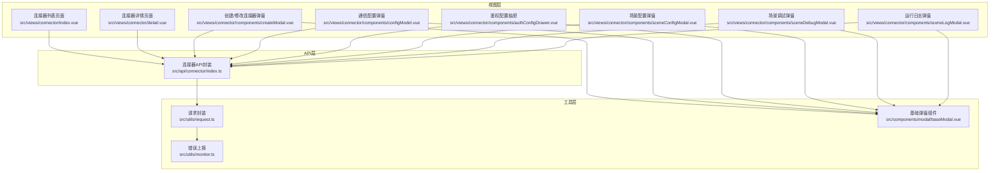
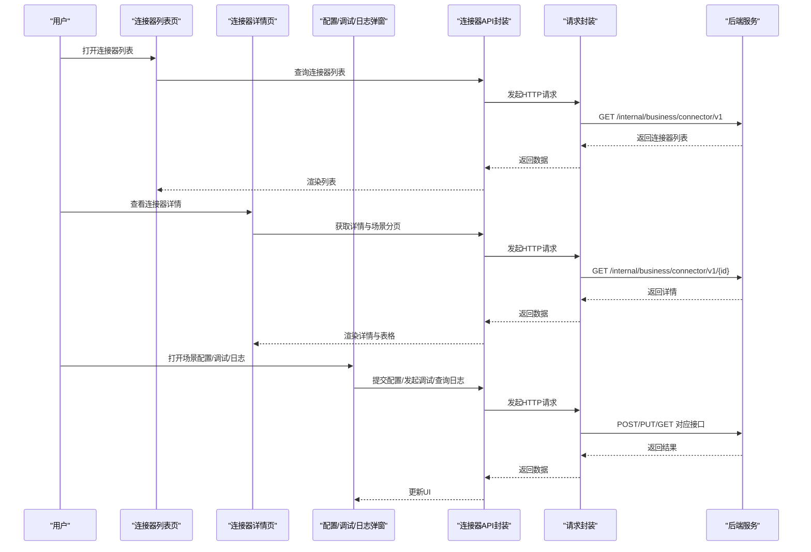
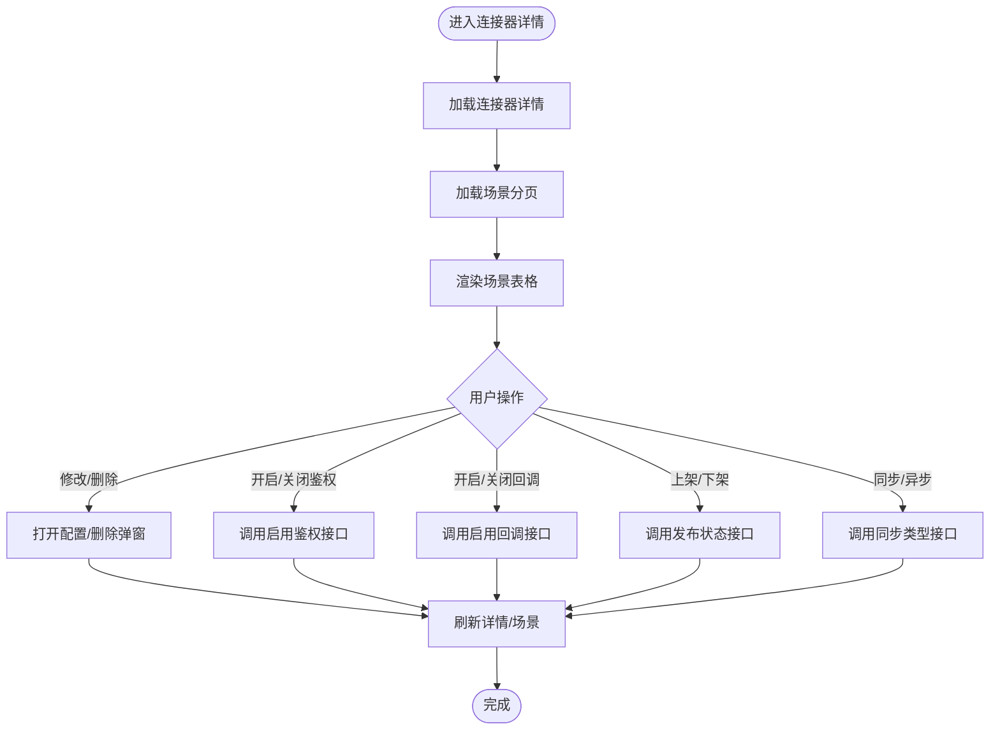
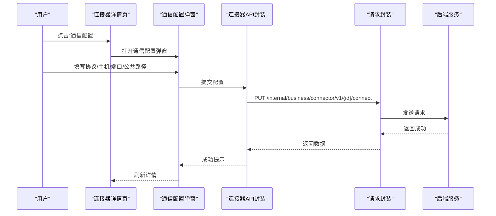
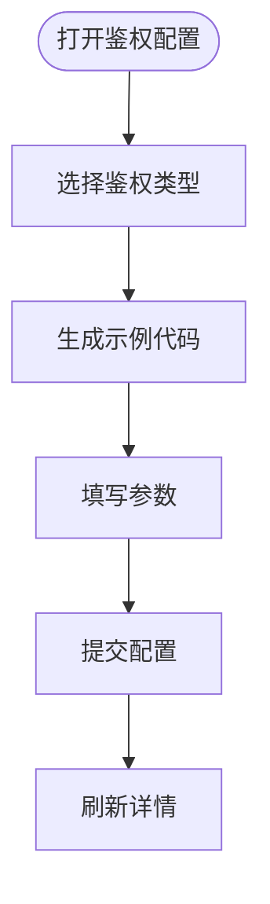
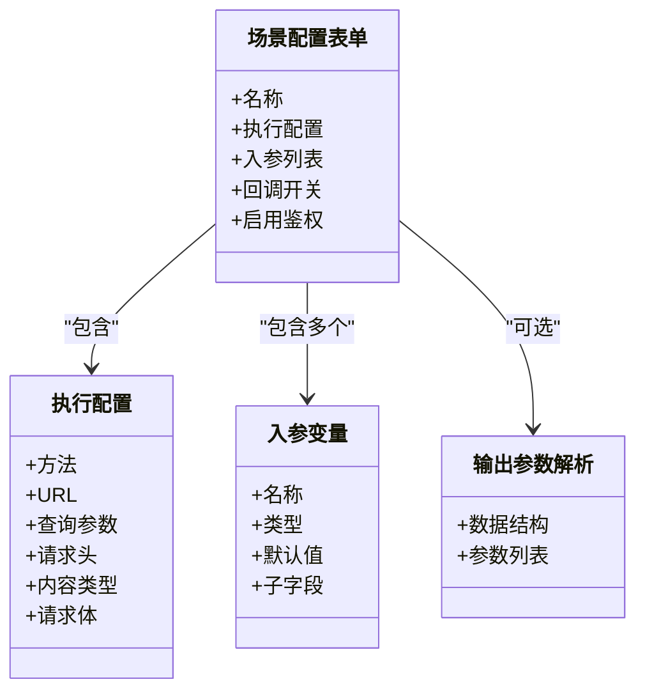
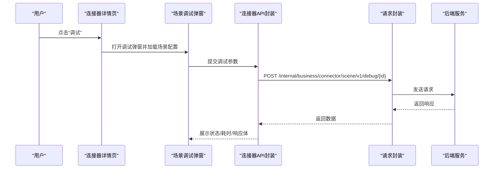
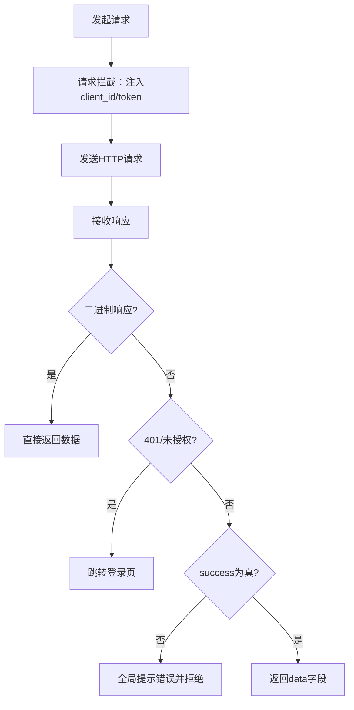
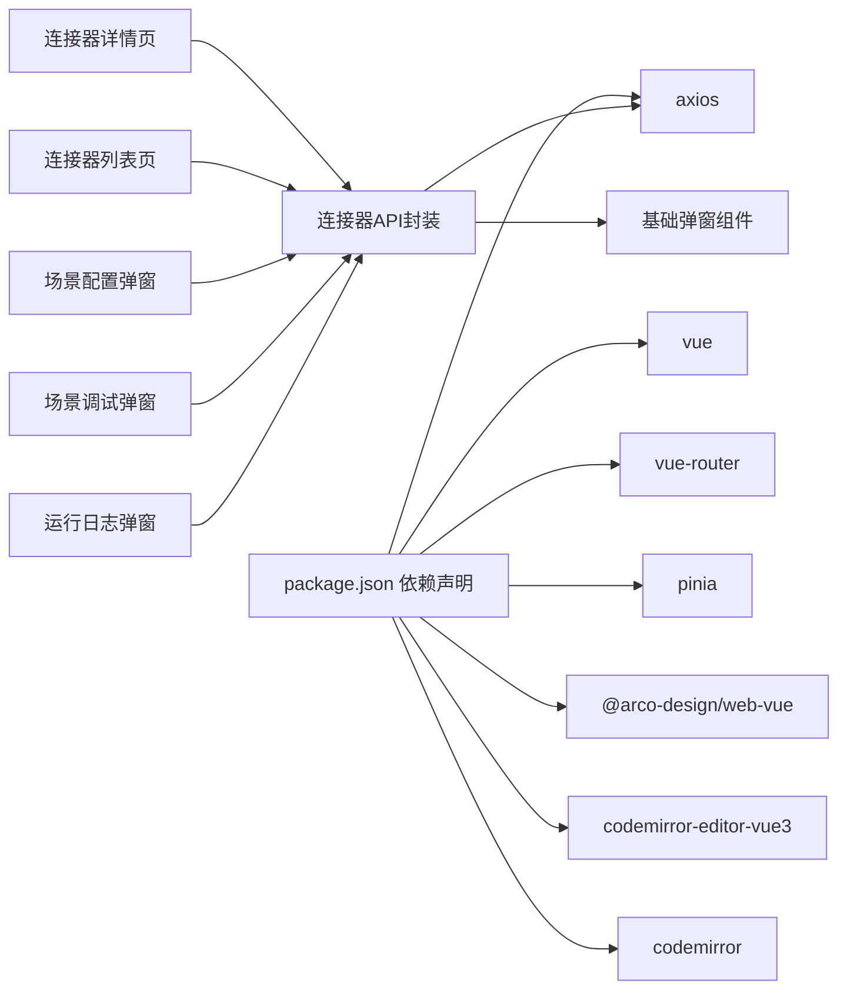

# 连接器系统

<cite>
**本文档引用的文件**
- [src/api/connector/index.ts](file://src/api/connector/index.ts)
- [src/views/connector/index.vue](file://src/views/connector/index.vue)
- [src/views/connector/detail.vue](file://src/views/connector/detail.vue)
- [src/views/connector/components/createModal.vue](file://src/views/connector/components/createModal.vue)
- [src/views/connector/components/configModel.vue](file://src/views/connector/components/configModel.vue)
- [src/views/connector/components/authConfigDrawer.vue](file://src/views/connector/components/authConfigDrawer.vue)
- [src/views/connector/components/sceneConfigModal.vue](file://src/views/connector/components/sceneConfigModal.vue)
- [src/views/connector/components/sceneDebugModal.vue](file://src/views/connector/components/sceneDebugModal.vue)
- [src/views/connector/components/sceneLogModal.vue](file://src/views/connector/components/sceneLogModal.vue)
- [src/utils/request.ts](file://src/utils/request.ts)
- [src/utils/monitor.ts](file://src/utils/monitor.ts)
- [src/components/modal/baseModal.vue](file://src/components/modal/baseModal.vue)
- [package.json](file://package.json)
</cite>

## 目录
1. [简介](#简介)
2. [项目结构](#项目结构)
3. [核心组件](#核心组件)
4. [架构总览](#架构总览)
5. [详细组件分析](#详细组件分析)
6. [依赖关系分析](#依赖关系分析)
7. [性能考虑](#性能考虑)
8. [故障排除指南](#故障排除指南)
9. [结论](#结论)
10. [附录](#附录)

## 简介
本项目提供一个“连接器系统”，用于在应用之间建立数据连接，支持非专业用户通过可视化配置实现外部服务集成。系统围绕“连接器”和“场景（动作）”两大概念构建，提供通信配置、鉴权配置、场景参数映射、调试与运行日志等功能，并通过统一的请求封装与错误处理保障稳定性。

## 项目结构
连接器系统主要由三层构成：
- 视图层：负责用户交互与配置展示（连接器列表、详情、各配置弹窗）
- API 层：封装对后端接口的调用（连接器、场景、日志、调试等）
- 工具层：统一请求封装、错误上报与通用组件

**图表来源**
- [src/views/connector/index.vue:1-334](file://src/views/connector/index.vue#L1-L334)
- [src/views/connector/detail.vue:1-589](file://src/views/connector/detail.vue#L1-L589)
- [src/api/connector/index.ts:1-104](file://src/api/connector/index.ts#L1-L104)
- [src/utils/request.ts:1-159](file://src/utils/request.ts#L1-L159)
- [src/utils/monitor.ts:1-29](file://src/utils/monitor.ts#L1-L29)
- [src/components/modal/baseModal.vue:1-104](file://src/components/modal/baseModal.vue#L1-L104)

**章节来源**
- [src/views/connector/index.vue:1-334](file://src/views/connector/index.vue#L1-L334)
- [src/views/connector/detail.vue:1-589](file://src/views/connector/detail.vue#L1-L589)
- [src/api/connector/index.ts:1-104](file://src/api/connector/index.ts#L1-L104)
- [src/utils/request.ts:1-159](file://src/utils/request.ts#L1-L159)
- [src/utils/monitor.ts:1-29](file://src/utils/monitor.ts#L1-L29)
- [src/components/modal/baseModal.vue:1-104](file://src/components/modal/baseModal.vue#L1-L104)

## 核心组件
- 连接器列表与详情：提供连接器的创建、修改、删除、通信与鉴权配置入口，以及场景列表的查看与操作。
- 场景配置：支持为每个场景配置入参变量、URL、查询参数、请求头、请求体（含多种 Content-Type）、回调与数据解析规则。
- 调试与日志：提供场景调试能力与运行日志查询，便于定位问题。
- 统一请求封装：集中处理请求头注入、鉴权令牌、响应拦截与错误提示。
- 错误上报：在开发模式下将前端错误上报至指定接口，辅助排障。

**章节来源**
- [src/views/connector/index.vue:1-334](file://src/views/connector/index.vue#L1-L334)
- [src/views/connector/detail.vue:1-589](file://src/views/connector/detail.vue#L1-L589)
- [src/views/connector/components/sceneConfigModal.vue:1-848](file://src/views/connector/components/sceneConfigModal.vue#L1-L848)
- [src/views/connector/components/sceneDebugModal.vue:1-414](file://src/views/connector/components/sceneDebugModal.vue#L1-L414)
- [src/views/connector/components/sceneLogModal.vue:1-265](file://src/views/connector/components/sceneLogModal.vue#L1-L265)
- [src/utils/request.ts:1-159](file://src/utils/request.ts#L1-L159)
- [src/utils/monitor.ts:1-29](file://src/utils/monitor.ts#L1-L29)

## 架构总览
连接器系统采用前后端分离架构，前端通过统一的请求封装与后端交互；后端提供连接器与场景的 CRUD、配置开关、调试与日志查询等接口。系统通过多处弹窗/抽屉组件承载配置与运维能力，保证界面简洁与操作聚焦。

**图表来源**
- [src/views/connector/index.vue:104-127](file://src/views/connector/index.vue#L104-L127)
- [src/views/connector/detail.vue:322-346](file://src/views/connector/detail.vue#L322-L346)
- [src/api/connector/index.ts:6-104](file://src/api/connector/index.ts#L6-L104)
- [src/utils/request.ts:117-154](file://src/utils/request.ts#L117-L154)

**章节来源**
- [src/api/connector/index.ts:1-104](file://src/api/connector/index.ts#L1-L104)
- [src/utils/request.ts:1-159](file://src/utils/request.ts#L1-L159)

## 详细组件分析

### 连接器列表与详情
- 列表页：支持按名称与类型筛选，提供创建连接器入口与卡片式展示。
- 详情页：展示连接器基本信息、通信与鉴权配置状态；表格列出场景，支持开关鉴权、回调、上下架、同步/异步类型；提供场景配置、运行日志、调试入口。

**图表来源**
- [src/views/connector/detail.vue:272-434](file://src/views/connector/detail.vue#L272-L434)
- [src/api/connector/index.ts:31-63](file://src/api/connector/index.ts#L31-L63)

**章节来源**
- [src/views/connector/index.vue:1-334](file://src/views/connector/index.vue#L1-L334)
- [src/views/connector/detail.vue:1-589](file://src/views/connector/detail.vue#L1-L589)
- [src/api/connector/index.ts:1-104](file://src/api/connector/index.ts#L1-L104)

### 通信配置（域名/端口/协议）
- 功能：为连接器配置统一的通信域、端口与公共路径，形成完整访问地址。
- 表单字段：协议（http/https）、主机名（支持IP）、端口、公共路径。
- 行为：必填校验，提交后刷新连接器详情。

**图表来源**
- [src/views/connector/detail.vue:301-309](file://src/views/connector/detail.vue#L301-L309)
- [src/views/connector/components/configModel.vue:80-122](file://src/views/connector/components/configModel.vue#L80-L122)
- [src/api/connector/index.ts:35-38](file://src/api/connector/index.ts#L35-L38)
- [src/utils/request.ts:133-139](file://src/utils/request.ts#L133-L139)

**章节来源**
- [src/views/connector/components/configModel.vue:1-153](file://src/views/connector/components/configModel.vue#L1-L153)
- [src/views/connector/detail.vue:301-309](file://src/views/connector/detail.vue#L301-L309)
- [src/api/connector/index.ts:35-38](file://src/api/connector/index.ts#L35-L38)

### 鉴权配置（Token/Basic Auth）
- 功能：为连接器配置鉴权方案与参数（token 或 Basic 认证），并提供示例代码生成。
- 表单字段：鉴权类型（none/token/Basic）、token、用户名/密码。
- 行为：根据类型动态显示参数输入，提交后刷新连接器详情。

**图表来源**
- [src/views/connector/components/authConfigDrawer.vue:167-184](file://src/views/connector/components/authConfigDrawer.vue#L167-L184)
- [src/views/connector/components/authConfigDrawer.vue:225-257](file://src/views/connector/components/authConfigDrawer.vue#L225-L257)
- [src/views/connector/detail.vue:306-309](file://src/views/connector/detail.vue#L306-L309)

**章节来源**
- [src/views/connector/components/authConfigDrawer.vue:1-354](file://src/views/connector/components/authConfigDrawer.vue#L1-L354)
- [src/views/connector/detail.vue:306-309](file://src/views/connector/detail.vue#L306-L309)
- [src/api/connector/index.ts:40-43](file://src/api/connector/index.ts#L40-L43)

### 场景配置（入参/请求/回调）
- 功能：为场景配置入参变量（支持任意、对象、数组）、URL、查询参数、请求头、请求体（JSON/form-data/urlencoded），以及回调与数据解析规则。
- 行为：支持动态增删入参与子字段，支持将入参变量插入到 JSON 编辑器；提交时根据 Content-Type 转换请求体格式；开启回调时可配置输出参数解析。

**图表来源**
- [src/views/connector/components/sceneConfigModal.vue:365-385](file://src/views/connector/components/sceneConfigModal.vue#L365-L385)
- [src/views/connector/components/sceneConfigModal.vue:410-425](file://src/views/connector/components/sceneConfigModal.vue#L410-L425)

**章节来源**
- [src/views/connector/components/sceneConfigModal.vue:1-848](file://src/views/connector/components/sceneConfigModal.vue#L1-L848)
- [src/api/connector/index.ts:65-83](file://src/api/connector/index.ts#L65-L83)

### 场景调试
- 功能：基于场景配置生成调试请求，支持切换请求参数/请求头/请求体三个面板，查看响应体与耗时。
- 行为：从场景详情加载配置，将对象/数组类型的入参序列化为字符串，默认值作为调试输入；提交后展示响应状态与响应体。

**图表来源**
- [src/views/connector/components/sceneDebugModal.vue:231-286](file://src/views/connector/components/sceneDebugModal.vue#L231-L286)
- [src/views/connector/components/sceneDebugModal.vue:292-318](file://src/views/connector/components/sceneDebugModal.vue#L292-L318)
- [src/api/connector/index.ts:95-98](file://src/api/connector/index.ts#L95-L98)

**章节来源**
- [src/views/connector/components/sceneDebugModal.vue:1-414](file://src/views/connector/components/sceneDebugModal.vue#L1-L414)
- [src/api/connector/index.ts:95-98](file://src/api/connector/index.ts#L95-L98)

### 运行日志
- 功能：按日期范围、流程、状态筛选场景运行记录，分页展示触发时间、耗时与状态。
- 行为：首次打开时加载流程下拉与日志列表；支持清空筛选条件重置。

**章节来源**
- [src/views/connector/components/sceneLogModal.vue:1-265](file://src/views/connector/components/sceneLogModal.vue#L1-L265)
- [src/api/connector/index.ts:85-93](file://src/api/connector/index.ts#L85-L93)

### 统一请求封装与错误处理
- 请求封装：统一设置 baseURL、超时、客户端标识与令牌注入；对 blob/arraybuffer 类型响应直接透传；对非 2xx/非 success 的响应统一提示错误并拒绝。
- 错误处理：对常见 HTTP 状态码进行统一提示；在开发模式下可将错误上报至指定接口。

**图表来源**
- [src/utils/request.ts:26-113](file://src/utils/request.ts#L26-L113)
- [src/utils/monitor.ts:4-28](file://src/utils/monitor.ts#L4-L28)

**章节来源**
- [src/utils/request.ts:1-159](file://src/utils/request.ts#L1-L159)
- [src/utils/monitor.ts:1-29](file://src/utils/monitor.ts#L1-L29)

## 依赖关系分析
- 前端依赖：Vue 3、Vue Router、Pinia、Arco Design、Axios、CodeMirror 等。
- 连接器系统依赖 axios 进行 HTTP 通信，依赖 Arco Design 组件库构建 UI，依赖 CodeMirror 提供语法高亮的编辑器。
- 组件间通过 props 与事件进行解耦，统一通过 API 封装访问后端。

**图表来源**
- [package.json:13-44](file://package.json#L13-L44)
- [src/api/connector/index.ts:1-3](file://src/api/connector/index.ts#L1-L3)
- [src/components/modal/baseModal.vue:1-24](file://src/components/modal/baseModal.vue#L1-L24)

**章节来源**
- [package.json:1-63](file://package.json#L1-L63)
- [src/api/connector/index.ts:1-3](file://src/api/connector/index.ts#L1-L3)

## 性能考虑
- 请求缓存：当前实现未内置缓存策略，建议在高频查询场景（如日志分页）引入本地缓存或防抖策略，减少重复请求。
- 图片与资源：连接器图标使用静态资源，建议在构建阶段进行压缩与懒加载，降低首屏压力。
- 表单渲染：场景配置弹窗包含大量动态表格与 CodeMirror 编辑器，建议在大数据量时采用虚拟滚动与延迟初始化，提升交互流畅度。
- 超时与重试：当前请求封装设置了超时，未实现自动重试。对于弱网环境，可在调用层增加指数退避重试策略，避免频繁失败影响用户体验。

## 故障排除指南
- 登录态失效：当后端返回 401 时，请求拦截器会跳转登录页；若未跳转，请检查 token 注入逻辑与白名单配置。
- 接口报错：响应拦截器会统一提示错误信息；若提示为空，检查后端返回结构与 success 字段。
- 调试无响应：确保场景已配置正确的 URL、方法与请求体；检查调试弹窗中的入参默认值是否符合后端期望。
- 日志查询异常：确认筛选条件（日期范围、流程、状态）是否正确；尝试清空筛选重试。
- 错误上报：开发模式下可通过错误上报函数将错误信息发送至指定接口，便于定位问题。

**章节来源**
- [src/utils/request.ts:47-113](file://src/utils/request.ts#L47-L113)
- [src/utils/monitor.ts:4-28](file://src/utils/monitor.ts#L4-L28)
- [src/views/connector/components/sceneDebugModal.vue:292-318](file://src/views/connector/components/sceneDebugModal.vue#L292-L318)
- [src/views/connector/components/sceneLogModal.vue:125-145](file://src/views/connector/components/sceneLogModal.vue#L125-L145)

## 结论
连接器系统通过清晰的视图层与 API 层划分，结合统一的请求封装与错误处理，提供了完整的连接器生命周期管理能力。其可视化配置与调试、日志功能有效降低了外部服务集成的门槛。后续可在缓存、重试、渲染性能等方面进一步优化，以提升大规模场景下的稳定性与用户体验。

## 附录
- 最佳实践
  - 在创建连接器时先配置通信与鉴权，再逐步完善场景参数与回调。
  - 使用调试功能验证场景配置，确保入参与请求体符合后端规范。
  - 对关键场景开启回调并配置输出参数解析，便于后续流程使用。
  - 在弱网环境下适当调整超时与重试策略，提升成功率。
- 开发建议
  - 对高频接口增加本地缓存与防抖。
  - 对大表格与编辑器组件采用虚拟化与延迟初始化。
  - 在生产环境关闭错误上报，仅在开发环境启用以便快速定位问题。