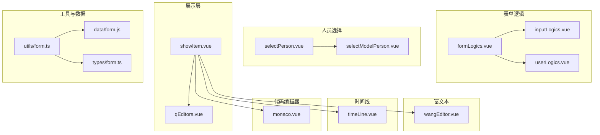
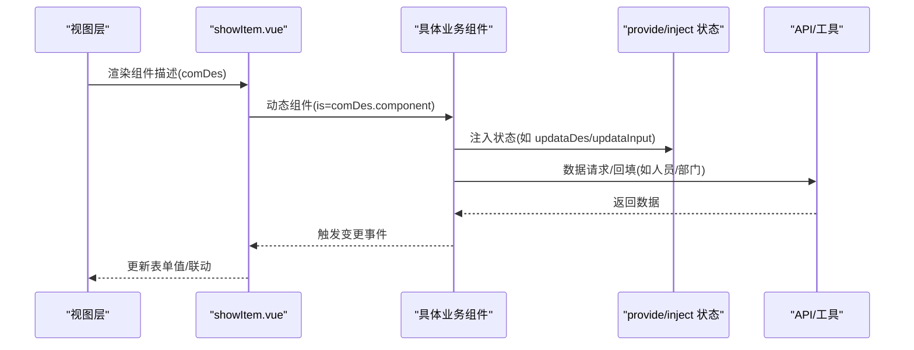
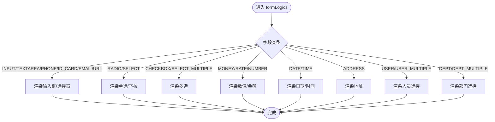
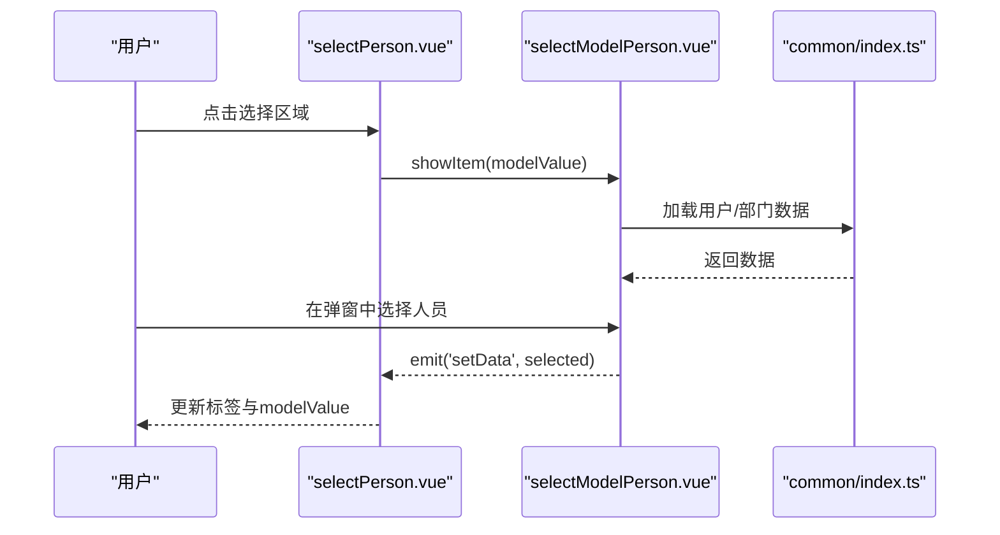
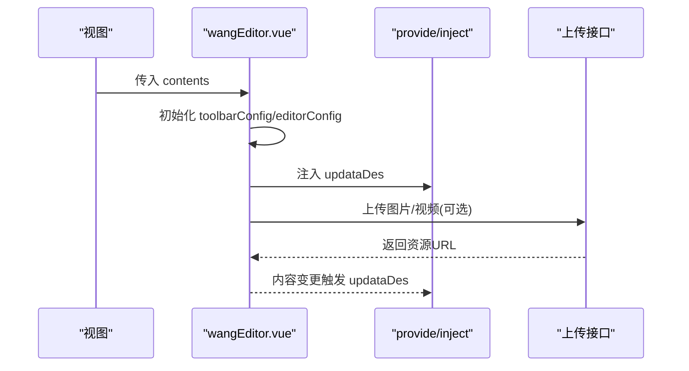
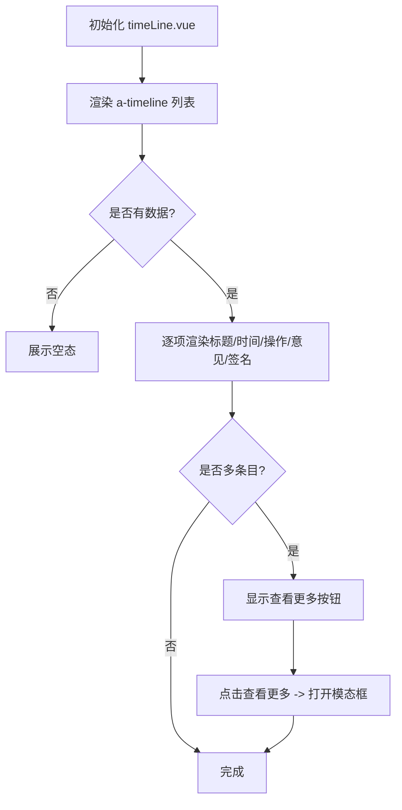
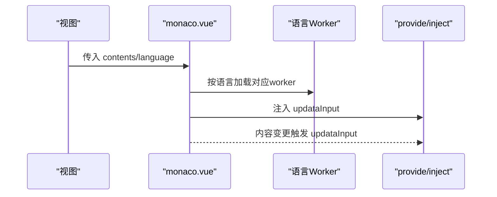
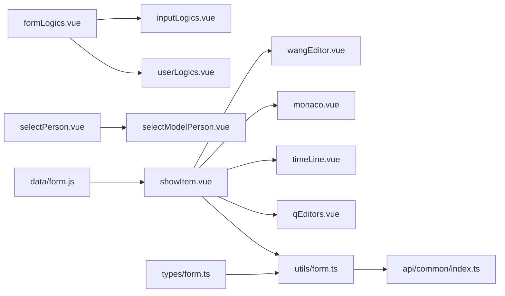

# 业务组件库

<cite>
**本文引用的文件**
- [src/components/formLogics/formLogics.vue](file://src/components/formLogics/formLogics.vue)
- [src/components/formLogics/inputLogics.vue](file://src/components/formLogics/inputLogics.vue)
- [src/components/formLogics/userLogics.vue](file://src/components/formLogics/userLogics.vue)
- [src/components/selectPerson/selectPerson.vue](file://src/components/selectPerson/selectPerson.vue)
- [src/components/selectPerson/components/selectModelPerson.vue](file://src/components/selectPerson/components/selectModelPerson.vue)
- [src/components/wangEditor/wangEditor.vue](file://src/components/wangEditor/wangEditor.vue)
- [src/components/timeLine/timeLine.vue](file://src/components/timeLine/timeLine.vue)
- [src/components/monaco/monaco.vue](file://src/components/monaco/monaco.vue)
- [src/components/showItem/qEditors.vue](file://src/components/showItem/qEditors.vue)
- [src/components/showItem/showItem.vue](file://src/components/showItem/showItem.vue)
- [src/utils/form.ts](file://src/utils/form.ts)
- [src/data/form.js](file://src/data/form.js)
- [src/times/form.ts](file://src/types/form.ts)
- [src/views/form/components/create.vue](file://src/views/form/components/create.vue)
- [src/views/form/components/condition.vue](file://src/views/form/components/condition.vue)
- [src/api/common/index.ts](file://src/api/common/index.ts)
- [src/api/form/index.ts](file://src/api/form/index.ts)
</cite>

## 目录
1. [简介](#简介)
2. [项目结构](#项目结构)
3. [核心组件](#核心组件)
4. [架构总览](#架构总览)
5. [详细组件分析](#详细组件分析)
6. [依赖关系分析](#依赖关系分析)
7. [性能考量](#性能考量)
8. [故障排查指南](#故障排查指南)
9. [结论](#结论)
10. [附录](#附录)

## 简介
本文件系统化梳理新工作台项目的业务组件库，重点覆盖表单逻辑组件、人员选择组件、富文本编辑器、时间线组件、代码编辑器等业务专用组件。文档从架构设计、实现原理、功能特性、配置项、事件与数据绑定、集成与扩展、API 文档、使用示例与最佳实践等方面进行深入解析，并提供实际业务案例与代码路径指引，帮助开发者快速理解与应用。

## 项目结构
业务组件库主要分布在以下目录：
- 表单逻辑与展示：src/components/formLogics、src/components/showItem
- 人员选择：src/components/selectPerson
- 富文本编辑：src/components/wangEditor
- 时间线：src/components/timeLine
- 代码编辑器：src/components/monaco
- 工具与数据模型：src/utils/form.ts、src/data/form.js、src/types/form.ts
- 视图与表单逻辑配置：src/views/form/components

图表来源
- [src/components/formLogics/formLogics.vue:1-35](file://src/components/formLogics/formLogics.vue#L1-L35)
- [src/components/formLogics/inputLogics.vue:1-28](file://src/components/formLogics/inputLogics.vue#L1-L28)
- [src/components/formLogics/userLogics.vue:1-24](file://src/components/formLogics/userLogics.vue#L1-L24)
- [src/components/selectPerson/selectPerson.vue:1-115](file://src/components/selectPerson/selectPerson.vue#L1-L115)
- [src/components/selectPerson/components/selectModelPerson.vue:1-81](file://src/components/selectPerson/components/selectModelPerson.vue#L1-L81)
- [src/components/wangEditor/wangEditor.vue:1-121](file://src/components/wangEditor/wangEditor.vue#L1-L121)
- [src/components/timeLine/timeLine.vue:1-199](file://src/components/timeLine/timeLine.vue#L1-L199)
- [src/components/monaco/monaco.vue:1-57](file://src/components/monaco/monaco.vue#L1-L57)
- [src/components/showItem/showItem.vue:1-196](file://src/components/showItem/showItem.vue#L1-L196)
- [src/components/showItem/qEditors.vue:1-50](file://src/components/showItem/qEditors.vue#L1-L50)
- [src/utils/form.ts:1-800](file://src/utils/form.ts#L1-L800)
- [src/data/form.js:1-800](file://src/data/form.js#L1-L800)
- [src/types/form.ts:1-45](file://src/types/form.ts#L1-L45)

章节来源
- [src/components/formLogics/formLogics.vue:1-35](file://src/components/formLogics/formLogics.vue#L1-L35)
- [src/components/selectPerson/selectPerson.vue:1-115](file://src/components/selectPerson/selectPerson.vue#L1-L115)
- [src/components/wangEditor/wangEditor.vue:1-121](file://src/components/wangEditor/wangEditor.vue#L1-L121)
- [src/components/timeLine/timeLine.vue:1-199](file://src/components/timeLine/timeLine.vue#L1-L199)
- [src/components/monaco/monaco.vue:1-57](file://src/components/monaco/monaco.vue#L1-L57)
- [src/components/showItem/showItem.vue:1-196](file://src/components/showItem/showItem.vue#L1-L196)
- [src/utils/form.ts:1-800](file://src/utils/form.ts#L1-L800)
- [src/data/form.js:1-800](file://src/data/form.js#L1-L800)
- [src/types/form.ts:1-45](file://src/types/form.ts#L1-L45)

## 核心组件
- 表单逻辑组件：根据字段类型与条件动态渲染输入控件，支持数值、区间、人员、部门等逻辑分支。
- 人员选择组件：支持单选/多选、标签化展示、弹窗选择、部门树联动。
- 富文本编辑器：基于 wangeditor 的 Vue 组件，支持工具栏、图片/视频上传、占位符与双向绑定。
- 时间线组件：展示流程审批/填写记录，支持多条目、操作类型、自动审批、手写签名等。
- 代码编辑器：基于 Monaco Editor 的 Vue 组件，支持语言切换、主题、工作线程与实时回传。
- 展示与容器：统一的组件容器 showItem.vue，负责渲染与交互；qEditors.vue 支持折叠/展开的富文本展示。

章节来源
- [src/components/formLogics/formLogics.vue:1-35](file://src/components/formLogics/formLogics.vue#L1-L35)
- [src/components/selectPerson/selectPerson.vue:1-115](file://src/components/selectPerson/selectPerson.vue#L1-L115)
- [src/components/wangEditor/wangEditor.vue:1-121](file://src/components/wangEditor/wangEditor.vue#L1-L121)
- [src/components/timeLine/timeLine.vue:1-199](file://src/components/timeLine/timeLine.vue#L1-L199)
- [src/components/monaco/monaco.vue:1-57](file://src/components/monaco/monaco.vue#L1-L57)
- [src/components/showItem/showItem.vue:1-196](file://src/components/showItem/showItem.vue#L1-L196)
- [src/components/showItem/qEditors.vue:1-50](file://src/components/showItem/qEditors.vue#L1-L50)

## 架构总览
组件间通过“容器 + 子组件”的组合模式组织，统一由 showItem.vue 动态渲染具体组件；表单逻辑组件通过 formLogics.vue 根据字段类型与条件选择性挂载子逻辑组件；人员选择通过 selectPerson.vue 与 selectModelPerson.vue 实现弹窗与数据回填；富文本与代码编辑器分别注入 provide/inject 机制以实现与设计器的状态同步。

图表来源
- [src/components/showItem/showItem.vue:1-196](file://src/components/showItem/showItem.vue#L1-L196)
- [src/components/wangEditor/wangEditor.vue:1-121](file://src/components/wangEditor/wangEditor.vue#L1-L121)
- [src/components/monaco/monaco.vue:1-57](file://src/components/monaco/monaco.vue#L1-L57)
- [src/api/common/index.ts:41-68](file://src/api/common/index.ts#L41-L68)

## 详细组件分析

### 表单逻辑组件（formLogics）
- 设计思路：根据字段类型与条件动态渲染不同逻辑子组件，减少冗余 DOM，提升运行效率。
- 关键点：
  - 条件分支：INPUT/TEXTAREA/PHONE/ID_CARD/EMAIL/URL 等文本类；RADIO/SELECT；CHECKBOX/SELECT_MULTIPLE；MONEY/RATE/NUMBER；DATE/TIME；ADDRESS；USER/USER_MULTIPLE；DEPT/DEPT_MULTIPLE。
  - 输入控件：文本类使用输入框或选择器，人员/部门类通过 selectRadioPerson/selectCheckPerson 与 deptList 交互。
  - 数据绑定：datas.value 与条件联动，支持多选/区间等复杂场景。
- 典型使用：在表单逻辑配置页中，按字段类型与比较符号选择对应控件，实现动态校验与联动。

图表来源
- [src/components/formLogics/formLogics.vue:1-35](file://src/components/formLogics/formLogics.vue#L1-L35)
- [src/components/formLogics/inputLogics.vue:1-28](file://src/components/formLogics/inputLogics.vue#L1-L28)
- [src/components/formLogics/userLogics.vue:1-24](file://src/components/formLogics/userLogics.vue#L1-L24)

章节来源
- [src/components/formLogics/formLogics.vue:1-35](file://src/components/formLogics/formLogics.vue#L1-L35)
- [src/components/formLogics/inputLogics.vue:1-28](file://src/components/formLogics/inputLogics.vue#L1-L28)
- [src/components/formLogics/userLogics.vue:1-24](file://src/components/formLogics/userLogics.vue#L1-L24)

### 人员选择组件（selectPerson）
- 功能特性：
  - 标签化展示已选人员，最多展示前 N 项，其余以“+n”聚合。
  - 支持点击关闭单个标签，支持弹窗选择。
  - 通过 selectModelPerson.vue 打开模态框，内部使用 personList 与部门树联动。
- 配置项：
  - modelValue：双向绑定的人员列表。
  - placeholder/title/deptList：占位提示、标题、部门列表。
- 事件与数据绑定：
  - update:modelValue：外部监听选中变化。
  - @setData：内部选择完成后回调，回填至父组件。
- 集成方式：作为表单字段组件直接使用，配合 deptList 与 API 获取用户/部门信息。

图表来源
- [src/components/selectPerson/selectPerson.vue:1-115](file://src/components/selectPerson/selectPerson.vue#L1-L115)
- [src/components/selectPerson/components/selectModelPerson.vue:1-81](file://src/components/selectPerson/components/selectModelPerson.vue#L1-L81)
- [src/api/common/index.ts:41-68](file://src/api/common/index.ts#L41-L68)

章节来源
- [src/components/selectPerson/selectPerson.vue:1-115](file://src/components/selectPerson/selectPerson.vue#L1-L115)
- [src/components/selectPerson/components/selectModelPerson.vue:1-81](file://src/components/selectPerson/components/selectModelPerson.vue#L1-L81)
- [src/api/common/index.ts:41-68](file://src/api/common/index.ts#L41-L68)

### 富文本编辑器（wangEditor）
- 功能特性：
  - 工具栏自定义：支持对齐、加粗、下划线、斜体、清除样式、颜色、字号、链接等。
  - 上传能力：图片/视频上传配置，支持自定义插入与超时控制。
  - 占位符与样式：支持 placeholder 与容器样式定制。
  - 状态同步：通过 provide/inject 将内容变更回传至设计器。
- 配置项：
  - contents：初始内容。
  - toolbarConfig：工具栏键集合与排除集合。
  - editorConfig：占位符、上传参数、超时、允许类型、最大尺寸等。
- 事件与数据绑定：
  - v-model：双向绑定内容。
  - watch(contents)：外部更新时同步编辑器内容。
  - watch(valueHtml)：内容变化时通过 updataDes 回传。

图表来源
- [src/components/wangEditor/wangEditor.vue:1-121](file://src/components/wangEditor/wangEditor.vue#L1-L121)

章节来源
- [src/components/wangEditor/wangEditor.vue:1-121](file://src/components/wangEditor/wangEditor.vue#L1-L121)

### 时间线组件（timeLine）
- 功能特性：
  - 展示流程审批/填写记录，支持标题、时间、操作类型、审批人/填写人、自动审批标识、处理意见、手写签名等。
  - 支持多条目展开查看更多。
  - 空态展示与模态框联动。
- 配置项：
  - commentList：时间线数据数组。
- 事件与数据绑定：
  - seeMore(item)：点击“查看更多”打开模态框。
  - 通过 window 接口与本地存储 token 进行签名图片加载。

图表来源
- [src/components/timeLine/timeLine.vue:1-199](file://src/components/timeLine/timeLine.vue#L1-L199)

章节来源
- [src/components/timeLine/timeLine.vue:1-199](file://src/components/timeLine/timeLine.vue#L1-L199)

### 代码编辑器（monaco）
- 功能特性：
  - 基于 Monaco Editor 的 Vue 组件，支持语言切换、主题、最小化预览、自动布局。
  - 工作线程分离：按语言加载对应 worker，提升性能。
  - 状态同步：通过 provide/inject 将内容变更回传至设计器。
- 配置项：
  - contents：初始内容。
  - language：语言类型。
  - editorOptions：字体大小、小地图、自动布局等。
- 事件与数据绑定：
  - v-model：双向绑定内容。
  - watch(content)：内容变化时通过 updataInput 回传。

图表来源
- [src/components/monaco/monaco.vue:1-57](file://src/components/monaco/monaco.vue#L1-L57)

章节来源
- [src/components/monaco/monaco.vue:1-57](file://src/components/monaco/monaco.vue#L1-L57)

### 展示与容器（showItem、qEditors）
- showItem.vue：
  - 统一渲染表单项与描述，支持编辑态与只读态切换。
  - 通过动态组件渲染具体业务组件，支持方法钩子与过滤联动。
- qEditors.vue：
  - 展示富文本内容，支持折叠/展开，内置 HTML 渲染与样式穿透。

章节来源
- [src/components/showItem/showItem.vue:1-196](file://src/components/showItem/showItem.vue#L1-L196)
- [src/components/showItem/qEditors.vue:1-50](file://src/components/showItem/qEditors.vue#L1-L50)

## 依赖关系分析
- 组件耦合：
  - formLogics.vue 与 inputLogics.vue、userLogics.vue 为组合关系，按字段类型与条件选择性渲染。
  - selectPerson.vue 与 selectModelPerson.vue 为父子关系，前者负责 UI，后者负责弹窗与数据加载。
  - showItem.vue 为通用容器，依赖 provide/inject 与各业务组件解耦。
- 外部依赖：
  - API：common/index.ts 提供用户/部门/关联组件数据查询。
  - 工具：utils/form.ts 提供表单数据转换、表达式计算、联动查询等。
  - 数据模型：data/form.js 定义基础组件属性与默认值；types/form.ts 定义类型约束。

图表来源
- [src/components/formLogics/formLogics.vue:1-35](file://src/components/formLogics/formLogics.vue#L1-L35)
- [src/components/selectPerson/selectPerson.vue:1-115](file://src/components/selectPerson/selectPerson.vue#L1-L115)
- [src/components/wangEditor/wangEditor.vue:1-121](file://src/components/wangEditor/wangEditor.vue#L1-L121)
- [src/components/monaco/monaco.vue:1-57](file://src/components/monaco/monaco.vue#L1-L57)
- [src/components/timeLine/timeLine.vue:1-199](file://src/components/timeLine/timeLine.vue#L1-L199)
- [src/components/showItem/showItem.vue:1-196](file://src/components/showItem/showItem.vue#L1-L196)
- [src/components/showItem/qEditors.vue:1-50](file://src/components/showItem/qEditors.vue#L1-L50)
- [src/utils/form.ts:1-800](file://src/utils/form.ts#L1-L800)
- [src/data/form.js:1-800](file://src/data/form.js#L1-L800)
- [src/types/form.ts:1-45](file://src/types/form.ts#L1-L45)
- [src/api/common/index.ts:41-68](file://src/api/common/index.ts#L41-L68)

章节来源
- [src/utils/form.ts:1-800](file://src/utils/form.ts#L1-L800)
- [src/data/form.js:1-800](file://src/data/form.js#L1-L800)
- [src/types/form.ts:1-45](file://src/types/form.ts#L1-L45)
- [src/api/common/index.ts:41-68](file://src/api/common/index.ts#L41-L68)

## 性能考量
- 按需渲染：formLogics.vue 仅渲染匹配类型的子组件，避免不必要的 DOM。
- 工作线程：monaco.vue 按语言加载 worker，降低主线程压力。
- 数据转换：utils/form.ts 对大量联动/表达式/上传等操作进行异步处理与延迟计算，避免阻塞 UI。
- 图片/视频上传：wangEditor.vue 设置超时与大小限制，防止大文件导致卡顿。

## 故障排查指南
- 富文本上传失败
  - 检查上传接口配置与 token 注入。
  - 查看超时与类型限制设置。
  - 参考路径：[wangEditor.vue:34-73](file://src/components/wangEditor/wangEditor.vue#L34-L73)
- 人员选择无数据
  - 确认 deptList 与 API 返回一致。
  - 检查 common/index.ts 的 getUsersByIds/getDeptsByIds。
  - 参考路径：[selectModelPerson.vue:20-64](file://src/components/selectPerson/components/selectModelPerson.vue#L20-L64)、[api/common/index.ts:41-68](file://src/api/common/index.ts#L41-L68)
- 表单逻辑不生效
  - 检查 formLogics.vue 的类型判断与条件分支。
  - 确认条件与字段类型匹配。
  - 参考路径：[formLogics.vue:3-16](file://src/components/formLogics/formLogics.vue#L3-L16)
- 时间线签名无法加载
  - 检查 window 接口与 token。
  - 参考路径：[timeLine.vue:41-43](file://src/components/timeLine/timeLine.vue#L41-L43)
- 代码编辑器语言不识别
  - 确认 language 与 worker 映射。
  - 参考路径：[monaco.vue:23-43](file://src/components/monaco/monaco.vue#L23-L43)

章节来源
- [src/components/wangEditor/wangEditor.vue:34-73](file://src/components/wangEditor/wangEditor.vue#L34-L73)
- [src/components/selectPerson/components/selectModelPerson.vue:20-64](file://src/components/selectPerson/components/selectModelPerson.vue#L20-L64)
- [src/api/common/index.ts:41-68](file://src/api/common/index.ts#L41-L68)
- [src/components/formLogics/formLogics.vue:3-16](file://src/components/formLogics/formLogics.vue#L3-L16)
- [src/components/timeLine/timeLine.vue:41-43](file://src/components/timeLine/timeLine.vue#L41-L43)
- [src/components/monaco/monaco.vue:23-43](file://src/components/monaco/monaco.vue#L23-L43)

## 结论
业务组件库通过“容器 + 子组件 + 工具/数据层”的分层设计，实现了高内聚、低耦合的业务组件体系。表单逻辑组件、人员选择、富文本与代码编辑器、时间线等组件覆盖了典型业务场景，配合统一的 provide/inject 机制与完善的 API/工具链，能够高效支撑表单设计与流程审批等业务需求。建议在扩展新组件时遵循现有模式，保持配置项与事件的一致性，确保与工具链与数据模型无缝衔接。

## 附录

### API 文档（节选）
- 表单设计与提交
  - 设计应用：PUT /internal/business/app/v1/design/{appId}
  - 保存表单设计：PUT /internal/business/app/v1/formDesign/{appId}
  - 获取应用流程历史：GET /internal/business/app/v1/processHistory/{appId}
  - 提交表单数据：POST /internal/business/submit/form/v1/{appId}
  - 参考路径：[api/form/index.ts:1-31](file://src/api/form/index.ts#L1-L31)
- 通用数据与关联组件
  - 用户/部门查询：GET/POST /internal/business/user/v1/...
  - 关联组件数据：POST /internal/business/original/v1/relationComponentData
  - 参考路径：[api/common/index.ts:41-68](file://src/api/common/index.ts#L41-L68)

章节来源
- [src/api/form/index.ts:1-31](file://src/api/form/index.ts#L1-L31)
- [src/api/common/index.ts:41-68](file://src/api/common/index.ts#L41-L68)

### 使用示例与最佳实践
- 表单逻辑配置
  - 在表单逻辑配置页中，选择字段与比较符号，动态生成对应输入控件，实现条件联动与校验。
  - 参考路径：[views/form/components/create.vue:1-354](file://src/views/form/components/create.vue#L1-L354)、[views/form/components/condition.vue:61-124](file://src/views/form/components/condition.vue#L61-L124)
- 富文本与代码编辑器
  - 在需要富文本描述的字段中使用 qEditors 或 wangEditor；在需要代码片段的场景使用 monaco。
  - 注意上传与语言配置，避免超时与资源缺失。
  - 参考路径：[components/showItem/qEditors.vue:1-50](file://src/components/showItem/qEditors.vue#L1-L50)、[components/wangEditor/wangEditor.vue:1-121](file://src/components/wangEditor/wangEditor.vue#L1-L121)、[components/monaco/monaco.vue:1-57](file://src/components/monaco/monaco.vue#L1-L57)
- 人员选择
  - 使用 selectPerson 作为表单字段，结合 deptList 与 API 获取用户/部门数据，支持单选/多选与标签化展示。
  - 参考路径：[components/selectPerson/selectPerson.vue:1-115](file://src/components/selectPerson/selectPerson.vue#L1-L115)、[components/selectPerson/components/selectModelPerson.vue:1-81](file://src/components/selectPerson/components/selectModelPerson.vue#L1-L81)
- 数据转换与联动
  - 使用 utils/form.ts 的 setFormData/setUpDateData/submitFormData 等方法处理复杂字段与子表单的数据转换与联动。
  - 参考路径：[utils/form.ts:346-577](file://src/utils/form.ts#L346-L577)

章节来源
- [src/views/form/components/create.vue:1-354](file://src/views/form/components/create.vue#L1-L354)
- [src/views/form/components/condition.vue:61-124](file://src/views/form/components/condition.vue#L61-L124)
- [src/components/showItem/qEditors.vue:1-50](file://src/components/showItem/qEditors.vue#L1-L50)
- [src/components/wangEditor/wangEditor.vue:1-121](file://src/components/wangEditor/wangEditor.vue#L1-L121)
- [src/components/monaco/monaco.vue:1-57](file://src/components/monaco/monaco.vue#L1-L57)
- [src/components/selectPerson/selectPerson.vue:1-115](file://src/components/selectPerson/selectPerson.vue#L1-L115)
- [src/components/selectPerson/components/selectModelPerson.vue:1-81](file://src/components/selectPerson/components/selectModelPerson.vue#L1-L81)
- [src/utils/form.ts:346-577](file://src/utils/form.ts#L346-L577)