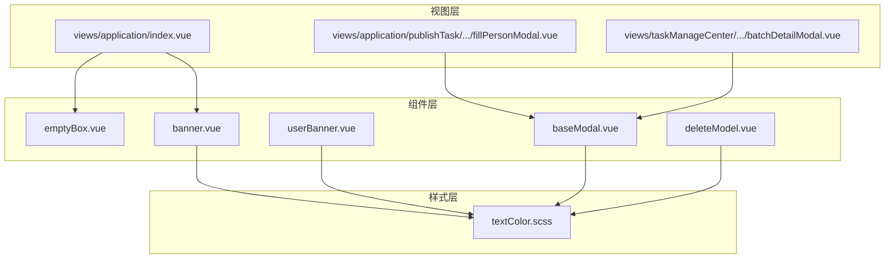
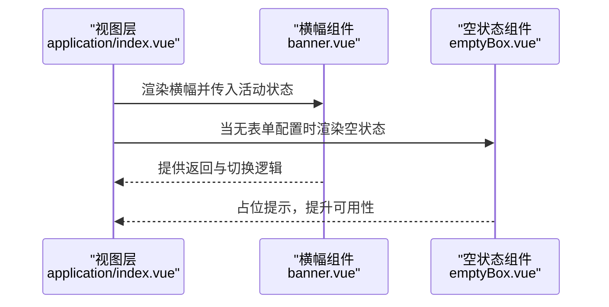
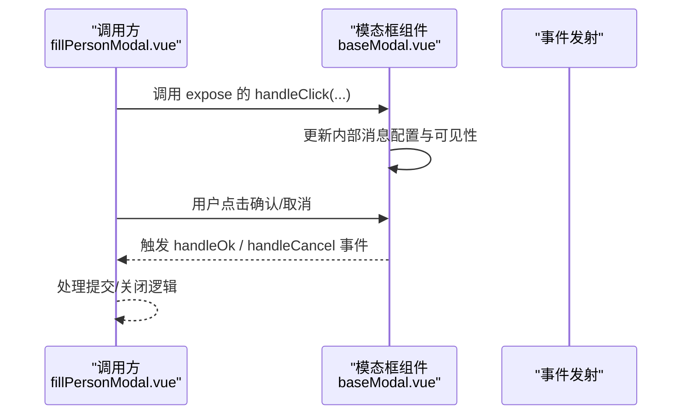
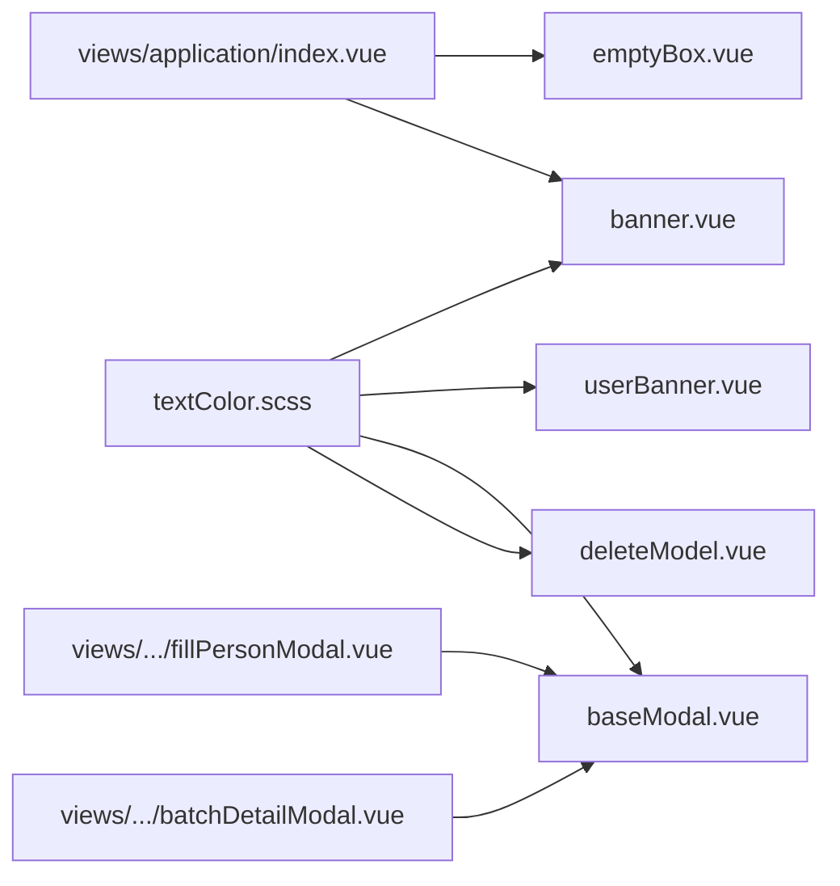

# 展示组件

<cite>
**本文引用的文件**
- [emptyBox.vue](file://src/components/emptyBox/emptyBox.vue)
- [banner.vue](file://src/components/banner/banner.vue)
- [userBanner.vue](file://src/components/banner/userBanner.vue)
- [baseModal.vue](file://src/components/modal/baseModal.vue)
- [deleteModel.vue](file://src/components/modal/deleteModel.vue)
- [textColor.scss](file://src/styles/textColor.scss)
- [index.vue（应用视图）](file://src/views/application/index.vue)
- [fillPersonModal.vue](file://src/views/application/publishTask/components/fillPersonModal.vue)
- [batchDetailModal.vue](file://src/views/taskManageCenter/batchDetailModal.vue)
</cite>

## 目录
1. [简介](#简介)
2. [项目结构](#项目结构)
3. [核心组件](#核心组件)
4. [架构总览](#架构总览)
5. [详细组件分析](#详细组件分析)
6. [依赖关系分析](#依赖关系分析)
7. [性能与可维护性建议](#性能与可维护性建议)
8. [故障排查指南](#故障排查指南)
9. [结论](#结论)
10. [附录：主题与无障碍实践](#附录主题与无障碍实践)

## 简介
本文件聚焦于新工作台项目中的基础展示组件，包括空状态组件、横幅组件（含用户横幅）、模态框组件等。文档从视觉样式、交互行为、配置项、插槽与事件、典型使用场景、主题定制、响应式适配与无障碍访问等方面进行系统化说明，并结合仓库中真实页面的使用示例，帮助开发者在不同业务场景下正确选择与组合这些组件。

## 项目结构
围绕展示组件的相关目录与文件如下：
- 组件层
  - 空状态：src/components/emptyBox/emptyBox.vue
  - 横幅：src/components/banner/banner.vue、src/components/banner/userBanner.vue
  - 模态框：src/components/modal/baseModal.vue、src/components/modal/deleteModel.vue
- 样式层
  - 主题色变量：src/styles/textColor.scss
- 视图层（使用示例）
  - 应用页：src/views/application/index.vue
  - 发布任务-人员选择弹窗：src/views/application/publishTask/components/fillPersonModal.vue
  - 批次详情弹窗：src/views/taskManageCenter/batchDetailModal.vue

图表来源
- [emptyBox.vue:1-44](file://src/components/emptyBox/emptyBox.vue#L1-L44)
- [banner.vue:1-256](file://src/components/banner/banner.vue#L1-L256)
- [userBanner.vue:1-251](file://src/components/banner/userBanner.vue#L1-L251)
- [baseModal.vue:1-104](file://src/components/modal/baseModal.vue#L1-L104)
- [deleteModel.vue:1-72](file://src/components/modal/deleteModel.vue#L1-L72)
- [textColor.scss:1-91](file://src/styles/textColor.scss#L1-L91)
- [index.vue（应用视图）:1-194](file://src/views/application/index.vue#L1-L194)
- [fillPersonModal.vue:80-258](file://src/views/application/publishTask/components/fillPersonModal.vue#L80-L258)
- [batchDetailModal.vue:50-218](file://src/views/taskManageCenter/batchDetailModal.vue#L50-L218)

章节来源
- [emptyBox.vue:1-44](file://src/components/emptyBox/emptyBox.vue#L1-L44)
- [banner.vue:1-256](file://src/components/banner/banner.vue#L1-L256)
- [userBanner.vue:1-251](file://src/components/banner/userBanner.vue#L1-L251)
- [baseModal.vue:1-104](file://src/components/modal/baseModal.vue#L1-L104)
- [deleteModel.vue:1-72](file://src/components/modal/deleteModel.vue#L1-L72)
- [textColor.scss:1-91](file://src/styles/textColor.scss#L1-L91)
- [index.vue（应用视图）:1-194](file://src/views/application/index.vue#L1-L194)
- [fillPersonModal.vue:80-258](file://src/views/application/publishTask/components/fillPersonModal.vue#L80-L258)
- [batchDetailModal.vue:50-218](file://src/views/taskManageCenter/batchDetailModal.vue#L50-L218)

## 核心组件
- 空状态组件（emptyBox）
  - 作用：在数据为空时提供占位提示，提升用户感知与引导性。
  - 关键点：支持通过属性传入描述文本；默认居中显示，包含图片与标题区域。
- 横幅组件（banner）
  - 作用：顶部导航与步骤引导，支持返回与切换“表单设计/流程设计”。
  - 关键点：根据路由参数与表单类型动态渲染标题；点击返回按钮按角色或来源跳转；支持步骤标签切换。
- 用户横幅（userBanner）
  - 作用：顶部用户信息与菜单导航，支持下拉菜单与路由跳转。
  - 关键点：根据当前菜单编码高亮选中项；支持用户头像或首字母占位；提供退出登录等快捷入口。
- 模态框组件（baseModal）
  - 作用：统一的二次确认与信息展示弹窗，封装标题、描述、按钮与插槽。
  - 关键点：通过暴露的方法触发显示；支持宽度、按钮显隐、文案自定义；footer区默认左右布局；可透传原生属性。
- 删除确认模态框（deleteModel）
  - 作用：轻量删除确认弹窗，强调主按钮颜色。
  - 关键点：与 baseModal 类似，但主按钮样式更突出；适合删除类操作。

章节来源
- [emptyBox.vue:1-44](file://src/components/emptyBox/emptyBox.vue#L1-L44)
- [banner.vue:1-256](file://src/components/banner/banner.vue#L1-L256)
- [userBanner.vue:1-251](file://src/components/banner/userBanner.vue#L1-L251)
- [baseModal.vue:1-104](file://src/components/modal/baseModal.vue#L1-L104)
- [deleteModel.vue:1-72](file://src/components/modal/deleteModel.vue#L1-L72)

## 架构总览
以下序列图展示了“应用页”中空状态与横幅的协作关系，以及“发布任务人员选择弹窗”中模态框的调用链路。

图表来源
- [index.vue（应用视图）:1-194](file://src/views/application/index.vue#L1-L194)
- [banner.vue:1-256](file://src/components/banner/banner.vue#L1-L256)
- [emptyBox.vue:1-44](file://src/components/emptyBox/emptyBox.vue#L1-L44)

图表来源
- [fillPersonModal.vue:80-258](file://src/views/application/publishTask/components/fillPersonModal.vue#L80-L258)
- [baseModal.vue:1-104](file://src/components/modal/baseModal.vue#L1-L104)

## 详细组件分析

### 空状态组件（emptyBox）
- 视觉样式
  - 居中布局，白色背景圆角容器；图片尺寸固定；文字颜色与字号规范。
- 交互行为
  - 作为占位元素出现，不参与复杂交互；可通过父组件条件渲染控制显示。
- 配置与插槽
  - 支持通过属性传入描述文本；未传入时使用默认文案。
- 使用场景
  - 列表/表单无数据时的提示；表单初始化阶段的引导。
- 典型用法
  - 在应用页中，当表单配置不存在或列表为空时显示。

章节来源
- [emptyBox.vue:1-44](file://src/components/emptyBox/emptyBox.vue#L1-L44)
- [index.vue（应用视图）:23-25](file://src/views/application/index.vue#L23-L25)

### 横幅组件（banner）
- 视觉样式
  - 白色背景+阴影；左侧返回图标；中部步骤标签（数字/图标+名称）；激活态使用主题色。
- 交互行为
  - 返回按钮：根据当前路由与本地存储的角色来源决定跳转路径；支持直接跳转到表单或流程设计页。
  - 步骤标签：点击切换路由，携带类型与表单ID参数。
- 配置与插槽
  - 通过属性传入当前激活步骤；内部读取表单ID以生成标题；未传入时使用表单配置推断。
- 使用场景
  - 表单设计与流程设计之间的导航；跨页面保持上下文一致。
- 典型用法
  - 在表单页与流程页均引入，配合路由查询参数控制显示。

章节来源
- [banner.vue:1-256](file://src/components/banner/banner.vue#L1-L256)
- [index.vue（应用视图）:2-3](file://src/views/application/index.vue#L2-L3)

### 用户横幅（userBanner）
- 视觉样式
  - 左侧返回图标；中部菜单标签（居中对齐）；右侧用户头像/首字母与下拉菜单。
- 交互行为
  - 返回：支持传入目标URL或回退；菜单高亮基于当前路由与菜单编码匹配。
  - 下拉菜单：提供退出登录等快捷入口。
- 配置与插槽
  - 支持传入标题、URL、激活项等；内部通过接口获取菜单树并渲染。
- 使用场景
  - 各功能模块顶部导航；用户身份与权限入口。

章节来源
- [userBanner.vue:1-251](file://src/components/banner/userBanner.vue#L1-L251)

### 模态框组件（baseModal）
- 视觉样式
  - 基于第三方组件库的弹窗容器；头部/主体/底部内边距统一；footer区默认无分割线。
- 交互行为
  - 通过暴露的 handleClick 显示弹窗；handleOk 与 handleCancel 事件由外部监听；支持加载态。
- 配置与插槽
  - 可透传原生属性；支持插槽插入自定义内容；支持宽度、按钮显隐、文案自定义。
- 使用场景
  - 二次确认、信息展示、表单提交前确认等。
- 典型用法
  - 在“发布任务人员选择弹窗”中，通过 handleClick 动态设置标题、按钮文案与宽度；handleOk 用于提交数据并关闭弹窗。

章节来源
- [baseModal.vue:1-104](file://src/components/modal/baseModal.vue#L1-L104)
- [fillPersonModal.vue:140-162](file://src/views/application/publishTask/components/fillPersonModal.vue#L140-L162)
- [batchDetailModal.vue:82-89](file://src/views/taskManageCenter/batchDetailModal.vue#L82-L89)

### 删除确认模态框（deleteModel）
- 视觉样式
  - 与 baseModal 类似，但主按钮采用品牌强调色。
- 交互行为
  - 与 baseModal 相同的事件与暴露方法；适合删除类操作。
- 使用场景
  - 数据删除、资源移除等高风险操作的确认。

章节来源
- [deleteModel.vue:1-72](file://src/components/modal/deleteModel.vue#L1-L72)

## 依赖关系分析
- 组件间依赖
  - 视图层依赖横幅与空状态组件；模态框组件被多个视图复用。
- 样式依赖
  - 横幅与模态框组件均使用主题色变量，保证视觉一致性。
- 外部依赖
  - 模态框组件依赖第三方组件库的弹窗组件；横幅组件依赖路由与本地存储。

图表来源
- [textColor.scss:1-91](file://src/styles/textColor.scss#L1-L91)
- [banner.vue:1-256](file://src/components/banner/banner.vue#L1-L256)
- [userBanner.vue:1-251](file://src/components/banner/userBanner.vue#L1-L251)
- [baseModal.vue:1-104](file://src/components/modal/baseModal.vue#L1-L104)
- [deleteModel.vue:1-72](file://src/components/modal/deleteModel.vue#L1-L72)
- [index.vue（应用视图）:1-194](file://src/views/application/index.vue#L1-L194)
- [fillPersonModal.vue:80-258](file://src/views/application/publishTask/components/fillPersonModal.vue#L80-L258)
- [batchDetailModal.vue:50-218](file://src/views/taskManageCenter/batchDetailModal.vue#L50-L218)

## 性能与可维护性建议
- 按需渲染
  - 空状态组件仅在无数据时渲染，避免不必要的DOM节点。
- 弹窗懒加载
  - 模态框组件建议在首次打开时再挂载，减少初始渲染开销。
- 主题变量集中管理
  - 使用主题色变量统一风格，便于全局调整。
- 事件解耦
  - 通过事件回调与暴露方法解耦弹窗与调用方逻辑，降低耦合度。
- 可访问性
  - 为按钮与链接提供语义化标签与键盘可达性；为图片提供替代文本；确保焦点顺序合理。

[本节为通用建议，无需列出章节来源]

## 故障排查指南
- 空状态不显示
  - 检查父组件的条件渲染逻辑是否正确；确认属性传入值是否覆盖默认文案。
- 横幅标题不正确
  - 确认路由参数与表单ID是否正确传递；检查表单配置是否存在。
- 模态框无法关闭
  - 确认是否调用了暴露的 handleClose 方法；检查外部是否阻止了默认行为。
- 主题色不生效
  - 检查主题变量文件是否正确引入；确认组件样式作用域与深度选择器使用是否正确。

章节来源
- [emptyBox.vue:12-17](file://src/components/emptyBox/emptyBox.vue#L12-L17)
- [banner.vue:48-89](file://src/components/banner/banner.vue#L48-L89)
- [baseModal.vue:73-76](file://src/components/modal/baseModal.vue#L73-L76)
- [textColor.scss:1-2](file://src/styles/textColor.scss#L1-L2)

## 结论
本项目的基础展示组件在结构与职责上清晰明确：空状态组件负责“无数据”场景的友好提示；横幅与用户横幅承担导航与上下文提示；模态框组件提供统一的交互入口。通过主题色变量与统一的事件/方法约定，组件具备良好的可扩展性与可维护性。建议在实际业务中遵循本文档的配置与使用建议，结合具体页面需求灵活组合这些组件。

[本节为总结，无需列出章节来源]

## 附录：主题与无障碍实践
- 主题定制
  - 使用主题色变量统一控制组件的强调色与边框色；在组件样式中通过变量引用，避免硬编码颜色。
- 响应式适配
  - 横幅与模态框的宽度与内边距已针对常见屏幕尺寸优化；如需进一步适配，可在视图层增加媒体查询或使用组件库提供的响应式能力。
- 无障碍访问
  - 为按钮添加 aria-label 或语义化文本；为图片提供 alt；确保键盘可聚焦与可操作；为弹窗提供遮罩层与焦点陷阱，防止焦点逃逸。

章节来源
- [textColor.scss:1-91](file://src/styles/textColor.scss#L1-L91)
- [banner.vue:91-256](file://src/components/banner/banner.vue#L91-L256)
- [baseModal.vue:79-104](file://src/components/modal/baseModal.vue#L79-L104)