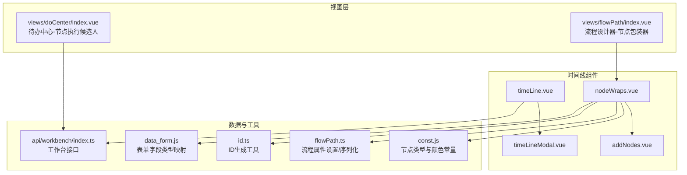
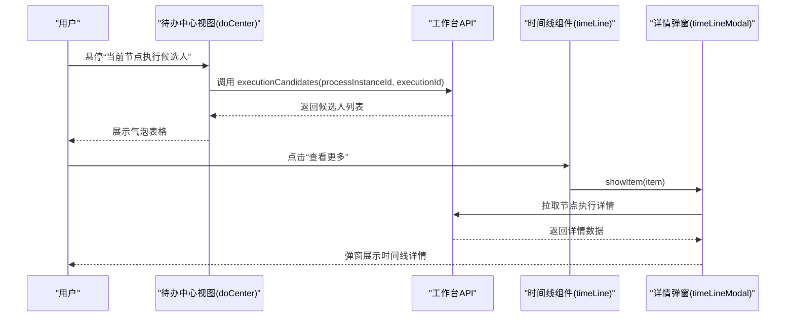
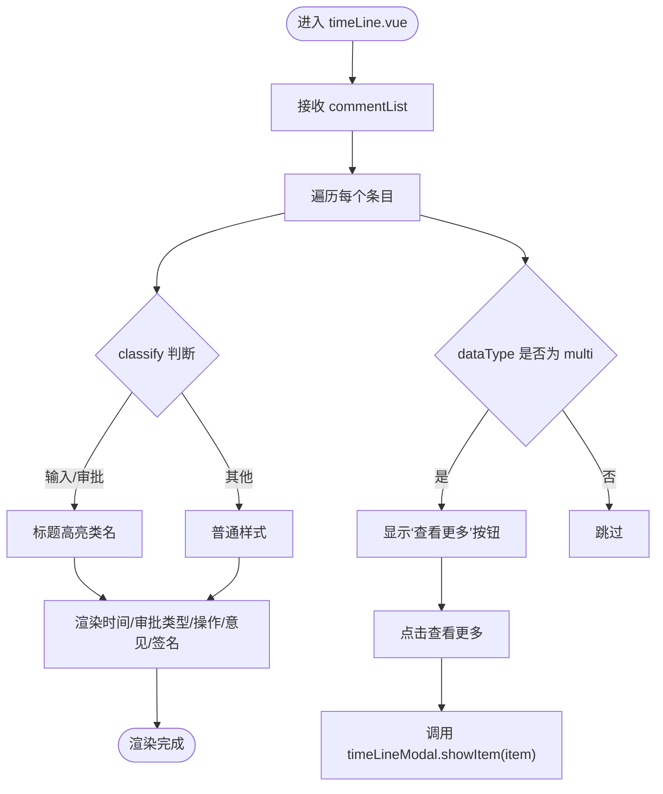
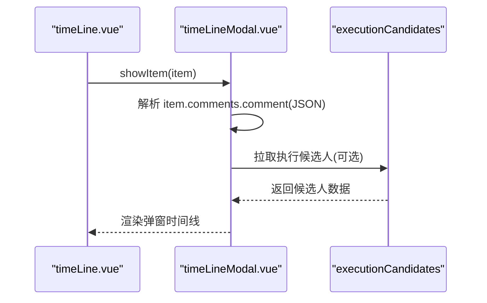
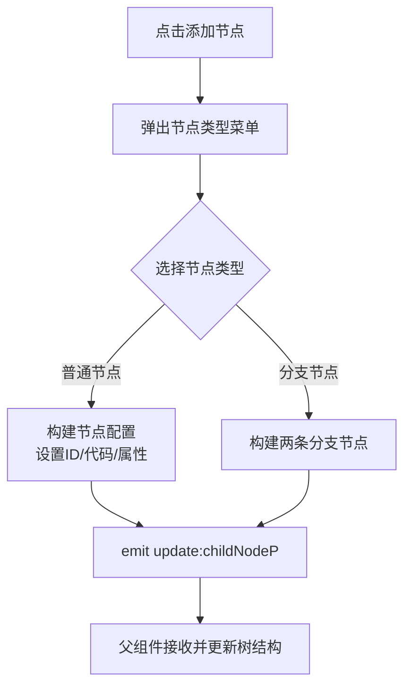
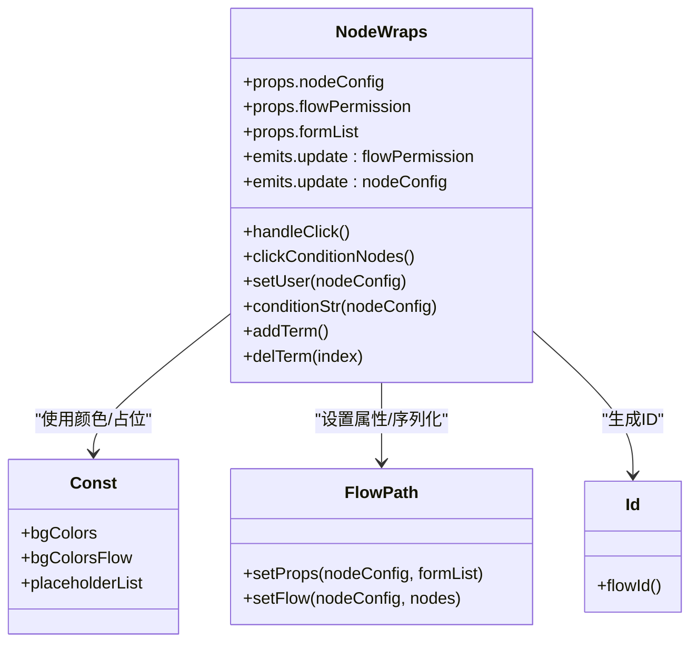
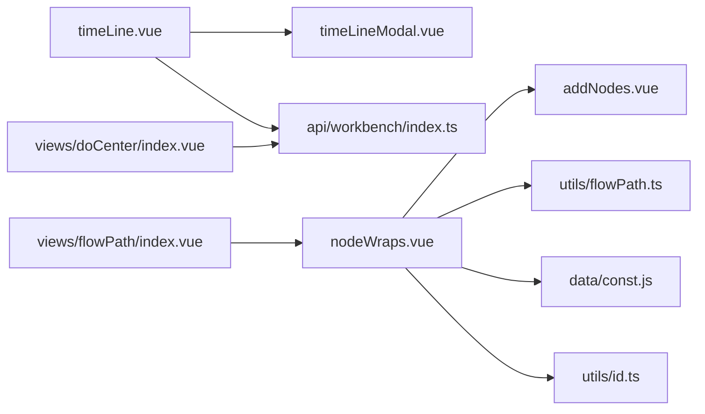

# 时间线组件

<cite>
**本文引用的文件**
- [timeLine.vue](file://src/components/timeLine/timeLine.vue)
- [timeLineModal.vue](file://src/components/timeLine/timeLineModal.vue)
- [addNodes.vue](file://src/components/timeLine/addNodes.vue)
- [nodeWraps.vue](file://src/components/timeLine/nodeWraps.vue)
- [const.js](file://src/data/const.js)
- [flowPath.ts](file://src/utils/flowPath.ts)
- [id.ts](file://src/utils/id.ts)
- [data_form.js](file://src/data/data_form.js)
- [index.ts](file://src/api/workbench/index.ts)
- [index.vue](file://src/views/doCenter/index.vue)
- [index.vue](file://src/views/flowPath/index.vue)
- [wornbench.css](file://src/styles/wornbench.css)
</cite>

## 目录
1. [简介](#简介)
2. [项目结构](#项目结构)
3. [核心组件](#核心组件)
4. [架构总览](#架构总览)
5. [详细组件分析](#详细组件分析)
6. [依赖关系分析](#依赖关系分析)
7. [性能考量](#性能考量)
8. [故障排查指南](#故障排查指南)
9. [结论](#结论)
10. [附录](#附录)

## 简介
本文件系统化梳理新工作台项目中的“时间线组件”，覆盖其设计架构、实现原理、数据结构、节点类型、连线样式与交互行为，并给出配置参数、事件处理与数据绑定机制说明。同时结合工作流设计、项目管理、流程跟踪等业务场景，提供可落地的应用示例与最佳实践，包括自定义样式、动画效果与响应式布局建议。

## 项目结构
时间线组件位于 src/components/timeLine 目录下，围绕“流程审批日志”与“节点执行详情”两大能力展开：
- timeLine.vue：主时间线展示组件，基于 Arco 的 Timeline 组件渲染审批历史。
- timeLineModal.vue：弹窗式详情面板，用于展示更详细的节点执行信息。
- addNodes.vue：节点添加入口与快捷菜单，支持在流程图中插入不同类型的节点。
- nodeWraps.vue：流程节点包装器，负责节点渲染、点击交互、分支节点条件展示与子节点递归渲染。

图表来源
- [timeLine.vue:1-199](file://src/components/timeLine/timeLine.vue#L1-L199)
- [timeLineModal.vue:1-210](file://src/components/timeLine/timeLineModal.vue#L1-L210)
- [addNodes.vue:1-247](file://src/components/timeLine/addNodes.vue#L1-L247)
- [nodeWraps.vue:1-310](file://src/components/timeLine/nodeWraps.vue#L1-L310)
- [const.js:1-475](file://src/data/const.js#L1-L475)
- [flowPath.ts:1-322](file://src/utils/flowPath.ts#L1-L322)
- [id.ts:1-26](file://src/utils/id.ts#L1-L26)
- [data_form.js:1-800](file://src/data/data_form.js#L1-L800)
- [index.ts:1-139](file://src/api/workbench/index.ts#L1-L139)
- [index.vue:1-200](file://src/views/doCenter/index.vue#L1-L200)
- [index.vue:1-192](file://src/views/flowPath/index.vue#L1-L192)

章节来源
- [timeLine.vue:1-199](file://src/components/timeLine/timeLine.vue#L1-L199)
- [timeLineModal.vue:1-210](file://src/components/timeLine/timeLineModal.vue#L1-L210)
- [addNodes.vue:1-247](file://src/components/timeLine/addNodes.vue#L1-L247)
- [nodeWraps.vue:1-310](file://src/components/timeLine/nodeWraps.vue#L1-L310)

## 核心组件
- 主时间线组件 timeLine.vue
  - 负责接收 commentList 数据并渲染 Arco Timeline，支持“查看更多”弹窗、审批人/填写人信息、操作类型、自动审批标识、处理意见、手写签名等展示。
  - 通过 ref 调用 timeLineModal 的 showItem 方法打开详情弹窗。
- 弹窗详情组件 timeLineModal.vue
  - 在弹窗内再次渲染 Arco Timeline，用于展示更细粒度的节点执行详情，如每个操作人的处理结果、意见、签名等。
- 节点添加组件 addNodes.vue
  - 提供节点添加入口与快捷菜单，支持插入“填写节点”“审批节点”“抄送节点”“业务分支”“业务连接”等节点类型。
  - 通过 emit 事件向上游传递更新后的节点配置。
- 节点包装器 nodeWraps.vue
  - 渲染节点卡片（开始/结束/填写/审批/抄送/业务分支/业务连接），支持点击进入属性编辑、显示候选人信息、分支条件展示与子节点递归渲染。
  - 与设计器上下文 provide/inject 协作，统一处理节点点击与更新。

章节来源
- [timeLine.vue:83-95](file://src/components/timeLine/timeLine.vue#L83-L95)
- [timeLineModal.vue:83-115](file://src/components/timeLine/timeLineModal.vue#L83-L115)
- [addNodes.vue:8-77](file://src/components/timeLine/addNodes.vue#L8-L77)
- [nodeWraps.vue:72-120](file://src/components/timeLine/nodeWraps.vue#L72-L120)

## 架构总览
时间线组件与流程设计器、工作台接口紧密协作：
- 视图层 doCenter/index.vue 通过 executionCandidates 接口获取“当前节点执行候选人”，并在表格中悬停展示。
- 流程设计器 flowPath/index.vue 使用 nodeWraps.vue 渲染节点树，支持分支条件、字段控制、序列化导出等。
- 时间线组件通过工作台 API 获取流程日志与节点执行详情，实现“流程轨迹”可视化。

图表来源
- [index.vue:206-220](file://src/views/doCenter/index.vue#L206-L220)
- [index.ts:122-129](file://src/api/workbench/index.ts#L122-L129)
- [timeLine.vue:92-94](file://src/components/timeLine/timeLine.vue#L92-L94)
- [timeLineModal.vue:90-100](file://src/components/timeLine/timeLineModal.vue#L90-L100)

## 详细组件分析

### 主时间线组件 timeLine.vue
- 数据绑定
  - 接收 commentList 属性，内部遍历渲染每个时间轴条目。
  - 支持 classify 字段区分“输入中/审批中/审批空/通知/撤销”等状态，动态切换样式类名。
- 内容渲染
  - 标题区域根据状态显示绿色高亮。
  - 时间标签、审批类型、操作类型、自动审批标识、处理意见、手写签名等按条件渲染。
  - 当 dataType 为 multi 时，显示“查看更多”按钮，触发弹窗展示完整详情。
- 交互行为
  - seeMore(item) 调用子组件 timeLineModal 的暴露方法 showItem，传入当前条目的详情数据。
- 样式与主题
  - 使用 scoped SCSS 控制容器高度、滚动、文本颜色与排版；通过类名切换实现状态高亮。

图表来源
- [timeLine.vue:3-81](file://src/components/timeLine/timeLine.vue#L3-L81)

章节来源
- [timeLine.vue:1-199](file://src/components/timeLine/timeLine.vue#L1-L199)

### 弹窗详情组件 timeLineModal.vue
- 功能职责
  - 作为弹窗容器，内部再次渲染 Arco Timeline，承载更丰富的节点执行细节。
  - 暴露 showItem 方法，供父组件调用时传入条目数据并打开弹窗。
- 数据处理
  - 将传入的 item.comments 中 comment 字段进行 JSON 解析，确保展示字段正确。
  - 通过工作台 API executionCandidates 获取实时候选人信息（预留扩展点）。
- 样式与交互
  - 使用 scoped SCSS 控制弹窗宽度、列表项排版与图片尺寸，保证阅读体验。

图表来源
- [timeLine.vue:92-94](file://src/components/timeLine/timeLine.vue#L92-L94)
- [timeLineModal.vue:90-100](file://src/components/timeLine/timeLineModal.vue#L90-L100)
- [index.ts:122-129](file://src/api/workbench/index.ts#L122-L129)

章节来源
- [timeLineModal.vue:1-210](file://src/components/timeLine/timeLineModal.vue#L1-L210)

### 节点添加组件 addNodes.vue
- 功能职责
  - 提供节点添加入口与快捷菜单，支持插入多种节点类型。
  - 通过 emit 事件向上游传递更新后的 childNodeP，实现父子节点关系建立。
- 节点类型
  - 基于 const.js 中的 Components 定义，支持“填写节点”“审批节点”“抄送节点”“业务分支”“业务连接”等。
- 交互与样式
  - 通过 SCSS 实现“竖线”连接线与悬浮缩放动画，提升节点添加的引导性与交互感。

图表来源
- [addNodes.vue:38-76](file://src/components/timeLine/addNodes.vue#L38-L76)
- [const.js:20-390](file://src/data/const.js#L20-L390)

章节来源
- [addNodes.vue:1-247](file://src/components/timeLine/addNodes.vue#L1-L247)
- [const.js:1-475](file://src/data/const.js#L1-L475)

### 节点包装器 nodeWraps.vue
- 功能职责
  - 渲染节点卡片（开始/结束/填写/审批/抄送/业务分支/业务连接），支持点击进入属性编辑。
  - 显示候选人信息（部门/岗位/角色/用户），分支节点展示条件表达式与优先级。
  - 子节点递归渲染，形成完整的流程树。
- 交互机制
  - 通过 provide/inject 向子节点注入 handleClick、setProcess 等方法，统一处理节点点击与更新。
  - 条件节点支持增删条件项，合并/迁移子节点逻辑。
- 数据与工具
  - 使用 const.js 的 bgColors/bgColorsFlow/placeholderList 控制节点颜色与占位提示。
  - 使用 flowPath.ts 的 setProps 为节点注入字段控制、格式化等属性。
  - 使用 id.ts 的 flowId 生成唯一标识。

图表来源
- [nodeWraps.vue:72-262](file://src/components/timeLine/nodeWraps.vue#L72-L262)
- [const.js:8-18](file://src/data/const.js#L8-L18)
- [flowPath.ts:4-76](file://src/utils/flowPath.ts#L4-L76)
- [id.ts:20-22](file://src/utils/id.ts#L20-L22)

章节来源
- [nodeWraps.vue:1-310](file://src/components/timeLine/nodeWraps.vue#L1-L310)
- [const.js:1-475](file://src/data/const.js#L1-L475)
- [flowPath.ts:1-322](file://src/utils/flowPath.ts#L1-L322)
- [id.ts:1-26](file://src/utils/id.ts#L1-L26)

## 依赖关系分析
- 组件耦合
  - timeLine.vue 与 timeLineModal.vue 通过方法暴露/调用实现解耦，前者负责触发，后者负责渲染。
  - nodeWraps.vue 与 addNodes.vue 通过事件与 props 双向协作，前者渲染节点树，后者提供节点添加入口。
- 外部依赖
  - 工作台 API：executionCandidates 用于获取节点执行候选人，processInstanceIdLog 用于获取流程日志。
  - 流程工具：flowPath.ts 提供节点属性设置、流程序列化、PID 计算等。
  - 数据常量：const.js 提供节点类型、颜色、占位提示等基础配置。
  - ID 工具：id.ts 提供唯一 ID 生成。

图表来源
- [timeLine.vue:83-95](file://src/components/timeLine/timeLine.vue#L83-L95)
- [timeLineModal.vue:83-115](file://src/components/timeLine/timeLineModal.vue#L83-L115)
- [addNodes.vue:8-77](file://src/components/timeLine/addNodes.vue#L8-L77)
- [nodeWraps.vue:72-120](file://src/components/timeLine/nodeWraps.vue#L72-L120)
- [index.ts:1-139](file://src/api/workbench/index.ts#L1-L139)
- [flowPath.ts:1-322](file://src/utils/flowPath.ts#L1-L322)
- [const.js:1-475](file://src/data/const.js#L1-L475)
- [id.ts:1-26](file://src/utils/id.ts#L1-L26)
- [index.vue:158-200](file://src/views/doCenter/index.vue#L158-L200)
- [index.vue:39-144](file://src/views/flowPath/index.vue#L39-L144)

章节来源
- [index.ts:1-139](file://src/api/workbench/index.ts#L1-L139)
- [flowPath.ts:1-322](file://src/utils/flowPath.ts#L1-L322)
- [const.js:1-475](file://src/data/const.js#L1-L475)
- [id.ts:1-26](file://src/utils/id.ts#L1-L26)

## 性能考量
- 渲染优化
  - timeLine.vue 对长列表采用纵向滚动容器，避免一次性渲染过多节点导致卡顿。
  - 条目内容按需渲染（如仅在 multi 时显示“查看更多”按钮）。
- 数据处理
  - nodeWraps.vue 的条件字符串拼接与候选人信息拼装应避免重复计算，可在 props 变更时使用 computed 缓存。
  - 分支节点的递归渲染需注意层级深度，必要时增加阈值控制与懒加载。
- 网络请求
  - 待办中心的 executionCandidates 请求应在用户悬停时触发，避免频繁请求；可加入防抖与缓存策略。
- 样式与动画
  - addNodes.vue 的悬浮缩放与阴影变化使用 CSS 过渡，保持流畅体验；在低端设备上可考虑减少复杂阴影。

## 故障排查指南
- 弹窗无法打开
  - 检查 timeLine.vue 中是否正确调用 timeLineModal 的 showItem 方法，以及 ref 是否正确注入。
  - 确认 timeLineModal.vue 是否正确暴露 showItem 并初始化弹窗配置。
- 详情数据为空
  - 确认传入 item.comments 的 comment 字段是否为字符串，需要先 JSON 解析后再渲染。
  - 检查工作台 API executionCandidates 的返回结构是否符合预期。
- 节点添加无效
  - 确认 addNodes.vue 的 emit 事件命名(update:childNodeP)与父组件监听一致。
  - 检查 nodeWraps.vue 的 provide/inject 是否正确传递 handleClick/setProcess。
- 样式异常
  - 检查 wornbench.css 中节点卡片、箭头、覆盖线等样式是否被覆盖。
  - 确认 scoped 样式作用域与全局样式的优先级关系。

章节来源
- [timeLine.vue:92-94](file://src/components/timeLine/timeLine.vue#L92-L94)
- [timeLineModal.vue:90-100](file://src/components/timeLine/timeLineModal.vue#L90-L100)
- [addNodes.vue:36-76](file://src/components/timeLine/addNodes.vue#L36-L76)
- [nodeWraps.vue:105-120](file://src/components/timeLine/nodeWraps.vue#L105-L120)
- [wornbench.css:572-744](file://src/styles/wornbench.css#L572-L744)

## 结论
时间线组件通过“主时间线 + 弹窗详情 + 节点添加 + 节点包装器”的组合，实现了从流程日志到节点执行详情的完整可视化闭环。配合流程设计器与工作台 API，能够满足工作流设计、项目管理与流程跟踪等多场景需求。建议在实际使用中关注渲染性能、数据处理与网络请求的优化，并结合业务定制样式与交互细节。

## 附录

### 数据结构与节点类型
- 节点类型（节选）
  - START：开始节点
  - END：结束节点
  - INPUT：填写节点
  - APPROVE：审批节点
  - NOTICE：抄送节点
  - BRANCH：业务分支
  - CONNECTOR：业务连接
- 颜色与占位
  - bgColors：普通节点背景色映射
  - bgColorsFlow：流程状态颜色映射
  - placeholderList：默认占位提示

章节来源
- [const.js:8-18](file://src/data/const.js#L8-L18)
- [const.js:20-390](file://src/data/const.js#L20-L390)

### 配置参数与事件
- timeLine.vue
  - 属性：commentList（数组）
  - 事件：通过 ref 调用 timeLineModal 的 showItem
- timeLineModal.vue
  - 暴露：showItem(item)
  - 内部：解析 item.comments.comment(JSON)，渲染详情
- addNodes.vue
  - 属性：childNodeP、roleList、deptList、postList
  - 事件：update:childNodeP
- nodeWraps.vue
  - 属性：nodeConfig、flowPermission、formList
  - 事件：update:flowPermission、update:nodeConfig
  - 方法：handleClick、clickConditionNodes、setUser、conditionStr

章节来源
- [timeLine.vue:83-95](file://src/components/timeLine/timeLine.vue#L83-L95)
- [timeLineModal.vue:83-115](file://src/components/timeLine/timeLineModal.vue#L83-L115)
- [addNodes.vue:18-36](file://src/components/timeLine/addNodes.vue#L18-L36)
- [nodeWraps.vue:80-105](file://src/components/timeLine/nodeWraps.vue#L80-L105)

### 业务应用场景
- 工作流设计
  - 使用 nodeWraps.vue 渲染节点树，addNodes.vue 快速插入节点，flowPath.ts 序列化导出流程配置。
- 项目管理
  - 在 doCenter/index.vue 中展示“当前节点执行候选人”，通过 executionCandidates 实时获取处理人信息。
- 流程跟踪
  - 在 timeLine.vue 中展示审批历史，点击“查看更多”打开 timeLineModal.vue 查看详细节点执行情况。

章节来源
- [index.vue:39-144](file://src/views/flowPath/index.vue#L39-L144)
- [index.vue:158-200](file://src/views/doCenter/index.vue#L158-L200)
- [index.ts:122-129](file://src/api/workbench/index.ts#L122-L129)

### 自定义样式与响应式建议
- 自定义样式
  - 节点卡片：通过 wornbench.css 中的 .node-wrap-box/.start-node 等类名进行主题色与边框调整。
  - 连接线：利用伪元素:before 实现箭头与竖线，保持与节点布局一致。
  - 弹窗详情：timeLineModal.vue 的 scoped 样式控制宽度与图片尺寸，确保阅读体验。
- 动画效果
  - addNodes.vue 的按钮 hover/active 状态使用过渡与阴影，增强交互反馈。
- 响应式设计
  - timeLine.vue 使用 calc(100vh - 270px) 控制高度，配合 overflow-y: auto 实现滚动。
  - 表格与弹窗宽度在 doCenter/index.vue 中设置为 1200px，适配主流屏幕分辨率。

章节来源
- [wornbench.css:572-744](file://src/styles/wornbench.css#L572-L744)
- [timeLine.vue:96-103](file://src/components/timeLine/timeLine.vue#L96-L103)
- [index.vue:1-200](file://src/views/doCenter/index.vue#L1-L200)