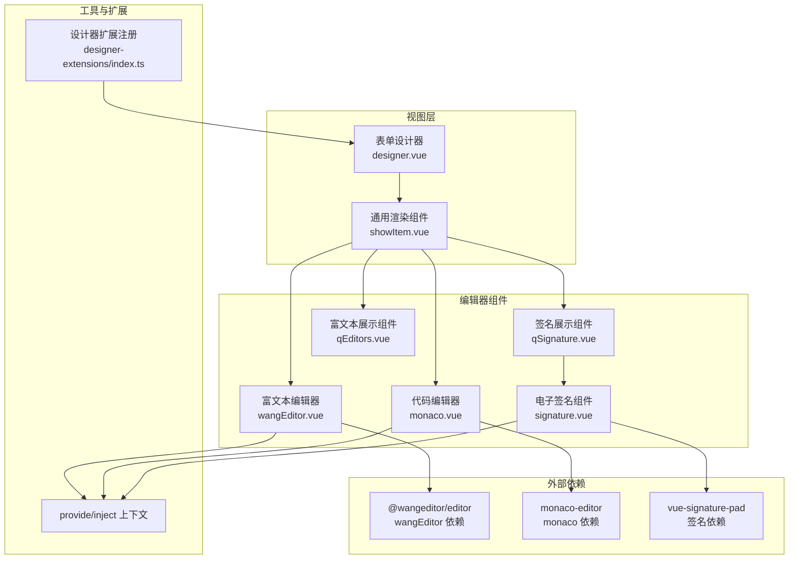
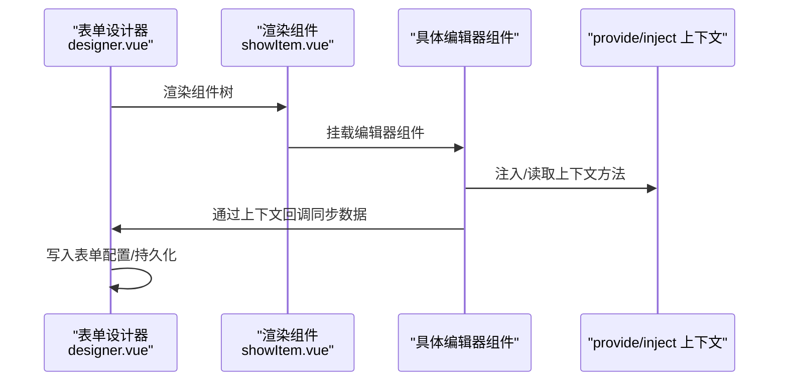
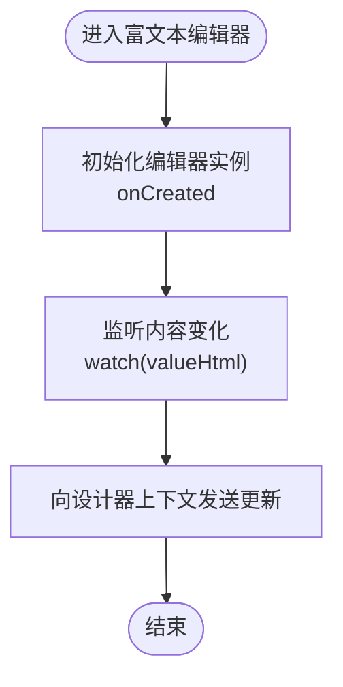
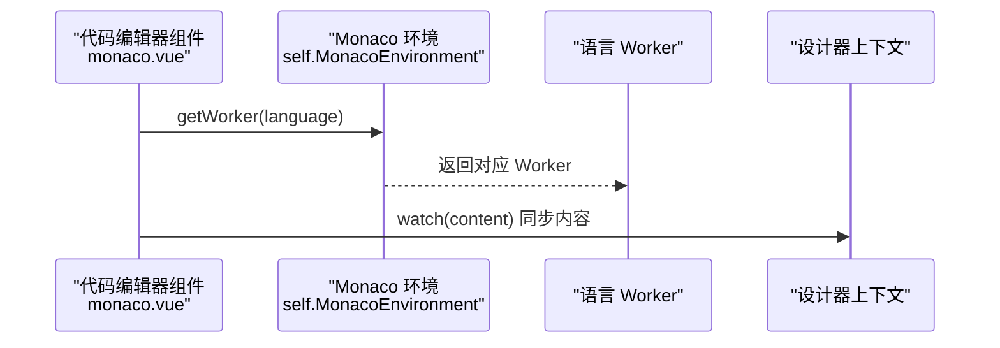
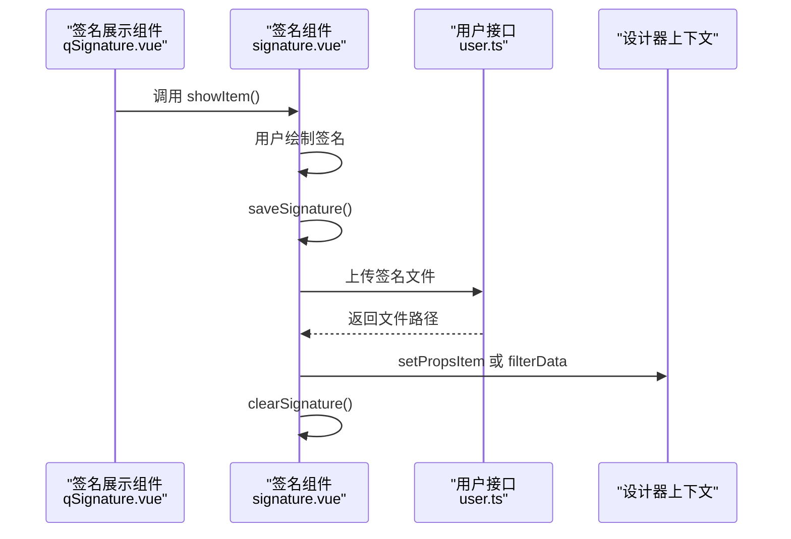
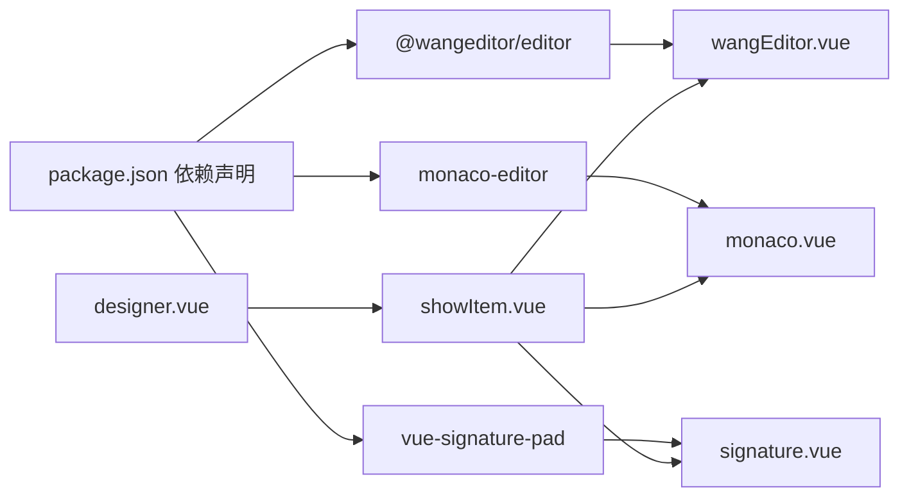

# 编辑器组件

<cite>
**本文引用的文件列表**
- [wangEditor.vue](file://src/components/wangEditor/wangEditor.vue)
- [monaco.vue](file://src/components/monaco/monaco.vue)
- [signature.vue](file://src/components/signature/signature.vue)
- [qSignature.vue](file://src/components/showItem/qSignature.vue)
- [qEditors.vue](file://src/components/showItem/qEditors.vue)
- [designer.vue](file://src/views/form/designer.vue)
- [showItem.vue](file://src/components/showItem/showItem.vue)
- [user.ts](file://src/api/user.ts)
- [package.json](file://package.json)
- [index.ts](file://src/designer-extensions/index.ts)
- [index.vue](file://src/designer-extensions/user/index.vue)
</cite>

## 目录
1. [简介](#简介)
2. [项目结构](#项目结构)
3. [核心组件](#核心组件)
4. [架构总览](#架构总览)
5. [组件详解](#组件详解)
6. [依赖关系分析](#依赖关系分析)
7. [性能与优化](#性能与优化)
8. [故障排查](#故障排查)
9. [结论](#结论)
10. [附录：API与使用指南](#附录api与使用指南)

## 简介
本文件面向新工作台项目的“编辑器组件”模块，系统性梳理并说明以下三类编辑器的专业实现：
- 富文本编辑器：基于 wangEditor 的可视化编辑组件，支持工具栏、图片/视频上传、占位符与样式定制。
- 代码编辑器：基于 Monaco Editor 的高性能代码编辑组件，提供多语言支持、Worker 分离与主题配置。
- 电子签名组件：基于 vue-signature-pad 的手写签名组件，支持撤销、清屏、保存并上传至后端。

文档将从架构、数据流、配置项、事件处理、性能优化、API 使用与集成实践等维度进行深入解析，并给出在文档编辑、代码编写、合同签署等业务场景中的应用建议。

## 项目结构
编辑器相关代码主要分布在以下位置：
- 组件层：富文本、代码、签名与展示组件分别位于 components 目录下
- 视图层：表单设计器与渲染视图负责承载编辑器组件
- 工具与扩展：通过 provide/inject 在设计器上下文中传递状态与回调
- 依赖管理：package.json 中声明了编辑器相关依赖

图表来源
- [designer.vue](file://src/views/form/designer.vue)
- [showItem.vue](file://src/components/showItem/showItem.vue)
- [wangEditor.vue](file://src/components/wangEditor/wangEditor.vue)
- [monaco.vue](file://src/components/monaco/monaco.vue)
- [signature.vue](file://src/components/signature/signature.vue)
- [qSignature.vue](file://src/components/showItem/qSignature.vue)
- [qEditors.vue](file://src/components/showItem/qEditors.vue)
- [index.ts](file://src/designer-extensions/index.ts)
- [package.json](file://package.json)

章节来源
- [designer.vue](file://src/views/form/designer.vue)
- [showItem.vue](file://src/components/showItem/showItem.vue)
- [package.json](file://package.json)

## 核心组件
本节概览三大编辑器组件的关键职责与交互模式：
- 富文本编辑器：提供工具栏与编辑区域，支持图片/视频上传、占位符与样式定制；通过 watch 同步内容至设计器上下文。
- 代码编辑器：封装 Monaco Editor，按需加载 Worker，提供语言切换与主题配置；通过 watch 同步内容至设计器上下文。
- 电子签名组件：弹窗式手写签名面板，支持撤销、清屏、保存并上传；保存成功后回填值并可触发过滤逻辑。

章节来源
- [wangEditor.vue](file://src/components/wangEditor/wangEditor.vue)
- [monaco.vue](file://src/components/monaco/monaco.vue)
- [signature.vue](file://src/components/signature/signature.vue)
- [qSignature.vue](file://src/components/showItem/qSignature.vue)
- [qEditors.vue](file://src/components/showItem/qEditors.vue)

## 架构总览
编辑器组件在设计器中通过统一的 provide/inject 机制与父级通信，形成“组件-上下文-视图”的清晰分层。

图表来源
- [designer.vue](file://src/views/form/designer.vue)
- [showItem.vue](file://src/components/showItem/showItem.vue)
- [wangEditor.vue](file://src/components/wangEditor/wangEditor.vue)
- [monaco.vue](file://src/components/monaco/monaco.vue)
- [signature.vue](file://src/components/signature/signature.vue)

## 组件详解

### 富文本编辑器（wangEditor）
- 功能特性
  - 可定制工具栏：通过 toolbarKeys 控制显示的菜单项，excludeKeys 可排除不需要的菜单项
  - 内容编辑：默认高度与滚动策略，支持占位符
  - 媒体上传：内置图片与视频上传配置，支持请求头、超时、文件类型限制、大小限制与自定义插入
  - 数据同步：通过 watch 监听内容变化，向设计器上下文发送更新
- 关键配置
  - 工具栏：toolbarKeys 与 excludeKeys
  - 编辑器：placeholder、MENU_CONF.uploadImage、MENU_CONF.uploadVideo
  - 样式：深度作用选择器覆盖默认容器与占位符样式
- 事件与数据流
  - onCreated 回调获取编辑器实例
  - watch(valueHtml) 将内容同步到设计器上下文
  - watch(props.contents) 将外部传入的内容同步到编辑器
- 性能与优化
  - 合理设置占位符与最小高度，避免频繁重排
  - 上传配置中设置合适的超时与大小限制，减少失败重试
- 使用示例
  - 在设计器中作为组件使用，传入 contents 初始化内容
  - 通过设计器上下文回调获取最新内容并持久化

图表来源
- [wangEditor.vue](file://src/components/wangEditor/wangEditor.vue)

章节来源
- [wangEditor.vue](file://src/components/wangEditor/wangEditor.vue)

### 代码编辑器（Monaco Editor）
- 功能特性
  - 多语言支持：通过 language 属性切换语言
  - Worker 分离：按语言动态加载对应 Worker，降低主线程压力
  - 主题与布局：支持主题、字体大小、自动布局与小地图开关
  - 数据同步：通过 watch 监听内容变化，向设计器上下文发送更新
- 关键配置
  - 语言：props.language
  - 主题与布局：editorOptions（fontSize、minimap、automaticLayout）
  - Worker：self.MonacoEnvironment.getWorker 按语言返回对应 Worker
- 事件与数据流
  - watch(content) 将内容同步到设计器上下文
  - 通过 AmoAYunMonacoEditorVue3 组件绑定 v-model
- 性能与优化
  - 按需加载 Worker，避免一次性加载所有语言 Worker
  - 关闭小地图与启用自动布局提升渲染效率
- 使用示例
  - 在设计器中作为组件使用，传入 contents 与 language 初始化
  - 通过设计器上下文回调获取最新内容并持久化

图表来源
- [monaco.vue](file://src/components/monaco/monaco.vue)

章节来源
- [monaco.vue](file://src/components/monaco/monaco.vue)

### 电子签名组件（vue-signature-pad）
- 功能特性
  - 弹窗式签名面板：支持撤销、清屏、保存
  - 文件上传：将签名转为 PNG 并上传至后端，成功后回填值
  - 过滤逻辑：根据是否处于编辑态决定是否触发过滤数据
- 关键配置
  - 画笔颜色与宽度：options.penColor、minWidth、maxWidth
  - 上传参数：folder、fileProfile 等
- 事件与数据流
  - save：生成 Base64，转 File，构造 FormData，调用上传接口
  - 上传成功后，根据是否存在 comDes.id 决定更新设计器上下文或签名专用上下文
  - clear：清空签名板
  - showItem：暴露给父组件打开弹窗
- 性能与优化
  - 仅在需要时创建 Canvas，避免重复创建
  - 上传前对 Base64 进行转换，减少传输体积
- 使用示例
  - 在表单中点击“点击签名”，弹出签名面板
  - 保存后回显图片，或在非编辑态下触发过滤逻辑

图表来源
- [signature.vue](file://src/components/signature/signature.vue)
- [qSignature.vue](file://src/components/showItem/qSignature.vue)
- [user.ts](file://src/api/user.ts)

章节来源
- [signature.vue](file://src/components/signature/signature.vue)
- [qSignature.vue](file://src/components/showItem/qSignature.vue)
- [user.ts](file://src/api/user.ts)

### 富文本展示组件（qEditors）
- 功能特性
  - 支持折叠/展开：通过 props.fold 与 props.foldContext 控制
  - 内容渲染：v-html 直接渲染富文本，避免二次格式化
- 使用场景
  - 在只读模式下展示富文本描述或说明
- 注意事项
  - v-html 渲染需确保内容安全，避免 XSS
  - 样式通过 ::v-deep 覆盖段落间距与换行

章节来源
- [qEditors.vue](file://src/components/showItem/qEditors.vue)

## 依赖关系分析
- 组件依赖
  - 富文本：@wangeditor/editor、@wangeditor/editor-for-vue
  - 代码：monaco-editor、@amoayun/monaco-editor-vue3
  - 签名：vue-signature-pad
- 设计器上下文
  - 通过 provide/inject 在设计器与组件间传递回调（如 updataDes、updataInput、setPropsItem、filterData 等）
- 扩展机制
  - 通过 designer-extensions/index.ts 注册扩展组件，便于在设计器中扩展更多能力

图表来源
- [package.json](file://package.json)
- [designer.vue](file://src/views/form/designer.vue)
- [showItem.vue](file://src/components/showItem/showItem.vue)
- [wangEditor.vue](file://src/components/wangEditor/wangEditor.vue)
- [monaco.vue](file://src/components/monaco/monaco.vue)
- [signature.vue](file://src/components/signature/signature.vue)

章节来源
- [package.json](file://package.json)
- [index.ts](file://src/designer-extensions/index.ts)

## 性能与优化
- 富文本编辑器
  - 合理设置占位符与最小高度，避免频繁重排
  - 上传配置中设置合适的超时与大小限制，减少失败重试
- 代码编辑器
  - 按需加载 Worker，避免一次性加载所有语言 Worker
  - 关闭小地图与启用自动布局提升渲染效率
- 电子签名
  - 仅在需要时创建 Canvas，避免重复创建
  - 上传前对 Base64 进行转换，减少传输体积

[本节为通用性能建议，不直接分析特定文件]

## 故障排查
- 富文本编辑器
  - 无法上传图片/视频：检查上传配置中的 server、headers、allowedFileTypes、maxFileSize 等
  - 工具栏按钮无效：确认 toolbarKeys 与 excludeKeys 的配置是否正确
- 代码编辑器
  - Worker 加载失败：确认 self.MonacoEnvironment.getWorker 的语言分支是否覆盖所需语言
  - 主题或布局异常：检查 editorOptions 的配置项
- 电子签名
  - 保存后无回显：确认上传接口返回值与 setPropsItem 的调用路径
  - 弹窗无法打开：检查父组件调用 showItem 的时机与可见性控制

章节来源
- [wangEditor.vue](file://src/components/wangEditor/wangEditor.vue)
- [monaco.vue](file://src/components/monaco/monaco.vue)
- [signature.vue](file://src/components/signature/signature.vue)

## 结论
本项目在表单设计器中集成了富文本、代码与电子签名三大编辑器组件，均通过统一的 provide/inject 机制与设计器上下文进行数据交换。富文本强调工具栏与媒体上传的灵活性，代码编辑器强调多语言与 Worker 分离的性能，电子签名强调易用性与上传回填流程。整体架构清晰、扩展性强，适合在文档编辑、代码编写、合同签署等业务场景中复用与扩展。

[本节为总结性内容，不直接分析特定文件]

## 附录：API与使用指南

### 富文本编辑器（wangEditor）
- 属性
  - contents：初始内容（HTML 字符串）
- 事件
  - onCreated：编辑器实例创建回调
- 配置要点
  - toolbarKeys/excludeKeys：工具栏菜单控制
  - MENU_CONF.uploadImage/MENU_CONF.uploadVideo：上传配置
  - placeholder：占位符
- 数据流
  - watch(contents) 同步外部内容
  - watch(valueHtml) 同步内部内容到设计器上下文

章节来源
- [wangEditor.vue](file://src/components/wangEditor/wangEditor.vue)

### 代码编辑器（Monaco Editor）
- 属性
  - contents：初始内容（字符串）
  - language：语言标识（如 javascript、typescript、json 等）
- 配置要点
  - editorOptions：fontSize、minimap、automaticLayout
  - self.MonacoEnvironment：按语言返回 Worker
- 数据流
  - watch(content) 同步内容到设计器上下文

章节来源
- [monaco.vue](file://src/components/monaco/monaco.vue)

### 电子签名组件（signature）
- 属性
  - comDes：组件描述对象（含 id、props 等）
  - showEdit：是否处于编辑态
- 方法
  - showItem：打开签名弹窗
- 上传与回填
  - 保存后调用上传接口，成功后通过设计器上下文 setPropsItem 或 filterData 更新

章节来源
- [signature.vue](file://src/components/signature/signature.vue)
- [qSignature.vue](file://src/components/showItem/qSignature.vue)
- [user.ts](file://src/api/user.ts)

### 富文本展示组件（qEditors）
- 属性
  - comDes：组件描述对象（含 desc、fold、foldContext 等）
- 行为
  - 支持折叠/展开
  - v-html 渲染富文本

章节来源
- [qEditors.vue](file://src/components/showItem/qEditors.vue)

### 设计器上下文与扩展
- provide/inject
  - 提供 updataDes、updataInput、setPropsItem、filterData 等回调
- 扩展注册
  - 通过 designer-extensions/index.ts 注册扩展组件

章节来源
- [designer.vue](file://src/views/form/designer.vue)
- [showItem.vue](file://src/components/showItem/showItem.vue)
- [index.ts](file://src/designer-extensions/index.ts)
- [index.vue](file://src/designer-extensions/user/index.vue)