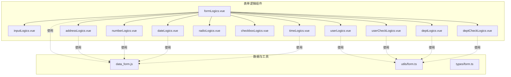
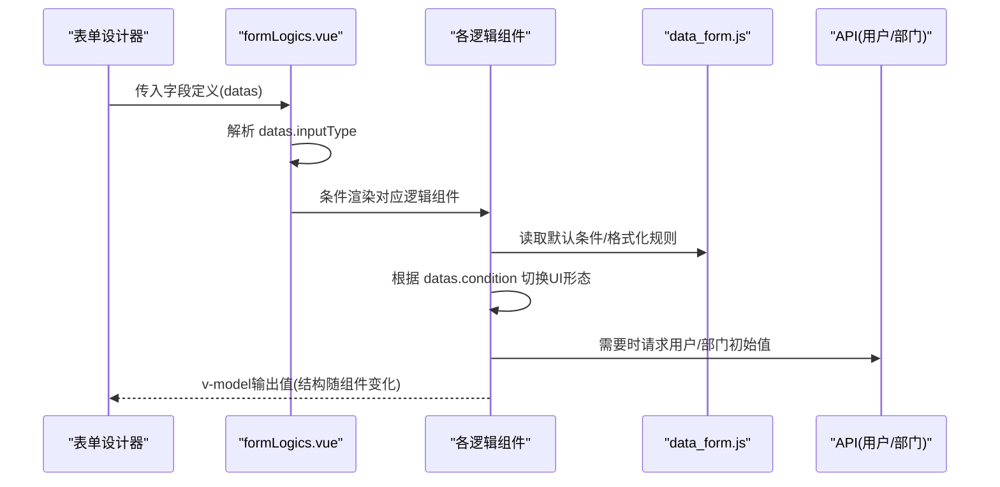
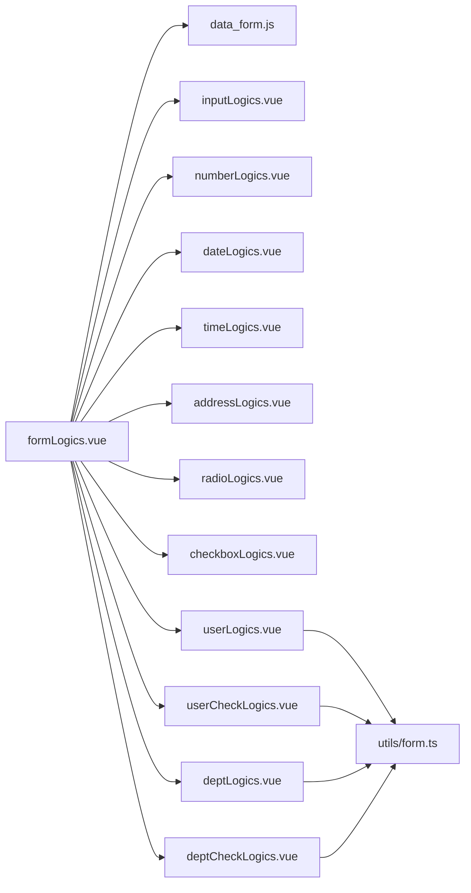

# 表单逻辑组件

<cite>
**本文引用的文件**
- [formLogics.vue](file://src/components/formLogics/formLogics.vue)
- [inputLogics.vue](file://src/components/formLogics/inputLogics.vue)
- [numberLogics.vue](file://src/components/formLogics/numberLogics.vue)
- [dateLogics.vue](file://src/components/formLogics/dateLogics.vue)
- [timeLogics.vue](file://src/components/formLogics/timeLogics.vue)
- [addressLogics.vue](file://src/components/formLogics/addressLogics.vue)
- [radioLogics.vue](file://src/components/formLogics/radioLogics.vue)
- [checkboxLogics.vue](file://src/components/formLogics/checkboxLogics.vue)
- [userLogics.vue](file://src/components/formLogics/userLogics.vue)
- [userCheckLogics.vue](file://src/components/formLogics/userCheckLogics.vue)
- [deptLogics.vue](file://src/components/formLogics/deptLogics.vue)
- [deptCheckLogics.vue](file://src/components/formLogics/deptCheckLogics.vue)
- [data_form.js](file://src/data/data_form.js)
- [form.ts](file://src/utils/form.ts)
- [form.ts 类型定义](file://src/types/form.ts)
</cite>

## 目录
1. [简介](#简介)
2. [项目结构](#项目结构)
3. [核心组件](#核心组件)
4. [架构总览](#架构总览)
5. [详细组件分析](#详细组件分析)
6. [依赖分析](#依赖分析)
7. [性能考虑](#性能考虑)
8. [故障排查指南](#故障排查指南)
9. [结论](#结论)
10. [附录](#附录)

## 简介
本文件面向新工作台项目的“表单逻辑组件”，系统性梳理并解释表单设计器中基于字段类型的条件与值绑定逻辑。内容涵盖：
- 输入类逻辑、数值类逻辑、日期时间逻辑、地址逻辑、用户/部门选择逻辑等组件的设计与实现原理
- 组件如何根据字段类型自动匹配相应逻辑处理
- 组件间依赖关系与数据流转机制
- 完整的API接口说明、配置参数、事件处理与数据绑定方式
- 实际业务场景应用示例与最佳实践

## 项目结构
表单逻辑组件位于 src/components/formLogics 目录下，采用按功能拆分的单文件组件（.vue）组织方式；同时配合 src/data/data_form.js 提供字段类型到条件选项与默认值的映射，以及 src/utils/form.ts 提供表单数据初始化、提交、联动查询与表达式计算等通用逻辑。

图表来源
- [formLogics.vue:1-35](file://src/components/formLogics/formLogics.vue#L1-L35)
- [inputLogics.vue:1-28](file://src/components/formLogics/inputLogics.vue#L1-L28)
- [numberLogics.vue:1-50](file://src/components/formLogics/numberLogics.vue#L1-L50)
- [dateLogics.vue:1-45](file://src/components/formLogics/dateLogics.vue#L1-L45)
- [timeLogics.vue:1-28](file://src/components/formLogics/timeLogics.vue#L1-L28)
- [addressLogics.vue:1-65](file://src/components/formLogics/addressLogics.vue#L1-L65)
- [radioLogics.vue:1-27](file://src/components/formLogics/radioLogics.vue#L1-L27)
- [checkboxLogics.vue:1-27](file://src/components/formLogics/checkboxLogics.vue#L1-L27)
- [userLogics.vue:1-24](file://src/components/formLogics/userLogics.vue#L1-L24)
- [userCheckLogics.vue:1-23](file://src/components/formLogics/userCheckLogics.vue#L1-L23)
- [deptLogics.vue:1-25](file://src/components/formLogics/deptLogics.vue#L1-L25)
- [deptCheckLogics.vue:1-23](file://src/components/formLogics/deptCheckLogics.vue#L1-L23)
- [data_form.js:596-800](file://src/data/data_form.js#L596-L800)
- [form.ts:1-120](file://src/utils/form.ts#L1-L120)

章节来源
- [formLogics.vue:1-35](file://src/components/formLogics/formLogics.vue#L1-L35)
- [data_form.js:596-800](file://src/data/data_form.js#L596-L800)

## 核心组件
- formLogics.vue：作为统一入口，依据字段 inputType 自动选择并渲染对应逻辑子组件，负责条件与值的绑定容器。
- inputLogics.vue：针对文本类字段（如 INPUT、TEXTAREA、PHONE、ID_CARD、EMAIL、URL、TIME_INTERVAL、DATE_INTERVAL），根据 condition 渲染输入框或可多选的下拉选择。
- numberLogics.vue：针对数值类字段（NUMBER、MONEY、RATE），支持单值输入与范围输入（min/max）两种形态。
- dateLogics.vue：针对 DATE 字段，支持单点时间选择与范围选择，并通过外部数据源 optionsTimes 提供动态范围选项（注释保留）。
- timeLogics.vue：针对 TIME 字段，支持单点时间选择与时间范围选择，格式由 datas.default 控制。
- addressLogics.vue：针对 ADDRESS 字段，提供省市区三级联动选择，支持默认层级配置。
- radioLogics.vue / checkboxLogics.vue：针对 RADIO/SELECT 与 CHECKBOX/SELECT_MULTIPLE，根据 condition 决定是否多选。
- userLogics.vue / userCheckLogics.vue：针对 USER 与 USER_MULTIPLE，分别提供单选/多选的人选组件。
- deptLogics.vue / deptCheckLogics.vue：针对 DEPT 与 DEPT_MULTIPLE，分别提供单选/多选的部门选择组件。

章节来源
- [formLogics.vue:1-35](file://src/components/formLogics/formLogics.vue#L1-L35)
- [inputLogics.vue:1-28](file://src/components/formLogics/inputLogics.vue#L1-L28)
- [numberLogics.vue:1-50](file://src/components/formLogics/numberLogics.vue#L1-L50)
- [dateLogics.vue:1-45](file://src/components/formLogics/dateLogics.vue#L1-L45)
- [timeLogics.vue:1-28](file://src/components/formLogics/timeLogics.vue#L1-L28)
- [addressLogics.vue:1-65](file://src/components/formLogics/addressLogics.vue#L1-L65)
- [radioLogics.vue:1-27](file://src/components/formLogics/radioLogics.vue#L1-L27)
- [checkboxLogics.vue:1-27](file://src/components/formLogics/checkboxLogics.vue#L1-L27)
- [userLogics.vue:1-24](file://src/components/formLogics/userLogics.vue#L1-L24)
- [userCheckLogics.vue:1-23](file://src/components/formLogics/userCheckLogics.vue#L1-L23)
- [deptLogics.vue:1-25](file://src/components/formLogics/deptLogics.vue#L1-L25)
- [deptCheckLogics.vue:1-23](file://src/components/formLogics/deptCheckLogics.vue#L1-L23)

## 架构总览
表单逻辑组件的运行时架构如下：
- 入口组件 formLogics.vue 根据字段类型选择具体逻辑组件
- 各逻辑组件内部根据 condition 切换 UI 形态（单值/范围/多选/空值判断）
- 数据绑定采用 v-model 双向绑定，值结构因组件而异（字符串、数字、数组、时间戳/范围对象等）
- 地址组件依赖外部省市区数据源进行联动
- 用户/部门组件依赖远程 API 获取初始值与回显

图表来源
- [formLogics.vue:3-16](file://src/components/formLogics/formLogics.vue#L3-L16)
- [data_form.js:596-800](file://src/data/data_form.js#L596-L800)
- [userLogics.vue:3-4](file://src/components/formLogics/userLogics.vue#L3-L4)
- [deptLogics.vue:3-4](file://src/components/formLogics/deptLogics.vue#L3-L4)

## 详细组件分析

### formLogics.vue：统一入口与类型匹配
- 职责：根据 datas.inputType 与 datas.condition 的组合，选择并渲染对应的逻辑组件。
- 关键点：
  - 输入类：INPUT、TEXTAREA、PHONE、ID_CARD、EMAIL、URL、TIME_INTERVAL、DATE_INTERVAL
  - 选择类：RADIO、SELECT、CHECKBOX、SELECT_MULTIPLE
  - 数值类：NUMBER、MONEY、RATE
  - 时间类：DATE、TIME
  - 地址类：ADDRESS
  - 用户/部门：USER、USER_MULTIPLE、DEPT、DEPT_MULTIPLE
- 依赖：接收 deptList 以供用户/部门组件使用；内部不直接调用 API，仅负责条件渲染。

章节来源
- [formLogics.vue:3-16](file://src/components/formLogics/formLogics.vue#L3-L16)

### inputLogics.vue：输入类逻辑
- UI形态：
  - 文本/区间：当 condition 不为“为空/不为空”且为比较/包含类时，渲染可编辑输入框
  - 多选项：当 condition 为“为空/不为空/比较/包含”之外时，渲染可多选下拉框（允许自定义创建）
- 数据绑定：v-model 绑定到 datas.value（字符串或数组，取决于是否多选）

章节来源
- [inputLogics.vue:3-7](file://src/components/formLogics/inputLogics.vue#L3-L7)

### numberLogics.vue：数值类逻辑
- UI形态：
  - 单值：condition 不为“为空/不为空/范围”时，渲染数值输入框
  - 范围：condition 为“范围”时，渲染 min/max 两个输入框
- 数据绑定：单值绑定到 datas.value；范围绑定到 datas.min/datas.max

章节来源
- [numberLogics.vue:3-17](file://src/components/formLogics/numberLogics.vue#L3-L17)

### dateLogics.vue：日期时间逻辑
- UI形态：
  - 单点：condition 为“等于/不等于/大于等于/小于等于”时，渲染带时间的选择器
  - 范围：condition 为“范围”时，渲染日期范围选择器
- 数据绑定：v-model 绑定到 datas.value（单值或范围对象）
- 默认格式：通过外部数据源 optionsTimes 提供动态范围选项（注释保留）

章节来源
- [dateLogics.vue:3-20](file://src/components/formLogics/dateLogics.vue#L3-L20)
- [data_form.js:701-739](file://src/data/data_form.js#L701-L739)

### timeLogics.vue：时间逻辑
- UI形态：
  - 单点：condition 为“等于/不等于/大于等于/小于等于”时，渲染时间选择器
  - 范围：condition 为“范围”时，渲染时间范围选择器
- 数据绑定：v-model 绑定到 datas.value（单值或范围对象）
- 格式控制：value-format 与显示格式由 datas.default 指定

章节来源
- [timeLogics.vue:3-8](file://src/components/formLogics/timeLogics.vue#L3-L8)

### addressLogics.vue：地址逻辑（省市区）
- UI形态：三列布局，省/市/区三级联动
- 数据绑定：datas.value 为长度为3的数组，分别对应省/市/区编码
- 交互逻辑：
  - 更换省份后清空市/区并刷新市列表
  - 更换城市后清空区并刷新区列表
- 默认层级：支持通过 datas.default 控制是否显示区级

章节来源
- [addressLogics.vue:3-15](file://src/components/formLogics/addressLogics.vue#L3-L15)
- [addressLogics.vue:33-54](file://src/components/formLogics/addressLogics.vue#L33-L54)

### radioLogics.vue / checkboxLogics.vue：单选/多选逻辑
- 单选：RADIO/SELECT，condition 为“为空/不为空”时不渲染；当 condition 为“包含其中之一/不包含其中之一”时，切换为多选模式
- 多选：CHECKBOX/SELECT_MULTIPLE，始终以多选模式渲染
- 数据绑定：v-model 绑定到 datas.value（字符串或数组）

章节来源
- [radioLogics.vue:3-7](file://src/components/formLogics/radioLogics.vue#L3-L7)
- [checkboxLogics.vue:3-7](file://src/components/formLogics/checkboxLogics.vue#L3-L7)

### userLogics.vue / userCheckLogics.vue：用户选择逻辑
- 单选：condition 为“等于/不等于”时，使用单选用户组件
- 多选：condition 为“包含其中之一/不包含其中之一”时，使用多选用户组件
- 数据绑定：v-model 绑定到 datas.default（用于回显/选择）
- 依赖：接收父组件传入的 deptList，用于过滤或展示

章节来源
- [userLogics.vue:3-4](file://src/components/formLogics/userLogics.vue#L3-L4)
- [userCheckLogics.vue](file://src/components/formLogics/userCheckLogics.vue#L3)

### deptLogics.vue / deptCheckLogics.vue：部门选择逻辑
- 单选/多选与用户组件一致，区别在于选择目标为部门
- 数据绑定：v-model 绑定到 datas.default（用于回显/选择）
- 依赖：接收父组件传入的 deptList

章节来源
- [deptLogics.vue:3-4](file://src/components/formLogics/deptLogics.vue#L3-L4)
- [deptCheckLogics.vue](file://src/components/formLogics/deptCheckLogics.vue#L3)

### 数据映射与默认条件：data_form.js
- 功能：提供字段类型到默认条件集合的映射，以及根据字段类型生成规则的方法
- 关键导出：
  - getDataForm(type)：返回该类型的默认条件集合
  - setDataForm(val, item, formList)：根据字段元数据填充 item 的 inputType、inputName、default、rulesOption 等
  - 条件枚举：typeFlter、selectTypeFlter、selectDateFlter、numTypeFlter 等
  - 动态范围选项：optionsTimes
- 作用：为 formLogics.vue 与各逻辑组件提供条件与默认值的统一来源

章节来源
- [data_form.js:596-800](file://src/data/data_form.js#L596-L800)

### 数据初始化/提交/联动：utils/form.ts
- 初始化：
  - setUpDateData/setFormData：将服务端返回的原始值转换为组件可识别的 props.value 结构（如用户/部门回显、多选值映射、时间区间等）
- 提交：
  - submitFormData：将组件值结构还原为后端期望的字段值（如用户/部门取 id，多选取 id 数组等）
- 联动与表达式：
  - getQuery：根据关联字段值触发远程查询，填充下拉选项或表格数据
  - setExpressionValue：执行表达式计算并将结果写回组件值
- 类型：
  - FormConfs：表单配置与逻辑项的类型定义

章节来源
- [form.ts:62-300](file://src/utils/form.ts#L62-L300)
- [form.ts:452-577](file://src/utils/form.ts#L452-L577)
- [form.ts:602-722](file://src/utils/form.ts#L602-L722)
- [form.ts:723-800](file://src/utils/form.ts#L723-L800)
- [form.ts 类型定义:12-24](file://src/types/form.ts#L12-L24)

## 依赖分析
- 组件内聚与耦合：
  - formLogics.vue 低耦合，仅负责条件渲染，高内聚于类型匹配
  - 各逻辑组件内部强依赖 datas 结构（inputType、condition、value/default/format 等）
  - 地址组件依赖外部省市区数据源
  - 用户/部门组件依赖远程 API 回显
- 外部依赖：
  - data_form.js：条件与默认值来源
  - utils/form.ts：初始化/提交/联动/表达式计算
  - types/form.ts：类型约束

图表来源
- [formLogics.vue:3-16](file://src/components/formLogics/formLogics.vue#L3-L16)
- [data_form.js:596-800](file://src/data/data_form.js#L596-L800)
- [userLogics.vue:10-12](file://src/components/formLogics/userLogics.vue#L10-L12)
- [deptLogics.vue:10-12](file://src/components/formLogics/deptLogics.vue#L10-L12)
- [form.ts:1-120](file://src/utils/form.ts#L1-L120)

## 性能考虑
- 渲染优化：
  - 使用 v-if 按条件精确渲染，避免不必要的 DOM 创建
  - 地址联动仅在变更时更新子列表，减少重绘
- 数据绑定：
  - v-model 双向绑定在组件内部完成，避免跨层传递复杂状态
- 异步加载：
  - 用户/部门回显通过 Promise 异步获取，避免阻塞主流程
- 建议：
  - 对高频联动字段使用防抖策略
  - 对长列表多选组件启用虚拟滚动（若 UI 框架支持）

## 故障排查指南
- 症状：条件不生效或 UI 不显示
  - 排查：确认 datas.inputType 与 datas.condition 是否在 formLogics.vue 的匹配分支中
  - 参考：[formLogics.vue:3-16](file://src/components/formLogics/formLogics.vue#L3-L16)
- 症状：数值范围未正确赋值
  - 排查：确认 condition 为“范围”，并检查 datas.min/datas.max 是否被正确赋值
  - 参考：[numberLogics.vue:6-17](file://src/components/formLogics/numberLogics.vue#L6-L17)
- 症状：地址联动异常
  - 排查：确认 datas.value 为长度为3的数组；检查 changeProvince/changeCity 是否被触发
  - 参考：[addressLogics.vue:33-54](file://src/components/formLogics/addressLogics.vue#L33-L54)
- 症状：用户/部门回显为空
  - 排查：确认传入 deptList 有效；检查 API 返回结构与 utils/form.ts 中的回显逻辑
  - 参考：[userLogics.vue:10-12](file://src/components/formLogics/userLogics.vue#L10-L12)、[deptLogics.vue:10-12](file://src/components/formLogics/deptLogics.vue#L10-L12)、[form.ts:81-100](file://src/utils/form.ts#L81-L100)
- 症状：提交后字段值错误
  - 排查：确认 submitFormData 中对用户/部门/多选字段的 id 取值逻辑
  - 参考：[form.ts:452-577](file://src/utils/form.ts#L452-L577)

章节来源
- [formLogics.vue:3-16](file://src/components/formLogics/formLogics.vue#L3-L16)
- [numberLogics.vue:6-17](file://src/components/formLogics/numberLogics.vue#L6-L17)
- [addressLogics.vue:33-54](file://src/components/formLogics/addressLogics.vue#L33-L54)
- [userLogics.vue:10-12](file://src/components/formLogics/userLogics.vue#L10-L12)
- [deptLogics.vue:10-12](file://src/components/formLogics/deptLogics.vue#L10-L12)
- [form.ts:452-577](file://src/utils/form.ts#L452-L577)

## 结论
表单逻辑组件通过“统一入口 + 条件渲染”的设计，实现了对多种字段类型的灵活适配。结合 data_form.js 的条件映射与 utils/form.ts 的初始化/提交/联动能力，形成从“字段定义 -> UI渲染 -> 数据绑定 -> 远端回显/提交”的完整闭环。建议在实际使用中：
- 明确字段类型与默认条件，确保匹配分支覆盖全面
- 正确设置 datas.value/datas.default/datas.format 等关键属性
- 对用户/部门/地址等复杂字段，提前准备 deptList 与数据源
- 在提交前使用 submitFormData 规范化值结构，避免后端解析错误

## 附录

### API 接口与配置参数总览
- 统一入口
  - 参数：datas（字段定义）、deptList（部门列表，供用户/部门组件使用）
  - 返回：根据 inputType 渲染对应逻辑组件
  - 参考：[formLogics.vue:20-25](file://src/components/formLogics/formLogics.vue#L20-L25)
- 输入类组件
  - 参数：datas（包含 inputType、condition、value、default 等）
  - 行为：根据 condition 切换单值/多选/空值判断
  - 参考：[inputLogics.vue:12-16](file://src/components/formLogics/inputLogics.vue#L12-L16)
- 数值类组件
  - 参数：datas（包含 inputType、condition、value/min/max 等）
  - 行为：单值或范围输入
  - 参考：[numberLogics.vue:21-26](file://src/components/formLogics/numberLogics.vue#L21-L26)
- 日期/时间类组件
  - 参数：datas（包含 inputType、condition、value、default 等）
  - 行为：单点或范围选择，格式由 default 控制
  - 参考：[dateLogics.vue:29-34](file://src/components/formLogics/dateLogics.vue#L29-L34)、[timeLogics.vue:12-16](file://src/components/formLogics/timeLogics.vue#L12-L16)
- 地址类组件
  - 参数：datas（包含 inputType、condition、value、default 等）
  - 行为：省市区三级联动
  - 参考：[addressLogics.vue:19-32](file://src/components/formLogics/addressLogics.vue#L19-L32)
- 选择类组件
  - 参数：datas（包含 inputType、condition、default 等）
  - 行为：单选/多选切换
  - 参考：[radioLogics.vue:11-15](file://src/components/formLogics/radioLogics.vue#L11-L15)、[checkboxLogics.vue:11-15](file://src/components/formLogics/checkboxLogics.vue#L11-L15)
- 用户/部门组件
  - 参数：datas、deptList
  - 行为：单选/多选人员或部门
  - 参考：[userLogics.vue:8-13](file://src/components/formLogics/userLogics.vue#L8-L13)、[deptLogics.vue:8-13](file://src/components/formLogics/deptLogics.vue#L8-L13)

### 事件处理与数据绑定
- 事件：
  - 地址联动：changeProvince、changeCity（触发后更新市/区列表并清空后续字段）
  - 选择类：无显式事件，依赖 v-model
- 数据绑定：
  - 所有组件均通过 v-model 将值写回 datas.value 或 datas.default
  - 提交阶段由 utils/form.ts 统一规整为后端期望格式

章节来源
- [addressLogics.vue:33-54](file://src/components/formLogics/addressLogics.vue#L33-L54)
- [userLogics.vue:8-13](file://src/components/formLogics/userLogics.vue#L8-L13)
- [deptLogics.vue:8-13](file://src/components/formLogics/deptLogics.vue#L8-L13)
- [form.ts:452-577](file://src/utils/form.ts#L452-L577)

### 实际业务场景与最佳实践
- 场景一：审批流中的金额阈值控制
  - 使用 NUMBER/MONEY/RATE 字段，设置“范围”条件，前端展示 min/max 输入框，后端据此判定是否需要上级审批
  - 参考：[numberLogics.vue:6-17](file://src/components/formLogics/numberLogics.vue#L6-L17)、[data_form.js:233-282](file://src/data/data_form.js#L233-L282)
- 场景二：入职日期与转正日期的区间校验
  - 使用 DATE 字段，设置“范围”条件，前端展示起止日期选择器，确保入职日期早于转正日期
  - 参考：[dateLogics.vue:15-20](file://src/components/formLogics/dateLogics.vue#L15-L20)、[data_form.js:284-328](file://src/data/data_form.js#L284-L328)
- 场景三：地区选择与行政区划联动
  - 使用 ADDRESS 字段，默认层级为 3，前端实现省市区三级联动，保证数据一致性
  - 参考：[addressLogics.vue:3-15](file://src/components/formLogics/addressLogics.vue#L3-L15)
- 场景四：用户/部门筛选与权限控制
  - 使用 USER/DEPT 字段，结合“等于/不等于/包含其中之一/不包含其中之一”条件，前端渲染单选或多选组件，后端据此进行权限判定
  - 参考：[userLogics.vue:3-4](file://src/components/formLogics/userLogics.vue#L3-L4)、[deptLogics.vue:3-4](file://src/components/formLogics/deptLogics.vue#L3-L4)