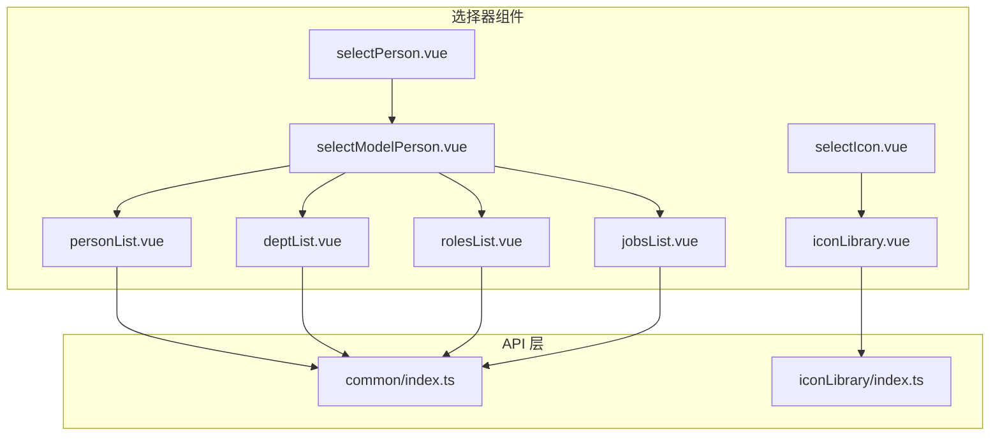
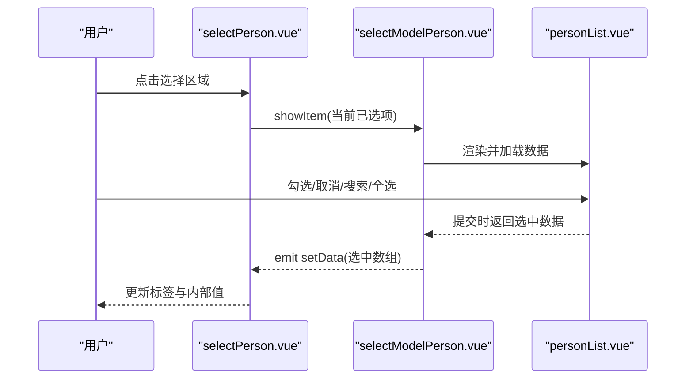
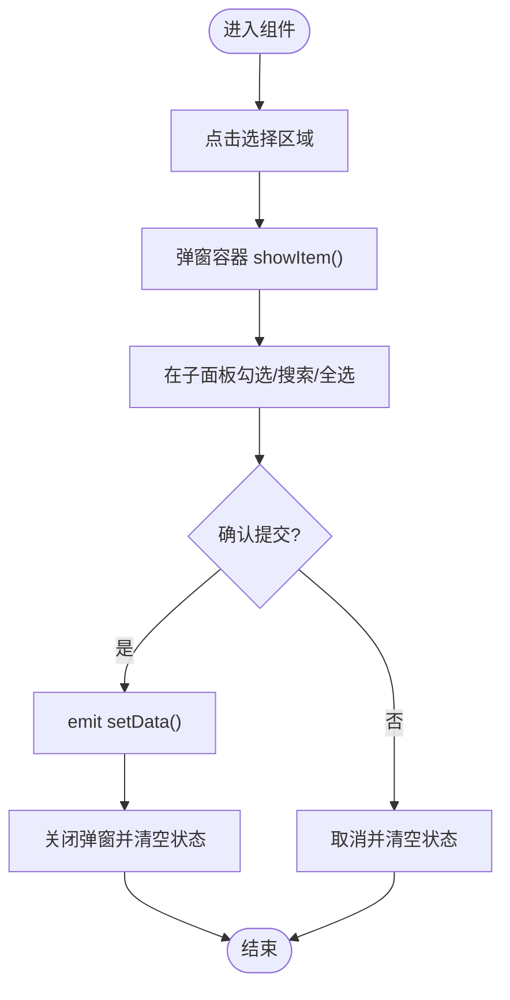
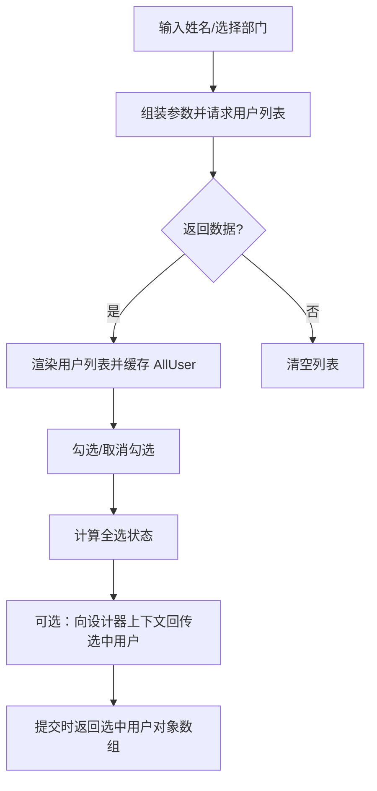
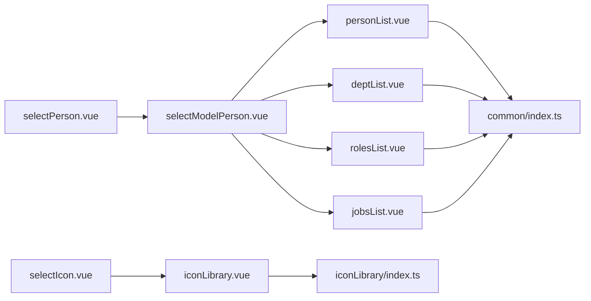

# 选择器组件

<cite>
**本文引用的文件**
- [selectPerson.vue](file://src/components/selectPerson/selectPerson.vue)
- [selectIcon.vue](file://src/components/selectIcon/selectIcon.vue)
- [personList.vue](file://src/components/selectPerson/components/personList.vue)
- [deptList.vue](file://src/components/selectPerson/components/deptList.vue)
- [rolesList.vue](file://src/components/selectPerson/components/rolesList.vue)
- [jobsList.vue](file://src/components/selectPerson/components/jobsList.vue)
- [selectModelPerson.vue](file://src/components/selectPerson/components/selectModelPerson.vue)
- [iconLibrary.vue](file://src/components/iconLibrary/iconLibrary.vue)
- [commonApi.index.ts](file://src/api/common/index.ts)
- [iconLibraryApi.index.ts](file://src/api/iconLibrary/index.ts)
</cite>

## 目录
1. [简介](#简介)
2. [项目结构](#项目结构)
3. [核心组件](#核心组件)
4. [架构总览](#架构总览)
5. [详细组件分析](#详细组件分析)
6. [依赖关系分析](#依赖关系分析)
7. [性能考虑](#性能考虑)
8. [故障排查指南](#故障排查指南)
9. [结论](#结论)
10. [附录：使用示例与最佳实践](#附录使用示例与最佳实践)

## 简介
本文件系统性梳理新工作台项目中的“选择器组件”，覆盖人员选择器、部门选择器、职位选择器、角色选择器、图标选择器等模块。内容包括：
- 数据源获取与加载策略
- 搜索过滤与分页思路
- 多选/单选与层级展示能力
- 组件配置项、事件回调与数据格式
- 集成方式与典型使用场景
- 性能优化建议与常见问题处理

## 项目结构
围绕选择器功能的相关文件组织如下：
- 人员选择器：selectPerson.vue 及其子组件（personList、deptList、rolesList、jobsList、selectModelPerson）
- 图标选择器：selectIcon.vue 与 iconLibrary.vue
- API 层：common/index.ts 提供用户/部门/列表查询；iconLibrary/index.ts 提供图标库接口

图表来源
- [selectPerson.vue:1-115](file://src/components/selectPerson/selectPerson.vue#L1-L115)
- [selectIcon.vue:1-29](file://src/components/selectIcon/selectIcon.vue#L1-L29)
- [selectModelPerson.vue:1-81](file://src/components/selectPerson/components/selectModelPerson.vue#L1-L81)
- [personList.vue:1-211](file://src/components/selectPerson/components/personList.vue#L1-L211)
- [deptList.vue:1-70](file://src/components/selectPerson/components/deptList.vue#L1-L70)
- [rolesList.vue:1-70](file://src/components/selectPerson/components/rolesList.vue#L1-L70)
- [jobsList.vue:1-71](file://src/components/selectPerson/components/jobsList.vue#L1-L71)
- [iconLibrary.vue:1-70](file://src/components/iconLibrary/iconLibrary.vue#L1-L70)
- [commonApi.index.ts](file://src/api/common/index.ts)
- [iconLibraryApi.index.ts](file://src/api/iconLibrary/index.ts)

章节来源
- [selectPerson.vue:1-115](file://src/components/selectPerson/selectPerson.vue#L1-L115)
- [selectIcon.vue:1-29](file://src/components/selectIcon/selectIcon.vue#L1-L29)
- [selectModelPerson.vue:1-81](file://src/components/selectPerson/components/selectModelPerson.vue#L1-L81)
- [personList.vue:1-211](file://src/components/selectPerson/components/personList.vue#L1-L211)
- [deptList.vue:1-70](file://src/components/selectPerson/components/deptList.vue#L1-L70)
- [rolesList.vue:1-70](file://src/components/selectPerson/components/rolesList.vue#L1-L70)
- [jobsList.vue:1-71](file://src/components/selectPerson/components/jobsList.vue#L1-L71)
- [iconLibrary.vue:1-70](file://src/components/iconLibrary/iconLibrary.vue#L1-L70)

## 核心组件
- 人员选择器（selectPerson）：以标签形式展示已选项，点击触发弹窗选择；支持多选、清空、限制显示数量。
- 部门选择器（deptList）：树形结构展示部门，支持严格勾选（父子不联动），可回传选中部门对象集合。
- 角色选择器（rolesList）：平铺列表，多选回传角色对象集合。
- 职位选择器（jobsList）：平铺列表，多选回传职位对象集合。
- 人员弹窗（selectModelPerson）：承载人员/部门/角色/职位等 Tab 的容器，统一控制弹窗生命周期与提交。
- 图标选择器（selectIcon + iconLibrary）：从图标库加载图标并选择。

章节来源
- [selectPerson.vue:28-64](file://src/components/selectPerson/selectPerson.vue#L28-L64)
- [deptList.vue:12-59](file://src/components/selectPerson/components/deptList.vue#L12-L59)
- [rolesList.vue:17-51](file://src/components/selectPerson/components/rolesList.vue#L17-L51)
- [jobsList.vue:17-52](file://src/components/selectPerson/components/jobsList.vue#L17-L52)
- [selectModelPerson.vue:19-68](file://src/components/selectPerson/components/selectModelPerson.vue#L19-L68)
- [selectIcon.vue:7-24](file://src/components/selectIcon/selectIcon.vue#L7-L24)
- [iconLibrary.vue:8-34](file://src/components/iconLibrary/iconLibrary.vue#L8-L34)

## 架构总览
人员选择器采用“展示层 + 弹窗容器 + 子面板”的分层设计：
- 展示层负责占位文案、标签渲染与删除
- 弹窗容器负责标题、尺寸、按钮与生命周期
- 子面板负责具体业务（人员、部门、角色、职位）

图表来源
- [selectPerson.vue:37-63](file://src/components/selectPerson/selectPerson.vue#L37-L63)
- [selectModelPerson.vue:45-64](file://src/components/selectPerson/components/selectModelPerson.vue#L45-L64)
- [personList.vue:68-168](file://src/components/selectPerson/components/personList.vue#L68-L168)

## 详细组件分析

### 人员选择器（selectPerson）
- 功能要点
  - 占位文案、最多展示 N 个标签、超出显示“+余量”
  - 支持移除单个标签
  - 打开弹窗后回填已选项
- 数据流
  - 使用 v-model 包装内部 userList，通过 update:modelValue 向父组件同步
  - 通过子组件 selectModelPerson 的 setData 回调写入最终结果
- 交互流程
  - 点击选择区域 -> 弹窗打开 -> 选择完成 -> 关闭弹窗并更新视图

图表来源
- [selectPerson.vue:55-63](file://src/components/selectPerson/selectPerson.vue#L55-L63)
- [selectModelPerson.vue:56-64](file://src/components/selectPerson/components/selectModelPerson.vue#L56-L64)

章节来源
- [selectPerson.vue:28-64](file://src/components/selectPerson/selectPerson.vue#L28-L64)

### 人员弹窗容器（selectModelPerson）
- 功能要点
  - 统一弹窗标题、宽度、按钮文案
  - 作为 Tab 容器承载人员/部门/角色/职位等子面板
  - 提交时收集子面板数据并通过 setData 事件上抛
- 生命周期
  - showItem 接收当前已选项并打开弹窗
  - handleCancel 清空输入与已选项
  - formSubmit 获取子面板数据并关闭弹窗

章节来源
- [selectModelPerson.vue:19-68](file://src/components/selectPerson/components/selectModelPerson.vue#L19-L68)

### 人员子面板（personList）
- 功能要点
  - 左侧树形部门筛选，右侧人员列表
  - 支持按姓名搜索、全选/反选、统计已选数量
  - 虚拟列表提升长列表性能
- 数据与状态
  - deptList 作为树形数据源
  - name 为搜索关键词
  - selectedKeys 为当前选中部门键值
  - data 为当前勾选的用户 ID 列表
  - AllUser 缓存初始用户集，用于回显与计算
- 交互逻辑
  - 选择部门或输入姓名触发 getUser 查询
  - 全选/反选更新 data 并计算 checkedAll 与 indeterminate
  - handleChange 中根据长度关系更新全选状态
  - getData 将选中 ID 映射为完整用户对象

图表来源
- [personList.vue:68-131](file://src/components/selectPerson/components/personList.vue#L68-L131)
- [personList.vue:132-168](file://src/components/selectPerson/components/personList.vue#L132-L168)

章节来源
- [personList.vue:42-168](file://src/components/selectPerson/components/personList.vue#L42-L168)

### 部门选择器（deptList）
- 功能要点
  - 树形结构，checkable=true，check-strictly=true 实现严格勾选
  - 通过递归遍历树，将选中键映射为完整部门对象数组
- 数据与状态
  - checkedKeys 为当前选中键集合
  - deptIds 为映射后的部门对象集合
- 事件
  - checkItem 在每次勾选后回传 deptIds 至设计器上下文

章节来源
- [deptList.vue:12-59](file://src/components/selectPerson/components/deptList.vue#L12-L59)

### 角色选择器（rolesList）
- 功能要点
  - 平铺列表，多选回传角色对象数组
- 数据与状态
  - data 为当前选中角色 ID 列表
  - handleChange 将 ID 映射为角色对象并回传至设计器上下文

章节来源
- [rolesList.vue:17-51](file://src/components/selectPerson/components/rolesList.vue#L17-L51)

### 职位选择器（jobsList）
- 功能要点
  - 平铺列表，多选回传职位对象数组
- 数据与状态
  - data 为当前选中职位 ID 列表
  - handleChange 将 ID 映射为职位对象并回传至设计器上下文

章节来源
- [jobsList.vue:17-52](file://src/components/selectPerson/components/jobsList.vue#L17-L52)

### 图标选择器（selectIcon + iconLibrary）
- 功能要点
  - 从图标库接口拉取图标列表，渲染为可点击网格
  - 点击图标触发 click 事件，向外传递所选图标 ID
- 数据与状态
  - icons 为图标列表（含下载地址拼接）
  - chooseIcon 触发外部事件
- 注意
  - 当前 selectIcon.vue 未填充模板，实际使用建议直接引入 iconLibrary.vue 或在其基础上扩展

章节来源
- [selectIcon.vue:7-24](file://src/components/selectIcon/selectIcon.vue#L7-L24)
- [iconLibrary.vue:8-34](file://src/components/iconLibrary/iconLibrary.vue#L8-L34)

## 依赖关系分析
- 组件内聚与耦合
  - selectPerson 仅负责展示与触发弹窗，低耦合
  - selectModelPerson 作为容器聚合多个子面板，适度耦合
  - 子面板各自职责清晰，通过 provide/inject 与设计器上下文通信
- 外部依赖
  - common/index.ts 提供用户/部门/列表查询
  - iconLibrary/index.ts 提供图标库接口
- 潜在风险
  - 子面板间共享状态通过注入上下文，需确保命名唯一与类型安全
  - 虚拟列表在大量数据时仍需注意内存占用与滚动性能

图表来源
- [selectPerson.vue:30](file://src/components/selectPerson/selectPerson.vue#L30)
- [selectModelPerson.vue:20-21](file://src/components/selectPerson/components/selectModelPerson.vue#L20-L21)
- [personList.vue:44](file://src/components/selectPerson/components/personList.vue#L44)
- [deptList.vue:17-18](file://src/components/selectPerson/components/deptList.vue#L17-L18)
- [rolesList.vue:23-24](file://src/components/selectPerson/components/rolesList.vue#L23-L24)
- [jobsList.vue:23-24](file://src/components/selectPerson/components/jobsList.vue#L23-L24)
- [selectIcon.vue:10](file://src/components/selectIcon/selectIcon.vue#L10)
- [iconLibrary.vue:10](file://src/components/iconLibrary/iconLibrary.vue#L10)

## 性能考虑
- 虚拟列表
  - 人员/角色/职位列表均启用虚拟列表，建议保持固定高度与合理条目数，避免频繁重排
- 搜索与分页
  - 当前人员列表通过本地全量缓存 AllUser 进行全选/反选判断；若用户规模较大，建议后端分页或前端分页加载
- 渲染优化
  - 标签展示限制为 N 个，超出部分以“+余量”提示，减少 DOM 节点数量
- 状态管理
  - 子面板通过注入上下文回传数据，建议在设计器侧集中处理，避免重复计算
- 图标加载
  - 图标列表一次性拉取，建议增加缓存与懒加载策略，避免首屏阻塞

## 故障排查指南
- 无法打开弹窗
  - 检查 selectModelPerson 的 showItem 是否被正确调用，以及弹窗组件是否支持 unmount-on-close
- 人员列表为空或无响应
  - 确认 common/index.ts 的用户查询接口可用，检查 deptId 与用户名参数是否正确
- 全选/反选状态异常
  - 检查 handleChange 逻辑与 userlist.length、data.length 的比较条件
- 部门勾选无效
  - 确认 check-strictly=true 生效，且 getData 递归映射正确
- 图标点击无回调
  - 确认 iconLibrary.vue 的 chooseIcon 是否触发 click 事件，以及父组件是否监听该事件

章节来源
- [selectModelPerson.vue:45-64](file://src/components/selectPerson/components/selectModelPerson.vue#L45-L64)
- [personList.vue:68-131](file://src/components/selectPerson/components/personList.vue#L68-L131)
- [deptList.vue:38-42](file://src/components/selectPerson/components/deptList.vue#L38-L42)
- [iconLibrary.vue:29-31](file://src/components/iconLibrary/iconLibrary.vue#L29-L31)

## 结论
本套选择器组件以“展示层 + 容器 + 子面板”的模式实现了人员、部门、角色、职位与图标的多场景选择需求。通过虚拟列表与有限标签展示提升了性能，通过统一弹窗容器与注入上下文降低了耦合。后续可在搜索分页、图标缓存与状态集中化方面进一步优化。

## 附录：使用示例与最佳实践
- 单选场景
  - 人员选择器：在弹窗提交后仅保留第一条记录；或在子面板中禁用多选
  - 部门/角色/职位：仅允许单个勾选，提交时取第一个元素
- 多选场景
  - 人员：默认多选，支持全选/反选；注意大数据量时的分页策略
  - 部门：严格勾选，避免父子联动导致范围扩大
- 搜索场景
  - 人员：结合姓名搜索与部门筛选；建议防抖与分页
  - 图标：支持关键词过滤（如在 iconLibrary.vue 内扩展）
- 分页场景
  - 人员/角色/职位：建议后端分页，前端仅维护当前页与总条数
- 集成建议
  - 在设计器上下文中统一接收 setForms('userIds'|'deptIds'|'roleIds'|'postIds')，便于后续联动
  - 对外暴露 getData/updateItem/clearData/setData 方法，便于外部统一控制