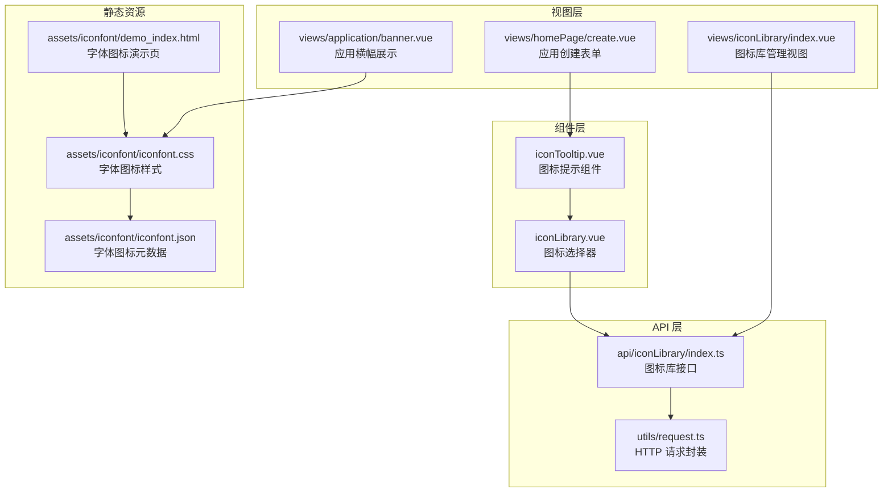
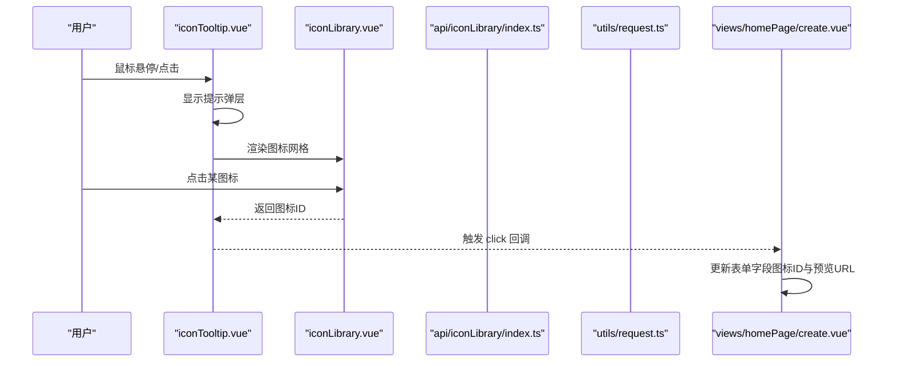
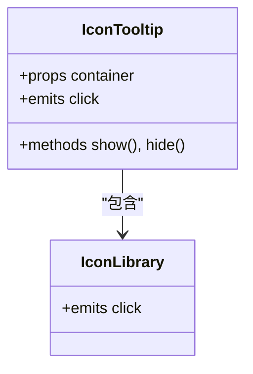
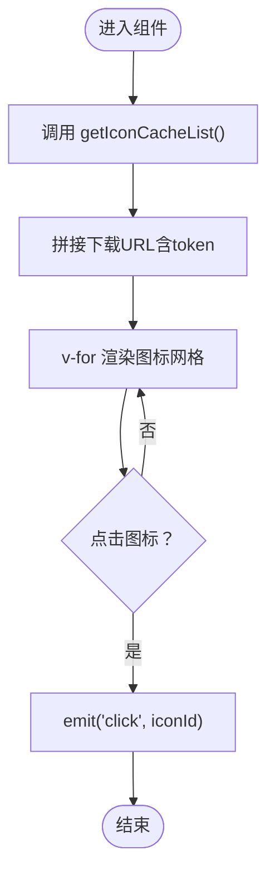
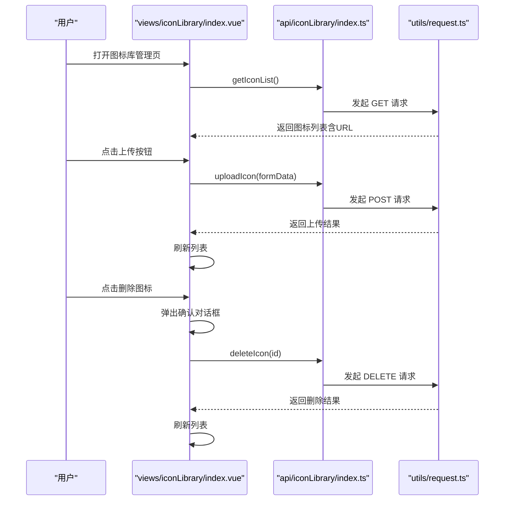
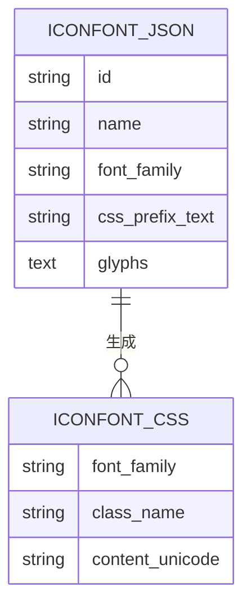
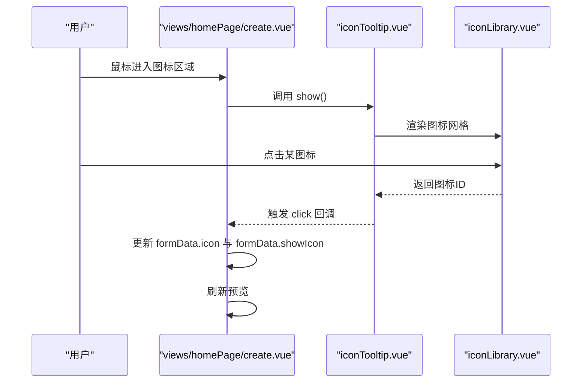
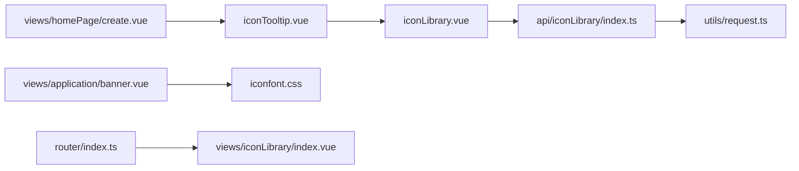

# 图标库

<cite>
**本文档引用的文件**   
- [iconLibrary.vue](file://src/components/iconLibrary/iconLibrary.vue)
- [iconTooltip.vue](file://src/components/iconLibrary/iconTooltip.vue)
- [index.vue（图标库管理视图）](file://src/views/iconLibrary/index.vue)
- [index.ts（图标库 API）](file://src/api/iconLibrary/index.ts)
- [index.ts（路由）](file://src/router/index.ts)
- [request.ts（HTTP 请求封装）](file://src/utils/request.ts)
- [create.vue（应用创建表单，演示图标选择）](file://src/views/homePage/create.vue)
- [banner.vue（应用横幅，展示图标）](file://src/views/application/banner.vue)
- [iconfont.json](file://src/assets/iconfont/iconfont.json)
- [iconfont.css](file://src/assets/iconfont/iconfont.css)
- [demo_index.html](file://src/assets/iconfont/demo_index.html)
- [textColor.scss](file://src/styles/textColor.scss)
</cite>

## 目录
1. [简介](#简介)
2. [项目结构](#项目结构)
3. [核心组件](#核心组件)
4. [架构总览](#架构总览)
5. [组件详解](#组件详解)
6. [依赖关系分析](#依赖关系分析)
7. [性能与体验](#性能与体验)
8. [故障排查](#故障排查)
9. [结论](#结论)
10. [附录](#附录)

## 简介
本文件面向新工作台项目的“图标库”能力，系统化梳理图标选择器与图标提示组件的设计理念、实现方式与使用方法。重点覆盖以下方面：
- 图标库的数据结构与来源（本地字体图标与后端图标资源）
- 搜索过滤、分类管理与批量选择的可扩展路径
- 组件的使用方法、样式定制与扩展机制
- 集成方式、性能优化与用户体验设计
- 完整使用示例与最佳实践

## 项目结构
图标库相关模块分布于组件层、视图层、API 层与静态资源层，形成“提示弹层 → 图标网格 → 后端接口”的清晰链路。

**图表来源**
- [iconTooltip.vue:1-58](file://src/components/iconLibrary/iconTooltip.vue#L1-L58)
- [iconLibrary.vue:1-70](file://src/components/iconLibrary/iconLibrary.vue#L1-L70)
- [index.vue（图标库管理视图）:1-114](file://src/views/iconLibrary/index.vue#L1-L114)
- [index.ts（图标库 API）:1-24](file://src/api/iconLibrary/index.ts#L1-L24)
- [request.ts（HTTP 请求封装）:1-159](file://src/utils/request.ts#L1-L159)
- [iconfont.css:1-76](file://src/assets/iconfont/iconfont.css#L1-L76)
- [iconfont.json:1-115](file://src/assets/iconfont/iconfont.json#L1-L115)
- [demo_index.html:1-534](file://src/assets/iconfont/demo_index.html#L1-L534)

**章节来源**
- [iconLibrary.vue:1-70](file://src/components/iconLibrary/iconLibrary.vue#L1-L70)
- [iconTooltip.vue:1-58](file://src/components/iconLibrary/iconTooltip.vue#L1-L58)
- [index.vue（图标库管理视图）:1-114](file://src/views/iconLibrary/index.vue#L1-L114)
- [index.ts（图标库 API）:1-24](file://src/api/iconLibrary/index.ts#L1-L24)
- [index.ts（路由）:100-103](file://src/router/index.ts#L100-L103)
- [request.ts（HTTP 请求封装）:1-159](file://src/utils/request.ts#L1-L159)
- [iconfont.css:1-76](file://src/assets/iconfont/iconfont.css#L1-L76)
- [iconfont.json:1-115](file://src/assets/iconfont/iconfont.json#L1-L115)
- [demo_index.html:1-534](file://src/assets/iconfont/demo_index.html#L1-L534)

## 核心组件
- 图标提示组件（iconTooltip）：以气泡提示形式承载图标选择器，支持显隐控制与容器定位。
- 图标选择器（iconLibrary）：从后端拉取图标列表，渲染为网格，点击回调上抛选中图标 ID。
- 图标库管理视图（views/iconLibrary/index.vue）：提供上传、删除与列表展示的完整管理界面。
- 图标库 API（api/iconLibrary/index.ts）：封装图标列表、上传、删除等接口。
- 字体图标资源（assets/iconfont）：提供本地可用的字体图标集，配合 CSS 类名与 JSON 元数据使用。

**章节来源**
- [iconTooltip.vue:1-58](file://src/components/iconLibrary/iconTooltip.vue#L1-L58)
- [iconLibrary.vue:1-70](file://src/components/iconLibrary/iconLibrary.vue#L1-L70)
- [index.vue（图标库管理视图）:1-114](file://src/views/iconLibrary/index.vue#L1-L114)
- [index.ts（图标库 API）:1-24](file://src/api/iconLibrary/index.ts#L1-L24)
- [iconfont.json:1-115](file://src/assets/iconfont/iconfont.json#L1-L115)
- [iconfont.css:1-76](file://src/assets/iconfont/iconfont.css#L1-L76)

## 架构总览
图标库的交互链路由“用户触发 → 提示组件 → 选择器 → 回调 → 视图更新”构成；同时提供“管理视图 → 上传/删除 → 列表刷新”的闭环。

**图表来源**
- [iconTooltip.vue:1-58](file://src/components/iconLibrary/iconTooltip.vue#L1-L58)
- [iconLibrary.vue:1-70](file://src/components/iconLibrary/iconLibrary.vue#L1-L70)
- [index.ts（图标库 API）:1-24](file://src/api/iconLibrary/index.ts#L1-L24)
- [request.ts（HTTP 请求封装）:1-159](file://src/utils/request.ts#L1-L159)
- [create.vue（应用创建表单，演示图标选择）:220-231](file://src/views/homePage/create.vue#L220-L231)

## 组件详解

### 图标提示组件（iconTooltip）
- 功能要点
  - 通过属性 container 指定弹层挂载容器，避免层级问题。
  - 内部嵌套 iconLibrary，作为内容插槽。
  - 暴露 show/hide 方法供父组件控制显示状态。
  - 接收子组件发出的图标 ID，并向上抛出 click 事件。
- 使用建议
  - 在复杂布局中，务必传入 container，确保弹层定位正确。
  - 结合父组件的 ref 调用 show/hide，提升交互可控性。

**图表来源**
- [iconTooltip.vue:1-58](file://src/components/iconLibrary/iconTooltip.vue#L1-L58)
- [iconLibrary.vue:1-70](file://src/components/iconLibrary/iconLibrary.vue#L1-L70)

**章节来源**
- [iconTooltip.vue:1-58](file://src/components/iconLibrary/iconTooltip.vue#L1-L58)

### 图标选择器（iconLibrary）
- 数据来源
  - 通过 API 获取图标缓存列表，拼接下载地址（含 token），渲染为图片网格。
- 交互行为
  - 点击图标触发 click 事件，回传图标 ID。
- 样式与体验
  - 图标尺寸统一、间距一致，悬停高亮，具备可点击反馈。
  - 支持在模态场景下自适应 footer 对齐。

**图表来源**
- [iconLibrary.vue:16-31](file://src/components/iconLibrary/iconLibrary.vue#L16-L31)
- [index.ts（图标库 API）:6-8](file://src/api/iconLibrary/index.ts#L6-L8)

**章节来源**
- [iconLibrary.vue:1-70](file://src/components/iconLibrary/iconLibrary.vue#L1-L70)
- [index.ts（图标库 API）:1-24](file://src/api/iconLibrary/index.ts#L1-L24)

### 图标库管理视图（views/iconLibrary/index.vue）
- 能力范围
  - 列表展示：从后端获取图标列表，拼接下载地址，支持缩略图展示。
  - 上传：自定义上传请求，携带文件夹参数，上传后刷新列表。
  - 删除：二次确认后调用删除接口，删除成功后刷新列表。
- 交互细节
  - 使用 Arco Upload 的 picture-card 列表类型，自定义请求与移除行为。
  - 通过 Modal.confirm 实现删除确认，避免误操作。

**图表来源**
- [index.vue（图标库管理视图）:27-72](file://src/views/iconLibrary/index.vue#L27-L72)
- [index.ts（图标库 API）:10-23](file://src/api/iconLibrary/index.ts#L10-L23)
- [request.ts（HTTP 请求封装）:117-154](file://src/utils/request.ts#L117-L154)

**章节来源**
- [index.vue（图标库管理视图）:1-114](file://src/views/iconLibrary/index.vue#L1-L114)
- [index.ts（图标库 API）:1-24](file://src/api/iconLibrary/index.ts#L1-L24)
- [request.ts（HTTP 请求封装）:1-159](file://src/utils/request.ts#L1-L159)

### 字体图标资源（assets/iconfont）
- iconfont.json：包含字体族、前缀、图标数组（含名称、unicode、font_class 等）。
- iconfont.css：定义字体族与各类名映射，便于直接使用类名渲染图标。
- demo_index.html：提供 Unicode、Font class、Symbol 三种使用方式的演示。

**图表来源**
- [iconfont.json:1-115](file://src/assets/iconfont/iconfont.json#L1-L115)
- [iconfont.css:1-76](file://src/assets/iconfont/iconfont.css#L1-L76)

**章节来源**
- [iconfont.json:1-115](file://src/assets/iconfont/iconfont.json#L1-L115)
- [iconfont.css:1-76](file://src/assets/iconfont/iconfont.css#L1-L76)
- [demo_index.html:1-534](file://src/assets/iconfont/demo_index.html#L1-L534)

### 应用示例：在表单中选择图标
- 场景描述：在“应用创建”表单中，通过 iconTooltip 打开图标选择器，选择后回填图标 ID 与预览 URL。
- 关键点
  - iconTooltip 通过 container 精确定位。
  - chooseIcon 回调中拼接预览 URL 并更新表单字段。
  - banner.vue 中展示应用横幅时，同样使用预览 URL 渲染图标。

**图表来源**
- [create.vue（应用创建表单，演示图标选择）:61-95](file://src/views/homePage/create.vue#L61-L95)
- [create.vue（应用创建表单，演示图标选择）:220-231](file://src/views/homePage/create.vue#L220-L231)
- [iconTooltip.vue:1-58](file://src/components/iconLibrary/iconTooltip.vue#L1-L58)
- [iconLibrary.vue:1-70](file://src/components/iconLibrary/iconLibrary.vue#L1-L70)

**章节来源**
- [create.vue（应用创建表单，演示图标选择）:1-248](file://src/views/homePage/create.vue#L1-L248)
- [banner.vue（应用横幅，展示图标）:1-201](file://src/views/application/banner.vue#L1-L201)

## 依赖关系分析
- 组件依赖
  - iconLibrary 依赖 api/iconLibrary/index.ts 获取图标列表。
  - iconTooltip 依赖 iconLibrary 作为内容插槽。
  - 视图层（create.vue、banner.vue）依赖 iconTooltip 与 iconLibrary 完成选择与展示。
- 外部依赖
  - utils/request.ts 提供统一的请求拦截、鉴权头注入与错误处理。
  - 路由层（router/index.ts）提供图标库管理页的入口。

**图表来源**
- [iconLibrary.vue:1-70](file://src/components/iconLibrary/iconLibrary.vue#L1-L70)
- [iconTooltip.vue:1-58](file://src/components/iconLibrary/iconTooltip.vue#L1-L58)
- [index.ts（图标库 API）:1-24](file://src/api/iconLibrary/index.ts#L1-L24)
- [request.ts（HTTP 请求封装）:1-159](file://src/utils/request.ts#L1-L159)
- [index.ts（路由）:100-103](file://src/router/index.ts#L100-L103)
- [banner.vue（应用横幅，展示图标）:1-201](file://src/views/application/banner.vue#L1-L201)
- [iconfont.css:1-76](file://src/assets/iconfont/iconfont.css#L1-L76)

**章节来源**
- [index.ts（路由）:100-103](file://src/router/index.ts#L100-L103)
- [request.ts（HTTP 请求封装）:1-159](file://src/utils/request.ts#L1-L159)

## 性能与体验
- 性能优化建议
  - 图标网格渲染：当前采用 v-for 直接渲染，建议在数据量较大时引入虚拟滚动或分页加载。
  - 图片预览：建议对大图进行压缩或懒加载，减少首屏压力。
  - 缓存策略：后端返回的图标 URL 已附带 token，前端可结合业务场景增加本地缓存与过期控制。
- 用户体验
  - 提示组件定位：通过 container 精确挂载，避免遮挡与层级冲突。
  - 悬停高亮与点击反馈：保持视觉一致性，增强可发现性。
  - 删除确认：管理视图中的删除操作需二次确认，降低误删风险。

[本节为通用指导，无需特定文件来源]

## 故障排查
- 无法显示图标
  - 检查后端接口返回的 URL 是否包含有效 token。
  - 确认 utils/request.ts 的拦截器是否正确注入 token。
- 上传失败
  - 确认自定义上传请求是否正确构造 multipart/form-data。
  - 检查后端接口权限与文件夹参数。
- 删除异常
  - 确认删除接口路径与参数是否正确。
  - 查看全局错误提示与网络响应状态码。

**章节来源**
- [index.ts（图标库 API）:1-24](file://src/api/iconLibrary/index.ts#L1-L24)
- [request.ts（HTTP 请求封装）:26-113](file://src/utils/request.ts#L26-L113)
- [index.vue（图标库管理视图）:37-72](file://src/views/iconLibrary/index.vue#L37-L72)

## 结论
图标库组件通过“提示组件 + 选择器 + 管理视图”的组合，提供了从选择到管理的完整闭环。其设计遵循低耦合、高内聚的原则，易于扩展与定制。后续可在搜索过滤、分类管理与批量选择等方面进一步完善，以满足更复杂的业务需求。

[本节为总结性内容，无需特定文件来源]

## 附录

### 使用示例与最佳实践
- 在表单中使用图标选择
  - 在父组件中引入 iconTooltip，并通过 ref 控制显示/隐藏。
  - 监听 click 事件，拼接预览 URL 并更新表单字段。
  - 参考路径：[create.vue（应用创建表单，演示图标选择）:61-95](file://src/views/homePage/create.vue#L61-L95)，[iconTooltip.vue:1-58](file://src/components/iconLibrary/iconTooltip.vue#L1-L58)，[iconLibrary.vue:1-70](file://src/components/iconLibrary/iconLibrary.vue#L1-L70)
- 展示应用图标
  - 在应用横幅等场景，直接使用预览 URL 渲染图标。
  - 参考路径：[banner.vue（应用横幅，展示图标）:8-12](file://src/views/application/banner.vue#L8-L12)
- 管理图标资源
  - 通过图标库管理视图进行上传与删除，完成后刷新列表。
  - 参考路径：[index.vue（图标库管理视图）:1-114](file://src/views/iconLibrary/index.vue#L1-L114)
- 字体图标使用
  - 通过 iconfont.css 的类名直接渲染字体图标。
  - 参考路径：[iconfont.css:1-76](file://src/assets/iconfont/iconfont.css#L1-L76)，[iconfont.json:1-115](file://src/assets/iconfont/iconfont.json#L1-L115)，[demo_index.html:1-534](file://src/assets/iconfont/demo_index.html#L1-L534)

### 样式定制与扩展
- 组件样式
  - 图标网格尺寸与间距、悬停样式可按需调整。
  - 参考路径：[iconLibrary.vue:35-69](file://src/components/iconLibrary/iconLibrary.vue#L35-L69)
- 主题变量
  - 可结合 textColor.scss 中的主题色进行统一风格控制。
  - 参考路径：[textColor.scss:1-91](file://src/styles/textColor.scss#L1-L91)