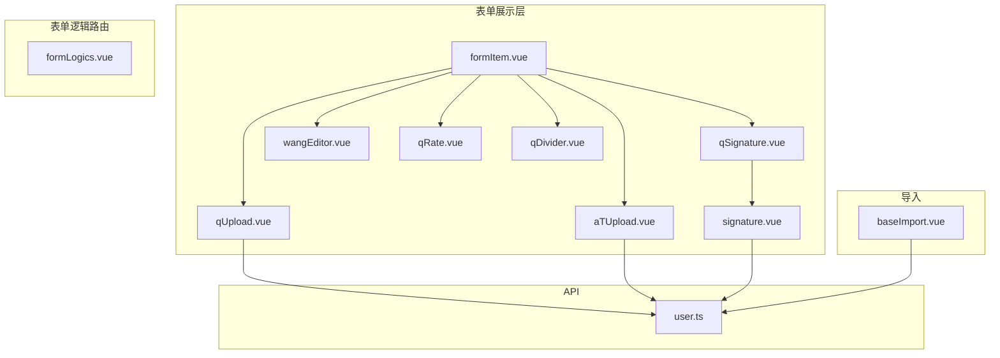
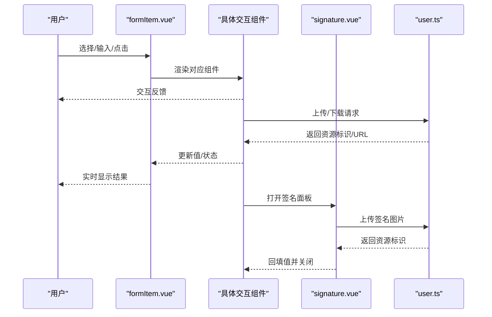
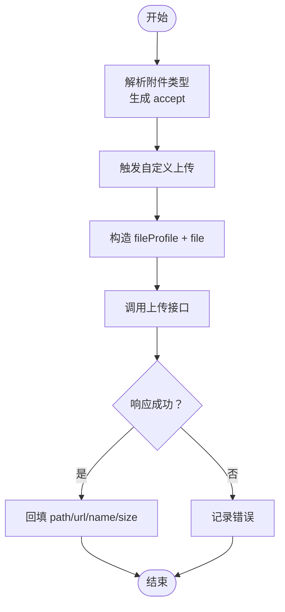
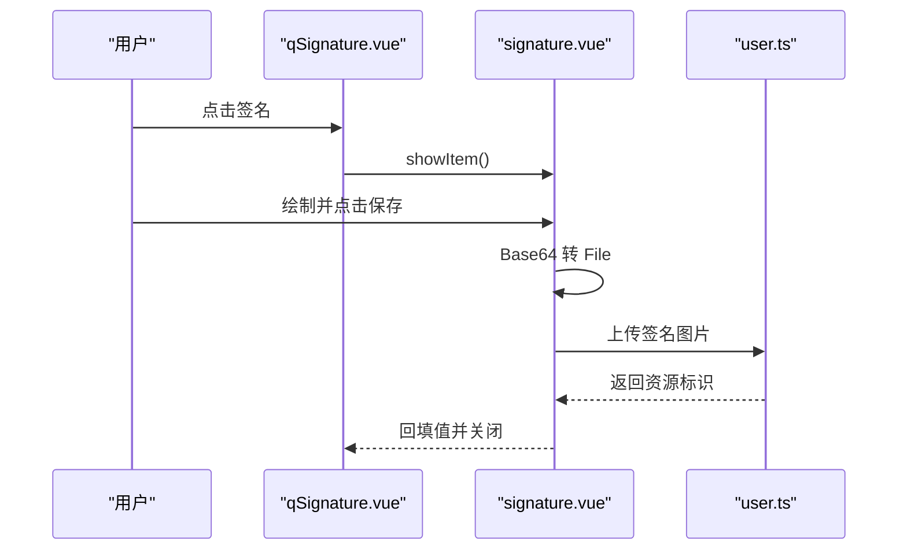
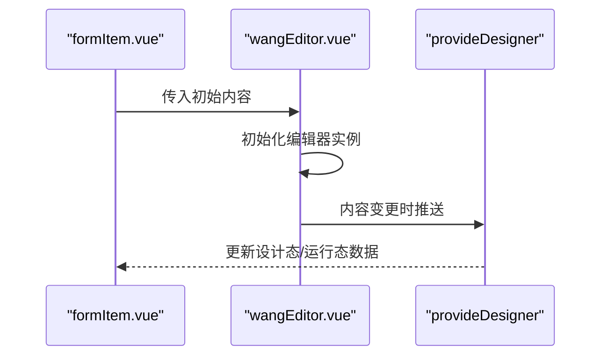
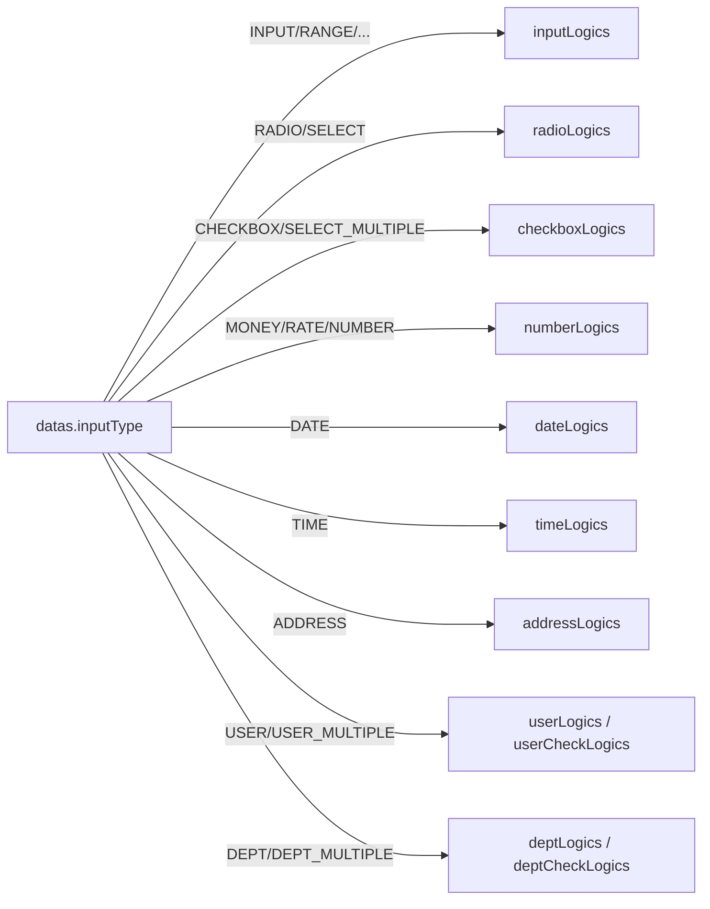
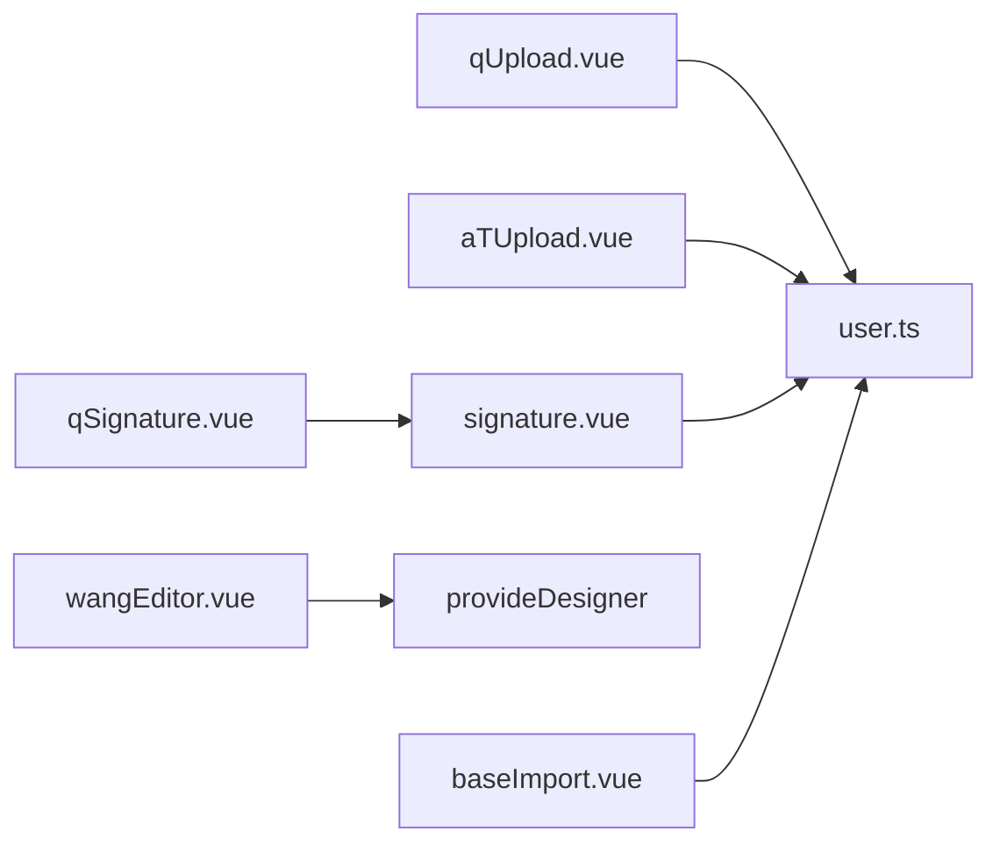

# 交互组件

<cite>
**本文引用的文件**
- [qUpload.vue](file://src/components/showItem/qUpload.vue)
- [aTUpload.vue](file://src/components/showItem/aTUpload.vue)
- [signature.vue](file://src/components/signature/signature.vue)
- [qSignature.vue](file://src/components/showItem/qSignature.vue)
- [wangEditor.vue](file://src/components/wangEditor/wangEditor.vue)
- [qRate.vue](file://src/components/showItem/qRate.vue)
- [qDivider.vue](file://src/components/showItem/qDivider.vue)
- [formItem.vue](file://src/components/showItem/formItem.vue)
- [formLogics.vue](file://src/components/formLogics/formLogics.vue)
- [baseImport.vue](file://src/components/baseImport/baseImport.vue)
- [user.ts](file://src/api/user.ts)
</cite>

## 目录
1. [简介](#简介)
2. [项目结构](#项目结构)
3. [核心组件](#核心组件)
4. [架构总览](#架构总览)
5. [组件详解](#组件详解)
6. [依赖关系分析](#依赖关系分析)
7. [性能与可用性](#性能与可用性)
8. [故障排查指南](#故障排查指南)
9. [结论](#结论)
10. [附录：API 接口与事件](#附录api-接口与事件)

## 简介
本文件聚焦新工作台项目中的交互组件，系统梳理并说明以下能力：
- 文件上传（含示例文件与业务文件）
- 电子签名（采集、保存、回显）
- 富文本编辑（工具栏与内容渲染）
- 评分组件（打分）
- 分割线组件（占位与分隔）
- 表单容器与逻辑路由（根据字段类型动态渲染）
- 基础导入流程（模板下载、校验、上传、错误回传）

文档覆盖事件处理、状态管理、数据传输、权限与安全、实时反馈与用户体验优化，并提供可直接定位到源码位置的路径指引。

## 项目结构
围绕“交互组件”的关键目录与文件如下：
- 表单项展示层：src/components/showItem
- 签名与富文本：src/components/signature、src/components/wangEditor
- 表单逻辑路由：src/components/formLogics
- 表单容器：src/components/showItem/formItem.vue
- 基础导入：src/components/baseImport/baseImport.vue
- API 层：src/api/user.ts

图表来源
- [formItem.vue:1-122](file://src/components/showItem/formItem.vue#L1-L122)
- [qUpload.vue:1-88](file://src/components/showItem/qUpload.vue#L1-L88)
- [aTUpload.vue:1-78](file://src/components/showItem/aTUpload.vue#L1-L78)
- [qSignature.vue:1-61](file://src/components/showItem/qSignature.vue#L1-L61)
- [signature.vue:1-121](file://src/components/signature/signature.vue#L1-L121)
- [wangEditor.vue:1-121](file://src/components/wangEditor/wangEditor.vue#L1-L121)
- [qRate.vue:1-16](file://src/components/showItem/qRate.vue#L1-L16)
- [qDivider.vue:1-38](file://src/components/showItem/qDivider.vue#L1-L38)
- [formLogics.vue:1-35](file://src/components/formLogics/formLogics.vue#L1-L35)
- [baseImport.vue:1-172](file://src/components/baseImport/baseImport.vue#L1-L172)
- [user.ts:1-16](file://src/api/user.ts#L1-L16)

章节来源
- [formItem.vue:1-122](file://src/components/showItem/formItem.vue#L1-L122)
- [formLogics.vue:1-35](file://src/components/formLogics/formLogics.vue#L1-L35)

## 核心组件
- 文件上传组件（业务文件）：qUpload.vue
- 文件上传组件（示例文件）：aTUpload.vue
- 电子签名组件（展示）：qSignature.vue
- 签名弹窗与保存：signature.vue
- 富文本编辑器：wangEditor.vue
- 评分组件：qRate.vue
- 分割线组件：qDivider.vue
- 表单容器：formItem.vue
- 表单逻辑路由：formLogics.vue
- 基础导入流程：baseImport.vue
- 文件上传/下载 API：user.ts

章节来源
- [qUpload.vue:1-88](file://src/components/showItem/qUpload.vue#L1-L88)
- [aTUpload.vue:1-78](file://src/components/showItem/aTUpload.vue#L1-L78)
- [qSignature.vue:1-61](file://src/components/showItem/qSignature.vue#L1-L61)
- [signature.vue:1-121](file://src/components/signature/signature.vue#L1-L121)
- [wangEditor.vue:1-121](file://src/components/wangEditor/wangEditor.vue#L1-L121)
- [qRate.vue:1-16](file://src/components/showItem/qRate.vue#L1-L16)
- [qDivider.vue:1-38](file://src/components/showItem/qDivider.vue#L1-L38)
- [formItem.vue:1-122](file://src/components/showItem/formItem.vue#L1-L122)
- [formLogics.vue:1-35](file://src/components/formLogics/formLogics.vue#L1-L35)
- [baseImport.vue:1-172](file://src/components/baseImport/baseImport.vue#L1-L172)
- [user.ts:1-16](file://src/api/user.ts#L1-L16)

## 架构总览
交互组件在表单中通过“容器 + 动态组件 + 逻辑路由”组织，统一由 API 层完成文件读写与下载；签名与富文本通过独立组件封装交互与状态。

图表来源
- [formItem.vue:1-122](file://src/components/showItem/formItem.vue#L1-L122)
- [signature.vue:1-121](file://src/components/signature/signature.vue#L1-L121)
- [user.ts:1-16](file://src/api/user.ts#L1-L16)

## 组件详解

### 文件上传（业务文件）：qUpload.vue
- 设计要点
  - 支持多种附件类型（图片、视频、音频、文档、压缩包），根据配置动态拼接 accept
  - 使用自定义上传钩子，构造 fileProfile 与文件，调用上传接口
  - 上传成功后回填 path、url、name、size 等字段，拼接下载地址与 token
  - 删除前钩子对示例文件进行保护，防止误删
- 关键行为
  - 输入参数：comDes.props.attachment_type、comDes.props.value
  - 输出：更新 comDes.props.value 的文件列表项
- 权限与安全
  - 下载 URL 携带 token，避免未授权访问
  - 上传前对示例文件进行保护
- 性能与体验
  - 采用 FormData 传输，支持大文件
  - 上传完成后替换临时项，避免重复渲染

图表来源
- [qUpload.vue:1-88](file://src/components/showItem/qUpload.vue#L1-L88)
- [user.ts:10-12](file://src/api/user.ts#L10-L12)

章节来源
- [qUpload.vue:1-88](file://src/components/showItem/qUpload.vue#L1-L88)
- [user.ts:10-12](file://src/api/user.ts#L10-L12)

### 文件上传（示例文件）：aTUpload.vue
- 设计要点
  - 与业务文件上传类似，但针对示例文件列表（exampleFiles）
  - 同样支持多类型 accept 与自定义上传
- 关键行为
  - 输入参数：comDes.props.attachment_type、comDes.props.exampleFiles
  - 输出：更新示例文件列表项

章节来源
- [aTUpload.vue:1-78](file://src/components/showItem/aTUpload.vue#L1-L78)

### 电子签名（展示）：qSignature.vue
- 设计要点
  - 提供点击区域，已签名则预览图片，否则提示点击签名
  - 内部嵌套 signature 弹窗组件，负责绘制与保存
- 关键行为
  - 点击进入签名弹窗
  - 保存成功后回填资源标识，关闭弹窗
- 权限与安全
  - 仅在非禁用状态下允许签名
  - 下载 URL 携带 token

章节来源
- [qSignature.vue:1-61](file://src/components/showItem/qSignature.vue#L1-L61)

### 签名弹窗与保存：signature.vue
- 设计要点
  - 基于 vue-signature-pad，提供撤销、清屏、保存按钮
  - 保存时将 Base64 转换为 File，构造 fileProfile 并上传
  - 成功后通过注入的 provide 注入器更新父级属性或过滤数据
- 关键行为
  - 保存：Base64 -> File -> 上传 -> 回填 -> 关闭
  - 撤销/清屏：调用签名板 API
- 权限与安全
  - 上传携带 token，下载时同样携带
- 可用性
  - 提供暴露方法 showItem，便于外部触发显示

图表来源
- [qSignature.vue:1-61](file://src/components/showItem/qSignature.vue#L1-L61)
- [signature.vue:1-121](file://src/components/signature/signature.vue#L1-L121)
- [user.ts:10-12](file://src/api/user.ts#L10-L12)

章节来源
- [signature.vue:1-121](file://src/components/signature/signature.vue#L1-L121)
- [user.ts:10-12](file://src/api/user.ts#L10-L12)

### 富文本编辑：wangEditor.vue
- 设计要点
  - 集成 @wangeditor/editor-for-vue 的 Toolbar 与 Editor
  - 自定义工具栏按键集合，隐藏冗余功能
  - 配置图片/视频上传（当前为空服务器地址，保留扩展点）
  - 通过 provide 注入器向上游推送内容变更
- 关键行为
  - 初始化编辑器实例
  - 监听内容变化，自动同步至上游
  - 支持从外部接收初始内容并同步
- 权限与安全
  - 上传请求头携带 token（如后续接入服务端）
- 可用性
  - 支持占位符、滚动区域、样式微调

图表来源
- [wangEditor.vue:1-121](file://src/components/wangEditor/wangEditor.vue#L1-L121)
- [formItem.vue:1-122](file://src/components/showItem/formItem.vue#L1-L122)

章节来源
- [wangEditor.vue:1-121](file://src/components/wangEditor/wangEditor.vue#L1-L121)

### 评分组件：qRate.vue
- 设计要点
  - 基于 Rate 组件，双向绑定值
  - 可与业务模块集成（例如应用模块上传接口引入）
- 关键行为
  - 输入参数：comDes.props.value
  - 输出：更新评分值

章节来源
- [qRate.vue:1-16](file://src/components/showItem/qRate.vue#L1-L16)

### 分割线组件：qDivider.vue
- 设计要点
  - 直接渲染分割线，支持方法钩子（input）用于扩展
- 关键行为
  - 输入参数：comDes.defaultValue、comDes.method.input
  - 输出：无直接输出，主要用于视觉分隔

章节来源
- [qDivider.vue:1-38](file://src/components/showItem/qDivider.vue#L1-L38)

### 表单容器与逻辑路由：formItem.vue、formLogics.vue
- 设计要点
  - formItem.vue 作为表单项容器，包裹 label、必填、描述等
  - formLogics.vue 根据字段类型动态选择具体输入组件（输入、单选、多选、数字、日期、时间、地址、人员、部门等）
- 关键行为
  - 容器：渲染组件、传递上下文（activeForm、formConfs、list、newIndex）
  - 路由：按 inputType 匹配对应逻辑组件

图表来源
- [formLogics.vue:1-35](file://src/components/formLogics/formLogics.vue#L1-L35)
- [formItem.vue:1-122](file://src/components/showItem/formItem.vue#L1-L122)

章节来源
- [formLogics.vue:1-35](file://src/components/formLogics/formLogics.vue#L1-L35)
- [formItem.vue:1-122](file://src/components/showItem/formItem.vue#L1-L122)

### 基础导入流程：baseImport.vue
- 设计要点
  - 步骤化流程：下载模板 -> 上传数据
  - 校验文件类型（.xlsx/.zip），限制数量
  - 自定义上传钩子，调用传入的 uploadFiles 方法
  - 成功时关闭模型；失败时下载错误明细并关闭模型
- 关键行为
  - 输入：scheduleData（标题、文案、限制、导出/上传函数）
  - 输出：触发 closeModel 或 importSuccess（由调用方决定）
- 权限与安全
  - 上传前校验文件类型，避免非法文件
  - 错误明细下载时同样携带 token（通过下载接口）

章节来源
- [baseImport.vue:1-172](file://src/components/baseImport/baseImport.vue#L1-L172)
- [user.ts:5-8](file://src/api/user.ts#L5-L8)

## 依赖关系分析
- 组件间耦合
  - qSignature.vue 依赖 signature.vue 的弹窗能力
  - formItem.vue 作为容器，承载各类交互组件
  - formLogics.vue 作为逻辑路由，解耦字段类型与组件映射
- 外部依赖
  - API 层：user.ts 提供上传/下载能力
  - 富文本：@wangeditor/editor-for-vue
  - 签名：vue-signature-pad
- 数据流
  - 上传成功后，组件通过本地状态更新文件列表或签名值
  - 富文本通过 provide 注入器向父级同步内容

图表来源
- [qUpload.vue:1-88](file://src/components/showItem/qUpload.vue#L1-L88)
- [aTUpload.vue:1-78](file://src/components/showItem/aTUpload.vue#L1-L78)
- [signature.vue:1-121](file://src/components/signature/signature.vue#L1-L121)
- [qSignature.vue:1-61](file://src/components/showItem/qSignature.vue#L1-L61)
- [wangEditor.vue:1-121](file://src/components/wangEditor/wangEditor.vue#L1-L121)
- [baseImport.vue:1-172](file://src/components/baseImport/baseImport.vue#L1-L172)
- [user.ts:1-16](file://src/api/user.ts#L1-L16)

## 性能与可用性
- 上传性能
  - 使用 FormData，支持大文件；建议在服务端配置合理的超时与大小限制
- 交互体验
  - 签名弹窗固定尺寸，Canvas 尺寸可控，避免过大导致卡顿
  - 富文本编辑器高度固定并溢出隐藏，减少布局抖动
- 安全建议
  - 上传接口应校验 MIME/扩展名，避免恶意文件
  - 下载链接携带短期有效 token，避免长期暴露
- 可靠性
  - 上传失败时提供错误明细下载，便于快速定位问题

## 故障排查指南
- 上传失败
  - 检查 fileProfile 构造是否正确，确认上传接口路径与参数
  - 查看网络面板与后端日志，确认 token 是否有效
- 签名保存无效
  - 确认签名板非空（isEmpty 判断），Base64 转 File 流程是否正确
  - 检查 provide 注入器是否正确注入，回填逻辑是否执行
- 富文本不更新
  - 确认 watch 内容变更逻辑，检查 provide 注入器是否可用
- 导入失败
  - 校验文件类型与数量限制，查看错误明细下载是否成功

章节来源
- [signature.vue:50-78](file://src/components/signature/signature.vue#L50-L78)
- [wangEditor.vue:82-92](file://src/components/wangEditor/wangEditor.vue#L82-L92)
- [baseImport.vue:103-129](file://src/components/baseImport/baseImport.vue#L103-L129)

## 结论
上述交互组件以“容器 + 路由 + 独立组件”的方式实现高内聚低耦合，配合统一的 API 层完成文件与签名的上传/下载，满足表单场景下的多样化交互需求。通过 provide 注入器与事件驱动，实现组件间松耦合的数据流转；同时在权限与安全方面采取 token 校验与文件类型限制，提升整体安全性与稳定性。

## 附录：API 接口与事件

- 文件上传
  - 接口：POST /internal/business/file/v1/upload
  - 参数：FormData，包含 fileProfile（JSON Blob）、file
  - 返回：资源标识（字符串）
  - 用途：业务文件上传、示例文件上传、签名图片上传
  - 参考路径：[user.ts:10-12](file://src/api/user.ts#L10-L12)

- 文件下载
  - 接口：GET /internal/business/file/v1/download
  - 参数：fileId（查询参数），responseType: blob
  - 用途：导入失败明细下载
  - 参考路径：[user.ts:5-8](file://src/api/user.ts#L5-L8)

- 事件与回调
  - 签名保存：signature.vue 在保存成功后通过注入器回填值并关闭弹窗
  - 富文本变更：wangEditor.vue 监听内容变化并通过注入器推送
  - 表单容器：formItem.vue 作为容器承载各组件并传递上下文
  - 导入流程：baseImport.vue 在上传完成后触发 closeModel 或 importSuccess（由调用方决定）

- 使用场景示例（路径指引）
  - 文件上传处理（业务文件）：[qUpload.vue:59-84](file://src/components/showItem/qUpload.vue#L59-L84)
  - 文件上传处理（示例文件）：[aTUpload.vue:49-73](file://src/components/showItem/aTUpload.vue#L49-L73)
  - 签名采集与回填：[signature.vue:50-78](file://src/components/signature/signature.vue#L50-L78)、[qSignature.vue:24-30](file://src/components/showItem/qSignature.vue#L24-L30)
  - 内容编辑（富文本）：[wangEditor.vue:77-92](file://src/components/wangEditor/wangEditor.vue#L77-L92)
  - 用户反馈（评分）：[qRate.vue:1-16](file://src/components/showItem/qRate.vue#L1-L16)
  - 分割线（占位）：[qDivider.vue:1-38](file://src/components/showItem/qDivider.vue#L1-L38)
  - 表单容器与逻辑路由：[formItem.vue:1-18](file://src/components/showItem/formItem.vue#L1-L18)、[formLogics.vue:1-17](file://src/components/formLogics/formLogics.vue#L1-L17)
  - 基础导入流程：[baseImport.vue:103-129](file://src/components/baseImport/baseImport.vue#L103-L129)