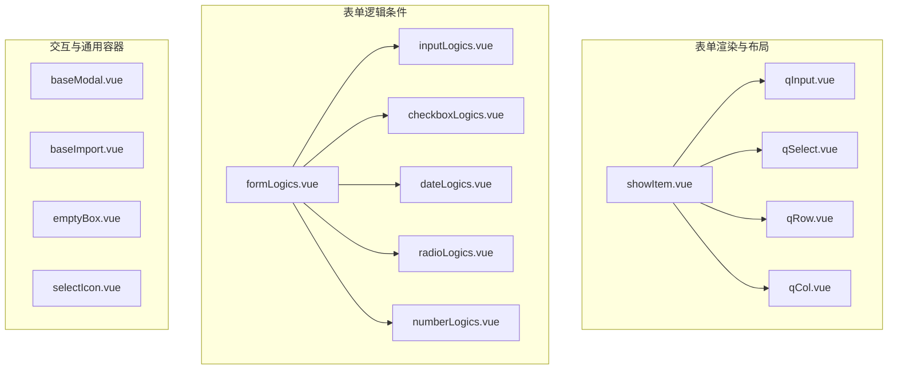
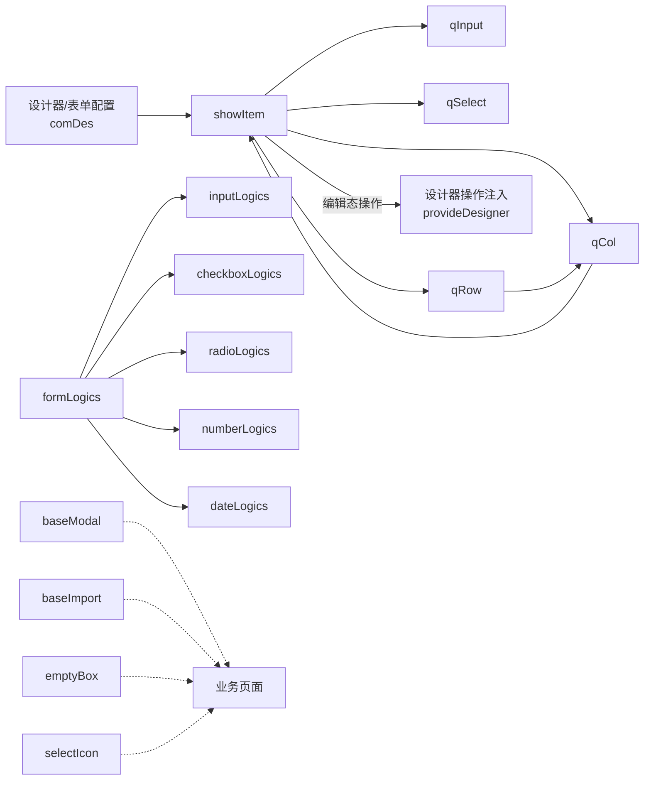
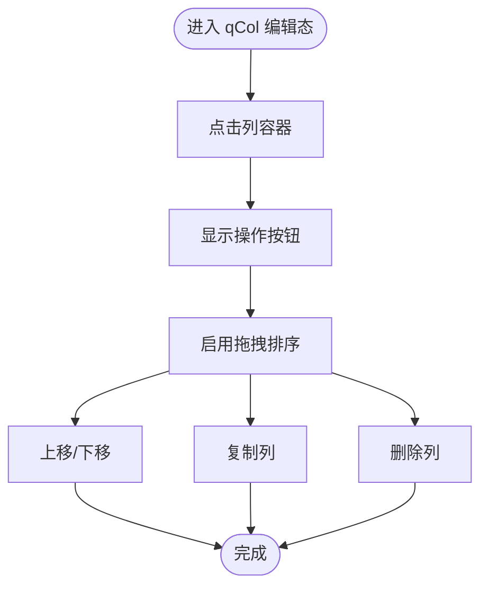
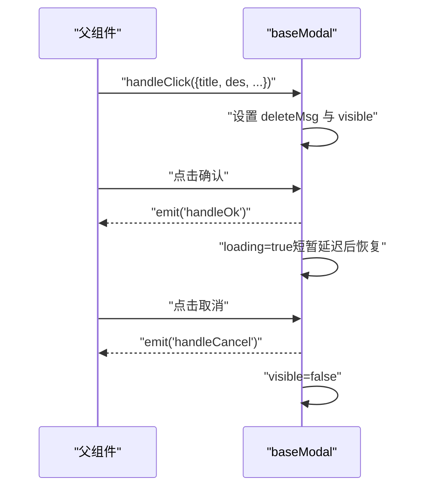
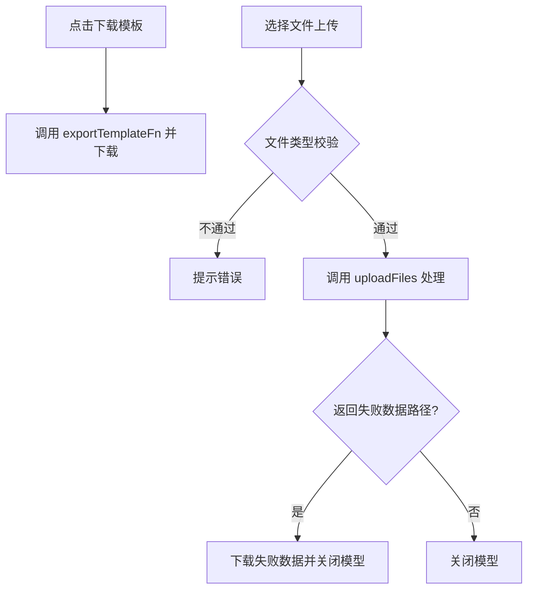
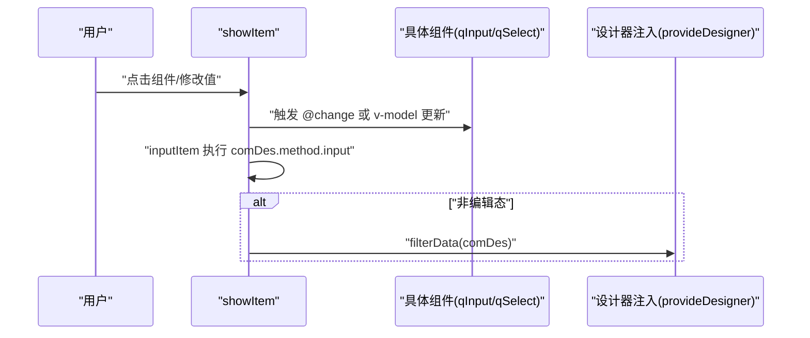
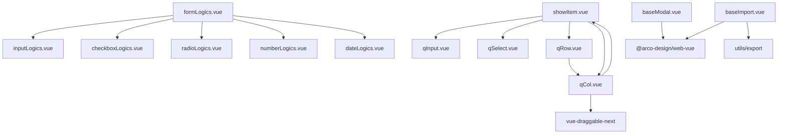

# 基础组件库

<cite>
**本文引用的文件**
- [showItem.vue](file://src/components/showItem/showItem.vue)
- [qInput.vue](file://src/components/showItem/qInput.vue)
- [qSelect.vue](file://src/components/showItem/qSelect.vue)
- [qRow.vue](file://src/components/showItem/qRow.vue)
- [qCol.vue](file://src/components/showItem/qCol.vue)
- [formLogics.vue](file://src/components/formLogics/formLogics.vue)
- [inputLogics.vue](file://src/components/formLogics/inputLogics.vue)
- [checkboxLogics.vue](file://src/components/formLogics/checkboxLogics.vue)
- [dateLogics.vue](file://src/components/formLogics/dateLogics.vue)
- [radioLogics.vue](file://src/components/formLogics/radioLogics.vue)
- [numberLogics.vue](file://src/components/formLogics/numberLogics.vue)
- [baseModal.vue](file://src/components/modal/baseModal.vue)
- [baseImport.vue](file://src/components/baseImport/baseImport.vue)
- [emptyBox.vue](file://src/components/emptyBox/emptyBox.vue)
- [selectIcon.vue](file://src/components/selectIcon/selectIcon.vue)
</cite>

## 目录
1. [简介](#简介)
2. [项目结构](#项目结构)
3. [核心组件](#核心组件)
4. [架构总览](#架构总览)
5. [组件详解](#组件详解)
6. [依赖关系分析](#依赖关系分析)
7. [性能与可维护性建议](#性能与可维护性建议)
8. [故障排查指南](#故障排查指南)
9. [结论](#结论)
10. [附录：API 参考](#附录api-参考)

## 简介
本文件面向“新工作台”项目的基础组件库，系统化梳理输入类、选择类、布局类、交互类与通用容器类组件的设计理念、实现细节与使用方式。重点覆盖以下方面：
- 组件属性配置、事件处理、样式定制与响应式设计
- 使用场景、最佳实践与扩展方法
- 组件 API 接口、属性说明、事件回调与插槽使用
- 通过流程图、时序图与类图展示关键交互与数据流

## 项目结构
基础组件主要集中在 src/components 目录下，按功能域划分：
- 表单渲染与布局：showItem 及其子组件（qInput、qSelect、qRow、qCol）
- 表单逻辑条件渲染：formLogics 及其子组件（inputLogics、checkboxLogics、dateLogics、radioLogics、numberLogics）
- 交互与通用容器：baseModal、baseImport、emptyBox、selectIcon

图表来源
- [showItem.vue:1-196](file://src/components/showItem/showItem.vue#L1-L196)
- [qInput.vue:1-21](file://src/components/showItem/qInput.vue#L1-L21)
- [qSelect.vue:1-34](file://src/components/showItem/qSelect.vue#L1-L34)
- [qRow.vue:1-36](file://src/components/showItem/qRow.vue#L1-L36)
- [qCol.vue:1-184](file://src/components/showItem/qCol.vue#L1-L184)
- [formLogics.vue:1-35](file://src/components/formLogics/formLogics.vue#L1-L35)
- [inputLogics.vue:1-28](file://src/components/formLogics/inputLogics.vue#L1-L28)
- [checkboxLogics.vue:1-27](file://src/components/formLogics/checkboxLogics.vue#L1-L27)
- [dateLogics.vue:1-45](file://src/components/formLogics/dateLogics.vue#L1-L45)
- [radioLogics.vue:1-27](file://src/components/formLogics/radioLogics.vue#L1-L27)
- [numberLogics.vue:1-50](file://src/components/formLogics/numberLogics.vue#L1-L50)
- [baseModal.vue:1-104](file://src/components/modal/baseModal.vue#L1-L104)
- [baseImport.vue:1-172](file://src/components/baseImport/baseImport.vue#L1-L172)
- [emptyBox.vue:1-44](file://src/components/emptyBox/emptyBox.vue#L1-L44)
- [selectIcon.vue:1-29](file://src/components/selectIcon/selectIcon.vue#L1-L29)

章节来源
- [showItem.vue:1-196](file://src/components/showItem/showItem.vue#L1-L196)
- [formLogics.vue:1-35](file://src/components/formLogics/formLogics.vue#L1-L35)
- [baseModal.vue:1-104](file://src/components/modal/baseModal.vue#L1-L104)
- [baseImport.vue:1-172](file://src/components/baseImport/baseImport.vue#L1-L172)
- [emptyBox.vue:1-44](file://src/components/emptyBox/emptyBox.vue#L1-L44)
- [selectIcon.vue:1-29](file://src/components/selectIcon/selectIcon.vue#L1-L29)

## 核心组件
- 表单渲染与布局
  - showItem：统一渲染器，根据 comDes.type 动态分发至具体组件；在编辑态支持拖拽、复制、上下移动、删除等操作；支持描述文本与必填标记。
  - qInput：基于输入框的文本输入组件，支持清空、占位符、只读、禁用、字数限制等属性。
  - qSelect：基于选择器的单选/多选组件，支持清空、变更事件与动态方法执行。
  - qRow/qCol：栅格布局容器，qRow 负责行级布局，qCol 负责列级拖拽与操作按钮显隐。
- 表单逻辑条件渲染
  - formLogics：根据输入类型动态选择对应逻辑组件，集中管理条件表达式与默认值。
  - inputLogics、checkboxLogics、radioLogics、numberLogics、dateLogics：针对不同输入类型的条件渲染与输入控件。
- 交互与通用容器
  - baseModal：通用弹窗容器，支持标题、描述、按钮、插槽与加载态。
  - baseImport：通用导入流程组件，包含步骤引导、模板下载、文件上传、错误提示与结果反馈。
  - emptyBox：空状态占位容器，支持自定义描述文案。
  - selectIcon：图标选择器骨架组件（当前为空）。

章节来源
- [showItem.vue:1-196](file://src/components/showItem/showItem.vue#L1-L196)
- [qInput.vue:1-21](file://src/components/showItem/qInput.vue#L1-L21)
- [qSelect.vue:1-34](file://src/components/showItem/qSelect.vue#L1-L34)
- [qRow.vue:1-36](file://src/components/showItem/qRow.vue#L1-L36)
- [qCol.vue:1-184](file://src/components/showItem/qCol.vue#L1-L184)
- [formLogics.vue:1-35](file://src/components/formLogics/formLogics.vue#L1-L35)
- [inputLogics.vue:1-28](file://src/components/formLogics/inputLogics.vue#L1-L28)
- [checkboxLogics.vue:1-27](file://src/components/formLogics/checkboxLogics.vue#L1-L27)
- [dateLogics.vue:1-45](file://src/components/formLogics/dateLogics.vue#L1-L45)
- [radioLogics.vue:1-27](file://src/components/formLogics/radioLogics.vue#L1-L27)
- [numberLogics.vue:1-50](file://src/components/formLogics/numberLogics.vue#L1-L50)
- [baseModal.vue:1-104](file://src/components/modal/baseModal.vue#L1-L104)
- [baseImport.vue:1-172](file://src/components/baseImport/baseImport.vue#L1-L172)
- [emptyBox.vue:1-44](file://src/components/emptyBox/emptyBox.vue#L1-L44)
- [selectIcon.vue:1-29](file://src/components/selectIcon/selectIcon.vue#L1-L29)

## 架构总览
基础组件围绕“统一渲染器 + 条件逻辑 + 通用交互”的模式组织，形成如下关系：
- showItem 作为统一入口，负责根据组件类型与编辑态渲染具体子组件，并暴露统一的交互能力（复制、删除、上下移动）。
- qRow/qCol 提供拖拽布局能力，qCol 内部嵌套 showItem 实现组件级拖拽与操作。
- formLogics 将输入类型与条件组合解耦，按需渲染对应逻辑组件。
- baseModal/baseImport/emptyBox/selectIcon 提供通用交互与占位能力，便于复用。

图表来源
- [showItem.vue:48-104](file://src/components/showItem/showItem.vue#L48-L104)
- [qRow.vue:12-24](file://src/components/showItem/qRow.vue#L12-L24)
- [qCol.vue:33-92](file://src/components/showItem/qCol.vue#L33-L92)
- [formLogics.vue:1-35](file://src/components/formLogics/formLogics.vue#L1-L35)
- [baseModal.vue:26-77](file://src/components/modal/baseModal.vue#L26-L77)
- [baseImport.vue:35-130](file://src/components/baseImport/baseImport.vue#L35-L130)
- [emptyBox.vue:1-44](file://src/components/emptyBox/emptyBox.vue#L1-L44)
- [selectIcon.vue:7-24](file://src/components/selectIcon/selectIcon.vue#L7-L24)

## 组件详解

### 输入组件

#### qInput（文本输入）
- 设计理念
  - 以最小封装对接 Arco Design 的输入框，统一受控于 comDes.props，支持清空、占位符、只读、禁用、字数限制等常用属性。
- 关键属性
  - allowClear：是否显示清除按钮
  - placeholder：占位符
  - readonly/disabled：只读/禁用
  - showWordLimit/maxLength：字数限制与展示
  - value：双向绑定值
- 事件与行为
  - 通过 v-model 与外部值同步；在编辑态由 showItem 汇总输入事件。
- 最佳实践
  - 对长文本建议开启字数限制与展示；对必填项配合 formConfs.titleStyle 控制标签显示。
- 扩展方法
  - 在 comDes.method.input 中编写输入后置逻辑（eval 执行，注意安全）。

章节来源
- [qInput.vue:1-21](file://src/components/showItem/qInput.vue#L1-L21)
- [showItem.vue:91-103](file://src/components/showItem/showItem.vue#L91-L103)

#### qSelect（选择器）
- 设计理念
  - 支持单选/多选、清空、动态选项与变更回调；适合枚举、搜索、远程筛选等场景。
- 关键属性
  - v-bind="comDes.props"：透传全部 Arco Select 属性
  - value：双向绑定值
  - @change：变更回调（内部触发 inputItem）
- 事件与行为
  - inputItem：在 comDes.method.input 中执行自定义逻辑
- 最佳实践
  - 大列表建议开启过滤或远程搜索；多选时控制最大展示数。
- 扩展方法
  - 在 comDes.method.input 中实现联动、校验或异步取数。

章节来源
- [qSelect.vue:1-34](file://src/components/showItem/qSelect.vue#L1-L34)
- [qSelect.vue:13-24](file://src/components/showItem/qSelect.vue#L13-L24)
- [showItem.vue:91-103](file://src/components/showItem/showItem.vue#L91-L103)

#### 其他输入组件（基于 formLogics）
- inputLogics：根据条件渲染输入框或可创建的多选框，适配字符串匹配与范围选择。
- numberLogics：数值输入或区间输入（min/max），支持右侧控制按钮。
- dateLogics：日期时间选择器或区间选择器，支持带时间的时间段。
- radioLogics/checkboxLogics：单选/多选下拉，结合默认选项集。

章节来源
- [inputLogics.vue:1-28](file://src/components/formLogics/inputLogics.vue#L1-L28)
- [numberLogics.vue:1-50](file://src/components/formLogics/numberLogics.vue#L1-L50)
- [dateLogics.vue:1-45](file://src/components/formLogics/dateLogics.vue#L1-L45)
- [radioLogics.vue:1-27](file://src/components/formLogics/radioLogics.vue#L1-L27)
- [checkboxLogics.vue:1-27](file://src/components/formLogics/checkboxLogics.vue#L1-L27)
- [formLogics.vue:1-35](file://src/components/formLogics/formLogics.vue#L1-L35)

### 选择组件

#### qSelect（复用说明）
- 与输入组件中的 qSelect 同名但职责不同：此处为“表单逻辑条件渲染”的选择器组件，用于条件表达式的值选择。
- 适用场景：在 formLogics 场景中，根据输入类型与条件动态生成对应的下拉选择控件。

章节来源
- [qSelect.vue:1-34](file://src/components/showItem/qSelect.vue#L1-L34)
- [formLogics.vue:3-16](file://src/components/formLogics/formLogics.vue#L3-L16)

### 布局组件

#### qRow/qCol（栅格布局）
- 设计理念
  - qRow 定义行级布局，qCol 定义列级布局；在编辑态启用拖拽与操作按钮，非编辑态仅渲染组件树。
- 关键特性
  - qRow：内部使用可拖拽容器包裹 qCol 列表，支持拖拽排序。
  - qCol：在编辑态支持上移/下移/复制/删除；提供 active 样式高亮当前选中列。
- 最佳实践
  - 列内嵌套 showItem，确保子组件具备统一的编辑态交互。
  - 注意拖拽组与动画参数的一致性，避免层级冲突。

图表来源
- [qCol.vue:12-25](file://src/components/showItem/qCol.vue#L12-L25)
- [qCol.vue:77-88](file://src/components/showItem/qCol.vue#L77-L88)
- [qRow.vue:3-8](file://src/components/showItem/qRow.vue#L3-L8)

章节来源
- [qRow.vue:1-36](file://src/components/showItem/qRow.vue#L1-L36)
- [qCol.vue:1-184](file://src/components/showItem/qCol.vue#L1-L184)

### 交互组件

#### baseModal（通用弹窗）
- 设计理念
  - 以轻量封装提供统一的弹窗交互：标题、描述、按钮、插槽与加载态；对外暴露 handleClick/close 方法。
- 关键属性
  - visible：是否可见
  - footer：是否显示底部按钮
  - width：弹窗宽度
  - maskClosable：点击遮罩是否关闭
  - $attrs：透传给底层模态框
- 事件
  - handleOk：确认回调
  - handleCancel：取消回调
- 最佳实践
  - 使用 showSlot 控制是否渲染插槽内容；在确认时设置 loading 并在回调后恢复。
- 扩展方法
  - 通过 expose 暴露的方法在父组件中统一控制弹窗状态。

图表来源
- [baseModal.vue:26-77](file://src/components/modal/baseModal.vue#L26-L77)

章节来源
- [baseModal.vue:1-104](file://src/components/modal/baseModal.vue#L1-L104)

#### baseImport（通用导入）
- 设计理念
  - 两步式导入流程：下载模板 -> 上传文件 -> 错误数据回写或成功提示。
- 关键属性
  - scheduleData：合并后的配置对象（标题、文案、限制、文件格式、回调函数等）
- 流程
  - 导出模板：调用 exportTemplateFn 并下载 Blob 文件
  - 上传校验：beforeUpload 校验文件类型
  - 导入处理：uploadFiles 返回失败路径则下载失败数据，否则关闭模型
- 最佳实践
  - 明确导出与上传回调；合理设置文件数量与大小限制；对错误数据进行可视化提示。

图表来源
- [baseImport.vue:74-129](file://src/components/baseImport/baseImport.vue#L74-L129)
- [baseImport.vue:87-100](file://src/components/baseImport/baseImport.vue#L87-L100)

章节来源
- [baseImport.vue:1-172](file://src/components/baseImport/baseImport.vue#L1-L172)

#### emptyBox（空状态占位）
- 设计理念
  - 提供统一的空状态展示：图片、标题与容器样式，支持自定义描述。
- 关键属性
  - desc：描述文案，默认“暂无内容”
- 最佳实践
  - 在列表/表格/卡片等容器无数据时统一使用，提升用户体验一致性。

章节来源
- [emptyBox.vue:1-44](file://src/components/emptyBox/emptyBox.vue#L1-L44)

#### selectIcon（图标选择器）
- 设计理念
  - 当前为骨架组件，提供 v-model 与标题属性，便于后续扩展。
- 关键属性
  - modelValue：数组类型，用于存储选中图标集合
  - title：弹窗标题，默认“选择人员”
- 最佳实践
  - 建议后续接入图标库与搜索能力，完善交互与数据结构。

章节来源
- [selectIcon.vue:1-29](file://src/components/selectIcon/selectIcon.vue#L1-L29)

### 统一渲染器 showItem
- 设计理念
  - 作为所有表单组件的统一出口，根据 comDes.type 分发到具体组件；在编辑态提供统一的设计器操作注入。
- 关键行为
  - 编辑态：渲染 a-form-item 或直接渲染组件；显示操作按钮；支持点击高亮 activeForm
  - 非编辑态：直接渲染组件并绑定 field 与 required
  - inputItem：在 comDes.method.input 中执行输入后置逻辑；在非编辑态触发 filterData
- 最佳实践
  - 保持 comDes 结构一致，确保 props 与 method 字段规范；谨慎使用 eval，建议改为函数式配置。

图表来源
- [showItem.vue:75-103](file://src/components/showItem/showItem.vue#L75-L103)

章节来源
- [showItem.vue:1-196](file://src/components/showItem/showItem.vue#L1-L196)

## 依赖关系分析
- 组件内聚与耦合
  - showItem 与 qRow/qCol 形成布局层与渲染层的清晰边界；qCol 内部再次嵌套 showItem，形成递归渲染与编辑态操作链路。
  - formLogics 通过输入类型与条件映射到具体逻辑组件，降低主流程复杂度。
- 外部依赖
  - Arco Design 组件库：输入框、选择器、日期时间选择器、上传、步骤条等
  - vue-draggable-next：拖拽排序
  - utils/export：Blob 下载工具
- 潜在风险
  - showItem 中存在 eval 执行输入方法，存在安全与调试风险，建议替换为受控函数式配置。
  - 样式使用 ::v-deep 与 scoped 混用，需注意样式隔离与升级成本。

图表来源
- [showItem.vue:10-14](file://src/components/showItem/showItem.vue#L10-L14)
- [qRow.vue:13](file://src/components/showItem/qRow.vue#L13)
- [qCol.vue:34](file://src/components/showItem/qCol.vue#L34)
- [baseImport.vue:37-40](file://src/components/baseImport/baseImport.vue#L37-L40)
- [baseModal.vue:3](file://src/components/modal/baseModal.vue#L3)

章节来源
- [showItem.vue:10-14](file://src/components/showItem/showItem.vue#L10-L14)
- [qRow.vue:13](file://src/components/showItem/qRow.vue#L13)
- [qCol.vue:34](file://src/components/showItem/qCol.vue#L34)
- [baseImport.vue:37-40](file://src/components/baseImport/baseImport.vue#L37-L40)
- [baseModal.vue:3](file://src/components/modal/baseModal.vue#L3)

## 性能与可维护性建议
- 渲染优化
  - 对 qCol 内部的递归渲染，建议引入虚拟滚动或分页策略，避免大列表卡顿。
  - 在 showItem 中对 inputItem 的 eval 使用缓存或白名单函数，减少重复解析。
- 样式治理
  - 减少 ::v-deep 使用，优先通过 props 与 CSS 变量传递主题；必要时使用样式作用域隔离。
- 可测试性
  - 为 baseModal、baseImport 等交互组件提供单元测试与快照测试，覆盖弹窗状态与导入流程。
- 文档与规范
  - 统一 comDes 结构与命名规范，完善 TypeScript 类型定义，提升 IDE 支持与可维护性。

## 故障排查指南
- 弹窗无法关闭或按钮不可点
  - 检查 visible 与 loading 状态更新逻辑；确认 handleOk 与 handleCancel 是否正确触发。
  - 参考路径：[baseModal.vue:58-76](file://src/components/modal/baseModal.vue#L58-L76)
- 导入失败且无提示
  - 确认 beforeUpload 校验与 uploadFiles 回调是否正确；检查失败数据路径是否存在。
  - 参考路径：[baseImport.vue:87-100](file://src/components/baseImport/baseImport.vue#L87-L100)、[baseImport.vue:103-129](file://src/components/baseImport/baseImport.vue#L103-L129)
- 拖拽无效或按钮不显示
  - 确认 qCol 的编辑态判断与 activeForm 高亮逻辑；检查 provideDesigner 注入是否生效。
  - 参考路径：[qCol.vue:12-30](file://src/components/showItem/qCol.vue#L12-L30)、[qCol.vue:45-51](file://src/components/showItem/qCol.vue#L45-L51)
- 输入后置逻辑未生效
  - 检查 comDes.method.input 是否存在且语法正确；避免在 eval 中使用不受信任输入。
  - 参考路径：[showItem.vue:91-103](file://src/components/showItem/showItem.vue#L91-L103)、[qSelect.vue:13-24](file://src/components/showItem/qSelect.vue#L13-L24)

章节来源
- [baseModal.vue:58-76](file://src/components/modal/baseModal.vue#L58-L76)
- [baseImport.vue:87-100](file://src/components/baseImport/baseImport.vue#L87-L100)
- [baseImport.vue:103-129](file://src/components/baseImport/baseImport.vue#L103-L129)
- [qCol.vue:12-30](file://src/components/showItem/qCol.vue#L12-L30)
- [qCol.vue:45-51](file://src/components/showItem/qCol.vue#L45-L51)
- [showItem.vue:91-103](file://src/components/showItem/showItem.vue#L91-L103)
- [qSelect.vue:13-24](file://src/components/showItem/qSelect.vue#L13-L24)

## 结论
本基础组件库通过“统一渲染器 + 条件逻辑 + 通用交互”的架构，实现了从输入、选择、布局到交互的完整闭环。建议在后续迭代中：
- 替换 showItem 中的 eval 为受控函数式配置
- 引入虚拟滚动与更完善的样式隔离策略
- 增强组件的可测试性与文档化程度
- 统一类型定义与命名规范，提升团队协作效率

## 附录：API 参考

### showItem
- 属性
  - comDes：组件描述对象（含 type、props、method、children 等）
  - newIndex/list：当前索引与列表，用于编辑态操作
  - showEdit：是否处于编辑态
  - deptList/formConfs/activeForm：部门列表、表单配置、当前激活表单
- 事件
  - inputItem：输入变更后置逻辑
- 插槽
  - 无

章节来源
- [showItem.vue:48-104](file://src/components/showItem/showItem.vue#L48-L104)

### qInput
- 属性
  - comDes：包含 allowClear、placeholder、readonly、disabled、showWordLimit、maxLength、value 等
  - showEdit/formConfs：编辑态与表单配置
- 事件
  - v-model：双向绑定
- 插槽
  - 无

章节来源
- [qInput.vue:7-13](file://src/components/showItem/qInput.vue#L7-L13)

### qSelect
- 属性
  - comDes：包含 v-bind 透传的 Select 属性与 value
  - formConfs：表单配置
- 事件
  - @change：变更回调
- 插槽
  - 无

章节来源
- [qSelect.vue:7-12](file://src/components/showItem/qSelect.vue#L7-L12)

### qRow/qCol
- 属性
  - comDes：包含 props 与 children
  - newIndex/list：索引与列表
  - showEdit/deptList/formConfs/activeForm：编辑态与上下文
- 事件
  - 编辑态：上移/下移/复制/删除
- 插槽
  - 无

章节来源
- [qRow.vue:12-24](file://src/components/showItem/qRow.vue#L12-L24)
- [qCol.vue:33-92](file://src/components/showItem/qCol.vue#L33-L92)

### formLogics 及其子组件
- 属性
  - datas：包含 inputType、condition、value、default、min、max 等
  - deptList：部门列表（部分子组件使用）
- 事件
  - 无
- 插槽
  - 无

章节来源
- [formLogics.vue:20-27](file://src/components/formLogics/formLogics.vue#L20-L27)
- [inputLogics.vue:12-18](file://src/components/formLogics/inputLogics.vue#L12-L18)
- [checkboxLogics.vue:11-17](file://src/components/formLogics/checkboxLogics.vue#L11-L17)
- [dateLogics.vue:29-35](file://src/components/formLogics/dateLogics.vue#L29-L35)
- [radioLogics.vue:11-17](file://src/components/formLogics/radioLogics.vue#L11-L17)
- [numberLogics.vue:21-27](file://src/components/formLogics/numberLogics.vue#L21-L27)

### baseModal
- 属性
  - showSlot：是否显示插槽，默认 true
- 事件
  - handleOk：确认
  - handleCancel：取消
- 方法
  - expose：handleClick、handleClose
- 插槽
  - 默认插槽：用于自定义内容

章节来源
- [baseModal.vue:26-77](file://src/components/modal/baseModal.vue#L26-L77)

### baseImport
- 属性
  - scheduleData：配置对象（标题、文案、限制、文件格式、回调函数等）
- 事件
  - closeModel：关闭模型
- 方法
  - 无
- 插槽
  - 无

章节来源
- [baseImport.vue:35-73](file://src/components/baseImport/baseImport.vue#L35-L73)

### emptyBox
- 属性
  - desc：描述文案，默认“暂无内容”
- 事件
  - 无
- 插槽
  - 无

章节来源
- [emptyBox.vue:11-18](file://src/components/emptyBox/emptyBox.vue#L11-L18)

### selectIcon
- 属性
  - modelValue：数组类型，选中图标集合
  - title：弹窗标题，默认“选择人员”
- 事件
  - update:modelValue：双向绑定
- 插槽
  - 无

章节来源
- [selectIcon.vue:7-24](file://src/components/selectIcon/selectIcon.vue#L7-L24)