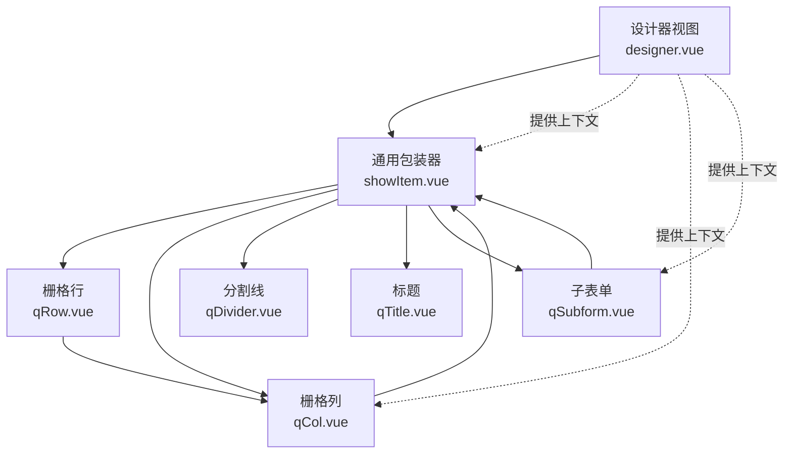
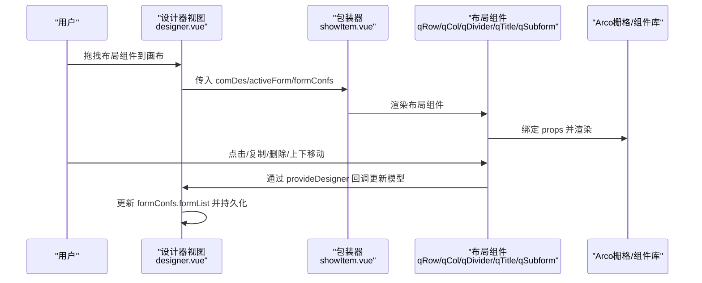
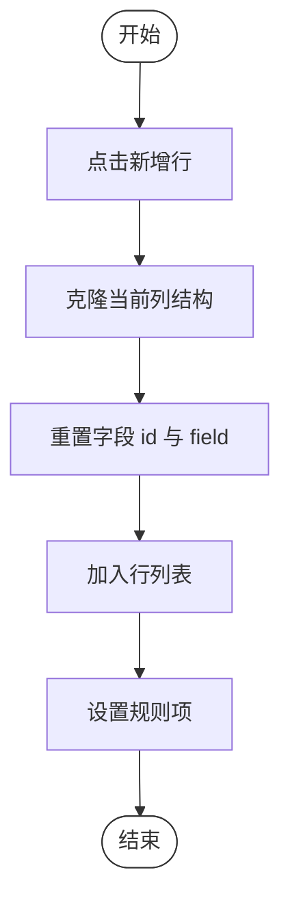
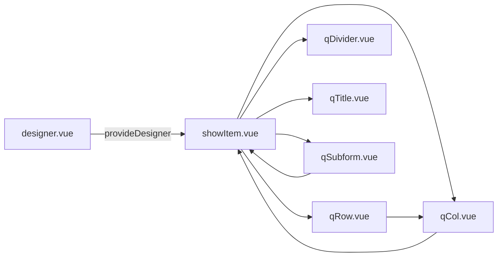

# 布局组件

<cite>
**本文引用的文件**
- [qRow.vue](file://src/components/showItem/qRow.vue)
- [qCol.vue](file://src/components/showItem/qCol.vue)
- [qDivider.vue](file://src/components/showItem/qDivider.vue)
- [qTitle.vue](file://src/components/showItem/qTitle.vue)
- [qSubform.vue](file://src/components/showItem/qSubform.vue)
- [showItem.vue](file://src/components/showItem/showItem.vue)
- [designer.vue](file://src/views/form/designer.vue)
- [textColor.scss](file://src/styles/textColor.scss)
- [form.js](file://src/data/form.js)
- [form.ts](file://src/types/form.ts)
</cite>

## 目录
1. [简介](#简介)
2. [项目结构](#项目结构)
3. [核心组件](#核心组件)
4. [架构总览](#架构总览)
5. [组件详解](#组件详解)
6. [依赖关系分析](#依赖关系分析)
7. [性能与可维护性](#性能与可维护性)
8. [故障排查指南](#故障排查指南)
9. [结论](#结论)
10. [附录：API 与属性参考](#附录api-与属性参考)

## 简介
本章节面向新工作台表单设计器中的“布局组件”，系统化梳理栅格布局（行/列）、分割线、标题、子表单等组件的设计理念、实现细节与使用规范。重点覆盖：
- 响应式设计与容器宽度策略
- 间距控制与对齐方式
- 组件嵌套规则与约束
- 在表单设计中的作用与最佳实践
- API 接口、属性配置、样式定制与断点设置
- 复杂表单布局、自适应设计与移动端适配的实际案例思路

## 项目结构
布局组件位于表单设计器的“展示层”组件体系中，围绕 Arco Design 的栅格系统进行封装与扩展，配合拖拽排序与设计器上下文提供器，实现可视化布局与运行态渲染。

图表来源
- [designer.vue:1-444](file://src/views/form/designer.vue#L1-L444)
- [showItem.vue:1-196](file://src/components/showItem/showItem.vue#L1-L196)
- [qRow.vue:1-36](file://src/components/showItem/qRow.vue#L1-L36)
- [qCol.vue:1-184](file://src/components/showItem/qCol.vue#L1-L184)
- [qDivider.vue:1-38](file://src/components/showItem/qDivider.vue#L1-L38)
- [qTitle.vue:1-22](file://src/components/showItem/qTitle.vue#L1-L22)
- [qSubform.vue:1-433](file://src/components/showItem/qSubform.vue#L1-L433)

章节来源
- [designer.vue:1-444](file://src/views/form/designer.vue#L1-L444)
- [showItem.vue:1-196](file://src/components/showItem/showItem.vue#L1-L196)

## 核心组件
- 栅格行（qRow）：基于 Arco 的 a-row，承载 qCol 列容器，支持编辑态拖拽重排与运行态渲染。
- 栅格列（qCol）：基于 Arco 的 a-col，作为布局容器，内部可放置任意表单控件或布局组件；提供列级交互按钮（上移/下移/复制/删除）。
- 分割线（qDivider）：基于 Arco 的 a-divider，用于视觉分隔与逻辑分区。
- 标题（qTitle）：用于在布局中插入标题层级文本，支持 H1-H5 不同字号映射。
- 子表单（qSubform）：表格化布局的子表单容器，支持动态增删行、字段拖拽入列、禁用特定组件类型等规则。

章节来源
- [qRow.vue:1-36](file://src/components/showItem/qRow.vue#L1-L36)
- [qCol.vue:1-184](file://src/components/showItem/qCol.vue#L1-L184)
- [qDivider.vue:1-38](file://src/components/showItem/qDivider.vue#L1-L38)
- [qTitle.vue:1-22](file://src/components/showItem/qTitle.vue#L1-L22)
- [qSubform.vue:1-433](file://src/components/showItem/qSubform.vue#L1-L433)

## 架构总览
布局组件通过统一的“包装器”组件 showItem 将“布局组件”与“业务控件”统一管理，利用 provide/inject 向子组件注入设计器上下文，实现统一的交互行为（点击高亮、复制、删除、上下移动、字段联动等）。设计器视图负责整体布局与表单配置，提供宽度、标题样式、按钮位置等全局参数。

图表来源
- [designer.vue:1-444](file://src/views/form/designer.vue#L1-L444)
- [showItem.vue:1-196](file://src/components/showItem/showItem.vue#L1-L196)
- [qRow.vue:1-36](file://src/components/showItem/qRow.vue#L1-L36)
- [qCol.vue:1-184](file://src/components/showItem/qCol.vue#L1-L184)
- [qDivider.vue:1-38](file://src/components/showItem/qDivider.vue#L1-L38)
- [qTitle.vue:1-22](file://src/components/showItem/qTitle.vue#L1-L22)
- [qSubform.vue:1-433](file://src/components/showItem/qSubform.vue#L1-L433)

## 组件详解

### 栅格行（qRow）
- 设计要点
  - 直接透传 comDes.props 至 a-row，确保栅格属性（如 gutter、wrap、justify、align 等）可配置。
  - 编辑态使用 vue-draggable-next 对列进行拖拽排序；运行态仅渲染列内容。
  - 支持在列容器内继续嵌套布局组件（如 qCol），形成多级栅格。
- 关键行为
  - 编辑态：draggable 包裹列列表，支持拖拽重排。
  - 运行态：直接渲染列集合，不暴露拖拽交互。
- 嵌套规则
  - qRow 内部应仅包含 qCol；不允许直接放入业务控件。
- 样式与主题
  - 使用 scoped SCSS 控制绘制区尺寸与对齐，结合主题色变量实现高亮态。

章节来源
- [qRow.vue:1-36](file://src/components/showItem/qRow.vue#L1-L36)
- [textColor.scss:1-91](file://src/styles/textColor.scss#L1-L91)

### 栅格列（qCol）
- 设计要点
  - 作为布局容器，内部可放置任意子项（含布局组件与业务控件）。
  - 提供列级操作按钮（上移/下移/复制/删除），通过 provideDesigner 注入的方法实现。
  - 编辑态支持将外部组件拖入列内，同时对字段 ID 进行规范化处理。
- 关键行为
  - 编辑态：draggable 容器，group="componentsGroup"，支持跨区域拖放。
  - 运行态：直接渲染子项列表。
  - 字段 ID 规范化：当子项来自外部拖入时，修正 id 与 props.field，避免冲突。
- 嵌套规则
  - qCol 内部可继续嵌套 qCol 或其他布局组件，形成多级栅格。
- 交互与事件
  - 提供 handleClick/copyItem/deleteItem/drawingItemon/drawingItemup 等方法，统一由设计器上下文处理。

章节来源
- [qCol.vue:1-184](file://src/components/showItem/qCol.vue#L1-L184)
- [designer.vue:178-223](file://src/views/form/designer.vue#L178-L223)

### 分割线（qDivider）
- 设计要点
  - 以 a-divider 为基础，提供最小化包裹，便于在布局中插入视觉分隔。
  - 支持 comDes.props 透传，可配置分割线样式与方向。
- 使用建议
  - 常用于模块间分隔、逻辑区块划分，避免与业务控件混用。
  - 与 qTitle 搭配使用，形成“标题+分割线”的区块入口。

章节来源
- [qDivider.vue:1-38](file://src/components/showItem/qDivider.vue#L1-L38)

### 标题（qTitle）
- 设计要点
  - 根据 comDes.props.fontSize 动态映射 H1-H5 不同字号，支持语义化标题层级。
  - 文本内容取自 comDes.title，适合在布局中作为区块标题。
- 使用建议
  - 与 qDivider 组合，形成清晰的区块边界。
  - 在 qRow/qCol 中作为首行元素，提升可读性。

章节来源
- [qTitle.vue:1-22](file://src/components/showItem/qTitle.vue#L1-L22)

### 子表单（qSubform）
- 设计要点
  - 采用表格化布局，左侧序号列，顶部表头，主体为字段单元格。
  - 支持动态增删行、复制行、删除行；运行态支持新增一行并绑定字段值。
  - 严格限制可拖入的组件类型，禁止将 ROW/SUBFORM/COL/SPLIT_LINE/TITLE 拖入子表单列。
- 关键流程
  - 新增行：克隆当前列结构，重置字段 id 与 field，加入列表。
  - 删除行：splice 移除指定索引行。
  - 字段变更：运行态收集每行每列的值，写回 props.value 并触发过滤/联动。
- 嵌套规则
  - 子表单列内不可再嵌套子表单或栅格组件；拖拽时会进行类型校验并提示错误。
- 交互与事件
  - 通过 provideDesigner 注入的 handleClick/copyItem/deleteItem/filterData/setRulesItem 等方法实现统一处理。

图表来源
- [qSubform.vue:80-91](file://src/components/showItem/qSubform.vue#L80-L91)
- [qSubform.vue:139-141](file://src/components/showItem/qSubform.vue#L139-L141)

章节来源
- [qSubform.vue:1-433](file://src/components/showItem/qSubform.vue#L1-L433)

## 依赖关系分析
- 组件耦合
  - showItem 作为统一包装器，集中处理表单项渲染、描述文案、按钮交互与 provideDesigner 注入。
  - qRow/qCol/qSubform 依赖 Arco 栅格与 a-form-item；qDivider/qTitle 为纯展示组件。
- 上下文依赖
  - 设计器通过 provideDesigner 提供统一的交互回调，包括点击高亮、复制、删除、上下移动、属性读写、数据过滤等。
- 数据流
  - 编辑态：拖拽/操作 -> 更新 formConfs.formList -> 触发 watch 持久化。
  - 运行态：读取 formConfs.formList 渲染真实表单，收集值并触发联动/过滤。

图表来源
- [designer.vue:286](file://src/views/form/designer.vue#L286)
- [showItem.vue:65-74](file://src/components/showItem/showItem.vue#L65-L74)
- [qRow.vue:1-36](file://src/components/showItem/qRow.vue#L1-L36)
- [qCol.vue:1-184](file://src/components/showItem/qCol.vue#L1-L184)
- [qDivider.vue:1-38](file://src/components/showItem/qDivider.vue#L1-L38)
- [qTitle.vue:1-22](file://src/components/showItem/qTitle.vue#L1-L22)
- [qSubform.vue:1-433](file://src/components/showItem/qSubform.vue#L1-L433)

章节来源
- [designer.vue:286](file://src/views/form/designer.vue#L286)
- [showItem.vue:65-74](file://src/components/showItem/showItem.vue#L65-L74)

## 性能与可维护性
- 渲染优化
  - 编辑态与运行态分别渲染，减少不必要的交互按钮与拖拽逻辑开销。
  - qSubform 在运行态按行渲染字段，避免一次性渲染大量节点。
- 事件与数据流
  - 使用 provide/inject 减少 props 层层传递，降低组件间耦合。
  - 字段 ID 规范化与克隆机制避免重复 id 导致的渲染异常。
- 可维护性
  - 统一的 provideDesigner 接口，便于扩展新的交互能力。
  - 组件职责清晰：qRow/qCol 负责布局，qDivider/qTitle 负责装饰，qSubform 负责表格化子表单。

## 故障排查指南
- 拖拽时报错“子表单不能添加栅格布局、标题、分割线及子表单组件”
  - 现象：从左侧拖入不合规组件到子表单列时触发。
  - 处理：检查拖拽目标是否为 ROW/SUBFORM/COL/SPLIT_LINE/TITLE，确保仅拖入业务控件。
  - 参考路径：[qSubform.vue:142-175](file://src/components/showItem/qSubform.vue#L142-L175)
- 字段 id 冲突或联动失效
  - 现象：复制/拖入后字段值异常或联动不生效。
  - 处理：确认 id 与 props.field 已被正确规范化；检查 provideDesigner 的 getPropsItem/setPropsItem 使用。
  - 参考路径：[qCol.vue:63-75](file://src/components/showItem/qCol.vue#L63-L75)，[designer.vue:178-223](file://src/views/form/designer.vue#L178-L223)
- 子表单运行态无法收集值
  - 现象：提交时缺少子表单字段值。
  - 处理：确认 inputItem 流程已触发并写回 props.value；检查 filterData 调用时机。
  - 参考路径：[qSubform.vue:96-117](file://src/components/showItem/qSubform.vue#L96-L117)

章节来源
- [qSubform.vue:142-175](file://src/components/showItem/qSubform.vue#L142-L175)
- [qCol.vue:63-75](file://src/components/showItem/qCol.vue#L63-L75)
- [designer.vue:178-223](file://src/views/form/designer.vue#L178-L223)
- [qSubform.vue:96-117](file://src/components/showItem/qSubform.vue#L96-L117)

## 结论
布局组件以 qRow/qCol 为核心，配合 qDivider/qTitle/qSubform 实现了灵活、可拖拽、可复用的表单布局能力。通过统一的包装器与设计器上下文，实现了编辑态与运行态的清晰分离，既保证了易用性，也兼顾了可维护性与扩展性。建议在复杂表单中优先采用栅格化布局，合理使用分割线与标题进行区块划分，并谨慎使用子表单以避免过度嵌套。

## 附录：API 与属性参考

### 公共属性（所有布局组件）
- comDes：组件描述对象，包含 type、title、component、props、children、method、defaultValue 等字段
- formConfs：表单配置对象，包含 width、widthType、titleStyle、label-col-props、wrapper-col-props 等
- showEdit：是否处于编辑态
- activeForm：当前选中的组件描述
- deptList：部门树数据（部分组件使用）

章节来源
- [showItem.vue:50-58](file://src/components/showItem/showItem.vue#L50-L58)
- [designer.vue:87-90](file://src/views/form/designer.vue#L87-L90)

### qRow（栅格行）
- 透传属性：a-row 所有可用属性（如 gutter、wrap、justify、align 等）
- 子组件：仅允许 qCol
- 交互：编辑态支持列拖拽排序

章节来源
- [qRow.vue:1-36](file://src/components/showItem/qRow.vue#L1-L36)

### qCol（栅格列）
- 透传属性：a-col 所有可用属性（如 span、offset、pull、push 等）
- 子组件：任意布局组件或业务控件
- 交互：提供列级操作按钮（上移/下移/复制/删除），通过 provideDesigner 实现

章节来源
- [qCol.vue:1-184](file://src/components/showItem/qCol.vue#L1-L184)

### qDivider（分割线）
- 透传属性：a-divider 所有可用属性
- 适用场景：模块间分隔、逻辑区块划分

章节来源
- [qDivider.vue:1-38](file://src/components/showItem/qDivider.vue#L1-L38)

### qTitle（标题）
- 透传属性：fontSize（支持 H1-H5 映射）
- 文本：comDes.title

章节来源
- [qTitle.vue:1-22](file://src/components/showItem/qTitle.vue#L1-L22)

### qSubform（子表单）
- 透传属性：a-form-item（运行态）与表格列配置
- 关键 props：addRow（是否显示新增行）、disabled（是否禁用）
- 关键方法：addLine、deleteLine、inputItem、filterData、setRulesItem
- 约束：禁止拖入 ROW/SUBFORM/COL/SPLIT_LINE/TITLE

章节来源
- [qSubform.vue:1-433](file://src/components/showItem/qSubform.vue#L1-L433)

### 表单配置（form.js/form.ts）
- 表单级配置（formConf）
  - width：容器宽度数值
  - widthType：'fixed' | 'scale'
  - titleStyle：'vertical' | 'horizontal' | 'hide'
  - label-col-props/wrapper-col-props：栅格布局参数
  - subEnable/subText：提交按钮配置
  - draftBox：草稿箱开关
- 类型定义（form.ts）
  - FormConfs：包含 id、name、category、formList、formLogics、widthType、width、titleStyle、draftBox、subText 等字段

章节来源
- [form.js:2-21](file://src/data/form.js#L2-L21)
- [form.ts:12-24](file://src/types/form.ts#L12-L24)

### 响应式与断点设置
- 容器宽度
  - fixed：固定像素宽度（width 为数值）
  - scale：百分比宽度（width 为百分比字符串）
- 标题样式
  - vertical/horizontal/hide 影响表单布局方向与标签显示
- 栅格参数
  - label-col-props/wrapper-col-props 控制标签与输入区占比
- 建议
  - 在移动端优先使用 scale + hide 标题样式，减少标签占用空间
  - 使用 gutter 与 wrap 控制行内换行与间距

章节来源
- [designer.vue:7](file://src/views/form/designer.vue#L7)
- [designer.vue:9](file://src/views/form/designer.vue#L9)
- [form.js:13-14](file://src/data/form.js#L13-L14)

### 最佳实践与布局模式
- 复杂表单布局
  - 使用 qRow/qCol 构建多列栅格，将不同业务模块拆分为独立区块
  - 在区块首行使用 qTitle + qDivider 组合，增强可读性
- 自适应设计
  - 设置 widthType=scale，配合 label-col-props/wrapper-col-props 实现响应式
  - 在窄屏设备启用 titleStyle=hide，避免标签溢出
- 移动端适配
  - 优先使用纵向布局（titleStyle=vertical），减少横向滚动
  - 控制列宽与间距，避免过小的点击区域
- 子表单使用
  - 仅在需要表格化录入时使用 qSubform
  - 严格遵守组件类型限制，避免在列内嵌套不合规组件