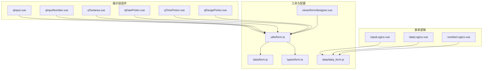
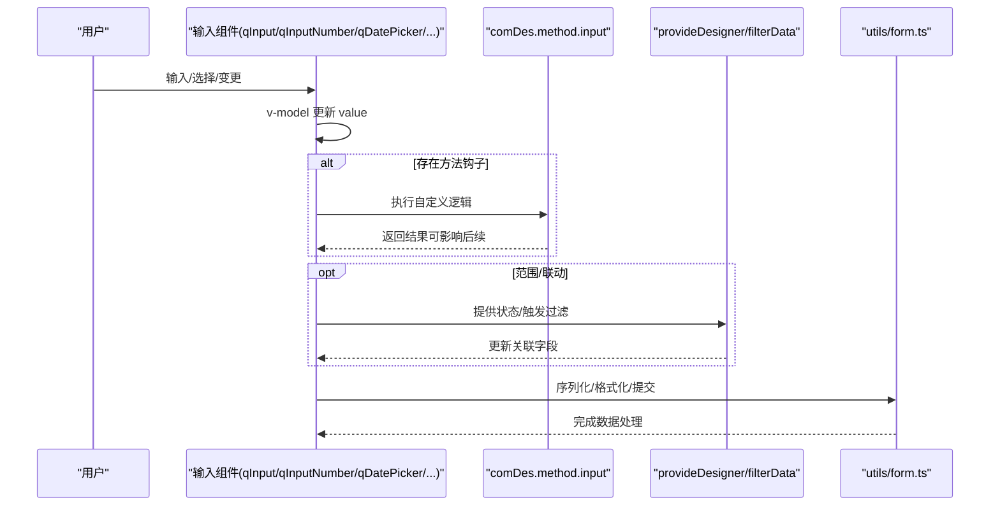
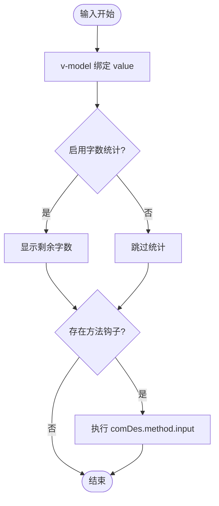
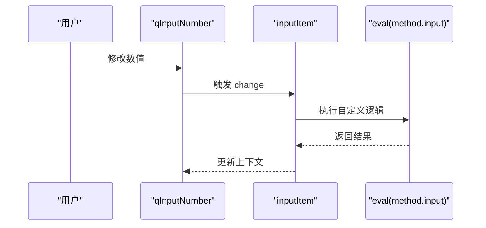
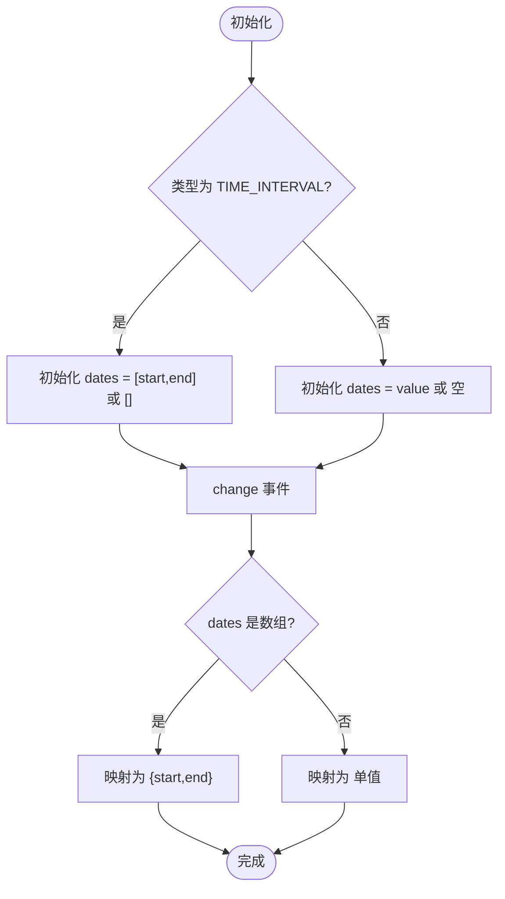
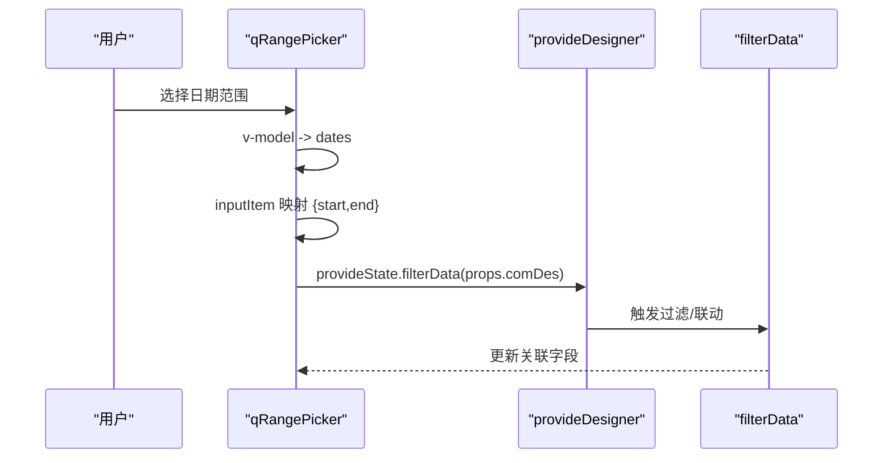
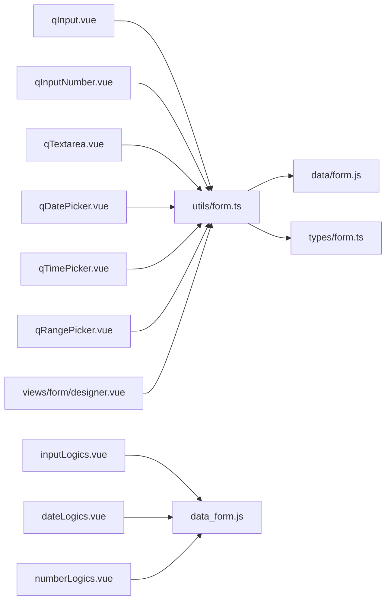

# 输入组件

<cite>
**本文引用的文件**
- [qInput.vue](file://src/components/showItem/qInput.vue)
- [qInputNumber.vue](file://src/components/showItem/qInputNumber.vue)
- [qTextarea.vue](file://src/components/showItem/qTextarea.vue)
- [qDatePicker.vue](file://src/components/showItem/qDatePicker.vue)
- [qTimePicker.vue](file://src/components/showItem/qTimePicker.vue)
- [qRangePicker.vue](file://src/components/showItem/qRangePicker.vue)
- [inputLogics.vue](file://src/components/formLogics/inputLogics.vue)
- [dateLogics.vue](file://src/components/formLogics/dateLogics.vue)
- [numberLogics.vue](file://src/components/formLogics/numberLogics.vue)
- [form.ts（类型）](file://src/types/form.ts)
- [form.ts（工具）](file://src/utils/form.ts)
- [form.js（组件定义）](file://src/data/form.js)
- [data_form.js（表单逻辑条件）](file://src/data/data_form.js)
- [designer.vue（设计器）](file://src/views/form/designer.vue)
</cite>

## 目录
1. [简介](#简介)
2. [项目结构](#项目结构)
3. [核心组件](#核心组件)
4. [架构总览](#架构总览)
5. [详细组件分析](#详细组件分析)
6. [依赖分析](#依赖分析)
7. [性能考虑](#性能考虑)
8. [故障排查指南](#故障排查指南)
9. [结论](#结论)
10. [附录](#附录)

## 简介
本文件面向新工作台项目的“输入组件”，系统性梳理文本输入、多行文本、数字输入、日期时间选择等输入类组件的设计理念与实现细节。内容覆盖：
- 属性配置：组件通用属性、业务属性与交互属性
- 事件处理：输入变更、范围选择、联动触发
- 数据验证与格式化：必填、字数限制、格式化策略
- 使用场景与最佳实践：表单校验、数据格式化、用户体验优化
- 扩展方法：通过方法钩子、联动机制、表达式计算进行扩展
- API 接口文档：组件属性、事件回调与数据绑定方式

## 项目结构
输入组件位于展示层组件目录，围绕设计器与运行时表单渲染展开；同时配合表单逻辑组件与工具函数完成联动、格式化与序列化。

图表来源
- [qInput.vue:1-21](file://src/components/showItem/qInput.vue#L1-L21)
- [qInputNumber.vue:1-31](file://src/components/showItem/qInputNumber.vue#L1-L31)
- [qTextarea.vue:1-20](file://src/components/showItem/qTextarea.vue#L1-L20)
- [qDatePicker.vue:1-31](file://src/components/showItem/qDatePicker.vue#L1-L31)
- [qTimePicker.vue:1-49](file://src/components/showItem/qTimePicker.vue#L1-L49)
- [qRangePicker.vue:1-50](file://src/components/showItem/qRangePicker.vue#L1-L50)
- [inputLogics.vue:1-28](file://src/components/formLogics/inputLogics.vue#L1-L28)
- [dateLogics.vue:1-45](file://src/components/formLogics/dateLogics.vue#L1-L45)
- [numberLogics.vue:1-50](file://src/components/formLogics/numberLogics.vue#L1-L50)
- [form.ts（工具）:1-800](file://src/utils/form.ts#L1-L800)
- [form.js（组件定义）:1-800](file://src/data/form.js#L1-L800)
- [data_form.js（表单逻辑条件）:1-200](file://src/data/data_form.js#L1-L200)
- [designer.vue（设计器）:1-200](file://src/views/form/designer.vue#L1-L200)

章节来源
- [designer.vue（设计器）:1-200](file://src/views/form/designer.vue#L1-L200)

## 核心组件
本节对输入类组件进行概览，说明其职责、通用属性与典型行为。

- 文本输入（qInput）
  - 职责：单行文本输入，支持占位符、只读、禁用、清空、字数统计与最大长度控制
  - 关键属性：placeholder、readonly、disabled、allowClear、showWordLimit、maxLength、value
  - 事件：双向绑定 v-model
  - 方法钩子：comDes.method.input（输入时可执行自定义逻辑）

- 数字输入（qInputNumber）
  - 职责：数值输入，支持步进、范围与格式化
  - 关键属性：同 antd 的 a-input-number 绑定，value、min、max、precision、step 等
  - 事件：change 回调，内部在 change 时执行 comDes.method.input
  - 数据绑定：v-model

- 多行文本（qTextarea）
  - 职责：多行文本输入，支持字数统计与最大长度
  - 关键属性：placeholder、readonly、disabled、allowClear、showWordLimit、maxLength、value
  - 事件：@input 触发 changeItem（当前为空实现，便于扩展）

- 日期选择（qDatePicker）
  - 职责：单日期选择，支持时间显示与格式化
  - 关键属性：v-bind 绑定 comDes.props，value 支持双向绑定
  - 事件：@change 触发 inputItem，执行 comDes.method.input

- 时间选择（qTimePicker）
  - 职责：支持单个时间或时间段（TIME_INTERVAL）选择
  - 关键属性：根据类型处理 value 结构（单值或 {start,end}）
  - 事件：@change 同步到 comDes.props.value

- 日期范围（qRangePicker）
  - 职责：日期范围选择，支持默认值与双向绑定
  - 关键属性：v-bind 绑定 comDes.props，默认值为空数组
  - 事件：@change 将选择结果映射为 {start,end} 并通过 provide/inject 的 filterData 进行过滤/联动

章节来源
- [qInput.vue:1-21](file://src/components/showItem/qInput.vue#L1-L21)
- [qInputNumber.vue:1-31](file://src/components/showItem/qInputNumber.vue#L1-L31)
- [qTextarea.vue:1-20](file://src/components/showItem/qTextarea.vue#L1-L20)
- [qDatePicker.vue:1-31](file://src/components/showItem/qDatePicker.vue#L1-L31)
- [qTimePicker.vue:1-49](file://src/components/showItem/qTimePicker.vue#L1-L49)
- [qRangePicker.vue:1-50](file://src/components/showItem/qRangePicker.vue#L1-L50)

## 架构总览
输入组件与表单逻辑、工具函数、配置数据协同工作，形成“配置驱动 + 事件驱动”的输入体系。

图表来源
- [qInputNumber.vue:12-22](file://src/components/showItem/qInputNumber.vue#L12-L22)
- [qDatePicker.vue:12-22](file://src/components/showItem/qDatePicker.vue#L12-L22)
- [qRangePicker.vue:22-36](file://src/components/showItem/qRangePicker.vue#L22-L36)
- [form.ts（工具）:452-577](file://src/utils/form.ts#L452-L577)

## 详细组件分析

### 文本输入（qInput）
- 设计要点
  - 采用 antd 的 a-input，透传 comDes.props，确保与设计器配置一致
  - 支持字数统计与最大长度控制，结合 showWordLimit 与 maxLength
  - 支持 allowClear、placeholder、readonly、disabled 等常用属性
- 事件与数据流
  - v-model 双向绑定 value
  - 可通过 comDes.method.input 在输入时执行自定义逻辑
- 最佳实践
  - 对敏感字段开启 readonly 或禁用输入
  - 配合必填校验与字数限制，提升数据质量

图表来源
- [qInput.vue:1-21](file://src/components/showItem/qInput.vue#L1-L21)
- [form.js（组件定义）:23-118](file://src/data/form.js#L23-L118)

章节来源
- [qInput.vue:1-21](file://src/components/showItem/qInput.vue#L1-L21)
- [form.js（组件定义）:23-118](file://src/data/form.js#L23-L118)

### 数字输入（qInputNumber）
- 设计要点
  - 透传 a-input-number 的所有属性，支持 min/max/precision/step 等
  - 在 change 事件中执行 comDes.method.input，便于联动与计算
- 事件与数据流
  - change -> inputItem -> eval(comDes.method.input)
  - v-model 绑定 value
- 注意事项
  - 使用 eval 执行自定义逻辑需谨慎，建议在设计器侧严格校验与限制

图表来源
- [qInputNumber.vue:12-22](file://src/components/showItem/qInputNumber.vue#L12-L22)

章节来源
- [qInputNumber.vue:1-31](file://src/components/showItem/qInputNumber.vue#L1-L31)

### 多行文本（qTextarea）
- 设计要点
  - 透传 a-textarea，支持字数统计与最大长度
  - 提供 @input 回调 changeItem，当前为空实现，便于扩展
- 适用场景
  - 需要换行的长文本输入，如备注、说明等

章节来源
- [qTextarea.vue:1-20](file://src/components/showItem/qTextarea.vue#L1-L20)

### 日期选择（qDatePicker）
- 设计要点
  - 通过 v-bind 透传 comDes.props，支持 format、disabled 等
  - change 事件触发 inputItem，执行 comDes.method.input
- 适用场景
  - 单日期选择，常用于出生日期、截止日期等

章节来源
- [qDatePicker.vue:1-31](file://src/components/showItem/qDatePicker.vue#L1-L31)

### 时间选择（qTimePicker）
- 设计要点
  - 支持两种模式：单个时间与时间段（TIME_INTERVAL）
  - 内部使用 ref 管理 dates，change 时将值映射回 comDes.props.value
- 数据结构
  - 单值：value
  - 时间段：{ start, end }

图表来源
- [qTimePicker.vue:14-39](file://src/components/showItem/qTimePicker.vue#L14-L39)

章节来源
- [qTimePicker.vue:1-49](file://src/components/showItem/qTimePicker.vue#L1-L49)

### 日期范围（qRangePicker）
- 设计要点
  - 使用 defaultValue=[] 初始化，change 时将选择结果映射为 {start,end}
  - 通过 provide/inject 获取 provideDesigner，调用 filterData 进行过滤/联动
- 数据流
  - v-model -> dates -> inputItem -> 映射 -> provideState.filterData

图表来源
- [qRangePicker.vue:22-40](file://src/components/showItem/qRangePicker.vue#L22-L40)

章节来源
- [qRangePicker.vue:1-50](file://src/components/showItem/qRangePicker.vue#L1-L50)

## 依赖分析
输入组件与表单逻辑、工具函数、类型定义与配置数据之间存在清晰的依赖关系。

图表来源
- [form.ts（工具）:1-800](file://src/utils/form.ts#L1-L800)
- [form.js（组件定义）:1-800](file://src/data/form.js#L1-L800)
- [data_form.js（表单逻辑条件）:1-200](file://src/data/data_form.js#L1-L200)
- [designer.vue（设计器）:1-200](file://src/views/form/designer.vue#L1-L200)

章节来源
- [form.ts（工具）:1-800](file://src/utils/form.ts#L1-L800)
- [form.ts（类型）:1-45](file://src/types/form.ts#L1-L45)
- [form.js（组件定义）:1-800](file://src/data/form.js#L1-L800)
- [data_form.js（表单逻辑条件）:1-200](file://src/data/data_form.js#L1-L200)
- [designer.vue（设计器）:1-200](file://src/views/form/designer.vue#L1-L200)

## 性能考虑
- 字数统计与最大长度
  - 合理设置 showWordLimit 与 maxLength，避免频繁 DOM 更新
- 事件节流
  - 对高频输入（如 qInputNumber）可在方法钩子中引入节流/防抖
- 渲染优化
  - 大量输入组件时，尽量减少不必要的 v-if 切换与深层嵌套
- 数据序列化
  - 提交前统一通过 utils/form.ts 的序列化流程，避免重复转换

## 故障排查指南
- 输入未生效
  - 检查 comDes.props.value 是否正确绑定 v-model
  - 确认 comDes.props.disabled/readonly 是否被错误置为 true
- 方法钩子未执行
  - 确认 comDes.method.input 是否存在且语法正确
  - 注意 qInputNumber 中使用 eval，若语法错误会吞掉异常
- 时间/日期格式异常
  - 检查 qTimePicker/qRangePicker 的 value 结构是否符合预期
  - 确认 provideDesigner/filterData 是否正确注入
- 提交数据不正确
  - 使用 utils/form.ts 的 submitFormData 流程核对字段映射与序列化

章节来源
- [qInputNumber.vue:12-22](file://src/components/showItem/qInputNumber.vue#L12-L22)
- [qTimePicker.vue:27-39](file://src/components/showItem/qTimePicker.vue#L27-L39)
- [qRangePicker.vue:38-40](file://src/components/showItem/qRangePicker.vue#L38-L40)
- [form.ts（工具）:452-577](file://src/utils/form.ts#L452-L577)

## 结论
输入组件以“配置驱动 + 事件驱动”为核心，通过 comDes.props 与方法钩子实现灵活扩展；配合表单逻辑与工具函数，形成从设计到运行时的一体化输入体验。建议在实际使用中：
- 明确字段的必填、字数与格式要求
- 合理使用方法钩子与联动机制
- 在提交前统一走序列化流程，确保数据一致性

## 附录

### API 接口文档（概览）
- 通用属性（来自 data/form.js 中各组件 props）
  - 基础：label、field、size、desc、required、visible、disabled、readonly
  - 输入增强：placeholder、allowClear、showWordLimit、maxLength、defaultValue
  - 联动：linkage（logicConditions、mode、sourceFormCode、relationTrigger）
  - 方法钩子：method.input（字符串形式的可执行代码）
- 事件
  - qInput/qTextarea：v-model
  - qInputNumber：@change
  - qDatePicker/qTimePicker/qRangePicker：@change
- 数据绑定
  - 所有组件均通过 v-model 绑定 comDes.props.value
  - qRangePicker 通过 provide/inject 的 filterData 实现联动过滤

章节来源
- [form.js（组件定义）:23-118](file://src/data/form.js#L23-L118)
- [qInput.vue:1-21](file://src/components/showItem/qInput.vue#L1-L21)
- [qInputNumber.vue:1-31](file://src/components/showItem/qInputNumber.vue#L1-L31)
- [qTextarea.vue:1-20](file://src/components/showItem/qTextarea.vue#L1-L20)
- [qDatePicker.vue:1-31](file://src/components/showItem/qDatePicker.vue#L1-L31)
- [qTimePicker.vue:1-49](file://src/components/showItem/qTimePicker.vue#L1-L49)
- [qRangePicker.vue:1-50](file://src/components/showItem/qRangePicker.vue#L1-L50)