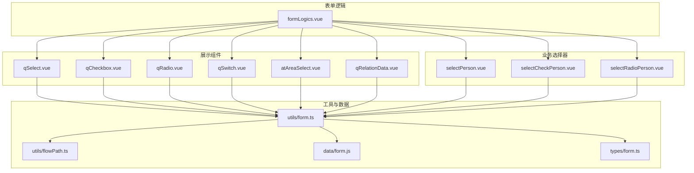
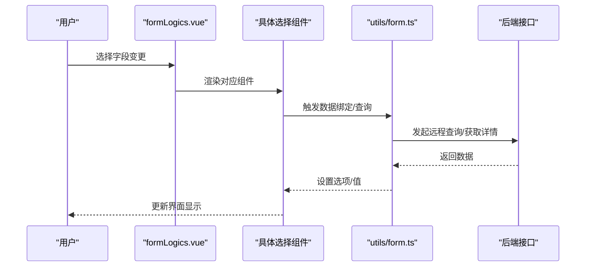
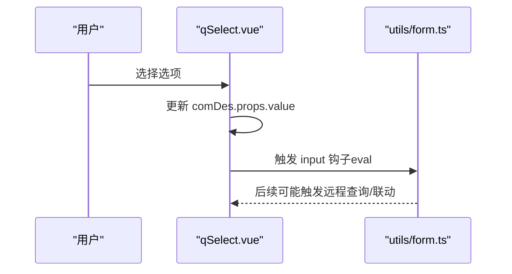
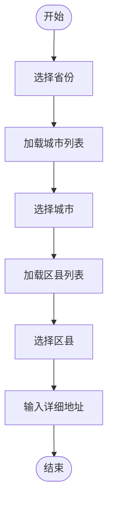
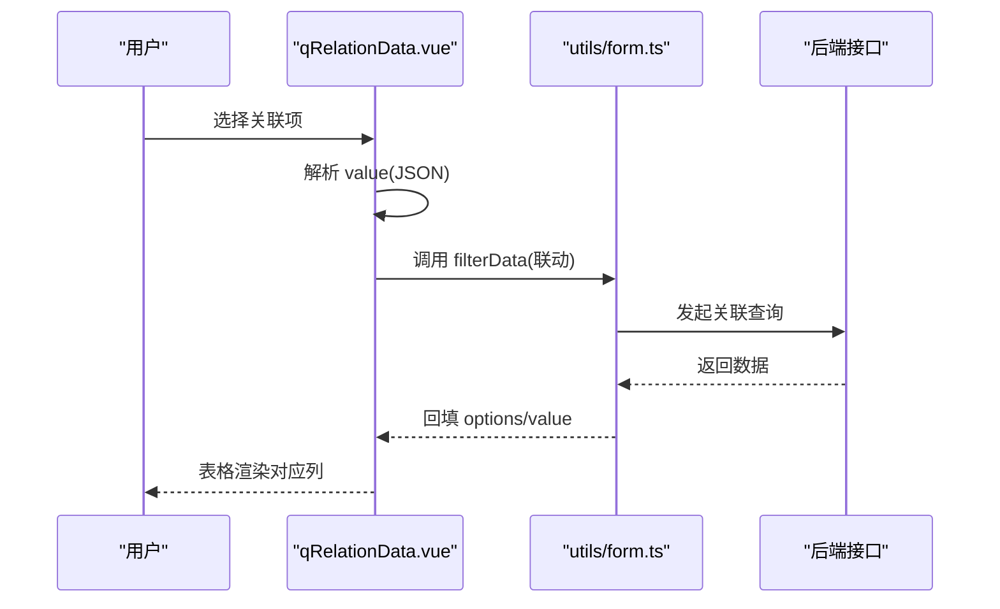
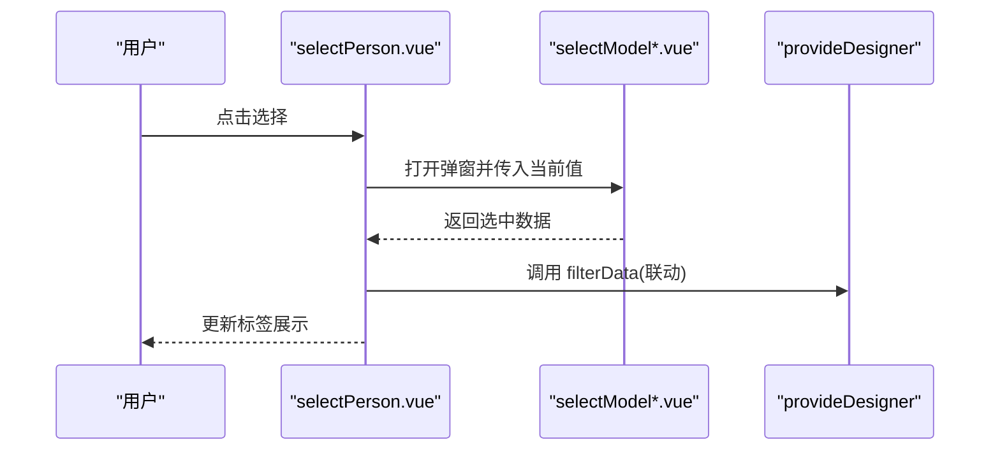
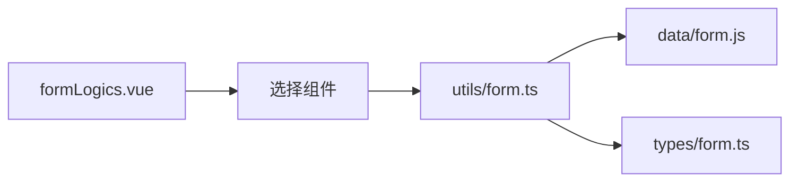

# 选择组件

<cite>
**本文引用的文件**
- [qSelect.vue](file://src/components/showItem/qSelect.vue)
- [qCheckbox.vue](file://src/components/showItem/qCheckbox.vue)
- [qRadio.vue](file://src/components/showItem/qRadio.vue)
- [qSwitch.vue](file://src/components/showItem/qSwitch.vue)
- [atAreaSelect.vue](file://src/components/showItem/atAreaSelect.vue)
- [qRelationData.vue](file://src/components/showItem/qRelationData.vue)
- [selectPerson.vue](file://src/components/selectPerson/selectPerson.vue)
- [selectCheckPerson.vue](file://src/components/selectPerson/selectCheckPerson.vue)
- [selectRadioPerson.vue](file://src/components/selectPerson/selectRadioPerson.vue)
- [formLogics.vue](file://src/components/formLogics/formLogics.vue)
- [form.ts](file://src/utils/form.ts)
- [flowPath.ts](file://src/utils/flowPath.ts)
- [form.js](file://src/data/form.js)
- [form.ts（types）](file://src/types/form.ts)
</cite>

## 目录
1. [简介](#简介)
2. [项目结构](#项目结构)
3. [核心组件](#核心组件)
4. [架构总览](#架构总览)
5. [详细组件分析](#详细组件分析)
6. [依赖关系分析](#依赖关系分析)
7. [性能考量](#性能考量)
8. [故障排查指南](#故障排查指南)
9. [结论](#结论)
10. [附录](#附录)

## 简介
本文件系统性梳理新工作台项目中的“选择类组件”，包括下拉选择、复选框、单选按钮、开关切换、地区选择、关联数据选择以及人员选择（含多选与单选模式）。文档从设计理念、属性配置、数据绑定、选项管理与状态控制等方面进行深入解析，并结合实际代码路径给出 API 接口、事件处理与数据格式化规范，覆盖多选处理、级联选择、远程数据加载等复杂场景。

## 项目结构
选择组件主要分布在以下模块：
- 展示型选择组件：位于 showItem 目录，直接基于 Arco 组件封装，用于只读或展示场景
- 业务选择器：位于 selectPerson 目录，提供弹窗式选择、标签化展示与交互
- 表单逻辑路由：formLogics 将不同输入类型路由到对应逻辑组件
- 工具与数据：utils/form.ts 提供表单数据绑定、提交、远程查询与格式化；data/form.js 定义组件默认属性与方法；types/form.ts 提供类型约束

图表来源
- [formLogics.vue:1-18](file://src/components/formLogics/formLogics.vue#L1-L18)
- [qSelect.vue:1-34](file://src/components/showItem/qSelect.vue#L1-L34)
- [qCheckbox.vue:1-33](file://src/components/showItem/qCheckbox.vue#L1-L33)
- [qRadio.vue:1-33](file://src/components/showItem/qRadio.vue#L1-L33)
- [qSwitch.vue:1-22](file://src/components/showItem/qSwitch.vue#L1-L22)
- [atAreaSelect.vue:1-127](file://src/components/showItem/atAreaSelect.vue#L1-L127)
- [qRelationData.vue:1-186](file://src/components/showItem/qRelationData.vue#L1-L186)
- [selectPerson.vue:1-115](file://src/components/selectPerson/selectPerson.vue#L1-L115)
- [selectCheckPerson.vue:1-117](file://src/components/selectPerson/selectCheckPerson.vue#L1-L117)
- [selectRadioPerson.vue:1-127](file://src/components/selectPerson/selectRadioPerson.vue#L1-L127)
- [form.ts:1-800](file://src/utils/form.ts#L1-L800)
- [flowPath.ts:25-88](file://src/utils/flowPath.ts#L25-L88)
- [form.js:470-669](file://src/data/form.js#L470-L669)
- [form.ts（types）:1-45](file://src/types/form.ts#L1-L45)

章节来源
- [formLogics.vue:1-18](file://src/components/formLogics/formLogics.vue#L1-L18)

## 核心组件
本节概述各选择组件的职责与通用属性约定：
- 下拉选择（qSelect）：基于 Arco Select 的轻量封装，支持清空、受控值与输入事件钩子
- 复选框组（qCheckbox）：基于 Arco Checkbox Group，支持多选值与输入事件钩子
- 单选按钮组（qRadio）：基于 Arco Radio Group，支持单选值与输入事件钩子
- 开关切换（qSwitch）：基于 Arco Switch，支持自定义文案插槽
- 地区选择（atAreaSelect）：省市区三级联动，支持详细地址输入
- 关联数据选择（qRelationData）：与远程表单建立关联，支持单选/多选表格展示与列渲染
- 人员选择（selectPerson/selectCheckPerson/selectRadioPerson）：弹窗式选择用户/部门，标签化展示与交互

章节来源
- [qSelect.vue:1-34](file://src/components/showItem/qSelect.vue#L1-L34)
- [qCheckbox.vue:1-33](file://src/components/showItem/qCheckbox.vue#L1-L33)
- [qRadio.vue:1-33](file://src/components/showItem/qRadio.vue#L1-L33)
- [qSwitch.vue:1-22](file://src/components/showItem/qSwitch.vue#L1-L22)
- [atAreaSelect.vue:1-127](file://src/components/showItem/atAreaSelect.vue#L1-L127)
- [qRelationData.vue:1-186](file://src/components/showItem/qRelationData.vue#L1-L186)
- [selectPerson.vue:1-115](file://src/components/selectPerson/selectPerson.vue#L1-L115)
- [selectCheckPerson.vue:1-117](file://src/components/selectPerson/selectCheckPerson.vue#L1-L117)
- [selectRadioPerson.vue:1-127](file://src/components/selectPerson/selectRadioPerson.vue#L1-L127)

## 架构总览
选择组件在运行时通过 formLogics.vue 按输入类型路由到具体组件；数据层由 utils/form.ts 负责：
- 初始化与绑定：根据字段类型与数据源设置初始值、禁用态、只读态
- 远程查询：对 RELATION_QUERY/RELATION_DATA 类型发起关联查询，动态生成选项或表格列
- 数据提交：在提交阶段将复杂类型（如 USER/DEPT、多选、开关）标准化为后端可接受的值
- 表达式计算：对函数类字段进行表达式求值并回填

图表来源
- [formLogics.vue:1-18](file://src/components/formLogics/formLogics.vue#L1-L18)
- [form.ts:602-722](file://src/utils/form.ts#L602-L722)

章节来源
- [formLogics.vue:1-18](file://src/components/formLogics/formLogics.vue#L1-L18)
- [form.ts:602-722](file://src/utils/form.ts#L602-L722)

## 详细组件分析

### 下拉选择（qSelect）
- 设计理念：以最小封装承载 Arco Select 的基础能力，保留清空、受控值与 change 钩子，便于扩展输入事件
- 属性配置
  - 基础：size、placeholder、disabled、readonly、visible
  - 数据源：dataSourceType、sourceFormCode、sourceFieldCode、options、defaultValue
  - 其他：label、desc、field、required
- 数据绑定
  - v-model 绑定 comDes.props.value
  - change 事件触发 input 方法钩子（通过 eval 执行 comDes.method.input）
- 使用场景
  - 单选下拉、远程选项加载、联动筛选
- API 与事件
  - v-bind="comDes.props" 透传属性
  - @change 触发 input 钩子
- 数据格式化
  - 与 utils/form.ts 的 setFormData/setUpDateData 协作，确保值与选项一致

图表来源
- [qSelect.vue:1-34](file://src/components/showItem/qSelect.vue#L1-L34)
- [form.ts:602-722](file://src/utils/form.ts#L602-L722)

章节来源
- [qSelect.vue:1-34](file://src/components/showItem/qSelect.vue#L1-L34)
- [form.js:479-546](file://src/data/form.js#L479-L546)
- [form.ts:346-451](file://src/utils/form.ts#L346-L451)

### 复选框（qCheckbox）
- 设计理念：基于 Checkbox Group 实现多选项选择，支持输入事件钩子
- 属性配置
  - 多选：multiple（在配置中体现）
  - 数据源：options、defaultValue、disabled、readonly、visible
- 数据绑定
  - v-model 绑定 comDes.props.value（数组）
  - change 事件触发 input 钩子
- 使用场景
  - 多选项勾选、与远程选项联动
- 数据格式化
  - 与 setFormData 中对 SELECT_MULTIPLE/CHECKBOX 的映射逻辑配合

章节来源
- [qCheckbox.vue:1-33](file://src/components/showItem/qCheckbox.vue#L1-L33)
- [form.js:547-620](file://src/data/form.js#L547-L620)
- [form.ts:373-382](file://src/utils/form.ts#L373-L382)

### 单选按钮（qRadio）
- 设计理念：Radio Group 实现互斥选择，支持输入事件钩子
- 属性配置
  - 数据源：options、defaultValue、disabled、readonly、visible
- 数据绑定
  - v-model 绑定 comDes.props.value
  - change 事件触发 input 钩子
- 使用场景
  - 互斥选项、与远程选项联动

章节来源
- [qRadio.vue:1-33](file://src/components/showItem/qRadio.vue#L1-L33)
- [form.ts:367-372](file://src/utils/form.ts#L367-L372)

### 开关切换（qSwitch）
- 设计理念：Switch 支持自定义文案插槽，适合布尔开关场景
- 属性配置
  - 文案：on、off
  - 状态：disabled、readonly、visible
- 数据绑定
  - v-model 绑定 comDes.props.value
- 使用场景
  - 开关控制、条件显隐

章节来源
- [qSwitch.vue:1-22](file://src/components/showItem/qSwitch.vue#L1-L22)

### 地区选择（atAreaSelect）
- 设计理念：省市区三级联动，支持详细地址输入，适配中国行政区域
- 属性配置
  - option：控制显示层级（省市区/省市区+详细）
  - defaultValue：prov/city/dist/det
  - prov/city/District/cityList：联动数据
- 数据绑定
  - 省/市/区分别 v-model 到对应值
  - changeProvince/changeCity/changeDist 更新联动列表与默认文本
- 使用场景
  - 地址录入、区域筛选

图表来源
- [atAreaSelect.vue:64-113](file://src/components/showItem/atAreaSelect.vue#L64-L113)

章节来源
- [atAreaSelect.vue:1-127](file://src/components/showItem/atAreaSelect.vue#L1-L127)

### 关联数据选择（qRelationData）
- 设计理念：与远程表单建立关联，支持单选/多选，并在下方表格中按字段类型渲染不同列
- 属性配置
  - selectType：single/multiple
  - formId：目标表单 ID
  - fieldList：字段清单（含类型、标题、ID）
  - value：当前选中值（字符串或数组，内部会 JSON 解析）
  - disabled：禁用态
- 数据绑定
  - 通过 watch 监听 fieldList 动态生成列（含图片、链接、用户/部门、多选等）
  - 通过 watch 监听 value，调用 provideDesigner 的 filterData 进行联动
- 使用场景
  - 主从表关联、跨表查询与选择、复杂字段展示

图表来源
- [qRelationData.vue:1-186](file://src/components/showItem/qRelationData.vue#L1-L186)
- [form.ts:602-722](file://src/utils/form.ts#L602-L722)

章节来源
- [qRelationData.vue:1-186](file://src/components/showItem/qRelationData.vue#L1-L186)
- [form.ts:602-722](file://src/utils/form.ts#L602-L722)

### 人员选择（selectPerson/selectCheckPerson/selectRadioPerson）
- 设计理念：弹窗式选择用户/部门，标签化展示已选项，支持移除与二次打开编辑
- 组件差异
  - selectPerson：通用标签展示与交互
  - selectCheckPerson：支持多选标签、禁用态校验、联动 filterData
  - selectRadioPerson：单选模式，仅保留一个标签
- 属性配置
  - modelValue：双向绑定值
  - placeholder/title/deptList：占位提示、标题、部门列表
  - comDes/formConfs：设计器上下文（用于禁用态与联动）
- 交互流程
  - 点击触发弹窗 selectModel/selectRadioModel
  - setData 回写值并调用 provideDesigner.filterData
  - 标签关闭移除对应项

图表来源
- [selectPerson.vue:1-115](file://src/components/selectPerson/selectPerson.vue#L1-L115)
- [selectCheckPerson.vue:1-117](file://src/components/selectPerson/selectCheckPerson.vue#L1-L117)
- [selectRadioPerson.vue:1-127](file://src/components/selectPerson/selectRadioPerson.vue#L1-L127)

章节来源
- [selectPerson.vue:1-115](file://src/components/selectPerson/selectPerson.vue#L1-L115)
- [selectCheckPerson.vue:1-117](file://src/components/selectPerson/selectCheckPerson.vue#L1-L117)
- [selectRadioPerson.vue:1-127](file://src/components/selectPerson/selectRadioPerson.vue#L1-L127)

## 依赖关系分析
- 组件到工具
  - 所有选择组件均依赖 utils/form.ts 的数据绑定、远程查询与提交逻辑
- 组件到数据
  - data/form.js 定义了 SELECT/SELECT_MULTIPLE/USER/DEPT 等类型的默认属性与方法
- 组件到类型
  - types/form.ts 提供 FormConfs/Appdes/FlowInfo 等类型约束，保障传递参数结构一致
- 组件到逻辑路由
  - formLogics.vue 根据 inputType 将字段路由到对应组件（如 RADIO/SELECT/CHECKBOX/USER 等）

图表来源
- [form.ts:1-800](file://src/utils/form.ts#L1-L800)
- [form.js:470-669](file://src/data/form.js#L470-L669)
- [form.ts（types）:1-45](file://src/types/form.ts#L1-L45)
- [formLogics.vue:1-18](file://src/components/formLogics/formLogics.vue#L1-L18)

章节来源
- [form.ts:1-800](file://src/utils/form.ts#L1-L800)
- [form.js:470-669](file://src/data/form.js#L470-L669)
- [form.ts（types）:1-45](file://src/types/form.ts#L1-L45)
- [formLogics.vue:1-18](file://src/components/formLogics/formLogics.vue#L1-L18)

## 性能考量
- 远程查询节流：在 getQuery/setExpressionValue 中对关联查询设置了延时，避免频繁请求
- 列渲染优化：qRelationData 在 fieldList 变更时重建列，建议减少不必要的字段数量
- 大数据量分页：当关联数据量较大时，建议后端分页并在前端按需加载
- 计算缓存：表达式计算结果通过 calculate 缓存，减少重复计算

## 故障排查指南
- 输入事件钩子报错
  - 现象：eval 执行失败导致控制台错误
  - 排查：检查 comDes.method.input 是否为合法 JS 片段，必要时改为受控调用而非 eval
  - 参考路径：[qSelect.vue:13-22](file://src/components/showItem/qSelect.vue#L13-L22)、[qCheckbox.vue:13-22](file://src/components/showItem/qCheckbox.vue#L13-L22)、[qRadio.vue:13-22](file://src/components/showItem/qRadio.vue#L13-L22)
- 关联查询未生效
  - 现象：选择后未更新选项/表格
  - 排查：确认 provideDesigner.filterData 是否注入，watch 对 value/fieldList 的监听是否触发
  - 参考路径：[qRelationData.vue:149-172](file://src/components/showItem/qRelationData.vue#L149-L172)
- 地区联动异常
  - 现象：切换省/市后区县列表为空或默认值不正确
  - 排查：检查 pcaa 数据加载与 defaultValue 初始化逻辑
  - 参考路径：[atAreaSelect.vue:36-62](file://src/components/showItem/atAreaSelect.vue#L36-L62)、[atAreaSelect.vue:64-113](file://src/components/showItem/atAreaSelect.vue#L64-L113)
- 多选/单选值不一致
  - 现象：提交时多选值未标准化
  - 排查：核对 setFormData/submitFormData 中对 SELECT_MULTIPLE/CHECKBOX/USER/DEPT 的转换
  - 参考路径：[form.ts:373-382](file://src/utils/form.ts#L373-L382)、[form.ts:479-577](file://src/utils/form.ts#L479-L577)

章节来源
- [qSelect.vue:13-22](file://src/components/showItem/qSelect.vue#L13-L22)
- [qCheckbox.vue:13-22](file://src/components/showItem/qCheckbox.vue#L13-L22)
- [qRadio.vue:13-22](file://src/components/showItem/qRadio.vue#L13-L22)
- [qRelationData.vue:149-172](file://src/components/showItem/qRelationData.vue#L149-L172)
- [atAreaSelect.vue:36-62](file://src/components/showItem/atAreaSelect.vue#L36-L62)
- [form.ts:373-382](file://src/utils/form.ts#L373-L382)
- [form.ts:479-577](file://src/utils/form.ts#L479-L577)

## 结论
本项目的选择组件体系以“最小封装 + 工具层统一处理”为核心设计思想：展示组件负责 UI 与事件，工具层负责数据绑定、远程查询与提交标准化，逻辑路由负责按类型渲染。通过统一的属性模型与类型约束，组件具备良好的可扩展性与一致性，能够满足多选、级联、远程加载等复杂场景需求。

## 附录

### API 与属性说明（摘要）
- 通用属性
  - label/desc/field/required/disabled/readonly/visible
  - size/placeholder/options/defaultValue
  - dataSourceType/sourceFormCode/sourceFieldCode
- 事件
  - change（部分组件）
  - input 钩子（通过 comDes.method.input 注入）
- 数据格式
  - 单选：字符串/数字/对象（含 label/value）
  - 多选：数组（元素为字符串/数字/对象）
  - 用户/部门：数组（元素为对象，包含 id/label 或 id/nickname/deptName）

章节来源
- [form.js:479-669](file://src/data/form.js#L479-L669)
- [form.ts:346-577](file://src/utils/form.ts#L346-L577)