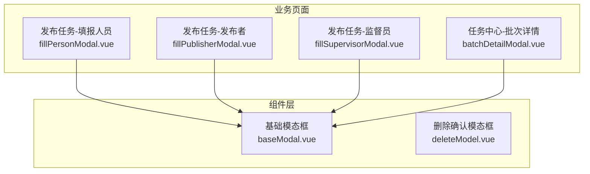
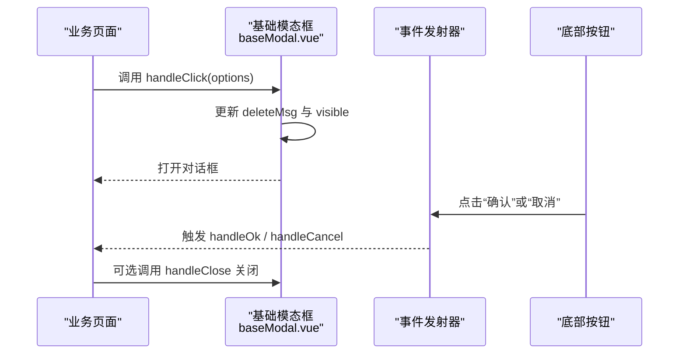
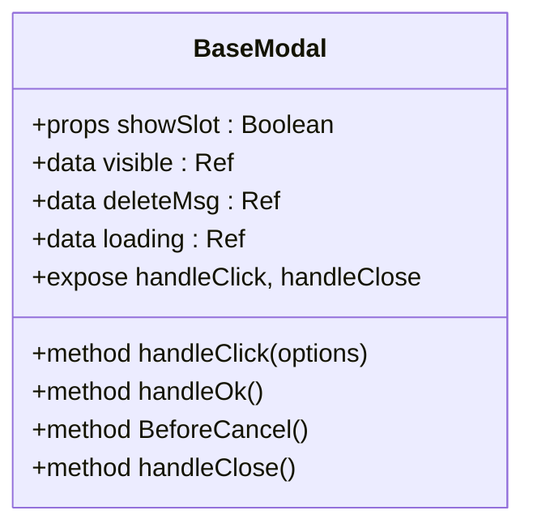
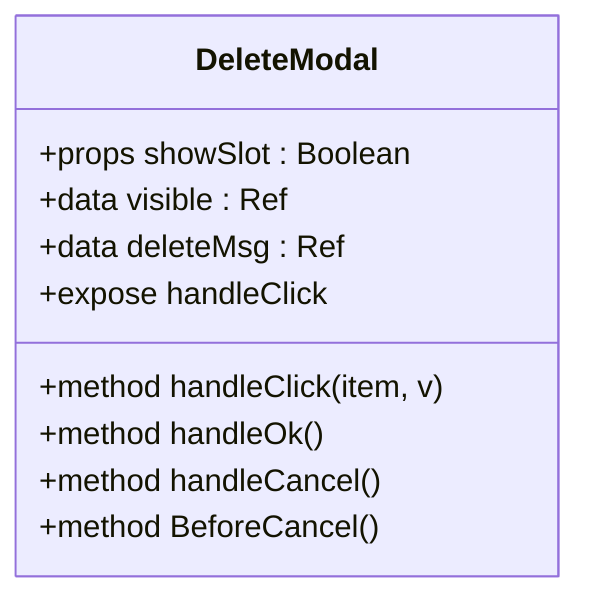
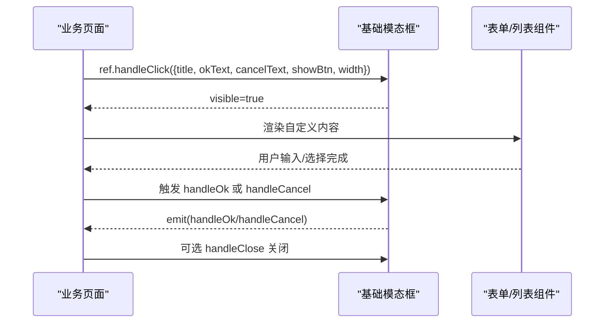
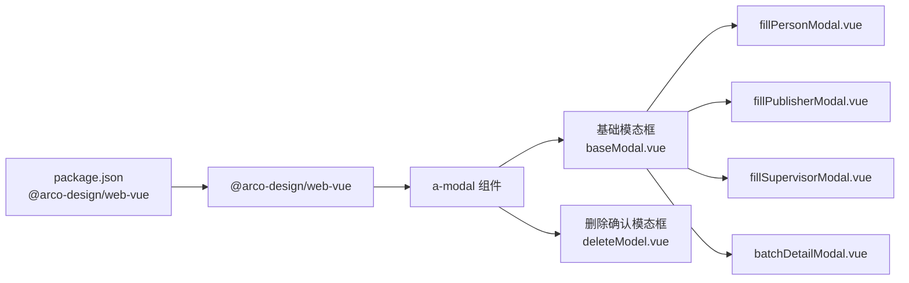

# 模态对话框

<cite>
**本文引用的文件**
- [baseModal.vue](file://src/components/modal/baseModal.vue)
- [deleteModel.vue](file://src/components/modal/deleteModel.vue)
- [fillPersonModal.vue](file://src/views/application/publishTask/components/fillPersonModal.vue)
- [batchDetailModal.vue](file://src/views/taskManageCenter/batchDetailModal.vue)
- [fillPublisherModal.vue](file://src/views/application/publishTask/components/fillPublisherModal.vue)
- [fillSupervisorModal.vue](file://src/views/application/publishTask/components/fillSupervisorModal.vue)
- [textColor.scss](file://src/styles/textColor.scss)
- [package.json](file://package.json)
</cite>

## 目录
1. [简介](#简介)
2. [项目结构](#项目结构)
3. [核心组件](#核心组件)
4. [架构总览](#架构总览)
5. [详细组件分析](#详细组件分析)
6. [依赖关系分析](#依赖关系分析)
7. [性能考量](#性能考量)
8. [故障排查指南](#故障排查指南)
9. [结论](#结论)
10. [附录：API 文档与最佳实践](#附录api-文档与最佳实践)

## 简介
本文件面向新工作台项目的模态对话框组件，系统性梳理基础模态框与删除确认对话框的设计架构与实现细节。重点覆盖：
- 显示控制与遮罩层处理
- 动画与交互行为
- 键盘事件与无障碍支持
- 配置选项、事件回调与内容定制
- 使用场景、最佳实践与样式定制
- 完整的 API 文档与代码示例路径

## 项目结构
模态对话框组件位于组件库目录下，基础模态框与删除确认模态框分别封装在独立的 Vue 单文件组件中，并在多个业务页面中复用。

图表来源
- [baseModal.vue:1-104](file://src/components/modal/baseModal.vue#L1-L104)
- [deleteModel.vue:1-72](file://src/components/modal/deleteModel.vue#L1-L72)
- [fillPersonModal.vue:1-258](file://src/views/application/publishTask/components/fillPersonModal.vue#L1-L258)
- [fillPublisherModal.vue:1-104](file://src/views/application/publishTask/components/fillPublisherModal.vue#L1-L104)
- [fillSupervisorModal.vue:1-105](file://src/views/application/publishTask/components/fillSupervisorModal.vue#L1-L105)
- [batchDetailModal.vue:1-218](file://src/views/taskManageCenter/batchDetailModal.vue#L1-L218)

章节来源
- [baseModal.vue:1-104](file://src/components/modal/baseModal.vue#L1-L104)
- [deleteModel.vue:1-72](file://src/components/modal/deleteModel.vue#L1-L72)
- [fillPersonModal.vue:1-258](file://src/views/application/publishTask/components/fillPersonModal.vue#L1-L258)
- [fillPublisherModal.vue:1-104](file://src/views/application/publishTask/components/fillPublisherModal.vue#L1-L104)
- [fillSupervisorModal.vue:1-105](file://src/views/application/publishTask/components/fillSupervisorModal.vue#L1-L105)
- [batchDetailModal.vue:1-218](file://src/views/taskManageCenter/batchDetailModal.vue#L1-L218)

## 核心组件
- 基础模态框（baseModal.vue）：通用型对话框，支持自定义标题、描述、按钮文案、宽度、是否显示确认按钮等；通过暴露方法控制显示与关闭；支持插槽扩展内容。
- 删除确认模态框（deleteModel.vue）：专用于删除类确认场景，内置默认样式与按钮颜色；提供统一的确认/取消交互。

章节来源
- [baseModal.vue:26-77](file://src/components/modal/baseModal.vue#L26-L77)
- [deleteModel.vue:23-61](file://src/components/modal/deleteModel.vue#L23-L61)

## 架构总览
基础模态框基于 Arco Design 的 a-modal 组件进行二次封装，统一了标题、正文、底部按钮的布局与样式，并通过事件机制与业务组件解耦。删除确认模态框在基础模态框之上进一步简化配置项，聚焦删除确认场景。

图表来源
- [baseModal.vue:48-76](file://src/components/modal/baseModal.vue#L48-L76)
- [fillPersonModal.vue:140-162](file://src/views/application/publishTask/components/fillPersonModal.vue#L140-L162)
- [batchDetailModal.vue:82-89](file://src/views/taskManageCenter/batchDetailModal.vue#L82-L89)

## 详细组件分析

### 基础模态框（baseModal.vue）
- 设计要点
  - 使用 Arco Design 的 a-modal 作为底层容器，确保一致的交互体验与可访问性。
  - 通过 deleteMsg 对象集中管理标题、描述、按钮文案、宽度、按钮可见性等配置。
  - 支持通过插槽注入自定义内容，满足复杂表单或列表展示需求。
  - 暴露 handleClick 与 handleClose 方法，供父组件控制显示与关闭。
  - 提供 handleOk 与 handleCancel 事件，便于业务侧处理确认与取消逻辑。
- 数据结构与状态
  - visible：控制对话框显隐
  - deleteMsg：包含标题、描述、按钮文案、宽度、按钮可见性、是否显示确认按钮等字段
  - loading：确认按钮加载态，模拟异步处理
- 事件与回调
  - handleOk：点击确认时触发，内部会短暂设置 loading 并延迟恢复
  - handleCancel：点击取消时触发
- 样式与主题
  - 统一头部、主体、底部内边距，适配不同内容密度
  - 引入主题色变量，保证与整体设计风格一致

图表来源
- [baseModal.vue:26-77](file://src/components/modal/baseModal.vue#L26-L77)

章节来源
- [baseModal.vue:26-104](file://src/components/modal/baseModal.vue#L26-L104)

### 删除确认模态框（deleteModel.vue）
- 设计要点
  - 专用于删除确认场景，默认按钮样式突出主操作，提升用户决策效率。
  - 通过 deleteMsg 控制标题、描述、按钮文案与宽度。
  - 仅暴露 handleClick 方法，适合快速弹出确认对话框。
- 事件与回调
  - handleOk：点击确认后立即关闭并触发 handleOk 事件
  - handleCancel：点击取消关闭
  - BeforeCancel：统一取消逻辑并触发 handleCancel 事件
- 样式与主题
  - 自定义确认按钮颜色，强调主操作

图表来源
- [deleteModel.vue:23-61](file://src/components/modal/deleteModel.vue#L23-L61)

章节来源
- [deleteModel.vue:23-72](file://src/components/modal/deleteModel.vue#L23-L72)

### 典型使用场景与集成方式
- 发布任务-填报人员范围选择
  - 在业务页面中引入基础模态框，通过 ref 调用 handleClick 传入标题、按钮文案、宽度等配置；在 handleOk 中收集表单数据并关闭对话框。
  - 示例路径：[fillPersonModal.vue:1-258](file://src/views/application/publishTask/components/fillPersonModal.vue#L1-L258)
- 任务中心-批次详情
  - 以基础模态框承载表格与分页，通过 handleClick 打开，内部处理筛选与分页逻辑。
  - 示例路径：[batchDetailModal.vue:1-218](file://src/views/taskManageCenter/batchDetailModal.vue#L1-L218)
- 发布任务-发布者与监督员
  - 通过基础模态框承载人员选择组件，统一标题与按钮配置。
  - 示例路径：[fillPublisherModal.vue:1-104](file://src/views/application/publishTask/components/fillPublisherModal.vue#L1-L104)、[fillSupervisorModal.vue:1-105](file://src/views/application/publishTask/components/fillSupervisorModal.vue#L1-L105)

图表来源
- [fillPersonModal.vue:140-187](file://src/views/application/publishTask/components/fillPersonModal.vue#L140-L187)
- [batchDetailModal.vue:82-115](file://src/views/taskManageCenter/batchDetailModal.vue#L82-L115)
- [fillPublisherModal.vue:52-75](file://src/views/application/publishTask/components/fillPublisherModal.vue#L52-L75)
- [fillSupervisorModal.vue:52-75](file://src/views/application/publishTask/components/fillSupervisorModal.vue#L52-L75)

章节来源
- [fillPersonModal.vue:140-200](file://src/views/application/publishTask/components/fillPersonModal.vue#L140-L200)
- [batchDetailModal.vue:82-173](file://src/views/taskManageCenter/batchDetailModal.vue#L82-L173)
- [fillPublisherModal.vue:52-82](file://src/views/application/publishTask/components/fillPublisherModal.vue#L52-L82)
- [fillSupervisorModal.vue:52-83](file://src/views/application/publishTask/components/fillSupervisorModal.vue#L52-L83)

## 依赖关系分析
- 组件依赖
  - 基础模态框与删除确认模态框均依赖 Arco Design 的 a-modal 组件。
  - 业务页面通过 import 方式引入基础模态框并在模板中使用。
- 主题与样式
  - 基础模态框样式中引用主题色变量，确保与整体设计风格一致。
- 外部依赖
  - 项目使用 @arco-design/web-vue 作为 UI 组件库，版本在 package.json 中声明。

图表来源
- [package.json:46-46](file://package.json#L46-L46)
- [baseModal.vue:3-3](file://src/components/modal/baseModal.vue#L3-L3)
- [deleteModel.vue:3-3](file://src/components/modal/deleteModel.vue#L3-L3)

章节来源
- [package.json:13-46](file://package.json#L13-L46)
- [baseModal.vue:3-3](file://src/components/modal/baseModal.vue#L3-L3)
- [deleteModel.vue:3-3](file://src/components/modal/deleteModel.vue#L3-L3)

## 性能考量
- 渲染优化
  - 使用 v-if 控制插槽内容渲染，避免不必要的 DOM 结构。
  - 通过 unmountOnClose 属性在关闭时卸载组件，减少内存占用。
- 交互反馈
  - 确认按钮设置 loading 态，避免重复提交，提升用户体验。
- 样式优化
  - 统一头部、主体、底部内边距，减少重复计算与重绘。

[本节为通用建议，不直接分析具体文件]

## 故障排查指南
- 对话框无法显示
  - 检查是否正确调用 handleClick 并传入 showBtn 与 width 等必要参数。
  - 确认父组件中 visible 已被设置为 true。
- 确认按钮无响应
  - 检查 handleOk 事件绑定与业务逻辑是否正确执行。
  - 若存在异步操作，请在完成后手动关闭对话框。
- 样式异常
  - 确认主题色变量是否正确引入。
  - 检查 scoped 样式与深度选择器的优先级。

章节来源
- [baseModal.vue:48-76](file://src/components/modal/baseModal.vue#L48-L76)
- [textColor.scss:1-91](file://src/styles/textColor.scss#L1-L91)

## 结论
新工作台的模态对话框组件通过基础模态框与删除确认模态框的组合，实现了统一的交互规范与灵活的内容定制能力。其基于 Arco Design 的 a-modal 进行封装，具备良好的可维护性与扩展性。建议在业务页面中统一使用基础模态框，仅在需要强调删除确认的场景使用删除确认模态框，以保持一致的用户体验。

[本节为总结性内容，不直接分析具体文件]

## 附录：API 文档与最佳实践

### 基础模态框 API
- 属性
  - showSlot: Boolean，是否渲染插槽内容，默认为 true
- 暴露方法
  - handleClick(options): 打开对话框并设置配置
  - handleClose(): 关闭对话框
- 事件
  - handleOk: 点击确认时触发
  - handleCancel: 点击取消时触发
- 配置项（options）
  - title: 标题文本
  - des: 描述文本
  - okText: 确认按钮文案
  - cancelText: 取消按钮文案
  - showBtn: 是否显示底部按钮
  - showConfirm: 是否显示确认按钮（默认 true）
  - width: 对话框宽度（默认 '500px'）

章节来源
- [baseModal.vue:39-46](file://src/components/modal/baseModal.vue#L39-L46)
- [baseModal.vue:48-76](file://src/components/modal/baseModal.vue#L48-L76)

### 删除确认模态框 API
- 属性
  - showSlot: Boolean，是否渲染插槽内容，默认为 true
- 暴露方法
  - handleClick(item, v): 打开对话框并设置配置
- 事件
  - handleOk: 点击确认时触发
  - handleCancel: 点击取消时触发
  - BeforeCancel: 统一取消逻辑并触发 handleCancel
- 配置项（item）
  - title: 标题文本
  - des: 描述文本
  - okText: 确认按钮文案
  - cancelText: 取消按钮文案
  - showBtn: 是否显示底部按钮
  - width: 对话框宽度（默认 '500px'）

章节来源
- [deleteModel.vue:28-35](file://src/components/modal/deleteModel.vue#L28-L35)
- [deleteModel.vue:37-60](file://src/components/modal/deleteModel.vue#L37-L60)

### 最佳实践
- 统一配置入口：通过 handleClick 传入统一的配置对象，避免分散的属性设置。
- 明确交互语义：删除确认场景使用删除确认模态框，其他场景使用基础模态框。
- 合理使用插槽：将复杂内容放入插槽，保持对话框结构清晰。
- 事件处理：在 handleOk 中处理业务逻辑，在 handleCancel 中清理状态。
- 样式定制：通过主题色变量与 scoped 样式保持一致性，避免样式冲突。

[本节为通用指导，不直接分析具体文件]

### 代码示例路径
- 基础模态框在发布任务-填报人员中的使用
  - [fillPersonModal.vue:1-258](file://src/views/application/publishTask/components/fillPersonModal.vue#L1-L258)
- 基础模态框在任务中心-批次详情中的使用
  - [batchDetailModal.vue:1-218](file://src/views/taskManageCenter/batchDetailModal.vue#L1-L218)
- 基础模态框在发布任务-发布者中的使用
  - [fillPublisherModal.vue:1-104](file://src/views/application/publishTask/components/fillPublisherModal.vue#L1-L104)
- 基础模态框在发布任务-监督员中的使用
  - [fillSupervisorModal.vue:1-105](file://src/views/application/publishTask/components/fillSupervisorModal.vue#L1-L105)

章节来源
- [fillPersonModal.vue:140-200](file://src/views/application/publishTask/components/fillPersonModal.vue#L140-L200)
- [batchDetailModal.vue:82-173](file://src/views/taskManageCenter/batchDetailModal.vue#L82-L173)
- [fillPublisherModal.vue:52-82](file://src/views/application/publishTask/components/fillPublisherModal.vue#L52-L82)
- [fillSupervisorModal.vue:52-83](file://src/views/application/publishTask/components/fillSupervisorModal.vue#L52-L83)