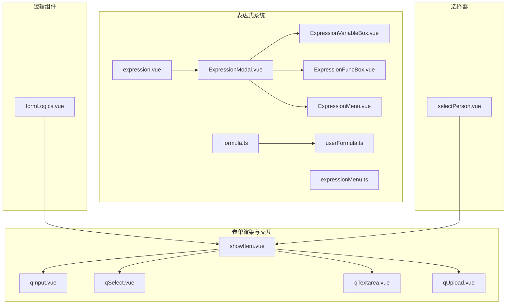
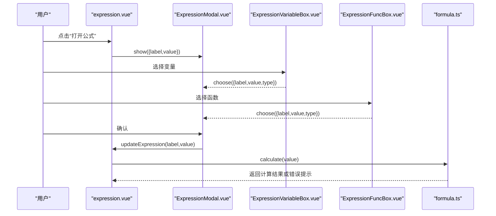
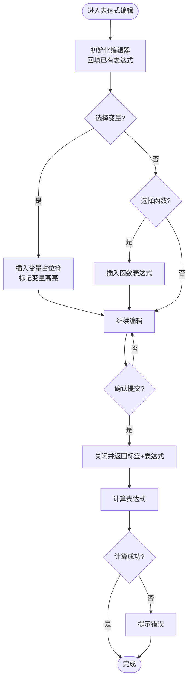
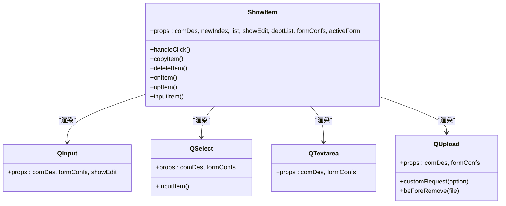
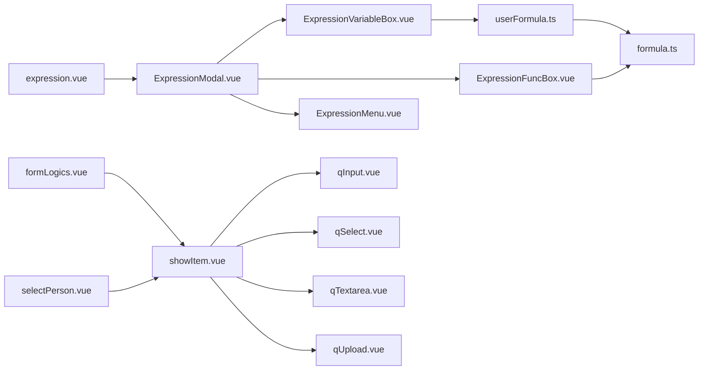

# 组件系统

<cite>
**本文引用的文件**
- [expression.vue](file://src/components/expression/expression.vue)
- [formula.ts](file://src/components/expression/formula.ts)
- [expressionMenu.ts](file://src/components/expression/expressionMenu.ts)
- [ExpressionModal.vue](file://src/components/expression/components/ExpressionModal.vue)
- [ExpressionMenu.vue](file://src/components/expression/components/ExpressionMenu.vue)
- [ExpressionVariableBox.vue](file://src/components/expression/components/ExpressionVariableBox.vue)
- [ExpressionFuncBox.vue](file://src/components/expression/components/ExpressionFuncBox.vue)
- [userFormula.ts](file://src/components/expression/formula/userFormula.ts)
- [showItem.vue](file://src/components/showItem/showItem.vue)
- [qInput.vue](file://src/components/showItem/qInput.vue)
- [qSelect.vue](file://src/components/showItem/qSelect.vue)
- [qTextarea.vue](file://src/components/showItem/qTextarea.vue)
- [qUpload.vue](file://src/components/showItem/qUpload.vue)
- [formLogics.vue](file://src/components/formLogics/formLogics.vue)
- [selectPerson.vue](file://src/components/selectPerson/selectPerson.vue)
</cite>

## 目录
1. [简介](#简介)
2. [项目结构](#项目结构)
3. [核心组件](#核心组件)
4. [架构总览](#架构总览)
5. [详细组件分析](#详细组件分析)
6. [依赖关系分析](#依赖关系分析)
7. [性能考量](#性能考量)
8. [故障排查指南](#故障排查指南)
9. [结论](#结论)
10. [附录](#附录)

## 简介
本文件面向新工作台项目的组件系统，围绕基础组件库、业务组件库与表达式系统进行系统化梳理。内容涵盖表单组件、逻辑组件、选择器组件、编辑器组件等的架构设计、实现要点、API 接口、事件处理、样式定制与响应式设计，并提供可操作的使用场景与扩展建议，帮助开发者快速理解与高效使用。

## 项目结构
组件系统主要由以下模块构成：
- 表达式系统：提供公式输入、变量与函数选择、语法高亮与标记、计算引擎集成与错误提示。
- 表单渲染与交互：统一的表单项容器与多种具体表单控件（输入、选择、文本域、上传等）。
- 逻辑组件：根据字段类型动态分发到对应逻辑处理组件，支持联动与校验。
- 人员选择器：多选人员展示与弹窗选择，支持标签化显示与移除。
- 基础组件：基于 Arco Design 的通用 UI 组件封装，统一风格与行为。

图表来源
- [expression.vue:1-131](file://src/components/expression/expression.vue#L1-L131)
- [ExpressionModal.vue:1-298](file://src/components/expression/components/ExpressionModal.vue#L1-L298)
- [ExpressionVariableBox.vue:1-171](file://src/components/expression/components/ExpressionVariableBox.vue#L1-L171)
- [ExpressionFuncBox.vue:1-108](file://src/components/expression/components/ExpressionFuncBox.vue#L1-L108)
- [ExpressionMenu.vue:1-45](file://src/components/expression/components/ExpressionMenu.vue#L1-L45)
- [formula.ts:1-96](file://src/components/expression/formula.ts#L1-L96)
- [userFormula.ts:1-411](file://src/components/expression/formula/userFormula.ts#L1-L411)
- [expressionMenu.ts:1-101](file://src/components/expression/expressionMenu.ts#L1-L101)
- [showItem.vue:1-196](file://src/components/showItem/showItem.vue#L1-L196)
- [qInput.vue:1-21](file://src/components/showItem/qInput.vue#L1-L21)
- [qSelect.vue:1-34](file://src/components/showItem/qSelect.vue#L1-L34)
- [qTextarea.vue:1-20](file://src/components/showItem/qTextarea.vue#L1-L20)
- [qUpload.vue:1-89](file://src/components/showItem/qUpload.vue#L1-L89)
- [formLogics.vue:1-35](file://src/components/formLogics/formLogics.vue#L1-L35)
- [selectPerson.vue:1-115](file://src/components/selectPerson/selectPerson.vue#L1-L115)

章节来源
- [expression.vue:1-131](file://src/components/expression/expression.vue#L1-L131)
- [showItem.vue:1-196](file://src/components/showItem/showItem.vue#L1-L196)
- [formLogics.vue:1-35](file://src/components/formLogics/formLogics.vue#L1-L35)
- [selectPerson.vue:1-115](file://src/components/selectPerson/selectPerson.vue#L1-L115)

## 核心组件
- 表达式输入组件：提供“打开公式编辑器”入口、标签展示、清空与更新事件；内部组合下拉菜单与模态框。
- 表达式编辑器：左侧变量树与函数树，右侧 CodeMirror 编辑区，支持插入变量占位符、函数、高亮与标记。
- 表单渲染容器：统一承载各控件，支持设计器模式下的拖拽、复制、删除与上下移动等交互。
- 逻辑组件：按字段类型分发到对应逻辑处理组件，便于扩展新的字段类型与联动规则。
- 人员选择器：标签化展示已选人员，支持点击打开弹窗选择、移除标签等。

章节来源
- [expression.vue:1-131](file://src/components/expression/expression.vue#L1-L131)
- [ExpressionModal.vue:1-298](file://src/components/expression/components/ExpressionModal.vue#L1-L298)
- [showItem.vue:1-196](file://src/components/showItem/showItem.vue#L1-L196)
- [formLogics.vue:1-35](file://src/components/formLogics/formLogics.vue#L1-L35)
- [selectPerson.vue:1-115](file://src/components/selectPerson/selectPerson.vue#L1-L115)

## 架构总览
表达式系统采用“组件 + 解析器 + 注册函数”的分层设计：
- 组件层：负责 UI 展示与交互（下拉菜单、模态框、变量/函数树、编辑器）。
- 数据层：提供变量树与函数树数据源，支持搜索过滤与父子节点映射。
- 计算层：通过 expr-eval 解析表达式，注册自定义函数（如用户信息、部门、日期、随机数、字符串、数组、金额、业务函数），并在运行时注入表单值与子表单值访问器。
- 事件层：组件间通过事件传递（如选择变量/函数、确认更新表达式），并触发上层逻辑。

图表来源
- [expression.vue:86-102](file://src/components/expression/expression.vue#L86-L102)
- [ExpressionModal.vue:57-187](file://src/components/expression/components/ExpressionModal.vue#L57-L187)
- [ExpressionVariableBox.vue:107-123](file://src/components/expression/components/ExpressionVariableBox.vue#L107-L123)
- [ExpressionFuncBox.vue:69-79](file://src/components/expression/components/ExpressionFuncBox.vue#L69-L79)
- [formula.ts:84-95](file://src/components/expression/formula.ts#L84-L95)

## 详细组件分析

### 表达式组件体系
- 组件职责
  - 表达式输入组件：承载标签展示、清空与更新事件；调用表达式编辑器。
  - 表达式编辑器：变量树与函数树选择、编辑区插入与标记、回填与提交。
  - 变量盒子：构建“当前用户/表单字段/子表单字段”等变量树，支持搜索过滤与父节点查找。
  - 函数盒子：聚合通用、日期、金额、字符串、数组、随机数、业务函数树，支持搜索过滤。
  - 计算引擎：注册用户相关函数与表单值访问器，解析并执行表达式，捕获错误并提示。

- 关键流程
  - 打开编辑器：传入当前标签与表达式值，初始化编辑区。
  - 插入变量/函数：在光标处插入占位符或直接替换，同时对变量占位符做高亮标记。
  - 提交更新：关闭对话框时，若表达式为空则清空标签，否则保留标签并向上抛出事件。
  - 表达式求值：预处理表达式（去除占位符标记），解析并评估，异常时提示错误。

图表来源
- [ExpressionModal.vue:57-187](file://src/components/expression/components/ExpressionModal.vue#L57-L187)
- [ExpressionVariableBox.vue:107-164](file://src/components/expression/components/ExpressionVariableBox.vue#L107-L164)
- [ExpressionFuncBox.vue:69-107](file://src/components/expression/components/ExpressionFuncBox.vue#L69-L107)
- [formula.ts:84-95](file://src/components/expression/formula.ts#L84-L95)

章节来源
- [expression.vue:1-131](file://src/components/expression/expression.vue#L1-L131)
- [ExpressionModal.vue:1-298](file://src/components/expression/components/ExpressionModal.vue#L1-L298)
- [ExpressionVariableBox.vue:1-171](file://src/components/expression/components/ExpressionVariableBox.vue#L1-L171)
- [ExpressionFuncBox.vue:1-108](file://src/components/expression/components/ExpressionFuncBox.vue#L1-L108)
- [ExpressionMenu.vue:1-45](file://src/components/expression/components/ExpressionMenu.vue#L1-L45)
- [formula.ts:1-96](file://src/components/expression/formula.ts#L1-L96)
- [userFormula.ts:1-411](file://src/components/expression/formula/userFormula.ts#L1-L411)
- [expressionMenu.ts:1-101](file://src/components/expression/expressionMenu.ts#L1-L101)

### 表单渲染与交互组件
- 统一容器
  - 支持设计器模式与只读模式切换，根据字段类型决定是否包裹 a-form-item。
  - 提供拖拽、复制、删除、上下移动等交互按钮，通过 provide/inject 与设计器通信。
  - 支持字段描述文案渲染与必填样式控制。
- 输入类控件
  - 输入框：支持清空、占字符限制与只读/禁用。
  - 文本域：支持字数统计与长度限制。
  - 选择器：绑定属性、清空与变更事件，支持方法钩子（eval）执行。
  - 上传：根据附件类型动态设置 accept，自定义上传请求，拼接下载地址与路径。

图表来源
- [showItem.vue:1-196](file://src/components/showItem/showItem.vue#L1-L196)
- [qInput.vue:1-21](file://src/components/showItem/qInput.vue#L1-L21)
- [qSelect.vue:1-34](file://src/components/showItem/qSelect.vue#L1-L34)
- [qTextarea.vue:1-20](file://src/components/showItem/qTextarea.vue#L1-L20)
- [qUpload.vue:1-89](file://src/components/showItem/qUpload.vue#L1-L89)

章节来源
- [showItem.vue:1-196](file://src/components/showItem/showItem.vue#L1-L196)
- [qInput.vue:1-21](file://src/components/showItem/qInput.vue#L1-L21)
- [qSelect.vue:1-34](file://src/components/showItem/qSelect.vue#L1-L34)
- [qTextarea.vue:1-20](file://src/components/showItem/qTextarea.vue#L1-L20)
- [qUpload.vue:1-89](file://src/components/showItem/qUpload.vue#L1-L89)

### 逻辑组件
- 功能概述：根据字段类型动态渲染对应逻辑组件（输入、单选/多选、数字、日期、时间、地址、用户、部门等），便于集中管理联动与校验逻辑。
- 设计要点：通过 props 透传数据与部门列表，保持组件解耦与可复用性。

章节来源
- [formLogics.vue:1-35](file://src/components/formLogics/formLogics.vue#L1-L35)

### 人员选择器组件
- 功能概述：以标签形式展示已选人员，支持点击打开弹窗选择、移除标签；标签数量超过阈值时显示“+n”。
- 交互要点：通过 ref 调用弹窗组件的 showItem 方法传入当前已选值，选择完成后回写到双向绑定值。

章节来源
- [selectPerson.vue:1-115](file://src/components/selectPerson/selectPerson.vue#L1-L115)

## 依赖关系分析
- 组件内聚与耦合
  - 表达式组件内部高度内聚：变量树、函数树、编辑器、菜单均在同一编辑器模态框中协作。
  - 表单容器与控件之间通过动态组件与 props 通信，耦合度低，易于扩展新控件。
- 外部依赖
  - 表达式系统依赖 expr-eval 解析器与 Arco Design UI 组件库。
  - 上传组件依赖后端上传接口与全局下载地址配置。
- 循环依赖
  - 当前未发现循环依赖；变量树构建与路由查询耦合于变量盒子，属于可控的条件加载。

图表来源
- [expression.vue:1-131](file://src/components/expression/expression.vue#L1-L131)
- [ExpressionModal.vue:1-298](file://src/components/expression/components/ExpressionModal.vue#L1-L298)
- [ExpressionVariableBox.vue:1-171](file://src/components/expression/components/ExpressionVariableBox.vue#L1-L171)
- [ExpressionFuncBox.vue:1-108](file://src/components/expression/components/ExpressionFuncBox.vue#L1-L108)
- [ExpressionMenu.vue:1-45](file://src/components/expression/components/ExpressionMenu.vue#L1-L45)
- [userFormula.ts:1-411](file://src/components/expression/formula/userFormula.ts#L1-L411)
- [formula.ts:1-96](file://src/components/expression/formula.ts#L1-L96)
- [showItem.vue:1-196](file://src/components/showItem/showItem.vue#L1-L196)
- [qInput.vue:1-21](file://src/components/showItem/qInput.vue#L1-L21)
- [qSelect.vue:1-34](file://src/components/showItem/qSelect.vue#L1-L34)
- [qTextarea.vue:1-20](file://src/components/showItem/qTextarea.vue#L1-L20)
- [qUpload.vue:1-89](file://src/components/showItem/qUpload.vue#L1-L89)
- [formLogics.vue:1-35](file://src/components/formLogics/formLogics.vue#L1-L35)
- [selectPerson.vue:1-115](file://src/components/selectPerson/selectPerson.vue#L1-L115)

## 性能考量
- 表达式编辑器
  - 搜索过滤：变量树与函数树均实现递归过滤，建议在大数据量时增加防抖与虚拟滚动优化。
  - 占位符高亮：标记变量 DOM 时注意避免频繁重排，可考虑批量标记或延迟渲染。
- 表单渲染
  - 动态组件渲染：按字段类型分发，避免不必要的组件实例化；对复杂子表单可采用懒加载。
  - 上传组件：自定义上传请求应避免阻塞主线程，必要时使用 Web Worker 或后台线程处理。
- 逻辑组件
  - eval 使用：仅在受控场景（如方法钩子）使用，建议限制可执行代码范围并做白名单校验。

## 故障排查指南
- 表达式解析错误
  - 现象：计算时报错并弹出错误消息。
  - 排查：检查表达式语法、占位符是否正确闭合、函数是否已注册、表单值是否存在。
- 变量/函数不可见
  - 现象：变量树或函数树中无内容或搜索不到。
  - 排查：确认路由是否为表单设计页以加载表单变量；检查搜索关键词大小写与匹配逻辑。
- 上传失败
  - 现象：上传后无法显示文件或下载链接异常。
  - 排查：确认 accept 类型与后端接口参数；检查自定义上传请求返回值与下载地址拼接逻辑。
- 人员选择器标签不更新
  - 现象：选择后标签未刷新。
  - 排查：确认弹窗回调 setData 已正确赋值到双向绑定值；检查 computed getter/setter 逻辑。

章节来源
- [formula.ts:84-95](file://src/components/expression/formula.ts#L84-L95)
- [ExpressionVariableBox.vue:125-145](file://src/components/expression/components/ExpressionVariableBox.vue#L125-L145)
- [ExpressionFuncBox.vue:81-101](file://src/components/expression/components/ExpressionFuncBox.vue#L81-L101)
- [qUpload.vue:59-85](file://src/components/showItem/qUpload.vue#L59-L85)
- [selectPerson.vue:47-63](file://src/components/selectPerson/selectPerson.vue#L47-L63)

## 结论
该组件系统以“表达式 + 表单 + 逻辑 + 选择器”为主线，形成清晰的层次化架构与良好的扩展性。表达式系统通过“变量/函数树 + 编辑器 + 计算引擎”的组合，提供了强大的可视化与可编程能力；表单渲染与逻辑组件保证了不同字段类型的统一管理与灵活扩展；人员选择器提升了用户体验与交互效率。建议后续在大数据量场景下引入虚拟滚动与缓存策略，在安全性方面对 eval 场景进行更严格的约束与审计。

## 附录
- 使用场景示例（路径指引）
  - 在表单设计页打开表达式编辑器并插入变量/函数：[ExpressionModal.vue:57-187](file://src/components/expression/components/ExpressionModal.vue#L57-L187)
  - 渲染输入框并启用清空与字数限制：[qInput.vue:1-21](file://src/components/showItem/qInput.vue#L1-L21)
  - 使用选择器并绑定方法钩子：[qSelect.vue:1-34](file://src/components/showItem/qSelect.vue#L1-L34)
  - 文本域字数统计与长度限制：[qTextarea.vue:1-20](file://src/components/showItem/qTextarea.vue#L1-L20)
  - 上传图片/视频/音频/文档/压缩包并拼接下载地址：[qUpload.vue:1-89](file://src/components/showItem/qUpload.vue#L1-L89)
  - 根据字段类型动态渲染逻辑组件：[formLogics.vue:1-35](file://src/components/formLogics/formLogics.vue#L1-L35)
  - 标签化展示人员并支持移除：[selectPerson.vue:1-115](file://src/components/selectPerson/selectPerson.vue#L1-L115)