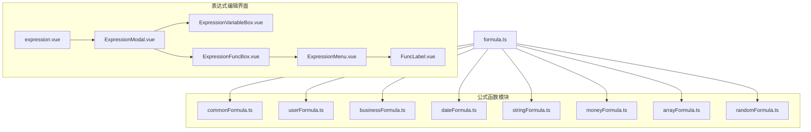
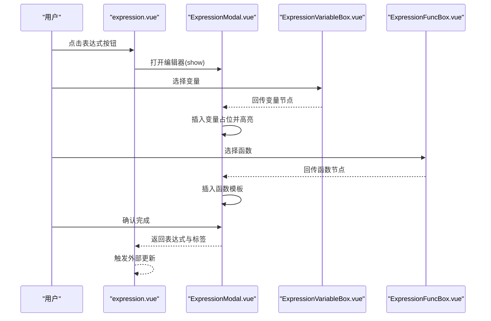
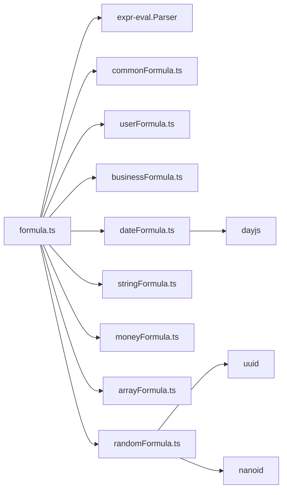
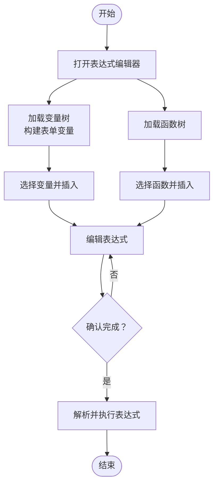

# 公式函数库

<cite>
**本文引用的文件**
- [commonFormula.ts](file://src/components/expression/formula/commonFormula.ts)
- [userFormula.ts](file://src/components/expression/formula/userFormula.ts)
- [businessFormula.ts](file://src/components/expression/formula/businessFormula.ts)
- [dateFormula.ts](file://src/components/expression/formula/dateFormula.ts)
- [stringFormula.ts](file://src/components/expression/formula/stringFormula.ts)
- [moneyFormula.ts](file://src/components/expression/formula/moneyFormula.ts)
- [arrayFormula.ts](file://src/components/expression/formula/arrayFormula.ts)
- [randomFormula.ts](file://src/components/expression/formula/randomFormula.ts)
- [formula.ts](file://src/components/expression/formula.ts)
- [expression.vue](file://src/components/expression/expression.vue)
- [ExpressionMenu.vue](file://src/components/expression/components/ExpressionMenu.vue)
- [ExpressionModal.vue](file://src/components/expression/components/ExpressionModal.vue)
- [ExpressionVariableBox.vue](file://src/components/expression/components/ExpressionVariableBox.vue)
- [ExpressionFuncBox.vue](file://src/components/expression/components/ExpressionFuncBox.vue)
- [FuncLabel.vue](file://src/components/expression/components/FuncLabel.vue)
</cite>

## 目录
1. [简介](#简介)
2. [项目结构](#项目结构)
3. [核心组件](#核心组件)
4. [架构总览](#架构总览)
5. [详细组件分析](#详细组件分析)
6. [依赖关系分析](#依赖关系分析)
7. [性能考量](#性能考量)
8. [故障排查指南](#故障排查指南)
9. [结论](#结论)
10. [附录](#附录)

## 简介
本文件系统性梳理公式函数库的设计与实现，覆盖通用函数、用户函数、业务函数、日期函数、字符串函数、金额函数、数组函数与随机函数等模块。文档提供各函数的用途、参数、返回值、使用示例与注意事项，并通过可视化图示展示模块间交互与表达式编辑流程，帮助开发者快速定位与使用合适函数。

## 项目结构
公式函数库位于表达式组件目录下，采用按功能域划分的模块化组织方式：
- 模块入口：formula.ts 统一注册各函数到表达式解析器
- 功能域模块：commonFormula、userFormula、businessFormula、dateFormula、stringFormula、moneyFormula、arrayFormula、randomFormula
- 表达式编辑界面：expression.vue、ExpressionModal.vue、ExpressionVariableBox.vue、ExpressionFuncBox.vue、ExpressionMenu.vue、FuncLabel.vue

图表来源
- [formula.ts:1-96](file://src/components/expression/formula.ts#L1-L96)
- [expression.vue:1-131](file://src/components/expression/expression.vue#L1-L131)
- [ExpressionModal.vue:1-298](file://src/components/expression/components/ExpressionModal.vue#L1-L298)
- [ExpressionVariableBox.vue:1-171](file://src/components/expression/components/ExpressionVariableBox.vue#L1-L171)
- [ExpressionFuncBox.vue:1-108](file://src/components/expression/components/ExpressionFuncBox.vue#L1-L108)
- [ExpressionMenu.vue:1-45](file://src/components/expression/components/ExpressionMenu.vue#L1-L45)
- [FuncLabel.vue:1-51](file://src/components/expression/components/FuncLabel.vue#L1-L51)

章节来源
- [formula.ts:1-96](file://src/components/expression/formula.ts#L1-L96)
- [expression.vue:1-131](file://src/components/expression/expression.vue#L1-L131)

## 核心组件
- 表达式解析与执行：formula.ts 中创建解析器并注册函数，提供 calculate 方法执行表达式
- 表达式编辑器：expression.vue 提供触发入口；ExpressionModal.vue 提供变量/函数选择与编辑区域
- 变量与函数面板：ExpressionVariableBox.vue、ExpressionFuncBox.vue 提供树形选择与搜索
- 函数描述展示：FuncLabel.vue 基于函数定义中的 desc 字段渲染富文本说明

章节来源
- [formula.ts:15-95](file://src/components/expression/formula.ts#L15-L95)
- [expression.vue:34-103](file://src/components/expression/expression.vue#L34-L103)
- [ExpressionModal.vue:45-187](file://src/components/expression/components/ExpressionModal.vue#L45-L187)
- [ExpressionVariableBox.vue:38-164](file://src/components/expression/components/ExpressionVariableBox.vue#L38-L164)
- [ExpressionFuncBox.vue:40-107](file://src/components/expression/components/ExpressionFuncBox.vue#L40-L107)
- [FuncLabel.vue:13-21](file://src/components/expression/components/FuncLabel.vue#L13-L21)

## 架构总览
表达式计算的端到端流程如下：
- 用户在表达式输入框中点击打开表达式编辑器
- 编辑器加载变量树与函数树，支持搜索与选择
- 选中变量或函数后插入到编辑区，支持变量高亮标注
- 点击确认后，将表达式交由解析器执行

图表来源
- [expression.vue:86-102](file://src/components/expression/expression.vue#L86-L102)
- [ExpressionModal.vue:57-187](file://src/components/expression/components/ExpressionModal.vue#L57-L187)
- [ExpressionVariableBox.vue:107-123](file://src/components/expression/components/ExpressionVariableBox.vue#L107-L123)
- [ExpressionFuncBox.vue:69-79](file://src/components/expression/components/ExpressionFuncBox.vue#L69-L79)

## 详细组件分析

### 通用公式函数（commonFormula）
- 功能概览
  - 为空判断：判断参数是否为空
  - 非空判断：判断参数是否不为空
  - 匹配返回：根据条件返回不同结果
  - 全满足/任意满足：对多个条件进行与/或判断
- 参数与返回
  - isNull/isNotNull：参数为任意值，返回布尔
  - match：条件、真返回、假返回，返回真/假返回
  - matchAll/matchAny：可变参数，返回布尔
- 使用示例
  - 判断空：isNull(...)
  - 条件分支：match(...)
  - 多条件组合：matchAll(...)、matchAny(...)
- 注意事项
  - 所有函数均支持异步参数解析
  - matchAll/matchAny 对空条件返回 false/true 的语义需明确

章节来源
- [commonFormula.ts:12-52](file://src/components/expression/formula/commonFormula.ts#L12-L52)
- [commonFormula.ts:54-136](file://src/components/expression/formula/commonFormula.ts#L54-L136)

### 用户公式函数（userFormula）
- 功能概览
  - 当前用户属性：ID、昵称、用户名、邮箱、手机、性别
  - 角色信息：ID、名称（逗号连接）
  - 部门信息：部门ID/名称，以及是否负责人
  - 主要部门/兼任部门：支持主职与兼职两种工作性质
  - 职位信息：ID、名称（支持主职/兼职）
- 参数与返回
  - getCurrentUser(attribute)：attribute 为 id/nickname/username/email/phone/sex/isLeader/isMainLeader/isPartLeader，返回对应属性值或布尔
  - getUserRole(attribute)：attribute 为 id/name，返回逗号连接的字符串
  - getUserDept/getUserMainDept/getUserPartDept(attribute)：attribute 为 id/name，返回逗号连接的字符串
  - getUserPost/getUserMainPost/getUserPartPost(attribute)：attribute 为 id/name，返回逗号连接的字符串
- 使用示例
  - 获取当前用户昵称：getCurrentUser("nickname")
  - 获取主要部门名称：getUserMainDept("name")
  - 获取角色名称：getUserRole("name")
- 注意事项
  - 部门/职位查询基于 API，返回值为 Promise
  - isLeader/isMainLeader/isPartLeader 内部调用部门查询并判断负责人标识

章节来源
- [userFormula.ts:19-112](file://src/components/expression/formula/userFormula.ts#L19-L112)
- [userFormula.ts:114-411](file://src/components/expression/formula/userFormula.ts#L114-L411)

### 业务公式函数（businessFormula）
- 功能概览
  - 部门负责人：获取当前用户所在部门的负责人信息
- 参数与返回
  - getUserDeptLeader(attribute)：attribute 为 id/username/nickname，默认 nickname，返回逗号连接的字符串
- 使用示例
  - 获取部门负责人昵称：getUserDeptLeader("nickname")
- 注意事项
  - 返回值为 Promise，需在表达式中等待解析

章节来源
- [businessFormula.ts:12-25](file://src/components/expression/formula/businessFormula.ts#L12-L25)
- [businessFormula.ts:27-52](file://src/components/expression/formula/businessFormula.ts#L27-L52)

### 日期公式函数（dateFormula）
- 功能概览
  - 获取当前日期时间：支持多种格式
  - 获取当前日期：YYYY-MM-DD
  - 获取当前时间：HH:mm:ss
  - 时间差：计算两个时间点之间的差值（支持毫秒到年）
  - 区间时间差：从区间对象中提取起止时间计算差值
- 参数与返回
  - getDatetime(format?)：format 支持 yyyy-MM-dd HH:mm:ss 等，返回字符串
  - getDate()：返回字符串
  - getTime()：返回字符串
  - getTimeDiff(start, end, unit)：unit 为 ms/s/min/h/d/w/m/y，返回数值（保留两位小数）
  - getIntervalTimeDiff(intervalDate, unit)：intervalDate 为包含 start/end 的对象或 JSON 字符串，返回数值
- 使用示例
  - 当前时间：getDatetime()
  - 时间差（天）：getTimeDiff("2025-11-10","2025-11-11","d")
  - 区间差值：getIntervalTimeDiff({"start":"...","end":"..."},"h")
- 注意事项
  - 时间解析兼容 Date 对象与常见字符串格式
  - 非法时间返回空字符串，避免抛错

章节来源
- [dateFormula.ts:13-71](file://src/components/expression/formula/dateFormula.ts#L13-L71)
- [dateFormula.ts:73-156](file://src/components/expression/formula/dateFormula.ts#L73-L156)
- [dateFormula.ts:158-180](file://src/components/expression/formula/dateFormula.ts#L158-L180)

### 字符串公式函数（stringFormula）
- 功能概览
  - 转换为字符串：支持 null/undefined、Date、数组、对象、原始值
  - 字符串比较：严格相等
  - 字符串拼接：多参数拼接
  - 字符串拆分：按分隔符拆分为数组
- 参数与返回
  - toStr(arg)：返回字符串
  - eqStr(a, b)：返回布尔
  - concatStr(...args)：返回字符串
  - splitStr(str, sep)：返回数组
- 使用示例
  - 转换数组为字符串：toStr([...])
  - 比较字符串：eqStr("a","b")
  - 拼接字符串：concatStr("a","b")
  - 拆分字符串：splitStr("a,b,c",",")
- 注意事项
  - 对象序列化失败回退为 toString
  - 拆分时若任一参数为空返回空数组

章节来源
- [stringFormula.ts:12-56](file://src/components/expression/formula/stringFormula.ts#L12-L56)
- [stringFormula.ts:58-127](file://src/components/expression/formula/stringFormula.ts#L58-L127)

### 金额公式函数（moneyFormula）
- 功能概览
  - 数字转中文大写金额（元/角/分）
  - 多数求和：支持数字、字符串、数组混合
  - 多数求平均值：过滤非法值后计算
  - 字符串转数字并保留两位小数
- 参数与返回
  - toChinese(number)：返回中文大写金额字符串
  - sum(...args)：返回数值
  - avg(...args)：返回数值
  - toNumber(arg)：返回字符串形式的数值（两位小数）
- 使用示例
  - 大写金额：toChinese("300.25")
  - 求和：sum("1","2",["3"])
  - 平均值：avg("1","2","3")
  - 转数字：toNumber("300.25")
- 注意事项
  - toChinese 限制范围与边界值处理
  - avg 对空数组返回 0，sum 将非法值视为 0

章节来源
- [moneyFormula.ts:39-121](file://src/components/expression/formula/moneyFormula.ts#L39-L121)
- [moneyFormula.ts:123-189](file://src/components/expression/formula/moneyFormula.ts#L123-L189)

### 数组公式函数（arrayFormula）
- 功能概览
  - 包含任一：目标数组中是否存在任一匹配项
  - 包含全部：目标数组中是否包含所有匹配项
- 参数与返回
  - includeAny(array, targets)：返回布尔
  - includeAll(array, targets)：返回布尔
- 使用示例
  - 包含任一：includeAny(["a","b"],["a"])
  - 包含全部：includeAll(["a","b"],["a"])
- 注意事项
  - 支持字符串、JSON 数组、类数组、单值等输入，内部统一封装为数组

章节来源
- [arrayFormula.ts:12-28](file://src/components/expression/formula/arrayFormula.ts#L12-L28)
- [arrayFormula.ts:30-69](file://src/components/expression/formula/arrayFormula.ts#L30-L69)
- [arrayFormula.ts:71-95](file://src/components/expression/formula/arrayFormula.ts#L71-L95)

### 随机公式函数（randomFormula）
- 功能概览
  - 生成 UUID
  - 生成 NanoID（可指定长度）
- 参数与返回
  - generateUuid()：返回字符串
  - generateNanoid(size?)：返回字符串
- 使用示例
  - UUID：generateUuid()
  - NanoID：generateNanoid(16)
- 注意事项
  - 依赖外部库，确保运行环境可用

章节来源
- [randomFormula.ts:14-20](file://src/components/expression/formula/randomFormula.ts#L14-L20)
- [randomFormula.ts:22-58](file://src/components/expression/formula/randomFormula.ts#L22-L58)

### 表达式解析与执行（formula.ts）
- 注册机制
  - 统一导入各模块的 register 函数并将函数挂载到解析器
  - 同时注册表单取值函数 getFormValue 与 getSubFormValue
- 执行流程
  - calculate 接收表达式字符串，去除特殊标记后解析并求值
  - 异常时提示并记录错误日志

章节来源
- [formula.ts:15-24](file://src/components/expression/formula.ts#L15-L24)
- [formula.ts:27-63](file://src/components/expression/formula.ts#L27-L63)
- [formula.ts:84-95](file://src/components/expression/formula.ts#L84-L95)

### 表达式编辑器（expression.vue 与相关组件）
- 表达式输入框：提供标签与值的绑定，清空与更新事件
- 模态框：左侧变量区、右侧函数区与中间编辑区
- 变量构建：支持当前用户、角色、部门、职位等内置变量；在表单设计页动态注入表单字段变量
- 函数构建：聚合各功能域函数树，支持搜索与选择

章节来源
- [expression.vue:47-102](file://src/components/expression/expression.vue#L47-L102)
- [ExpressionModal.vue:57-187](file://src/components/expression/components/ExpressionModal.vue#L57-L187)
- [ExpressionVariableBox.vue:50-98](file://src/components/expression/components/ExpressionVariableBox.vue#L50-L98)
- [ExpressionFuncBox.vue:53-61](file://src/components/expression/components/ExpressionFuncBox.vue#L53-L61)

## 依赖关系分析
- 模块耦合
  - formula.ts 作为统一入口，集中注册各函数，降低上层调用复杂度
  - 表达式编辑器通过树形组件与函数定义解耦，便于扩展新函数
- 外部依赖
  - expr-eval：表达式解析与求值
  - dayjs：日期格式化与时间差计算
  - uuid、nanoid：随机标识生成
  - arco-design：UI 组件库
- 潜在循环依赖
  - 各模块独立导出 register 与函数定义，未见循环导入迹象

图表来源
- [formula.ts:1-12](file://src/components/expression/formula.ts#L1-L12)
- [dateFormula.ts:1-2](file://src/components/expression/formula/dateFormula.ts#L1-L2)
- [randomFormula.ts:1-3](file://src/components/expression/formula/randomFormula.ts#L1-L3)

章节来源
- [formula.ts:1-12](file://src/components/expression/formula.ts#L1-L12)

## 性能考量
- 异步函数解析：多数函数返回 Promise，建议在表达式中合理组织以减少不必要的并发请求
- 数组与字符串处理：toStr、toArray 在输入规模较大时注意内存占用与序列化成本
- 日期解析：统一使用 dayjs，避免重复实例化；时间差计算为 O(1)，但字符串解析需注意格式一致性
- 表达式执行：calculate 对异常进行捕获与提示，建议在前端缓存常用变量值以减少重复请求

## 故障排查指南
- 表达式解析错误
  - 现象：执行时报错并弹出提示
  - 排查：检查表达式语法、函数名拼写、参数数量与类型
- 变量不可用
  - 现象：变量无法插入或显示为空
  - 排查：确认当前路由是否为表单设计页；确认表单字段存在且可访问
- 部门/职位/角色接口异常
  - 现象：相关函数返回空或报错
  - 排查：检查网络状态与后端接口；确认本地存储的用户信息完整
- 日期解析失败
  - 现象：时间差计算返回空
  - 排查：确认传入时间为 Date 或可被识别的字符串格式

章节来源
- [formula.ts:84-95](file://src/components/expression/formula.ts#L84-L95)
- [ExpressionVariableBox.vue:50-68](file://src/components/expression/components/ExpressionVariableBox.vue#L50-L68)
- [dateFormula.ts:158-180](file://src/components/expression/formula/dateFormula.ts#L158-L180)

## 结论
公式函数库通过清晰的功能域划分与统一的注册机制，提供了从基础运算、数据处理到业务逻辑、财务计算、日期处理与随机标识生成的完整能力。配合可视化表达式编辑器，开发者可以高效地构建与维护复杂表达式，提升表单与流程的智能化水平。

## 附录
- 表达式编辑流程（算法实现概览）

图表来源
- [ExpressionModal.vue:57-187](file://src/components/expression/components/ExpressionModal.vue#L57-L187)
- [ExpressionVariableBox.vue:50-98](file://src/components/expression/components/ExpressionVariableBox.vue#L50-L98)
- [ExpressionFuncBox.vue:53-61](file://src/components/expression/components/ExpressionFuncBox.vue#L53-L61)
- [formula.ts:84-95](file://src/components/expression/formula.ts#L84-L95)