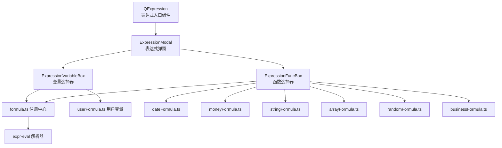
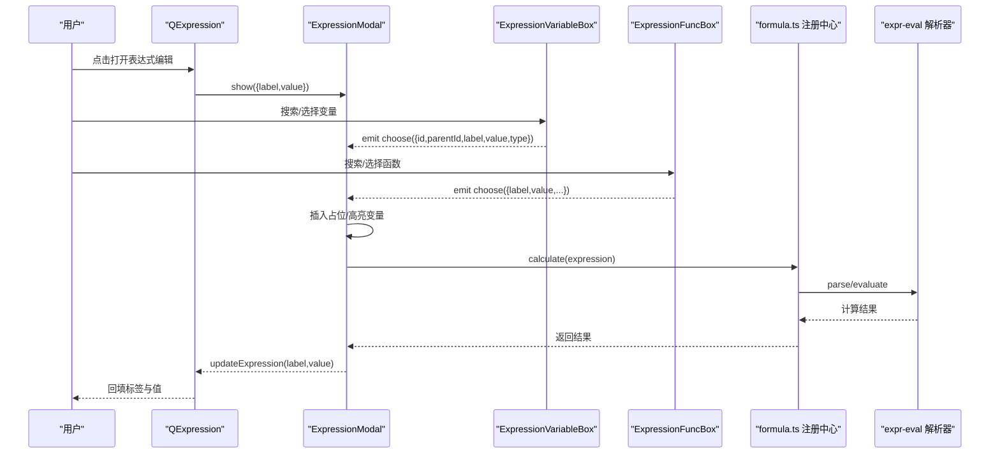
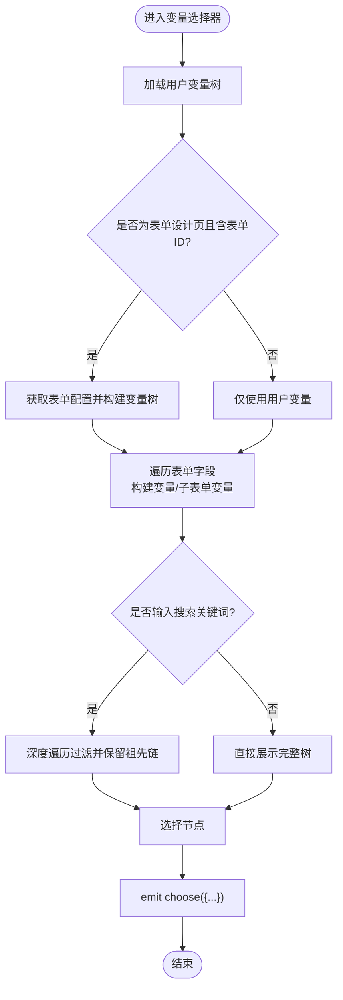
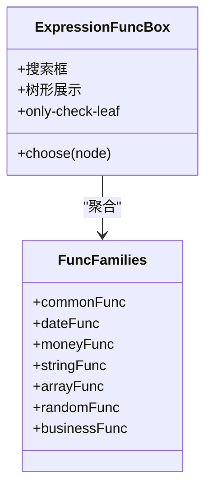
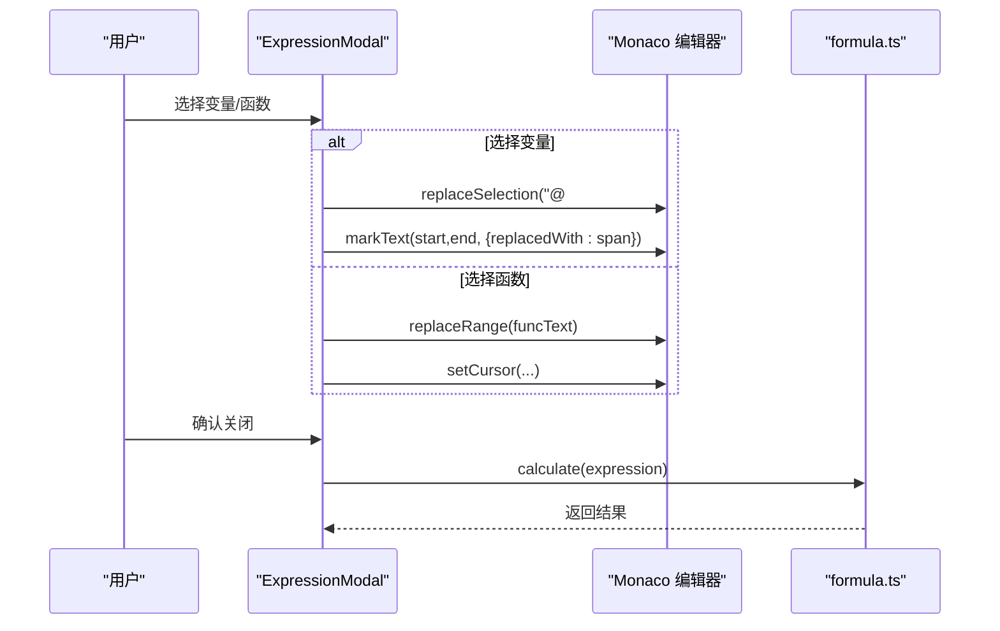
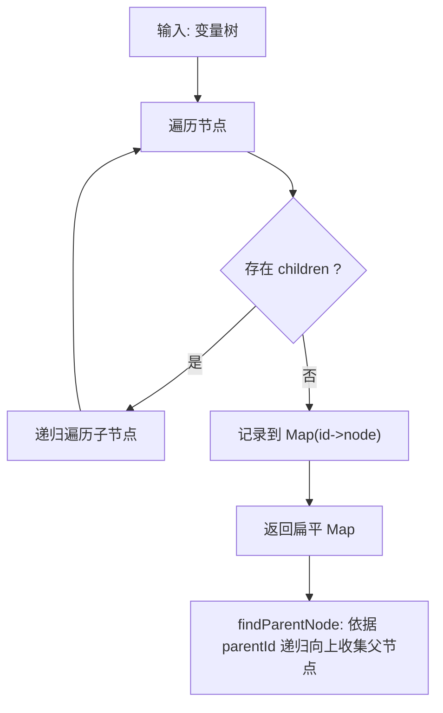
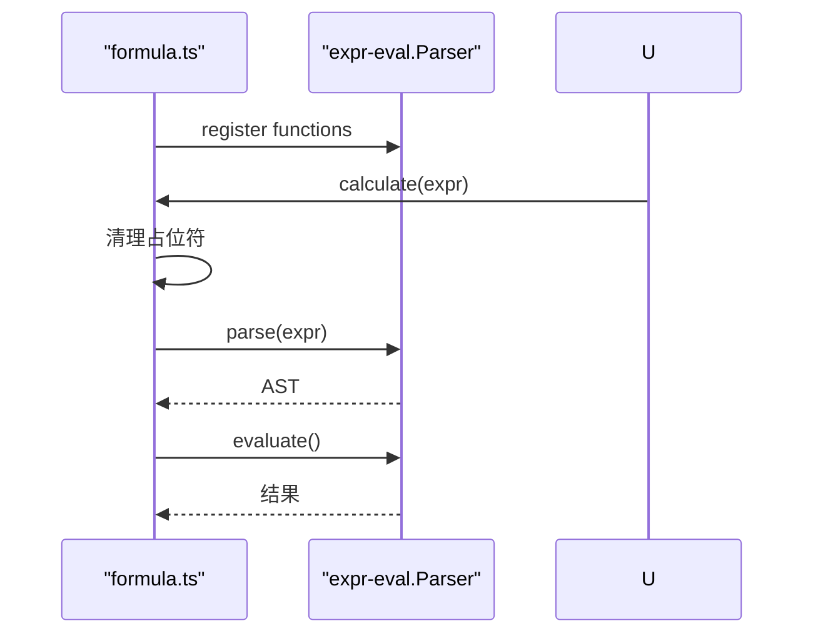
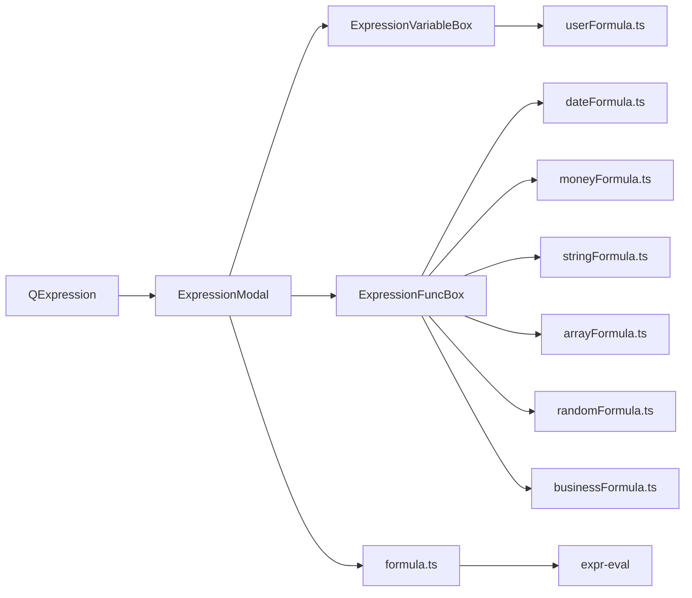

# 变量系统

<cite>
**本文引用的文件**
- [expression.vue](file://src/components/expression/expression.vue)
- [ExpressionVariableBox.vue](file://src/components/expression/components/ExpressionVariableBox.vue)
- [ExpressionFuncBox.vue](file://src/components/expression/components/ExpressionFuncBox.vue)
- [ExpressionModal.vue](file://src/components/expression/components/ExpressionModal.vue)
- [formula.ts](file://src/components/expression/formula.ts)
- [userFormula.ts](file://src/components/expression/formula/userFormula.ts)
- [dateFormula.ts](file://src/components/expression/formula/dateFormula.ts)
- [arrayFormula.ts](file://src/components/expression/formula/arrayFormula.ts)
- [moneyFormula.ts](file://src/components/expression/formula/moneyFormula.ts)
- [randomFormula.ts](file://src/components/expression/formula/randomFormula.ts)
- [businessFormula.ts](file://src/components/expression/formula/businessFormula.ts)
</cite>

## 目录
1. [简介](#简介)
2. [项目结构](#项目结构)
3. [核心组件](#核心组件)
4. [架构总览](#架构总览)
5. [详细组件分析](#详细组件分析)
6. [依赖关系分析](#依赖关系分析)
7. [性能与缓存策略](#性能与缓存策略)
8. [故障排查指南](#故障排查指南)
9. [结论](#结论)
10. [附录：变量命名规范与作用域规则](#附录变量命名规范与作用域规则)

## 简介
本文件系统性梳理变量系统的定义、作用域与生命周期管理，深入解析 ExpressionVariableBox 变量选择器的实现原理、变量列表的动态生成与变量值的获取机制；解释 ExpressionFuncBox 函数选择器的功能设计、函数列表的展示逻辑与函数调用处理流程；并重点分析 userFormula.ts 中的变量提取算法、flatVariableToMap 变量映射函数与 findParentNode 父节点查找逻辑。最后给出变量系统在表单计算、条件判断与数据绑定中的应用示例与最佳实践。

## 项目结构
变量系统位于表达式编辑组件体系中，由以下模块协同工作：
- 表达式入口组件：负责打开表达式编辑弹窗、回填标签与值
- 变量选择器：动态构建变量树、支持搜索、选择后回传变量元数据
- 函数选择器：聚合各类函数族，支持搜索与选择
- 表达式弹窗：承载 Monaco 编辑器与变量/函数插入、占位标记
- 公式注册中心：集中注册变量与函数到表达式解析器
- 用户变量与函数族：提供用户维度变量与常用函数族

图表来源
- [expression.vue:28-32](file://src/components/expression/expression.vue#L28-L32)
- [ExpressionModal.vue:115-139](file://src/components/expression/components/ExpressionModal.vue#L115-L139)
- [ExpressionVariableBox.vue:100-123](file://src/components/expression/components/ExpressionVariableBox.vue#L100-L123)
- [ExpressionFuncBox.vue:63-79](file://src/components/expression/components/ExpressionFuncBox.vue#L63-L79)
- [formula.ts:15-24](file://src/components/expression/formula.ts#L15-L24)

章节来源
- [expression.vue:1-131](file://src/components/expression/expression.vue#L1-L131)
- [ExpressionModal.vue:87-175](file://src/components/expression/components/ExpressionModal.vue#L87-L175)

## 核心组件
- QExpression：作为表达式输入的容器，负责打开弹窗、清空、回填标签与值
- ExpressionVariableBox：变量选择器，支持搜索、树形展示、选择事件回传
- ExpressionFuncBox：函数选择器，聚合多类函数族，支持搜索与叶子节点选择
- ExpressionModal：表达式弹窗，集成 Monaco 编辑器，负责变量/函数插入与占位标记
- formula.ts：注册中心，向解析器注入变量与函数，并提供表达式计算入口
- userFormula.ts：用户变量与函数注册，提供扁平化映射与父子链路查询

章节来源
- [expression.vue:47-102](file://src/components/expression/expression.vue#L47-L102)
- [ExpressionVariableBox.vue:38-123](file://src/components/expression/components/ExpressionVariableBox.vue#L38-L123)
- [ExpressionFuncBox.vue:40-79](file://src/components/expression/components/ExpressionFuncBox.vue#L40-L79)
- [ExpressionModal.vue:115-175](file://src/components/expression/components/ExpressionModal.vue#L115-L175)
- [formula.ts:15-95](file://src/components/expression/formula.ts#L15-L95)
- [userFormula.ts:114-410](file://src/components/expression/formula/userFormula.ts#L114-L410)

## 架构总览
变量系统围绕“选择器 + 注册中心 + 解析器”的模式组织，形成清晰的职责边界：
- 选择器层：负责 UI 展示与交互，输出标准化的节点元数据
- 注册中心层：负责将变量与函数注册到解析器，暴露统一的 evaluate 接口
- 解析器层：基于 expr-eval 执行表达式，按需从表单配置与运行时上下文中取值

图表来源
- [expression.vue:80-91](file://src/components/expression/expression.vue#L80-L91)
- [ExpressionModal.vue:115-175](file://src/components/expression/components/ExpressionModal.vue#L115-L175)
- [ExpressionVariableBox.vue:107-123](file://src/components/expression/components/ExpressionVariableBox.vue#L107-L123)
- [ExpressionFuncBox.vue:69-79](file://src/components/expression/components/ExpressionFuncBox.vue#L69-L79)
- [formula.ts:84-95](file://src/components/expression/formula.ts#L84-L95)

## 详细组件分析

### ExpressionVariableBox 变量选择器
- 动态变量树生成
  - 用户变量：来自 userFormula.ts 的 userVariable 结构，包含当前用户、角色、部门、职位等维度
  - 表单变量：仅在表单设计页（路由名为 form 或 flowPath）且携带 id 查询参数时，通过 getFormById 获取表单配置，动态构建表单项与子表单项的变量树
  - 子表单变量：当字段类型为 SUBFORM 时，递归构建子表单项，拼接 showLabel 用于显示层级路径
- 搜索与过滤
  - 支持关键词大小写无关的模糊匹配，采用深度优先遍历保留命中节点及其祖先链
- 选择事件
  - 选择节点后，emit choose，携带 id、parentId、label、value、type 等元数据，供上层弹窗插入占位与更新标签
- 变量值获取机制
  - 变量节点的 value 字段为可执行字符串（如 getFormValue/getSubFormValue 或用户函数调用），最终由 formula.ts 的解析器在 evaluate 时执行

图表来源
- [ExpressionVariableBox.vue:50-98](file://src/components/expression/components/ExpressionVariableBox.vue#L50-L98)
- [ExpressionVariableBox.vue:100-145](file://src/components/expression/components/ExpressionVariableBox.vue#L100-L145)
- [ExpressionVariableBox.vue:107-123](file://src/components/expression/components/ExpressionVariableBox.vue#L107-L123)

章节来源
- [ExpressionVariableBox.vue:38-171](file://src/components/expression/components/ExpressionVariableBox.vue#L38-L171)
- [userFormula.ts:114-371](file://src/components/expression/formula/userFormula.ts#L114-L371)

### ExpressionFuncBox 函数选择器
- 函数族聚合
  - 聚合 common/date/money/string/array/random/business 等函数族，统一以树形结构展示
- 搜索与过滤
  - 同样支持关键词大小写无关的模糊匹配，保留命中节点及其祖先链
- 选择事件
  - 仅允许叶子节点选择，选择后 emit 节点元数据，交由弹窗进行函数文本插入与光标定位

图表来源
- [ExpressionFuncBox.vue:40-108](file://src/components/expression/components/ExpressionFuncBox.vue#L40-L108)
- [dateFormula.ts:73-148](file://src/components/expression/formula/dateFormula.ts#L73-L148)
- [moneyFormula.ts:123-181](file://src/components/expression/formula/moneyFormula.ts#L123-L181)
- [arrayFormula.ts:30-64](file://src/components/expression/formula/arrayFormula.ts#L30-L64)
- [randomFormula.ts:22-52](file://src/components/expression/formula/randomFormula.ts#L22-L52)
- [businessFormula.ts:27-47](file://src/components/expression/formula/businessFormula.ts#L27-L47)

章节来源
- [ExpressionFuncBox.vue:40-108](file://src/components/expression/components/ExpressionFuncBox.vue#L40-L108)

### ExpressionModal 表达式弹窗与插入机制
- 变量插入
  - 当选择变量时，弹窗将变量值（可执行字符串）插入编辑器，并以自定义 DOM 替换选区，实现“占位高亮”，同时记录起止位置与标签
- 函数插入
  - 当选择函数时，直接替换选区为函数文本，并微调光标位置
- 表达式计算
  - 在关闭弹窗时，移除占位标记的前后缀，交给 formula.ts 的 calculate 执行解析

图表来源
- [ExpressionModal.vue:115-175](file://src/components/expression/components/ExpressionModal.vue#L115-L175)
- [ExpressionModal.vue:141-168](file://src/components/expression/components/ExpressionModal.vue#L141-L168)
- [formula.ts:84-95](file://src/components/expression/formula.ts#L84-L95)

章节来源
- [ExpressionModal.vue:87-175](file://src/components/expression/components/ExpressionModal.vue#L87-L175)
- [formula.ts:26-63](file://src/components/expression/formula.ts#L26-L63)

### userFormula.ts 变量提取与映射
- 变量提取算法
  - 通过递归遍历变量树，将每个节点的 value 字段映射到一个字典，便于快速查找变量定义
- flatVariableToMap
  - 将树结构扁平化为 Map，键为节点 id，值为节点对象，便于 O(1) 查找
- findParentNode
  - 基于扁平映射，沿 parentId 逐级向上查找父节点链，形成从子到父的完整路径

图表来源
- [userFormula.ts:373-386](file://src/components/expression/formula/userFormula.ts#L373-L386)
- [userFormula.ts:388-399](file://src/components/expression/formula/userFormula.ts#L388-L399)

章节来源
- [userFormula.ts:373-410](file://src/components/expression/formula/userFormula.ts#L373-L410)

### 表达式解析与计算
- 注册中心
  - 将用户变量与各函数族注册到 expr-eval 解析器，暴露 getFormValue、getSubFormValue 等函数
- 计算入口
  - calculate 在 evaluate 前清理占位符，捕获异常并提示错误

图表来源
- [formula.ts:15-24](file://src/components/expression/formula.ts#L15-L24)
- [formula.ts:26-63](file://src/components/expression/formula.ts#L26-L63)
- [formula.ts:84-95](file://src/components/expression/formula.ts#L84-L95)

章节来源
- [formula.ts:1-96](file://src/components/expression/formula.ts#L1-L96)

## 依赖关系分析
- 组件耦合
  - QExpression 仅与 ExpressionModal 通信，低耦合
  - ExpressionVariableBox 与 userFormula.ts 强关联，负责变量树构建与查找
  - ExpressionFuncBox 与各函数族模块强关联，负责函数树构建与展示
  - ExpressionModal 与两个选择器通过 choose 事件解耦
- 外部依赖
  - expr-eval：表达式解析与函数执行
  - dayjs：日期格式化与时间差计算
  - uuid/nanoid：随机标识生成
  - 表单工具：getFormById 提供表单配置

图表来源
- [ExpressionVariableBox.vue:40-48](file://src/components/expression/components/ExpressionVariableBox.vue#L40-L48)
- [ExpressionFuncBox.vue:44-51](file://src/components/expression/components/ExpressionFuncBox.vue#L44-L51)
- [ExpressionModal.vue:115-139](file://src/components/expression/components/ExpressionModal.vue#L115-L139)
- [formula.ts:1-24](file://src/components/expression/formula.ts#L1-L24)

章节来源
- [ExpressionVariableBox.vue:38-48](file://src/components/expression/components/ExpressionVariableBox.vue#L38-L48)
- [ExpressionFuncBox.vue:40-51](file://src/components/expression/components/ExpressionFuncBox.vue#L40-L51)
- [ExpressionModal.vue:115-139](file://src/components/expression/components/ExpressionModal.vue#L115-L139)
- [formula.ts:1-24](file://src/components/expression/formula.ts#L1-L24)

## 性能与缓存策略
- 变量树构建
  - 表单变量仅在特定路由与参数条件下构建，避免不必要的开销
  - 子表单变量按需递归构建，减少冗余节点
- 搜索过滤
  - 使用深度优先遍历进行过滤，保留祖先链，复杂度近似 O(N)，对中小规模表单友好
- 扁平映射
  - flatVariableToMap 将树转为 Map，后续查找与父链查询为 O(1)/O(h)（h 为层级）
- 表达式计算
  - calculate 在 evaluate 前清理占位符，避免重复渲染与二次解析
- 建议
  - 对超大表单建议限制子表单层级或启用虚拟滚动
  - 对频繁使用的变量可考虑前端缓存最近一次解析结果，结合变更监听重算

[本节为通用性能讨论，无需列出章节来源]

## 故障排查指南
- 表达式解析错误
  - 现象：弹出“表达式解析错误”提示
  - 排查：检查表达式语法、变量占位符是否正确清理、函数是否已注册
  - 参考：[formula.ts:84-95](file://src/components/expression/formula.ts#L84-L95)
- 变量未生效
  - 现象：变量插入后无值或报错
  - 排查：确认变量节点 value 是否为可执行字符串；确认表单 ID 与字段 ID 正确；确认 getFormById 能返回配置
  - 参考：[ExpressionVariableBox.vue:70-98](file://src/components/expression/components/ExpressionVariableBox.vue#L70-L98)、[formula.ts:26-63](file://src/components/expression/formula.ts#L26-L63)
- 函数不可用
  - 现象：函数无法选择或执行时报未注册
  - 排查：确认对应函数族已在注册中心注册
  - 参考：[formula.ts:17-24](file://src/components/expression/formula.ts#L17-L24)
- 搜索无结果
  - 现象：输入关键词无过滤结果
  - 排查：确认关键词大小写无关匹配逻辑；确认节点 label 已正确设置
  - 参考：[ExpressionVariableBox.vue:125-145](file://src/components/expression/components/ExpressionVariableBox.vue#L125-L145)、[ExpressionFuncBox.vue:81-101](file://src/components/expression/components/ExpressionFuncBox.vue#L81-L101)

章节来源
- [formula.ts:84-95](file://src/components/expression/formula.ts#L84-L95)
- [ExpressionVariableBox.vue:70-98](file://src/components/expression/components/ExpressionVariableBox.vue#L70-L98)
- [formula.ts:26-63](file://src/components/expression/formula.ts#L26-L63)
- [ExpressionFuncBox.vue:81-101](file://src/components/expression/components/ExpressionFuncBox.vue#L81-L101)

## 结论
变量系统通过“选择器 + 注册中心 + 解析器”的分层设计，实现了变量与函数的统一管理与高效执行。ExpressionVariableBox 与 ExpressionFuncBox 分别承担变量与函数的选择与展示职责，ExpressionModal 则完成占位插入与表达式计算。userFormula.ts 提供了完善的变量树构建、扁平映射与父链查询能力，配合 formula.ts 的注册与计算，满足表单计算、条件判断与数据绑定等场景需求。

[本节为总结，无需列出章节来源]

## 附录：变量命名规范与作用域规则
- 命名规范
  - 变量 id：全局唯一，建议采用“父级前缀 + 顺序编号”或“业务含义缩写 + 唯一序号”
  - 变量 label：面向用户的显示名称，建议使用“父级路径 / 当前项”的层级形式（例如“表单名称 / 字段标题”）
  - 变量 value：应为可执行字符串，确保解析器可识别（如 getFormValue/getSubFormValue 或用户函数调用）
- 类型定义
  - ExpressionVariable：包含 id、parentId、label、value、type、children 等字段
  - ExpressionFunc：包含 label、value、desc、children 等字段
- 作用域规则
  - 用户变量：始终可用，不受表单上下文影响
  - 表单变量：仅在表单设计页且携带有效表单 ID 时可用
  - 子表单变量：仅在字段类型为 SUBFORM 时生成，value 指向 getSubFormValue
- 缓存策略
  - 变量树构建：按路由与参数条件触发，避免重复构建
  - 扁平映射：按需生成 Map，用于快速查找与父链查询
  - 表达式计算：建议结合变更监听与结果缓存，减少重复计算

章节来源
- [userFormula.ts:9-18](file://src/components/expression/formula/userFormula.ts#L9-L18)
- [ExpressionVariableBox.vue:50-98](file://src/components/expression/components/ExpressionVariableBox.vue#L50-L98)
- [formula.ts:65-82](file://src/components/expression/formula.ts#L65-L82)