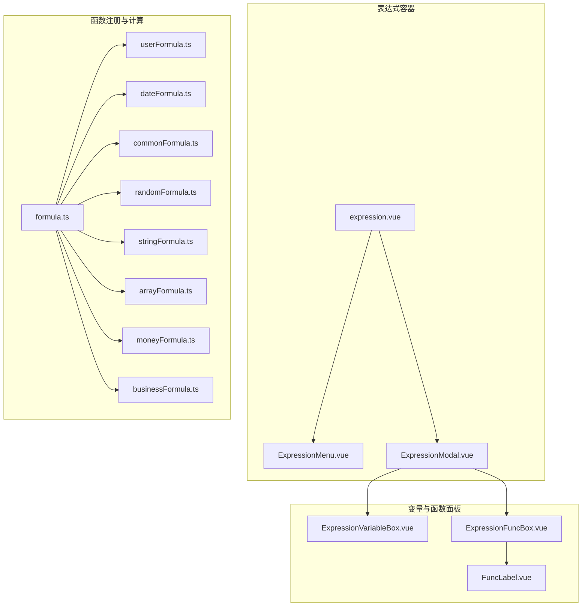
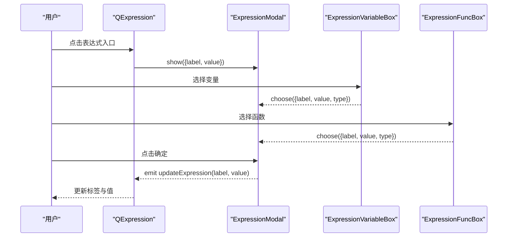
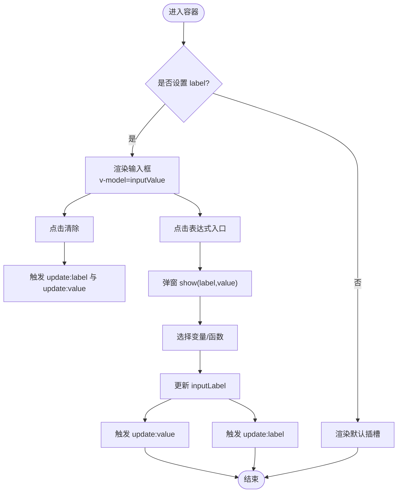
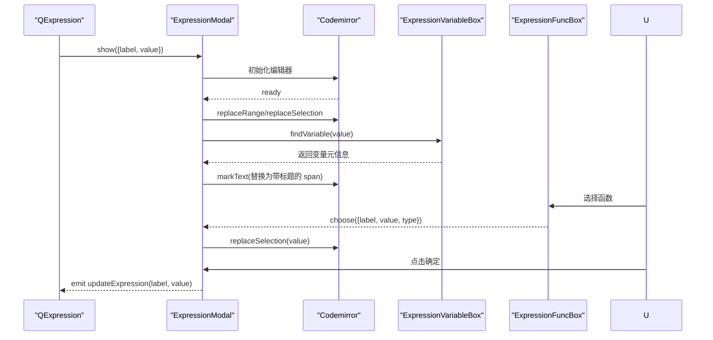
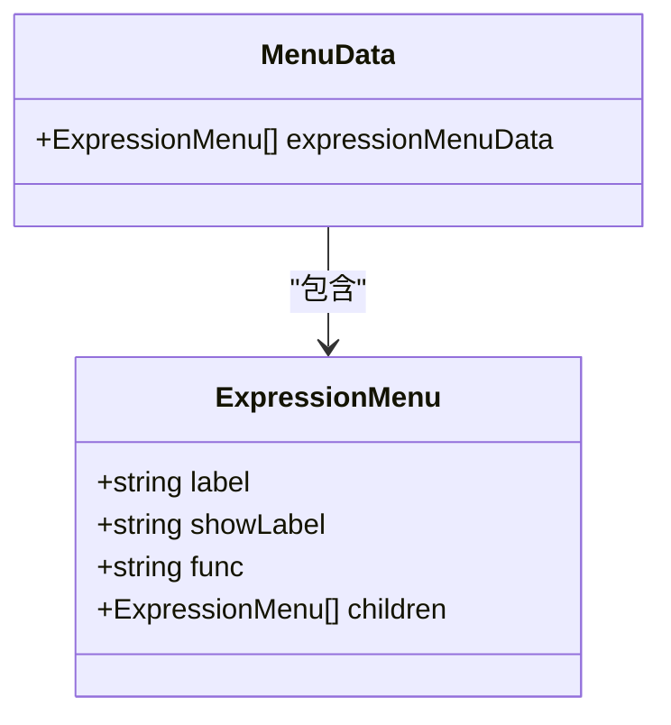
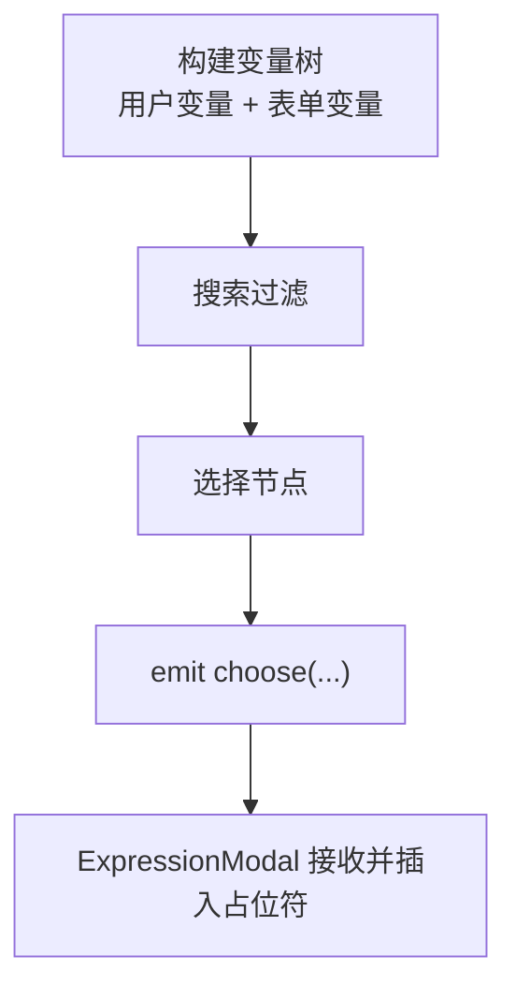
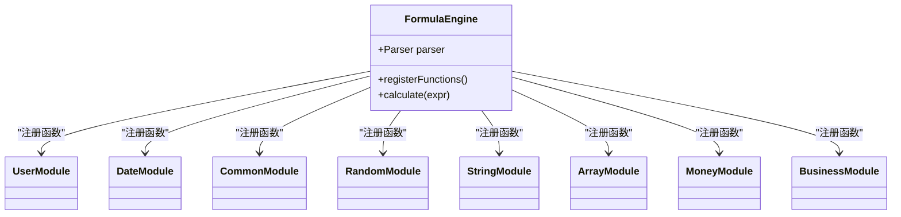
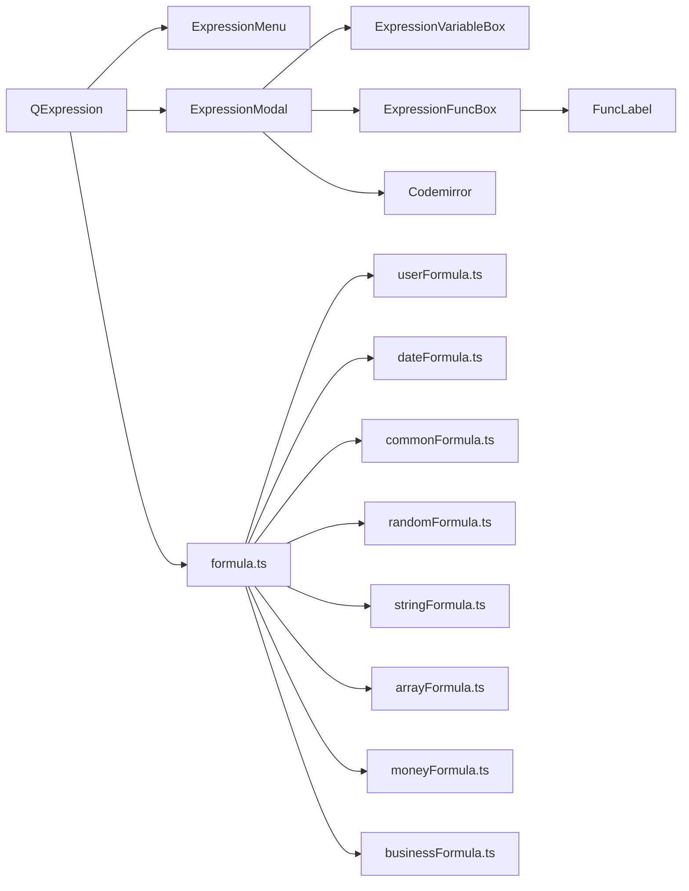

# 表达式引擎核心

<cite>
**本文引用的文件**
- [expression.vue](file://src/components/expression/expression.vue)
- [expressionMenu.ts](file://src/components/expression/expressionMenu.ts)
- [ExpressionModal.vue](file://src/components/expression/components/ExpressionModal.vue)
- [ExpressionMenu.vue](file://src/components/expression/components/ExpressionMenu.vue)
- [ExpressionVariableBox.vue](file://src/components/expression/components/ExpressionVariableBox.vue)
- [ExpressionFuncBox.vue](file://src/components/expression/components/ExpressionFuncBox.vue)
- [FuncLabel.vue](file://src/components/expression/components/FuncLabel.vue)
- [formula.ts](file://src/components/expression/formula.ts)
- [userFormula.ts](file://src/components/expression/formula/userFormula.ts)
- [dateFormula.ts](file://src/components/expression/formula/dateFormula.ts)
- [commonFormula.ts](file://src/components/expression/formula/commonFormula.ts)
- [randomFormula.ts](file://src/components/expression/formula/randomFormula.ts)
- [stringFormula.ts](file://src/components/expression/formula/stringFormula.ts)
- [arrayFormula.ts](file://src/components/expression/formula/arrayFormula.ts)
- [moneyFormula.ts](file://src/components/expression/formula/moneyFormula.ts)
- [businessFormula.ts](file://src/components/expression/formula/businessFormula.ts)
</cite>

## 目录
1. [简介](#简介)
2. [项目结构](#项目结构)
3. [核心组件](#核心组件)
4. [架构总览](#架构总览)
5. [详细组件分析](#详细组件分析)
6. [依赖关系分析](#依赖关系分析)
7. [性能考量](#性能考量)
8. [故障排查指南](#故障排查指南)
9. [结论](#结论)
10. [附录](#附录)

## 简介
本文件面向表达式引擎核心模块，系统性阐述表达式组件的架构设计、渲染机制与交互逻辑。重点覆盖以下方面：
- ExpressionModal 弹窗组件的功能实现与编辑器集成
- ExpressionMenu 下拉菜单的菜单项管理与递归渲染
- ExpressionMenu.ts 中的菜单配置逻辑
- 表达式输入框的双向绑定机制、标签显示逻辑与事件处理流程
- 表达式组件的属性配置、事件监听与插槽使用方法
- 表达式函数注册体系与计算引擎集成
- 在不同场景下的使用示例与最佳实践

## 项目结构
表达式引擎位于 src/components/expression 目录下，采用“容器组件 + 功能子组件 + 函数注册”的分层组织方式：
- 容器组件：expression.vue
- 弹窗与编辑器：ExpressionModal.vue
- 菜单与树形选择：ExpressionMenu.vue、ExpressionVariableBox.vue、ExpressionFuncBox.vue
- 函数与变量注册：formula.ts 及各领域公式模块
- 菜单配置：expressionMenu.ts

图表来源
- [expression.vue:1-131](file://src/components/expression/expression.vue#L1-L131)
- [ExpressionMenu.vue:1-45](file://src/components/expression/components/ExpressionMenu.vue#L1-L45)
- [ExpressionModal.vue:1-298](file://src/components/expression/components/ExpressionModal.vue#L1-L298)
- [ExpressionVariableBox.vue:1-171](file://src/components/expression/components/ExpressionVariableBox.vue#L1-L171)
- [ExpressionFuncBox.vue:1-108](file://src/components/expression/components/ExpressionFuncBox.vue#L1-L108)
- [FuncLabel.vue:1-51](file://src/components/expression/components/FuncLabel.vue#L1-L51)
- [formula.ts:1-96](file://src/components/expression/formula.ts#L1-L96)
- [userFormula.ts:1-411](file://src/components/expression/formula/userFormula.ts#L1-L411)
- [dateFormula.ts:1-180](file://src/components/expression/formula/dateFormula.ts#L1-L180)
- [commonFormula.ts:1-136](file://src/components/expression/formula/commonFormula.ts#L1-L136)
- [randomFormula.ts:1-58](file://src/components/expression/formula/randomFormula.ts#L1-L58)
- [stringFormula.ts:1-127](file://src/components/expression/formula/stringFormula.ts#L1-L127)
- [arrayFormula.ts:1-95](file://src/components/expression/formula/arrayFormula.ts#L1-L95)
- [moneyFormula.ts:1-189](file://src/components/expression/formula/moneyFormula.ts#L1-L189)
- [businessFormula.ts:1-52](file://src/components/expression/formula/businessFormula.ts#L1-L52)

章节来源
- [expression.vue:1-131](file://src/components/expression/expression.vue#L1-L131)
- [expressionMenu.ts:1-101](file://src/components/expression/expressionMenu.ts#L1-L101)

## 核心组件
- 表达式容器组件（QExpression）
  - 提供下拉菜单入口与标签展示区域
  - 支持默认插槽用于承载自定义输入控件
  - 内部维护双向绑定的值与标签，并通过事件向上抛出更新
- ExpressionModal 弹窗
  - 集成变量与函数面板、代码编辑器与结果回填
  - 负责表达式编辑、变量占位标记与最终值回传
- ExpressionMenu 下拉菜单
  - 递归渲染多级菜单，支持叶子节点与子菜单节点
- ExpressionVariableBox 与 ExpressionFuncBox
  - 变量树形选择与函数树形选择，支持搜索过滤
- FuncLabel 函数标签提示
  - 带描述气泡提示的函数标签展示
- 函数注册与计算引擎
  - 统一注册各类函数到表达式解析器，提供计算能力

章节来源
- [expression.vue:34-103](file://src/components/expression/expression.vue#L34-L103)
- [ExpressionModal.vue:36-192](file://src/components/expression/components/ExpressionModal.vue#L36-L192)
- [ExpressionMenu.vue:22-37](file://src/components/expression/components/ExpressionMenu.vue#L22-L37)
- [ExpressionVariableBox.vue:33-171](file://src/components/expression/components/ExpressionVariableBox.vue#L33-L171)
- [ExpressionFuncBox.vue:35-108](file://src/components/expression/components/ExpressionFuncBox.vue#L35-L108)
- [FuncLabel.vue:13-21](file://src/components/expression/components/FuncLabel.vue#L13-L21)
- [formula.ts:1-96](file://src/components/expression/formula.ts#L1-L96)

## 架构总览
表达式引擎采用“容器组件 + 子面板 + 编辑器 + 注册函数”的分层架构：
- 容器组件负责 UI 与事件编排
- 子面板负责变量/函数的选择与搜索
- 编辑器负责表达式文本编辑与占位符渲染
- 注册函数负责将业务函数注入解析器并参与计算

图表来源
- [expression.vue:78-102](file://src/components/expression/expression.vue#L78-L102)
- [ExpressionModal.vue:57-187](file://src/components/expression/components/ExpressionModal.vue#L57-L187)
- [ExpressionVariableBox.vue:107-123](file://src/components/expression/components/ExpressionVariableBox.vue#L107-L123)
- [ExpressionFuncBox.vue:69-79](file://src/components/expression/components/ExpressionFuncBox.vue#L69-L79)

## 详细组件分析

### 表达式容器组件（QExpression）
- 属性
  - label: 标签显示文本
  - value: 当前表达式值
  - custom?: 自定义开关（未在模板中直接使用）
- 插槽
  - 默认插槽：当未设置 label 时，容器会渲染默认插槽内容
- 事件
  - update:value: 表达式值变更
  - update:label: 标签文本变更
- 渲染机制
  - 若 label 存在：渲染内置输入框并绑定 inputValue
  - 若 label 不存在：渲染默认插槽
  - 标签展示：使用 a-tag 显示 inputLabel
- 交互逻辑
  - clearHandler：清空输入与标签并触发事件
  - openExpressionModal：打开弹窗并传入当前标签与值
  - chooseExpression：从下拉菜单选择变量/函数后更新标签与值
  - updateExpression：从弹窗回填标签与值

图表来源
- [expression.vue:12-26](file://src/components/expression/expression.vue#L12-L26)
- [expression.vue:71-102](file://src/components/expression/expression.vue#L71-L102)

章节来源
- [expression.vue:47-103](file://src/components/expression/expression.vue#L47-L103)

### ExpressionModal 弹窗组件
- 功能要点
  - 弹窗标题与宽度配置
  - 左侧变量区、右侧函数区与中间编辑区布局
  - Codemirror 编辑器集成，支持 JavaScript 模式与自动换行
  - 变量占位符渲染：将变量以带标题的 span 替换到编辑器中
  - 确定按钮：清理空表达式标签、回填标签与值
- 关键流程
  - show(data)：接收来自容器的初始标签与值
  - onReady：按分割规则将表达式片段与变量占位符插入编辑器
  - choose：根据选择类型插入变量占位符或函数调用
  - handleOk：校正标签与值，触发 updateExpression 事件

图表来源
- [ExpressionModal.vue:57-187](file://src/components/expression/components/ExpressionModal.vue#L57-L187)
- [ExpressionVariableBox.vue:147-164](file://src/components/expression/components/ExpressionVariableBox.vue#L147-L164)

章节来源
- [ExpressionModal.vue:45-192](file://src/components/expression/components/ExpressionModal.vue#L45-L192)

### ExpressionMenu 下拉菜单与菜单配置
- ExpressionMenu.vue
  - 递归渲染：若无 children 则渲染 a-doption；否则渲染 a-dsubmenu
  - 通过组件 is="ExpressionMenu" 实现自引用
- expressionMenu.ts
  - 定义 ExpressionMenu 接口与菜单数据结构
  - 菜单层级：用户信息、日期函数、常用工具等
  - 子菜单项包含 label、showLabel、func 等字段

图表来源
- [expressionMenu.ts:1-101](file://src/components/expression/expressionMenu.ts#L1-L101)

章节来源
- [ExpressionMenu.vue:22-37](file://src/components/expression/components/ExpressionMenu.vue#L22-L37)
- [expressionMenu.ts:8-101](file://src/components/expression/expressionMenu.ts#L8-L101)

### 变量与函数面板
- ExpressionVariableBox.vue
  - 构建变量树：用户变量 + 表单变量（仅在特定路由场景）
  - 支持搜索过滤：对树进行深度遍历匹配
  - 选择回调：emit choose({id, parentId, label, value, type})
  - 查找变量：将变量树扁平化，按 value 快速查找
- ExpressionFuncBox.vue
  - 聚合各领域函数集合：通用、日期、货币、字符串、数组、随机、业务
  - 支持搜索过滤与叶子节点选择
- FuncLabel.vue
  - 函数标签 + 气泡描述展示

图表来源
- [ExpressionVariableBox.vue:50-98](file://src/components/expression/components/ExpressionVariableBox.vue#L50-L98)
- [ExpressionVariableBox.vue:100-123](file://src/components/expression/components/ExpressionVariableBox.vue#L100-L123)
- [ExpressionFuncBox.vue:53-79](file://src/components/expression/components/ExpressionFuncBox.vue#L53-L79)

章节来源
- [ExpressionVariableBox.vue:33-171](file://src/components/expression/components/ExpressionVariableBox.vue#L33-L171)
- [ExpressionFuncBox.vue:35-108](file://src/components/expression/components/ExpressionFuncBox.vue#L35-L108)
- [FuncLabel.vue:13-21](file://src/components/expression/components/FuncLabel.vue#L13-L21)

### 函数注册与计算引擎
- formula.ts
  - 创建 Parser 实例并注册各领域函数
  - 注册表单值与子表单值读取函数
  - 提供 calculate(expression) 执行表达式并处理异常
- 各领域函数模块
  - userFormula.ts：用户相关信息函数
  - dateFormula.ts：日期时间与时间差函数
  - commonFormula.ts：通用判断与分支函数
  - randomFormula.ts：UUID/NanoID 生成
  - stringFormula.ts：字符串转换、比较、拼接、拆分
  - arrayFormula.ts：数组包含判断
  - moneyFormula.ts：金额大写、求和、平均值、字符串转数字
  - businessFormula.ts：部门负责人信息

图表来源
- [formula.ts:15-24](file://src/components/expression/formula.ts#L15-L24)
- [formula.ts:84-95](file://src/components/expression/formula.ts#L84-L95)
- [userFormula.ts:401-410](file://src/components/expression/formula/userFormula.ts#L401-L410)
- [dateFormula.ts:150-156](file://src/components/expression/formula/dateFormula.ts#L150-L156)
- [commonFormula.ts:129-135](file://src/components/expression/formula/commonFormula.ts#L129-L135)
- [randomFormula.ts:54-57](file://src/components/expression/formula/randomFormula.ts#L54-L57)
- [stringFormula.ts:121-126](file://src/components/expression/formula/stringFormula.ts#L121-L126)
- [arrayFormula.ts:66-69](file://src/components/expression/formula/arrayFormula.ts#L66-L69)
- [moneyFormula.ts:183-188](file://src/components/expression/formula/moneyFormula.ts#L183-L188)
- [businessFormula.ts:49-51](file://src/components/expression/formula/businessFormula.ts#L49-L51)

章节来源
- [formula.ts:1-96](file://src/components/expression/formula.ts#L1-L96)
- [userFormula.ts:1-411](file://src/components/expression/formula/userFormula.ts#L1-L411)
- [dateFormula.ts:1-180](file://src/components/expression/formula/dateFormula.ts#L1-L180)
- [commonFormula.ts:1-136](file://src/components/expression/formula/commonFormula.ts#L1-L136)
- [randomFormula.ts:1-58](file://src/components/expression/formula/randomFormula.ts#L1-L58)
- [stringFormula.ts:1-127](file://src/components/expression/formula/stringFormula.ts#L1-L127)
- [arrayFormula.ts:1-95](file://src/components/expression/formula/arrayFormula.ts#L1-L95)
- [moneyFormula.ts:1-189](file://src/components/expression/formula/moneyFormula.ts#L1-L189)
- [businessFormula.ts:1-52](file://src/components/expression/formula/businessFormula.ts#L1-L52)

## 依赖关系分析
- 组件耦合
  - QExpression 依赖 ExpressionMenu 与 ExpressionModal
  - ExpressionModal 依赖 ExpressionVariableBox 与 ExpressionFuncBox
  - ExpressionFuncBox 依赖 FuncLabel
- 数据流
  - 变量/函数面板通过 choose 事件向 ExpressionModal 回传数据
  - ExpressionModal 通过 updateExpression 事件向 QExpression 回传最终值
- 外部依赖
  - expr-eval 解析器
  - dayjs 时间库
  - codemirror 编辑器
  - arco-design 组件库（Dropdown、Tree、Tag、Modal 等）

图表来源
- [expression.vue:35-36](file://src/components/expression/expression.vue#L35-L36)
- [ExpressionModal.vue:37-39](file://src/components/expression/components/ExpressionModal.vue#L37-L39)
- [ExpressionFuncBox.vue:44-51](file://src/components/expression/components/ExpressionFuncBox.vue#L44-L51)
- [formula.ts:5-12](file://src/components/expression/formula.ts#L5-L12)

章节来源
- [expression.vue:35-36](file://src/components/expression/expression.vue#L35-L36)
- [ExpressionModal.vue:37-39](file://src/components/expression/components/ExpressionModal.vue#L37-L39)
- [ExpressionFuncBox.vue:44-51](file://src/components/expression/components/ExpressionFuncBox.vue#L44-L51)
- [formula.ts:5-12](file://src/components/expression/formula.ts#L5-L12)

## 性能考量
- 表达式计算
  - 使用 expr-eval 解析与求值，建议避免复杂嵌套与大量变量引用
  - 对异步函数（如用户信息、部门信息）应控制调用频率，必要时引入缓存
- 编辑器渲染
  - 变量占位符替换采用 markText，注意在长表达式中可能影响渲染性能
  - 建议限制表达式长度或分段处理
- 搜索过滤
  - 变量与函数树的搜索为深度遍历，建议在大数据量时增加节流或虚拟滚动
- 路由场景
  - 表单变量构建仅在特定路由生效，避免在无关页面产生额外开销

## 故障排查指南
- 表达式解析错误
  - 现象：计算时报错并弹出错误消息
  - 排查：检查表达式语法、变量占位符是否正确清理、函数是否已注册
  - 参考路径：[formula.ts:84-95](file://src/components/expression/formula.ts#L84-L95)
- 变量占位符未正确渲染
  - 现象：编辑器中变量未被替换为带标题的 span
  - 排查：确认 onReady 流程、splitFormulas 分割逻辑、findVariable 返回值
  - 参考路径：[ExpressionModal.vue:78-113](file://src/components/expression/components/ExpressionModal.vue#L78-L113)、[ExpressionVariableBox.vue:147-164](file://src/components/expression/components/ExpressionVariableBox.vue#L147-L164)
- 下拉菜单无法展开或选择
  - 现象：菜单无响应或子菜单不显示
  - 排查：确认 ExpressionMenu.vue 的 children 判断与递归渲染逻辑
  - 参考路径：[ExpressionMenu.vue:1-20](file://src/components/expression/components/ExpressionMenu.vue#L1-L20)
- 输入框清空后标签未更新
  - 现象：点击清除后标签仍残留
  - 排查：确认 clearHandler 的事件触发顺序与容器内标签更新
  - 参考路径：[expression.vue:71-76](file://src/components/expression/expression.vue#L71-L76)

章节来源
- [formula.ts:84-95](file://src/components/expression/formula.ts#L84-L95)
- [ExpressionModal.vue:78-113](file://src/components/expression/components/ExpressionModal.vue#L78-L113)
- [ExpressionVariableBox.vue:147-164](file://src/components/expression/components/ExpressionVariableBox.vue#L147-L164)
- [ExpressionMenu.vue:1-20](file://src/components/expression/components/ExpressionMenu.vue#L1-L20)
- [expression.vue:71-76](file://src/components/expression/expression.vue#L71-L76)

## 结论
表达式引擎通过清晰的分层设计与完善的函数注册体系，实现了从 UI 交互到表达式计算的完整闭环。容器组件负责编排，弹窗与面板负责输入，编辑器负责可视化与占位符渲染，函数模块负责能力扩展。遵循本文的最佳实践与故障排查建议，可确保在复杂业务场景中稳定、高效地使用表达式引擎。

## 附录
- 使用示例与最佳实践
  - 在表单设计器中启用表单变量构建，确保变量树完整
  - 使用 ExpressionMenu.ts 配置常用菜单项，便于快速选择
  - 对于长表达式，建议拆分并减少变量占位符数量
  - 异步函数调用需考虑网络延迟，必要时在前端做缓存与去抖
  - 通过插槽扩展自定义输入控件，保持与容器的事件同步