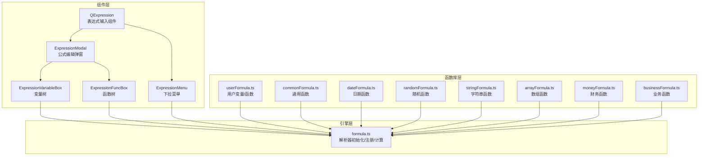
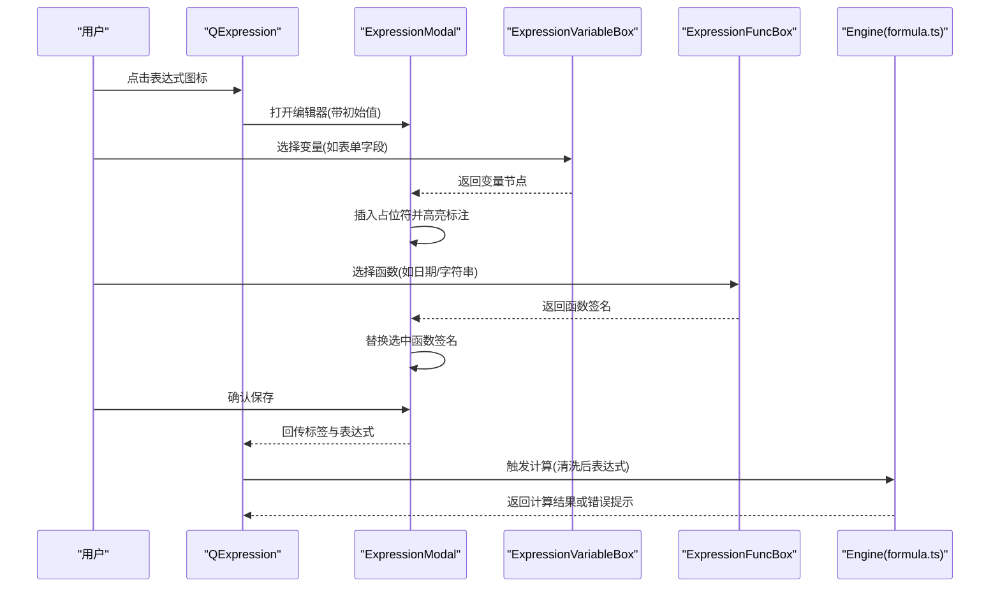
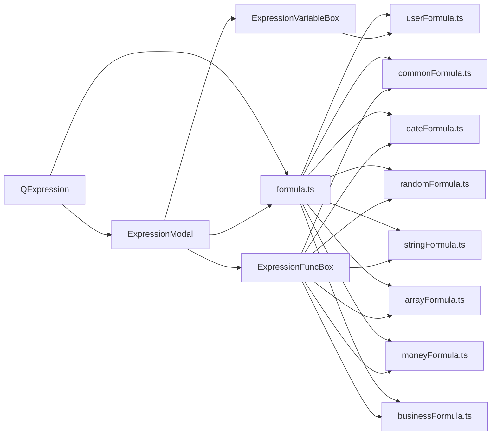

# 表达式系统

<cite>
**本文引用的文件**
- [expression.vue](file://src/components/expression/expression.vue)
- [formula.ts](file://src/components/expression/formula.ts)
- [expressionMenu.ts](file://src/components/expression/expressionMenu.ts)
- [ExpressionModal.vue](file://src/components/expression/components/ExpressionModal.vue)
- [ExpressionFuncBox.vue](file://src/components/expression/components/ExpressionFuncBox.vue)
- [ExpressionVariableBox.vue](file://src/components/expression/components/ExpressionVariableBox.vue)
- [ExpressionMenu.vue](file://src/components/expression/components/ExpressionMenu.vue)
- [userFormula.ts](file://src/components/expression/formula/userFormula.ts)
- [commonFormula.ts](file://src/components/expression/formula/commonFormula.ts)
- [dateFormula.ts](file://src/components/expression/formula/dateFormula.ts)
- [randomFormula.ts](file://src/components/expression/formula/randomFormula.ts)
- [stringFormula.ts](file://src/components/expression/formula/stringFormula.ts)
- [arrayFormula.ts](file://src/components/expression/formula/arrayFormula.ts)
- [moneyFormula.ts](file://src/components/expression/formula/moneyFormula.ts)
- [businessFormula.ts](file://src/components/expression/formula/businessFormula.ts)
</cite>

## 目录
1. [简介](#简介)
2. [项目结构](#项目结构)
3. [核心组件](#核心组件)
4. [架构总览](#架构总览)
5. [详细组件分析](#详细组件分析)
6. [依赖关系分析](#依赖关系分析)
7. [性能与优化](#性能与优化)
8. [故障排查指南](#故障排查指南)
9. [结论](#结论)
10. [附录：表达式语法与函数参考](#附录表达式语法与函数参考)

## 简介
本文件面向新工作台项目的“表达式系统”，系统性阐述表达式引擎的架构设计、公式解析机制、计算逻辑与运行时行为；详解表达式组件的使用方式、函数库分类、变量系统设计；并结合表单计算、条件显示、数据验证等典型场景，给出应用建议与最佳实践。同时提供表达式语法规则、内置函数说明、自定义函数开发流程与性能优化策略，辅以丰富的示例路径与业务场景演示，帮助开发者快速掌握表达式的使用与扩展。

## 项目结构
表达式系统位于前端组件目录下，采用“组件 + 函数库”的分层组织方式：
- 组件层：提供可视化编辑器与交互入口，负责变量/函数选择、公式编辑、标签展示与事件回调。
- 函数库层：按功能域划分若干模块，注册到表达式解析器，提供可调用的函数集合。
- 引擎层：基于第三方解析器初始化并集中注册函数，提供统一的计算入口。

图表来源
- [expression.vue:1-131](file://src/components/expression/expression.vue#L1-L131)
- [ExpressionModal.vue:1-298](file://src/components/expression/components/ExpressionModal.vue#L1-L298)
- [ExpressionVariableBox.vue:1-171](file://src/components/expression/components/ExpressionVariableBox.vue#L1-L171)
- [ExpressionFuncBox.vue:1-108](file://src/components/expression/components/ExpressionFuncBox.vue#L1-L108)
- [ExpressionMenu.vue:1-45](file://src/components/expression/components/ExpressionMenu.vue#L1-L45)
- [formula.ts:1-96](file://src/components/expression/formula.ts#L1-L96)
- [userFormula.ts:1-411](file://src/components/expression/formula/userFormula.ts#L1-L411)
- [commonFormula.ts:1-136](file://src/components/expression/formula/commonFormula.ts#L1-L136)
- [dateFormula.ts:1-180](file://src/components/expression/formula/dateFormula.ts#L1-L180)
- [randomFormula.ts:1-58](file://src/components/expression/formula/randomFormula.ts#L1-L58)
- [stringFormula.ts:1-127](file://src/components/expression/formula/stringFormula.ts#L1-L127)
- [arrayFormula.ts:1-95](file://src/components/expression/formula/arrayFormula.ts#L1-L95)
- [moneyFormula.ts:1-189](file://src/components/expression/formula/moneyFormula.ts#L1-L189)
- [businessFormula.ts:1-52](file://src/components/expression/formula/businessFormula.ts#L1-L52)

章节来源
- [expression.vue:1-131](file://src/components/expression/expression.vue#L1-L131)
- [formula.ts:1-96](file://src/components/expression/formula.ts#L1-L96)

## 核心组件
- QExpression 输入组件：提供表达式输入框、标签展示、变量/函数快捷选择入口，支持清空与更新事件。
- ExpressionModal 编辑器：左侧变量/函数树 + 中部代码编辑区，支持插入变量占位符、高亮标注、确认保存。
- ExpressionVariableBox 变量树：动态构建表单字段变量、子表单变量，支持搜索过滤与父子节点联动。
- ExpressionFuncBox 函数树：聚合各功能域函数，支持搜索过滤与函数详情提示。
- ExpressionMenu 下拉菜单：用于快速插入预置变量/函数片段。

章节来源
- [expression.vue:1-131](file://src/components/expression/expression.vue#L1-L131)
- [ExpressionModal.vue:1-298](file://src/components/expression/components/ExpressionModal.vue#L1-L298)
- [ExpressionVariableBox.vue:1-171](file://src/components/expression/components/ExpressionVariableBox.vue#L1-L171)
- [ExpressionFuncBox.vue:1-108](file://src/components/expression/components/ExpressionFuncBox.vue#L1-L108)
- [ExpressionMenu.vue:1-45](file://src/components/expression/components/ExpressionMenu.vue#L1-L45)
- [expressionMenu.ts:1-101](file://src/components/expression/expressionMenu.ts#L1-L101)

## 架构总览
表达式系统采用“组件驱动 + 解析器扩展”的双层架构：
- 组件层负责交互与数据流编排，通过事件将变量/函数片段注入编辑器，并回传最终表达式与标签。
- 引擎层基于解析器初始化，集中注册各类函数与表单访问函数，提供统一的计算入口；计算前对表达式进行清洗与去噪处理，异常时统一提示。

图表来源
- [expression.vue:78-102](file://src/components/expression/expression.vue#L78-L102)
- [ExpressionModal.vue:57-187](file://src/components/expression/components/ExpressionModal.vue#L57-L187)
- [formula.ts:84-95](file://src/components/expression/formula.ts#L84-L95)

## 详细组件分析

### 组件：QExpression（表达式输入）
- 功能要点
  - 支持标签展示与输入框切换，清空时同步清空标签与值。
  - 打开编辑器时携带当前值，便于覆盖或追加。
  - 从菜单选择变量/函数时，自动更新标签与值。
- 关键交互
  - 事件：update:value、update:label
  - 方法：openExpressionModal、updateExpression、clearHandler、chooseExpression

章节来源
- [expression.vue:50-102](file://src/components/expression/expression.vue#L50-L102)

### 组件：ExpressionModal（公式编辑器）
- 功能要点
  - 左侧变量/函数树，右侧代码编辑区，支持搜索与高亮。
  - 插入变量时以占位符形式嵌入，渲染为可悬浮提示的标签元素。
  - 确认时回传标签与表达式，若表达式为空则标签置空。
- 关键实现
  - 占位符规则：@#...@#
  - 变量占位符解析与回填：onReady 中按占位符切分并逐段替换。
  - 函数占位符直接替换，光标微调保持体验连贯。

章节来源
- [ExpressionModal.vue:57-187](file://src/components/expression/components/ExpressionModal.vue#L57-L187)

### 组件：ExpressionVariableBox（变量树）
- 功能要点
  - 当路由为表单设计页时，动态构建表单变量树，包含主表单字段与子表单字段。
  - 子表单变量通过专用函数包装，便于在表达式中一次性取值。
  - 支持搜索过滤，父子节点联动。
- 关键实现
  - 构建函数：buildFormVariable、buildSubFormVariable
  - 搜索算法：递归遍历，保留命中节点的父链
  - 查询定位：findVariable 基于扁平映射快速定位

章节来源
- [ExpressionVariableBox.vue:53-98](file://src/components/expression/components/ExpressionVariableBox.vue#L53-L98)
- [ExpressionVariableBox.vue:125-164](file://src/components/expression/components/ExpressionVariableBox.vue#L125-L164)

### 组件：ExpressionFuncBox（函数树）
- 功能要点
  - 聚合通用、日期、财务、字符串、数组、随机、业务等函数域。
  - 支持搜索过滤，点击返回函数节点，由编辑器替换为函数签名。
- 关键实现
  - 数据源：commonFunc、dateFunc、moneyFunc、stringFunc、arrayFunc、randomFunc、businessFunc
  - 搜索算法：递归过滤，保留命中节点的父链

章节来源
- [ExpressionFuncBox.vue:53-101](file://src/components/expression/components/ExpressionFuncBox.vue#L53-L101)

### 组件：ExpressionMenu（下拉菜单）
- 功能要点
  - 提供用户信息、日期函数、常用工具等快捷入口，支持多级菜单。
  - 选择后直接回填函数或变量片段。

章节来源
- [ExpressionMenu.vue:1-45](file://src/components/expression/components/ExpressionMenu.vue#L1-L45)
- [expressionMenu.ts:8-100](file://src/components/expression/expressionMenu.ts#L8-L100)

### 引擎：formula.ts（解析器与计算）
- 功能要点
  - 初始化解析器并注册各函数库。
  - 注册表单访问函数：getFormValue、getSubFormValue。
  - 计算入口：对表达式进行清洗（去除占位符标记），解析并求值，异常统一提示。
- 关键实现
  - 注册顺序：用户、日期、随机、通用、字符串、数组、财务、业务。
  - 计算流程：toRaw -> 清洗 -> parse -> evaluate -> 异常捕获

章节来源
- [formula.ts:15-24](file://src/components/expression/formula.ts#L15-L24)
- [formula.ts:27-63](file://src/components/expression/formula.ts#L27-L63)
- [formula.ts:84-95](file://src/components/expression/formula.ts#L84-L95)

### 函数库：userFormula.ts（用户变量/函数）
- 功能要点
  - 提供当前用户信息、角色、部门、职位等变量树。
  - 提供用户相关函数：getCurrentUser、getUserRole、getUserDept、getUserPost 等。
  - 支持主/兼任部门与职位的区分查询。
- 关键实现
  - 变量树：扁平化与父子链查找辅助函数
  - 注册：将函数注册到解析器

章节来源
- [userFormula.ts:114-371](file://src/components/expression/formula/userFormula.ts#L114-L371)
- [userFormula.ts:401-410](file://src/components/expression/formula/userFormula.ts#L401-L410)

### 函数库：commonFormula.ts（通用函数）
- 功能要点
  - 空值判断、布尔匹配、全满足/任意满足等逻辑控制函数。
  - 支持异步参数解析，保证条件与分支值的正确展开。

章节来源
- [commonFormula.ts:12-52](file://src/components/expression/formula/commonFormula.ts#L12-L52)
- [commonFormula.ts:129-135](file://src/components/expression/formula/commonFormula.ts#L129-L135)

### 函数库：dateFormula.ts（日期函数）
- 功能要点
  - 获取当前日期时间、日期、时间。
  - 时间差计算：支持多种单位（毫秒到年）。
  - 区间时间差：接收区间对象，自动解析起止时间。
- 关键实现
  - 日期标准化：统一解析为 Date 对象，兼容字符串与 ISO 格式。
  - 单位映射：毫秒到年的换算表。

章节来源
- [dateFormula.ts:13-71](file://src/components/expression/formula/dateFormula.ts#L13-L71)
- [dateFormula.ts:150-156](file://src/components/expression/formula/dateFormula.ts#L150-L156)
- [dateFormula.ts:158-179](file://src/components/expression/formula/dateFormula.ts#L158-L179)

### 函数库：randomFormula.ts（随机函数）
- 功能要点
  - 生成 UUID 与 NanoID，适配不同场景的唯一标识需求。

章节来源
- [randomFormula.ts:14-20](file://src/components/expression/formula/randomFormula.ts#L14-L20)
- [randomFormula.ts:54-57](file://src/components/expression/formula/randomFormula.ts#L54-L57)

### 函数库：stringFormula.ts（字符串函数）
- 功能要点
  - 类型安全的字符串转换、字符串比较、多参拼接、按分隔符拆分。
  - 对 Date、Array、Object 等进行稳健转换。

章节来源
- [stringFormula.ts:12-56](file://src/components/expression/formula/stringFormula.ts#L12-L56)
- [stringFormula.ts:20-26](file://src/components/expression/formula/stringFormula.ts#L20-L26)
- [stringFormula.ts:121-126](file://src/components/expression/formula/stringFormula.ts#L121-L126)

### 函数库：arrayFormula.ts（数组函数）
- 功能要点
  - 数组包含任一/全部元素的判断，支持多参与混合类型。
  - 内置类型归一化：字符串、类数组、对象等统一为数组。

章节来源
- [arrayFormula.ts:12-28](file://src/components/expression/formula/arrayFormula.ts#L12-L28)
- [arrayFormula.ts:71-94](file://src/components/expression/formula/arrayFormula.ts#L71-L94)

### 函数库：moneyFormula.ts（财务函数）
- 功能要点
  - 数字转中文大写金额（元/角/分），含冗余零精简。
  - 求和、平均值、字符串转数字（保留两位小数）。
- 关键实现
  - 中文大写：数字映射、单位映射、边界校验与格式化。
  - 数值处理：扁平化、NaN 容错、空数组返回 0。

章节来源
- [moneyFormula.ts:39-83](file://src/components/expression/formula/moneyFormula.ts#L39-L83)
- [moneyFormula.ts:85-121](file://src/components/expression/formula/moneyFormula.ts#L85-L121)
- [moneyFormula.ts:183-188](file://src/components/expression/formula/moneyFormula.ts#L183-L188)

### 函数库：businessFormula.ts（业务函数）
- 功能要点
  - 获取当前用户所在部门负责人信息（id/username/nickname）。

章节来源
- [businessFormula.ts:12-25](file://src/components/expression/formula/businessFormula.ts#L12-L25)
- [businessFormula.ts:49-51](file://src/components/expression/formula/businessFormula.ts#L49-L51)

## 依赖关系分析
- 组件与函数库
  - ExpressionVariableBox 依赖 userFormula 的变量树与扁平化工具。
  - ExpressionFuncBox 聚合各函数库导出的函数树。
  - ExpressionModal 在 ready 时调用 VariableBox 的查找能力回显变量占位符。
- 引擎与函数库
  - formula.ts 统一注册各函数库的 register 方法。
  - 注册表单访问函数：getFormValue、getSubFormValue。
- 组件与引擎
  - QExpression 通过 updateExpression 将最终表达式传递给引擎计算。
  - 引擎计算前进行清洗，异常统一提示。

图表来源
- [ExpressionVariableBox.vue:40-48](file://src/components/expression/components/ExpressionVariableBox.vue#L40-L48)
- [ExpressionFuncBox.vue:45-51](file://src/components/expression/components/ExpressionFuncBox.vue#L45-L51)
- [ExpressionModal.vue:77-113](file://src/components/expression/components/ExpressionModal.vue#L77-L113)
- [formula.ts:15-24](file://src/components/expression/formula.ts#L15-L24)

章节来源
- [ExpressionVariableBox.vue:40-48](file://src/components/expression/components/ExpressionVariableBox.vue#L40-L48)
- [ExpressionFuncBox.vue:45-51](file://src/components/expression/components/ExpressionFuncBox.vue#L45-L51)
- [formula.ts:15-24](file://src/components/expression/formula.ts#L15-L24)

## 性能与优化
- 表达式计算
  - 使用解析器惰性求值，避免重复计算；对复杂表达式建议拆分步骤，减少一次性解析成本。
  - 清洗阶段移除占位符标记，避免冗余字符影响解析。
- 变量/函数树
  - 搜索过滤采用递归遍历，建议在大量节点场景下增加节流与缓存策略。
  - 变量树构建仅在特定路由生效，避免不必要的 DOM 与数据构造。
- I/O 与异步
  - 用户/部门/职位等函数返回 Promise，注意在表达式中合理等待异步完成。
  - 表单访问函数 getFormValue/getSubFormValue 读取配置与值，避免频繁刷新导致的抖动。
- UI 体验
  - 编辑器中变量占位符高亮与回显，建议在 ready 后延迟一小段时间执行，确保 DOM 就绪。

[本节为通用性能建议，无需列出具体文件来源]

## 故障排查指南
- 表达式解析错误
  - 现象：计算时报错并弹出错误消息。
  - 排查：检查表达式语法、括号匹配、函数签名与参数类型；确认占位符是否正确清洗。
- 变量未找到
  - 现象：插入变量后无法解析。
  - 排查：确认当前路由是否为表单设计页；确认表单配置是否存在对应字段；检查 getSubFormValue 的子表单 ID 与字段 ID。
- 异步函数未完成
  - 现象：返回 Promise 对象而非期望值。
  - 排查：确保在表达式中使用 await 语义（解析器已对异步参数进行等待）；避免在 UI 层直接打印 Promise。
- 日期/时间解析失败
  - 现象：时间差计算返回空串。
  - 排查：确认传入时间格式为 Date 对象或可解析字符串；避免非法日期导致 NaN。

章节来源
- [formula.ts:84-95](file://src/components/expression/formula.ts#L84-L95)
- [dateFormula.ts:158-179](file://src/components/expression/formula/dateFormula.ts#L158-L179)

## 结论
表达式系统通过清晰的组件-引擎分层、完善的函数库体系与灵活的变量树构建，实现了“所见即所得”的公式编辑体验。其在表单计算、条件显示与数据验证等场景具备良好扩展性。建议在实际业务中遵循“先变量后函数”的组合策略，配合占位符高亮与搜索过滤，提升表达式编写效率与可维护性。

[本节为总结性内容，无需列出具体文件来源]

## 附录：表达式语法与函数参考

### 表达式语法规则
- 占位符
  - 变量占位符：@#变量值@#
  - 插入变量时由编辑器自动包裹，支持回显与高亮
- 表达式清洗
  - 计算前会移除占位符标记，确保解析器正常识别
- 函数调用
  - 严格遵循函数签名，参数类型与数量需与函数定义一致
- 异步参数
  - 函数参数可为 Promise，解析器内部会等待其完成后再进入计算

章节来源
- [ExpressionModal.vue:82-112](file://src/components/expression/components/ExpressionModal.vue#L82-L112)
- [formula.ts:84-95](file://src/components/expression/formula.ts#L84-L95)

### 内置函数一览（按功能域）
- 用户与组织
  - getCurrentUser(attribute)：获取当前用户属性（id、nickname、username、email、phone、sex）
  - getUserRole(attribute)：获取当前用户角色（id、name）
  - getUserDept(attribute) / getUserMainDept / getUserPartDept：获取部门（id、name）
  - getUserPost / getUserMainPost / getUserPartPost：获取职位（id、name）
  - getUserDeptLeader(attribute)：获取部门负责人（id、username、nickname）

章节来源
- [userFormula.ts:19-44](file://src/components/expression/formula/userFormula.ts#L19-L44)
- [userFormula.ts:52-88](file://src/components/expression/formula/userFormula.ts#L52-L88)
- [businessFormula.ts:12-25](file://src/components/expression/formula/businessFormula.ts#L12-L25)

- 日期与时间
  - getDatetime(format?)：当前日期时间，默认格式可定制
  - getDate()：当前日期
  - getTime()：当前时间
  - getTimeDiff(start, end, unit)：时间差（单位：ms/s/min/h/d/w/m/y）
  - getIntervalTimeDiff(interval, unit)：区间时间差

章节来源
- [dateFormula.ts:13-71](file://src/components/expression/formula/dateFormula.ts#L13-L71)
- [dateFormula.ts:150-156](file://src/components/expression/formula/dateFormula.ts#L150-L156)

- 通用逻辑
  - isNull(arg) / isNotNull(arg)：空值判断
  - match(condition, trueVal, falseVal)：条件匹配返回
  - matchAll(...conditions) / matchAny(...conditions)：全满足/任意满足

章节来源
- [commonFormula.ts:12-52](file://src/components/expression/formula/commonFormula.ts#L12-L52)

- 字符串处理
  - toStr(arg)：类型安全转换为字符串
  - eqStr(a, b)：字符串比较
  - concat(a, b, ...)：多参拼接
  - splitStr(str, sep)：按分隔符拆分

章节来源
- [stringFormula.ts:12-56](file://src/components/expression/formula/stringFormula.ts#L12-L56)

- 数组处理
  - includeAny(arr, targets)：包含任一
  - includeAll(arr, targets)：包含全部

章节来源
- [arrayFormula.ts:12-28](file://src/components/expression/formula/arrayFormula.ts#L12-L28)

- 财务计算
  - toChinese(number)：数字转中文大写（元/角/分）
  - sum(...numbers)：求和（支持多参与数组）
  - avg(...numbers)：平均值（支持多参与数组）
  - toNumber(str)：字符串转数字（保留两位小数）

章节来源
- [moneyFormula.ts:39-121](file://src/components/expression/formula/moneyFormula.ts#L39-L121)

- 随机与工具
  - generateUuid()：UUID
  - generateNanoid(size?)：NanoID

章节来源
- [randomFormula.ts:14-20](file://src/components/expression/formula/randomFormula.ts#L14-L20)

### 自定义函数开发流程
- 设计函数签名
  - 明确参数类型与返回值，必要时支持异步返回
- 实现函数体
  - 使用 await 处理异步参数，确保健壮性
- 导出函数树
  - 在对应函数库中导出函数树结构，包含 label/value/type/desc 等
- 注册到解析器
  - 在对应函数库的 register 中将函数注册到解析器
- 在引擎中启用
  - 在 formula.ts 中引入并调用对应函数库的 register

章节来源
- [commonFormula.ts:129-135](file://src/components/expression/formula/commonFormula.ts#L129-L135)
- [dateFormula.ts:150-156](file://src/components/expression/formula/dateFormula.ts#L150-L156)
- [randomFormula.ts:54-57](file://src/components/expression/formula/randomFormula.ts#L54-L57)
- [stringFormula.ts:121-126](file://src/components/expression/formula/stringFormula.ts#L121-L126)
- [arrayFormula.ts:66-69](file://src/components/expression/formula/arrayFormula.ts#L66-L69)
- [moneyFormula.ts:183-188](file://src/components/expression/formula/moneyFormula.ts#L183-L188)
- [businessFormula.ts:49-51](file://src/components/expression/formula/businessFormula.ts#L49-L51)
- [formula.ts:15-24](file://src/components/expression/formula.ts#L15-L24)

### 应用场景示例（路径指引）
- 表单计算
  - 使用 sum/avg 进行数值汇总与平均值计算；使用 toChinese 输出大写金额
  - 示例路径：[moneyFormula.ts:85-121](file://src/components/expression/formula/moneyFormula.ts#L85-L121)
- 条件显示
  - 使用 match/isNull/isNotNull 控制字段可见性；使用 matchAll/matchAny 组合多条件
  - 示例路径：[commonFormula.ts:12-52](file://src/components/expression/formula/commonFormula.ts#L12-L52)
- 数据验证
  - 使用 isNull/isNotNull 与字符串/数组函数进行基础校验；结合日期函数进行时间范围校验
  - 示例路径：[stringFormula.ts:12-56](file://src/components/expression/formula/stringFormula.ts#L12-L56)、[arrayFormula.ts:12-28](file://src/components/expression/formula/arrayFormula.ts#L12-L28)、[dateFormula.ts:13-71](file://src/components/expression/formula/dateFormula.ts#L13-L71)
- 变量系统
  - 在表单设计页通过 ExpressionVariableBox 动态构建字段变量；在表达式中使用 getFormValue/getSubFormValue 读取值
  - 示例路径：[ExpressionVariableBox.vue:53-98](file://src/components/expression/components/ExpressionVariableBox.vue#L53-L98)、[formula.ts:27-63](file://src/components/expression/formula.ts#L27-L63)