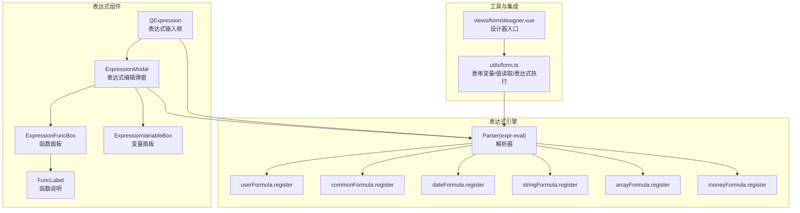
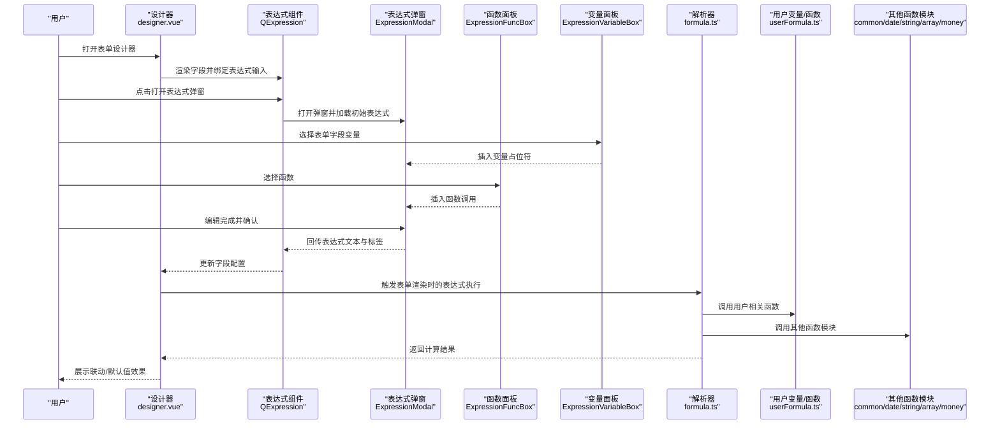
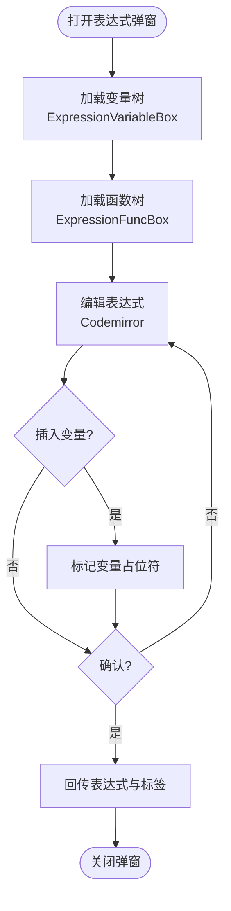
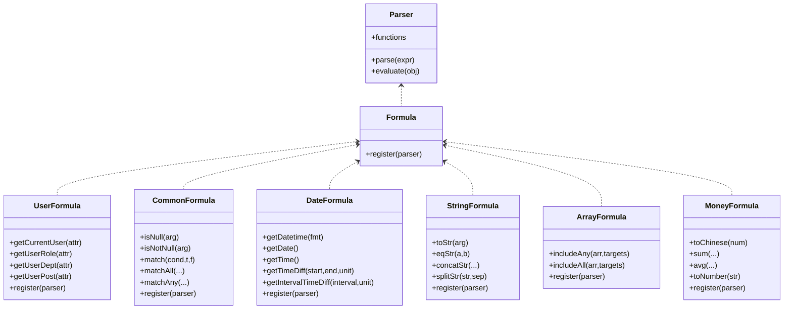
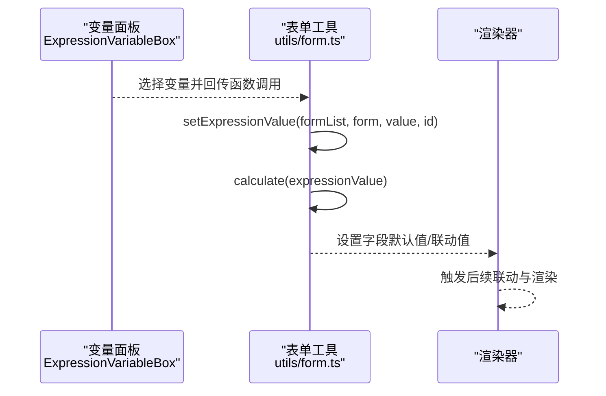
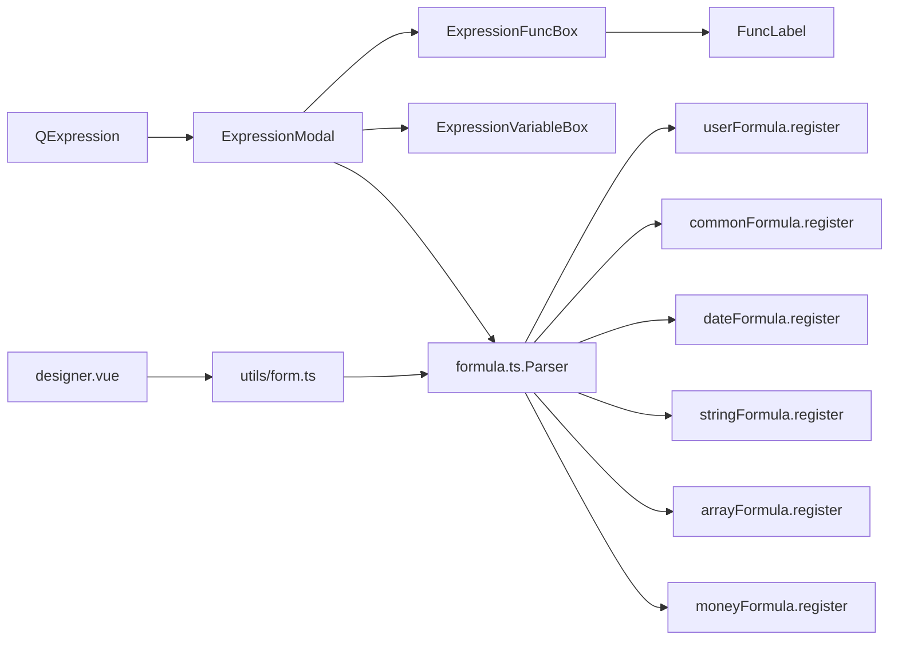

# 表达式集成应用

<cite>
**本文引用的文件**
- [expression.vue](file://src/components/expression/expression.vue)
- [formula.ts](file://src/components/expression/formula.ts)
- [expressionMenu.ts](file://src/components/expression/expressionMenu.ts)
- [ExpressionModal.vue](file://src/components/expression/components/ExpressionModal.vue)
- [ExpressionFuncBox.vue](file://src/components/expression/components/ExpressionFuncBox.vue)
- [ExpressionVariableBox.vue](file://src/components/expression/components/ExpressionVariableBox.vue)
- [FuncLabel.vue](file://src/components/expression/components/FuncLabel.vue)
- [userFormula.ts](file://src/components/expression/formula/userFormula.ts)
- [commonFormula.ts](file://src/components/expression/formula/commonFormula.ts)
- [dateFormula.ts](file://src/components/expression/formula/dateFormula.ts)
- [stringFormula.ts](file://src/components/expression/formula/stringFormula.ts)
- [arrayFormula.ts](file://src/components/expression/formula/arrayFormula.ts)
- [moneyFormula.ts](file://src/components/expression/formula/moneyFormula.ts)
- [form.ts](file://src/utils/form.ts)
- [designer.vue](file://src/views/form/designer.vue)
</cite>

## 目录
1. [简介](#简介)
2. [项目结构](#项目结构)
3. [核心组件](#核心组件)
4. [架构总览](#架构总览)
5. [详细组件分析](#详细组件分析)
6. [依赖关系分析](#依赖关系分析)
7. [性能考量](#性能考量)
8. [故障排查指南](#故障排查指南)
9. [结论](#结论)
10. [附录](#附录)

## 简介
本文件面向“表达式集成应用”的落地实践，围绕表单逻辑中的表达式集成展开，覆盖以下主题：
- 表达式在表单设计器中的集成方式与交互体验
- 条件显示、字段联动、字段计算、数据验证等典型场景
- 表达式在表单渲染过程中的执行时机、计算优先级与缓存策略
- 不同表单场景下的使用模式、性能优化技巧与常见问题解决
- 提供可直接参考的表达式集成示例路径，帮助快速落地

## 项目结构
表达式能力由“表达式组件 + 表达式引擎 + 函数注册 + 变量构建 + 渲染与校验集成”构成，核心目录如下：
- 组件层：表达式输入框、函数面板、变量面板、函数说明气泡
- 引擎层：基于 expr-eval 的表达式解析器与函数注册
- 工具层：表单变量构建、表单值读取、表达式计算与执行
- 集成层：表单设计器与表单渲染流程中的表达式触发点

图表来源
- [expression.vue:1-131](file://src/components/expression/expression.vue#L1-L131)
- [ExpressionModal.vue:1-298](file://src/components/expression/components/ExpressionModal.vue#L1-L298)
- [ExpressionFuncBox.vue:1-108](file://src/components/expression/components/ExpressionFuncBox.vue#L1-L108)
- [ExpressionVariableBox.vue:1-171](file://src/components/expression/components/ExpressionVariableBox.vue#L1-L171)
- [FuncLabel.vue:1-51](file://src/components/expression/components/FuncLabel.vue#L1-L51)
- [formula.ts:1-96](file://src/components/expression/formula.ts#L1-L96)
- [userFormula.ts:1-411](file://src/components/expression/formula/userFormula.ts#L1-L411)
- [commonFormula.ts:1-136](file://src/components/expression/formula/commonFormula.ts#L1-L136)
- [dateFormula.ts:1-180](file://src/components/expression/formula/dateFormula.ts#L1-L180)
- [stringFormula.ts:1-127](file://src/components/expression/formula/stringFormula.ts#L1-L127)
- [arrayFormula.ts:1-95](file://src/components/expression/formula/arrayFormula.ts#L1-L95)
- [moneyFormula.ts:1-189](file://src/components/expression/formula/moneyFormula.ts#L1-L189)
- [form.ts:723-734](file://src/utils/form.ts#L723-L734)
- [designer.vue:75-81](file://src/views/form/designer.vue#L75-L81)

章节来源
- [expression.vue:1-131](file://src/components/expression/expression.vue#L1-L131)
- [formula.ts:1-96](file://src/components/expression/formula.ts#L1-L96)
- [ExpressionModal.vue:1-298](file://src/components/expression/components/ExpressionModal.vue#L1-L298)
- [ExpressionFuncBox.vue:1-108](file://src/components/expression/components/ExpressionFuncBox.vue#L1-L108)
- [ExpressionVariableBox.vue:1-171](file://src/components/expression/components/ExpressionVariableBox.vue#L1-L171)
- [FuncLabel.vue:1-51](file://src/components/expression/components/FuncLabel.vue#L1-L51)
- [userFormula.ts:1-411](file://src/components/expression/formula/userFormula.ts#L1-L411)
- [commonFormula.ts:1-136](file://src/components/expression/formula/commonFormula.ts#L1-L136)
- [dateFormula.ts:1-180](file://src/components/expression/formula/dateFormula.ts#L1-L180)
- [stringFormula.ts:1-127](file://src/components/expression/formula/stringFormula.ts#L1-L127)
- [arrayFormula.ts:1-95](file://src/components/expression/formula/arrayFormula.ts#L1-L95)
- [moneyFormula.ts:1-189](file://src/components/expression/formula/moneyFormula.ts#L1-L189)
- [form.ts:723-734](file://src/utils/form.ts#L723-L734)
- [designer.vue:75-81](file://src/views/form/designer.vue#L75-L81)

## 核心组件
- 表达式输入框（QExpression）
  - 提供标签展示、清空、打开表达式弹窗、选择内置变量/函数的能力
  - 支持通过事件向外抛出更新后的表达式值与标签
- 表达式编辑弹窗（ExpressionModal）
  - 左侧变量区、右侧函数区与中间编辑区，支持变量占位符插入与高亮
  - 编辑完成后回传表达式文本与标签
- 函数面板（ExpressionFuncBox）与变量面板（ExpressionVariableBox）
  - 搜索过滤、树形选择、节点点击回调
- 函数说明（FuncLabel）
  - 气泡展示函数描述、用法、参数、返回与示例
- 表达式引擎（formula.ts）
  - 初始化解析器、注册各类函数、暴露 calculate 接口
- 用户变量与函数（userFormula.ts）
  - 构建“当前用户/角色/部门/职位”等变量树，注册用户相关函数
- 公共函数（commonFormula.ts）、日期函数（dateFormula.ts）、字符串函数（stringFormula.ts）、数组函数（arrayFormula.ts）、财务函数（moneyFormula.ts）
  - 各类通用函数注册与文档化描述
- 表单工具（form.ts）
  - 在表单渲染阶段按需执行表达式，设置默认值与联动值
- 设计器集成（designer.vue）
  - 设计器初始化默认值、保存与下一步流程中调用表达式能力

章节来源
- [expression.vue:47-103](file://src/components/expression/expression.vue#L47-L103)
- [ExpressionModal.vue:45-187](file://src/components/expression/components/ExpressionModal.vue#L45-L187)
- [ExpressionFuncBox.vue:40-107](file://src/components/expression/components/ExpressionFuncBox.vue#L40-L107)
- [ExpressionVariableBox.vue:38-170](file://src/components/expression/components/ExpressionVariableBox.vue#L38-L170)
- [FuncLabel.vue:13-21](file://src/components/expression/components/FuncLabel.vue#L13-L21)
- [formula.ts:1-96](file://src/components/expression/formula.ts#L1-L96)
- [userFormula.ts:114-411](file://src/components/expression/formula/userFormula.ts#L114-L411)
- [commonFormula.ts:54-135](file://src/components/expression/formula/commonFormula.ts#L54-L135)
- [dateFormula.ts:73-156](file://src/components/expression/formula/dateFormula.ts#L73-L156)
- [stringFormula.ts:58-126](file://src/components/expression/formula/stringFormula.ts#L58-L126)
- [arrayFormula.ts:30-69](file://src/components/expression/formula/arrayFormula.ts#L30-L69)
- [moneyFormula.ts:123-188](file://src/components/expression/formula/moneyFormula.ts#L123-L188)
- [form.ts:723-734](file://src/utils/form.ts#L723-L734)
- [designer.vue:75-81](file://src/views/form/designer.vue#L75-L81)

## 架构总览
表达式系统以“可视化编辑 + 解析执行 + 表单联动”为核心闭环：
- 设计期：在设计器中通过 QExpression 打开 ExpressionModal，选择变量/函数，编写表达式
- 运行期：在表单渲染时，按字段配置触发表达式计算，设置默认值或联动值
- 扩展性：通过注册函数扩展表达式能力；通过变量构建将表单字段映射为表达式可用变量

图表来源
- [designer.vue:75-81](file://src/views/form/designer.vue#L75-L81)
- [expression.vue:78-102](file://src/components/expression/expression.vue#L78-L102)
- [ExpressionModal.vue:57-187](file://src/components/expression/components/ExpressionModal.vue#L57-L187)
- [ExpressionFuncBox.vue:69-79](file://src/components/expression/components/ExpressionFuncBox.vue#L69-L79)
- [ExpressionVariableBox.vue:107-123](file://src/components/expression/components/ExpressionVariableBox.vue#L107-L123)
- [formula.ts:84-95](file://src/components/expression/formula.ts#L84-L95)
- [userFormula.ts:401-410](file://src/components/expression/formula/userFormula.ts#L401-L410)
- [commonFormula.ts:129-135](file://src/components/expression/formula/commonFormula.ts#L129-L135)
- [dateFormula.ts:150-156](file://src/components/expression/formula/dateFormula.ts#L150-L156)
- [stringFormula.ts:121-126](file://src/components/expression/formula/stringFormula.ts#L121-L126)
- [arrayFormula.ts:66-69](file://src/components/expression/formula/arrayFormula.ts#L66-L69)
- [moneyFormula.ts:183-188](file://src/components/expression/formula/moneyFormula.ts#L183-L188)

## 详细组件分析

### 表达式输入与弹窗（QExpression 与 ExpressionModal）
- QExpression
  - 负责展示标签、绑定输入框、清空与打开弹窗
  - 选择内置变量/函数时，自动更新标签与表达式值
- ExpressionModal
  - 变量区：根据路由上下文动态构建表单变量树，支持子表单字段
  - 函数区：聚合公共、日期、字符串、数组、财务等函数，支持搜索
  - 编辑区：Codemirror 编辑器，支持变量占位符高亮与插入
  - 确认后回传表达式文本与标签，供上层组件更新

图表来源
- [ExpressionVariableBox.vue:50-98](file://src/components/expression/components/ExpressionVariableBox.vue#L50-L98)
- [ExpressionFuncBox.vue:53-101](file://src/components/expression/components/ExpressionFuncBox.vue#L53-L101)
- [ExpressionModal.vue:77-187](file://src/components/expression/components/ExpressionModal.vue#L77-L187)
- [expression.vue:86-102](file://src/components/expression/expression.vue#L86-L102)

章节来源
- [expression.vue:47-103](file://src/components/expression/expression.vue#L47-L103)
- [ExpressionModal.vue:45-187](file://src/components/expression/components/ExpressionModal.vue#L45-L187)
- [ExpressionFuncBox.vue:40-107](file://src/components/expression/components/ExpressionFuncBox.vue#L40-L107)
- [ExpressionVariableBox.vue:38-170](file://src/components/expression/components/ExpressionVariableBox.vue#L38-L170)

### 表达式引擎与函数注册（formula.ts 与各函数模块）
- 初始化解析器并注册函数
- 提供 calculate 接口，去除特殊占位符后解析并执行表达式
- 注册用户变量与函数、日期、字符串、数组、财务、通用等函数

图表来源
- [formula.ts:1-96](file://src/components/expression/formula.ts#L1-L96)
- [userFormula.ts:401-410](file://src/components/expression/formula/userFormula.ts#L401-L410)
- [commonFormula.ts:129-135](file://src/components/expression/formula/commonFormula.ts#L129-L135)
- [dateFormula.ts:150-156](file://src/components/expression/formula/dateFormula.ts#L150-L156)
- [stringFormula.ts:121-126](file://src/components/expression/formula/stringFormula.ts#L121-L126)
- [arrayFormula.ts:66-69](file://src/components/expression/formula/arrayFormula.ts#L66-L69)
- [moneyFormula.ts:183-188](file://src/components/expression/formula/moneyFormula.ts#L183-L188)

章节来源
- [formula.ts:1-96](file://src/components/expression/formula.ts#L1-L96)
- [userFormula.ts:1-411](file://src/components/expression/formula/userFormula.ts#L1-L411)
- [commonFormula.ts:1-136](file://src/components/expression/formula/commonFormula.ts#L1-L136)
- [dateFormula.ts:1-180](file://src/components/expression/formula/dateFormula.ts#L1-L180)
- [stringFormula.ts:1-127](file://src/components/expression/formula/stringFormula.ts#L1-L127)
- [arrayFormula.ts:1-95](file://src/components/expression/formula/arrayFormula.ts#L1-L95)
- [moneyFormula.ts:1-189](file://src/components/expression/formula/moneyFormula.ts#L1-L189)

### 表单变量构建与值读取（ExpressionVariableBox 与 form.ts）
- ExpressionVariableBox
  - 基于当前路由与表单配置，构建“表单变量树”，支持主表单与子表单字段
  - 支持搜索过滤与节点选择，回传变量值（函数调用形式）
- form.ts
  - 在表单渲染阶段，当字段类型为“函数”时，执行表达式计算并设置默认值
  - 将计算结果写入表单值，驱动后续联动与渲染

图表来源
- [ExpressionVariableBox.vue:50-98](file://src/components/expression/components/ExpressionVariableBox.vue#L50-L98)
- [form.ts:723-734](file://src/utils/form.ts#L723-L734)

章节来源
- [ExpressionVariableBox.vue:38-170](file://src/components/expression/components/ExpressionVariableBox.vue#L38-L170)
- [form.ts:723-734](file://src/utils/form.ts#L723-L734)

### 表达式菜单与内置变量（expressionMenu.ts 与 userFormula.ts）
- expressionMenu.ts
  - 定义“当前用户/角色/部门/职位”等菜单项，支持多级展开
- userFormula.ts
  - 构建用户变量树，注册用户相关函数（如 getCurrentUser/getUserRole/getUserDept/getUserPost 等）

章节来源
- [expressionMenu.ts:1-101](file://src/components/expression/expressionMenu.ts#L1-L101)
- [userFormula.ts:114-371](file://src/components/expression/formula/userFormula.ts#L114-L371)

## 依赖关系分析
- 组件依赖
  - QExpression 依赖 ExpressionModal、ExpressionFuncBox、ExpressionVariableBox
  - ExpressionModal 依赖 FuncLabel 展示函数说明
- 引擎依赖
  - formula.ts 统一注册各函数模块
  - userFormula.ts 依赖用户 API 获取用户信息
- 工具与集成
  - form.ts 在渲染阶段调用 calculate 执行表达式
  - designer.vue 在初始化与保存流程中使用表达式能力

图表来源
- [expression.vue:35-41](file://src/components/expression/expression.vue#L35-L41)
- [ExpressionModal.vue:36-42](file://src/components/expression/components/ExpressionModal.vue#L36-L42)
- [ExpressionFuncBox.vue:40-51](file://src/components/expression/components/ExpressionFuncBox.vue#L40-L51)
- [ExpressionVariableBox.vue:40-48](file://src/components/expression/components/ExpressionVariableBox.vue#L40-L48)
- [FuncLabel.vue:13-20](file://src/components/expression/components/FuncLabel.vue#L13-L20)
- [formula.ts:5-24](file://src/components/expression/formula.ts#L5-L24)
- [userFormula.ts:401-410](file://src/components/expression/formula/userFormula.ts#L401-L410)
- [commonFormula.ts:129-135](file://src/components/expression/formula/commonFormula.ts#L129-L135)
- [dateFormula.ts:150-156](file://src/components/expression/formula/dateFormula.ts#L150-L156)
- [stringFormula.ts:121-126](file://src/components/expression/formula/stringFormula.ts#L121-L126)
- [arrayFormula.ts:66-69](file://src/components/expression/formula/arrayFormula.ts#L66-L69)
- [moneyFormula.ts:183-188](file://src/components/expression/formula/moneyFormula.ts#L183-L188)
- [form.ts:723-734](file://src/utils/form.ts#L723-L734)
- [designer.vue:75-81](file://src/views/form/designer.vue#L75-L81)

章节来源
- [expression.vue:35-41](file://src/components/expression/expression.vue#L35-L41)
- [formula.ts:5-24](file://src/components/expression/formula.ts#L5-L24)
- [userFormula.ts:401-410](file://src/components/expression/formula/userFormula.ts#L401-L410)
- [commonFormula.ts:129-135](file://src/components/expression/formula/commonFormula.ts#L129-L135)
- [dateFormula.ts:150-156](file://src/components/expression/formula/dateFormula.ts#L150-L156)
- [stringFormula.ts:121-126](file://src/components/expression/formula/stringFormula.ts#L121-L126)
- [arrayFormula.ts:66-69](file://src/components/expression/formula/arrayFormula.ts#L66-L69)
- [moneyFormula.ts:183-188](file://src/components/expression/formula/moneyFormula.ts#L183-L188)
- [form.ts:723-734](file://src/utils/form.ts#L723-L734)
- [designer.vue:75-81](file://src/views/form/designer.vue#L75-L81)

## 性能考量
- 表达式计算
  - 使用 expr-eval 进行解析与求值，建议避免在高频联动中使用复杂表达式或大量异步函数
  - 对于用户相关函数（如获取部门/角色），注意其可能返回 Promise，应确保在渲染前完成
- 变量构建
  - 表单变量树构建仅在特定路由（如表单设计页）进行，避免在普通表单渲染时重复构建
- 渲染触发
  - 表达式执行时机集中在“函数”类型的字段渲染阶段，避免在每次输入时重复计算
- 缓存策略
  - 当前实现未见显式缓存；可在业务层对热点表达式结果进行缓存，减少重复计算
- UI 交互
  - ExpressionModal 中的变量占位符高亮与插入采用 DOM 操作，建议在大表达式中谨慎使用，避免频繁重绘

[本节为通用性能建议，不直接分析具体文件]

## 故障排查指南
- 表达式解析错误
  - 现象：表达式解析报错并弹出错误消息
  - 排查：检查表达式语法、函数是否存在、变量占位符是否正确
  - 参考位置：[formula.ts:84-95](file://src/components/expression/formula.ts#L84-L95)
- 变量不可用或为空
  - 现象：表达式中引用的变量无法解析
  - 排查：确认当前路由是否为表单设计页；确认表单配置是否存在对应字段；确认变量值是否为函数调用形式
  - 参考位置：[ExpressionVariableBox.vue:50-98](file://src/components/expression/components/ExpressionVariableBox.vue#L50-L98)
- 用户信息获取异常
  - 现象：用户相关函数返回空或报错
  - 排查：确认本地存储中用户信息是否存在；确认用户 API 返回结构
  - 参考位置：[userFormula.ts:19-44](file://src/components/expression/formula/userFormula.ts#L19-L44)
- 表单渲染未生效
  - 现象：表达式计算结果未写入表单值
  - 排查：确认字段类型为“函数”；确认 setExpressionValue 流程是否被调用
  - 参考位置：[form.ts:723-734](file://src/utils/form.ts#L723-L734)

章节来源
- [formula.ts:84-95](file://src/components/expression/formula.ts#L84-L95)
- [ExpressionVariableBox.vue:50-98](file://src/components/expression/components/ExpressionVariableBox.vue#L50-L98)
- [userFormula.ts:19-44](file://src/components/expression/formula/userFormula.ts#L19-L44)
- [form.ts:723-734](file://src/utils/form.ts#L723-L734)

## 结论
表达式系统通过“可视化编辑 + 强大函数库 + 表单集成”的方式，实现了在表单设计器与运行期的灵活表达式能力。开发者可通过变量与函数面板快速组合表达式，并在表单渲染阶段按需执行，实现条件显示、字段联动、默认值计算与动态配置等场景。建议在复杂表达式与高频联动场景下关注性能与缓存策略，确保用户体验与稳定性。

[本节为总结性内容，不直接分析具体文件]

## 附录

### 表达式使用模式与示例（路径指引）
- 条件显示
  - 在字段属性中配置表达式，渲染时根据表达式结果控制字段可见性
  - 示例路径：[ExpressionModal.vue:176-187](file://src/components/expression/components/ExpressionModal.vue#L176-L187)
- 字段联动
  - 使用 getFormValue/getSubFormValue 获取其他字段值，结合公共/日期/字符串/数组/财务函数进行计算
  - 示例路径：[formula.ts:27-63](file://src/components/expression/formula.ts#L27-L63)
- 字段计算
  - 使用财务函数 sum/avg/toChinese，字符串函数 concat/split，数组函数 includeAny/includeAll 等
  - 示例路径：[moneyFormula.ts:85-106](file://src/components/expression/formula/moneyFormula.ts#L85-L106)、[stringFormula.ts:45-56](file://src/components/expression/formula/stringFormula.ts#L45-L56)、[arrayFormula.ts:12-28](file://src/components/expression/formula/arrayFormula.ts#L12-L28)
- 数据验证
  - 使用公共函数 isNull/isNotNull/match/matchAll/matchAny 进行条件判断
  - 示例路径：[commonFormula.ts:12-52](file://src/components/expression/formula/commonFormula.ts#L12-L52)
- 动态配置
  - 在表单设计页通过 QExpression 打开 ExpressionModal，选择变量与函数，生成表达式并保存
  - 示例路径：[expression.vue:86-102](file://src/components/expression/expression.vue#L86-L102)、[ExpressionModal.vue:115-139](file://src/components/expression/components/ExpressionModal.vue#L115-L139)

### 表达式执行时机与优先级
- 执行时机
  - 设计器初始化默认值时：[designer.vue:89-89](file://src/views/form/designer.vue#L89-L89)
  - 表单渲染阶段：当字段类型为“函数”时执行表达式并设置默认值：[form.ts:723-734](file://src/utils/form.ts#L723-L734)
- 计算优先级
  - 表达式解析优先级由 expr-eval 决定；建议在表达式中明确括号与函数调用顺序
- 缓存策略
  - 当前未见显式缓存；建议在业务层对热点表达式结果进行缓存，减少重复计算

章节来源
- [designer.vue:89-89](file://src/views/form/designer.vue#L89-L89)
- [form.ts:723-734](file://src/utils/form.ts#L723-L734)
- [expression.vue:86-102](file://src/components/expression/expression.vue#L86-L102)
- [ExpressionModal.vue:115-139](file://src/components/expression/components/ExpressionModal.vue#L115-L139)