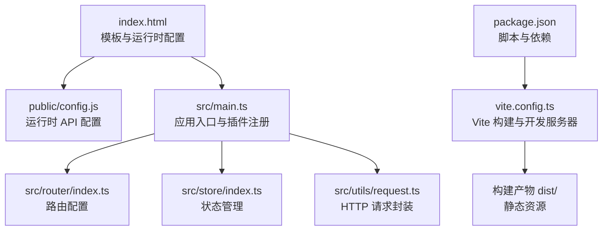
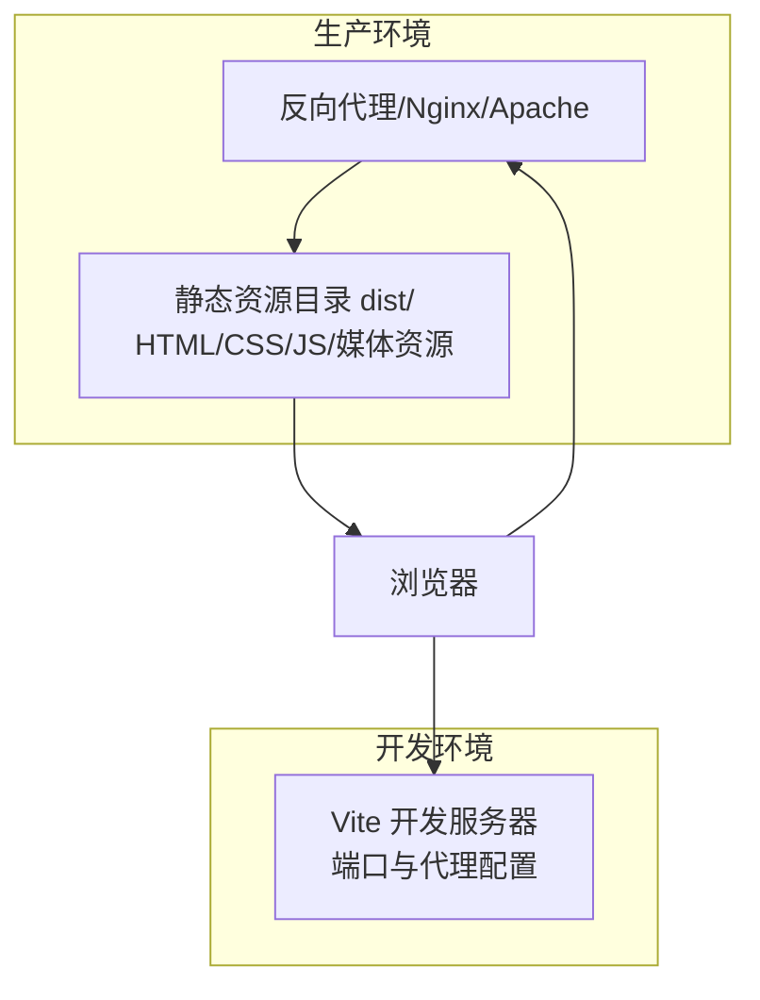
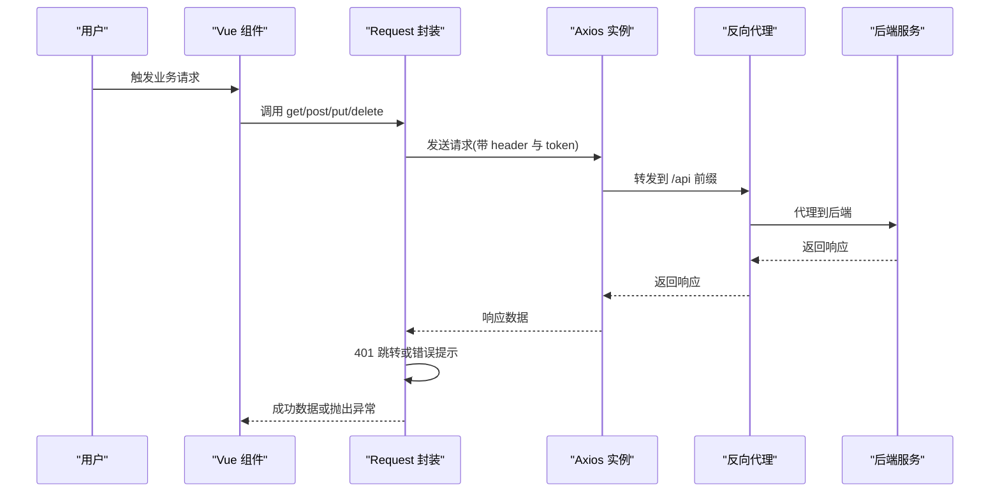
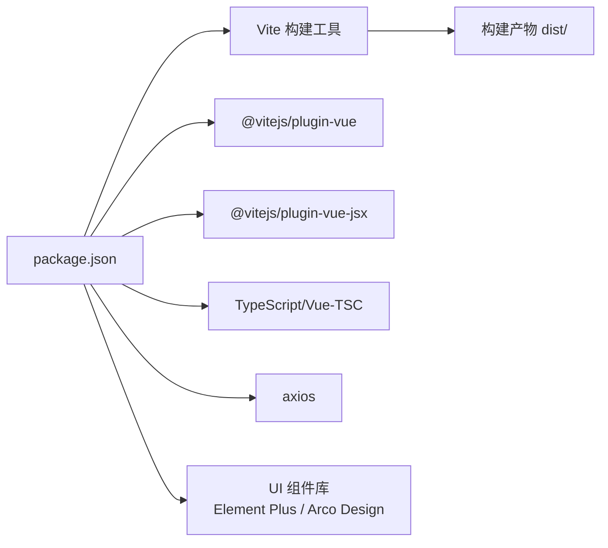

# 部署指南

<cite>
**本文引用的文件**
- [package.json](file://package.json)
- [vite.config.ts](file://vite.config.ts)
- [index.html](file://index.html)
- [public/config.js](file://public/config.js)
- [src/utils/env.ts](file://src/utils/env.ts)
- [src/utils/request.ts](file://src/utils/request.ts)
- [src/main.ts](file://src/main.ts)
- [tsconfig.json](file://tsconfig.json)
- [tsconfig.app.json](file://tsconfig.app.json)
- [README.md](file://README.md)
</cite>

## 目录
1. [简介](#简介)
2. [项目结构](#项目结构)
3. [核心组件](#核心组件)
4. [架构总览](#架构总览)
5. [详细组件分析](#详细组件分析)
6. [依赖分析](#依赖分析)
7. [性能考虑](#性能考虑)
8. [故障排查指南](#故障排查指南)
9. [结论](#结论)
10. [附录](#附录)

## 简介
本指南面向新工作台项目的生产环境部署，覆盖构建配置、部署流程与环境要求，详解 Vite 构建工具的配置项、静态资源处理与优化策略，解释环境变量、域名与 HTTPS 设置，并提供 Docker 容器化部署、CI/CD 流水线与自动化部署方案。同时给出多场景实施方案、监控告警与日志管理建议以及故障恢复策略，确保项目在生产环境中稳定可靠运行。

## 项目结构
项目采用 Vue 3 + TypeScript + Vite 技术栈，前端通过 Vite 构建，HTML 模板中引入运行时配置与字体样式，公共资源位于 public 目录，应用入口在 src/main.ts 中初始化路由、状态管理与 UI 组件库。

图表来源
- [index.html:1-16](file://index.html#L1-L16)
- [public/config.js:1-11](file://public/config.js#L1-L11)
- [src/main.ts:1-40](file://src/main.ts#L1-L40)
- [vite.config.ts:1-37](file://vite.config.ts#L1-L37)
- [package.json:1-62](file://package.json#L1-L62)

章节来源
- [README.md:1-6](file://README.md#L1-L6)
- [package.json:1-62](file://package.json#L1-L62)
- [vite.config.ts:1-37](file://vite.config.ts#L1-L37)
- [index.html:1-16](file://index.html#L1-L16)

## 核心组件
- 构建与打包：基于 Vite 的构建配置，包含开发服务器、代理、路径别名与 SVG 处理等。
- 运行时配置：通过 public/config.js 注入运行时 API 地址、下载地址等，便于生产环境替换。
- 请求封装：统一的 HTTP 封装与拦截器，负责鉴权头注入、白名单放行、错误提示与 401 跳转。
- 应用入口：初始化路由、状态管理、UI 组件库与全局组件注册。
- 类型配置：tsconfig 引用分层配置，启用路径别名与类型检查。

章节来源
- [vite.config.ts:1-37](file://vite.config.ts#L1-L37)
- [public/config.js:1-11](file://public/config.js#L1-L11)
- [src/utils/request.ts:1-159](file://src/utils/request.ts#L1-L159)
- [src/main.ts:1-40](file://src/main.ts#L1-L40)
- [tsconfig.app.json:1-20](file://tsconfig.app.json#L1-L20)

## 架构总览
前端通过 Vite 在开发环境提供热更新与代理能力；生产构建输出静态资源，由反向代理或静态站点服务器提供服务。运行时配置通过 window.api 注入，请求通过 axios 经过拦截器统一处理。

图表来源
- [vite.config.ts:8-24](file://vite.config.ts#L8-L24)
- [index.html:1-16](file://index.html#L1-L16)

## 详细组件分析

### Vite 构建与开发服务器配置
- 开发服务器
  - 监听地址与端口：允许外部访问，便于联调与测试。
  - 代理：将 /api 前缀转发至后端服务，支持跨域场景。
  - 文件系统：严格模式关闭，避免某些路径限制导致的开发问题。
- 插件与解析
  - Vue 插件与 JSX 支持。
  - SVG Loader：默认以 URL 形式导入，启用 SVGO 优化。
  - 路径别名：@ 指向 src，assets、styles 别名便于模块组织。
- 静态资源
  - 显式声明 xlsx 文件作为静态资源，确保构建时被正确处理。
  - 字体与图标等静态资源放置于 public，随 HTML 一同发布。

章节来源
- [vite.config.ts:1-37](file://vite.config.ts#L1-L37)

### 运行时配置与环境变量
- 运行时配置
  - 通过 public/config.js 注入 apiUrl、logoutUrl、shareUrl、userURL、dowUrl、dataWriteUrl、maxSize 等参数，便于在不重新构建的情况下切换后端地址与功能开关。
- 环境变量
  - import.meta.env.MODE 控制调试模式判断，影响部分运行时行为。
- 类型配置
  - tsconfig.app.json 启用路径别名与类型检查，保证开发体验与类型安全。

章节来源
- [public/config.js:1-11](file://public/config.js#L1-L11)
- [src/utils/env.ts:1-4](file://src/utils/env.ts#L1-L4)
- [tsconfig.app.json:1-20](file://tsconfig.app.json#L1-L20)

### 请求封装与鉴权
- 基础配置
  - baseURL 默认为 /api，统一前缀便于代理与跨域处理。
  - 超时时间较长，适配复杂业务请求。
- 请求拦截
  - 固定 client_id 注入。
  - 白名单放行，其余请求携带 token。
- 响应拦截
  - 对 401 统一跳转至认证地址。
  - 错误码非成功时弹窗提示并拒绝 Promise。
  - Blob/ArrayBuffer 类型透传，支持文件下载。
- 全局错误映射
  - 常见 HTTP 状态码映射为用户可读提示。

图表来源
- [src/utils/request.ts:15-114](file://src/utils/request.ts#L15-L114)

章节来源
- [src/utils/request.ts:1-159](file://src/utils/request.ts#L1-L159)

### 应用入口与组件注册
- 初始化应用实例，注册路由、状态管理、UI 组件库与图标库。
- 动态注册组件，减少手动导入成本。
- 全局组件注册，提升复用性。

章节来源
- [src/main.ts:1-40](file://src/main.ts#L1-L40)

### 构建与预览脚本
- dev：启动 Vite 开发服务器。
- build：执行生产构建，输出静态资源至 dist。
- preview：本地预览构建产物。
- test/test:watch：单元测试与监听模式。

章节来源
- [package.json:6-12](file://package.json#L6-L12)

## 依赖分析
- 运行时依赖
  - Vue 3 生态、Element Plus、Arco Design、ECharts、Monaco Editor、WangEditor 等 UI 与编辑器库。
  - axios、dayjs、uuid、nanoid 等常用工具库。
- 开发依赖
  - @vitejs/plugin-vue、@vitejs/plugin-vue-jsx、sass、typescript、vitest、vue-tsc 等。
- 构建工具
  - Vite（使用 rolldown-vite@7.2.5），配合插件链路完成编译与优化。

图表来源
- [package.json:13-57](file://package.json#L13-L57)
- [vite.config.ts:1-37](file://vite.config.ts#L1-L37)

章节来源
- [package.json:1-62](file://package.json#L1-L62)
- [vite.config.ts:1-37](file://vite.config.ts#L1-L37)

## 性能考虑
- 资源体积
  - 合理拆分第三方库与业务代码，结合动态导入与路由懒加载降低首屏体积。
  - 使用 SVG Loader 与 SVGO 优化矢量资源。
- 构建优化
  - 启用压缩与 Tree Shaking（Vite 默认开启），避免无用代码进入产物。
  - 对大文件（如 xlsx）按需加载，减少初始包大小。
- 缓存策略
  - 静态资源采用强缓存策略，文件名带哈希，确保更新即失效。
- 网络优化
  - 通过反向代理启用 gzip/br 压缩，合理设置缓存头与 CORS。
- 监控指标
  - 建议接入前端性能监控（如 SPA 白屏时长、首屏时间、资源加载耗时）。

## 故障排查指南
- 认证与鉴权
  - 若出现 401，检查 localStorage 中 token 是否存在，确认白名单是否覆盖当前接口。
  - 确认 window.api.apiUrl 指向正确的认证地址。
- 跨域与代理
  - 确认 /api 前缀代理已正确配置，目标后端地址可达。
  - 检查 changeOrigin 与跨域头设置。
- 静态资源
  - 确保 public 下的字体、图标与配置文件在构建后仍可访问。
  - xlsx 文件需显式声明为静态资源，避免被忽略。
- 构建与预览
  - 如构建失败，检查 Vite 插件链与路径别名配置。
  - 使用 preview 本地验证构建产物可用性。

章节来源
- [src/utils/request.ts:26-113](file://src/utils/request.ts#L26-L113)
- [public/config.js:1-11](file://public/config.js#L1-L11)
- [vite.config.ts:12-20](file://vite.config.ts#L12-L20)

## 结论
本指南提供了新工作台项目在生产环境的完整部署路径：明确构建配置、运行时参数、请求拦截与鉴权机制，给出 Docker 与 CI/CD 的通用实践建议，并提供监控、日志与故障恢复策略。遵循上述方案可显著提升部署稳定性与可维护性。

## 附录

### A. 生产环境构建与部署流程
- 步骤
  - 在生产机安装 Node.js 与包管理器。
  - 安装依赖并执行构建脚本，生成 dist 目录。
  - 将 dist 目录部署至静态服务器或通过反向代理提供服务。
  - 替换 public/config.js 中的运行时配置，指向生产后端。
- 注意事项
  - 确保静态资源可被正确缓存与回源。
  - 对敏感信息（如 client_id、token）仅在运行时注入，不在客户端暴露。

章节来源
- [package.json:6-12](file://package.json#L6-L12)
- [vite.config.ts:25-35](file://vite.config.ts#L25-L35)
- [public/config.js:1-11](file://public/config.js#L1-L11)

### B. 环境变量与域名设置
- 环境变量
  - import.meta.env.MODE 控制调试模式，影响部分运行时逻辑。
- 域名与 HTTPS
  - 在反向代理层配置域名与证书，确保 HTTPS。
  - 在 public/config.js 中设置 apiUrl、logoutUrl、shareUrl 等为 HTTPS 地址。
- 代理与跨域
  - 保持 /api 前缀代理至后端，避免前端直连后端导致跨域。

章节来源
- [src/utils/env.ts:1-4](file://src/utils/env.ts#L1-L4)
- [public/config.js:1-11](file://public/config.js#L1-L11)
- [vite.config.ts:12-20](file://vite.config.ts#L12-L20)

### C. Docker 容器化部署
- 方案
  - 使用 Nginx 镜像挂载 dist 目录，提供静态资源服务。
  - 反向代理层统一处理 HTTPS、CORS 与 /api 代理。
- 最佳实践
  - 将运行时配置通过环境变量注入（如通过 Nginx 变量或构建时替换）。
  - 使用只读文件系统与最小化镜像，减少攻击面。

[本节为概念性指导，无需文件引用]

### D. CI/CD 流水线与自动化部署
- 流程
  - 代码提交触发构建，执行测试与构建脚本。
  - 产出制品上传至制品库或直接部署到目标服务器。
  - 部署阶段替换运行时配置并重启服务。
- 建议
  - 分环境（dev/staging/prod）隔离配置与权限。
  - 引入蓝绿/金丝雀发布策略，降低变更风险。

[本节为概念性指导，无需文件引用]

### E. 监控告警与日志管理
- 前端监控
  - 上报错误堆栈、性能指标与用户行为。
- 日志管理
  - 后端统一收集与存储日志，前端记录关键事件与错误。
- 告警
  - 设定阈值（如错误率、响应时间、资源加载失败）触发告警。

[本节为概念性指导，无需文件引用]