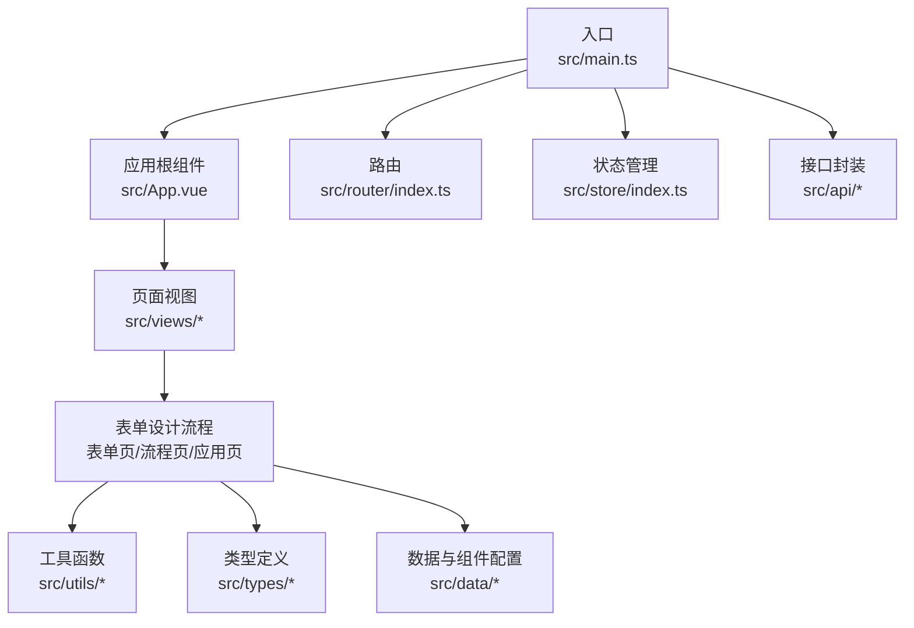
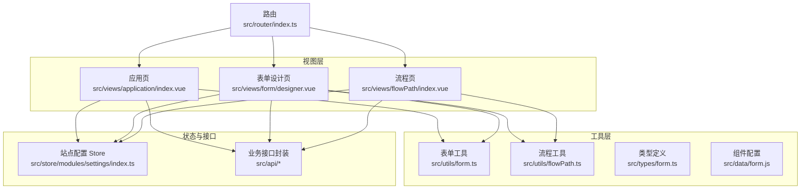
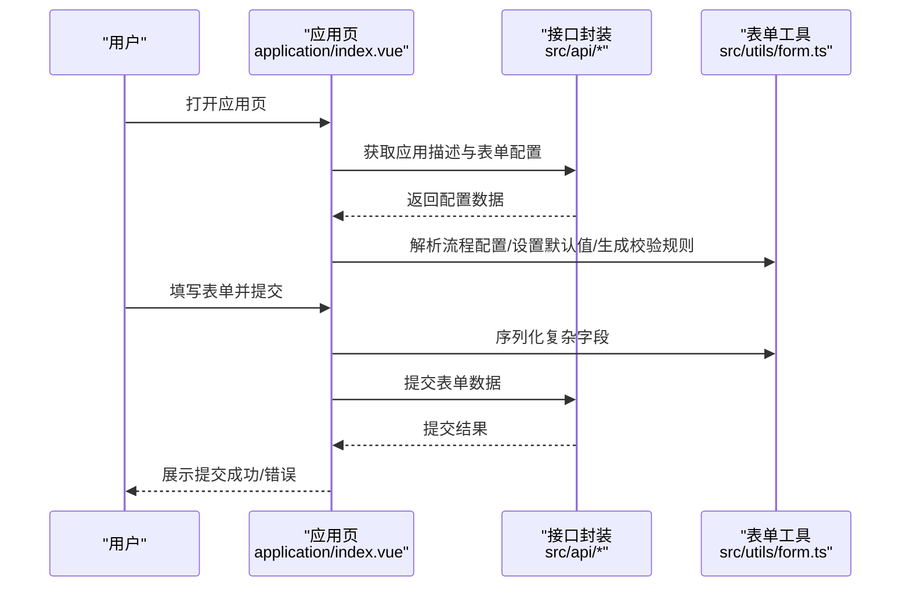
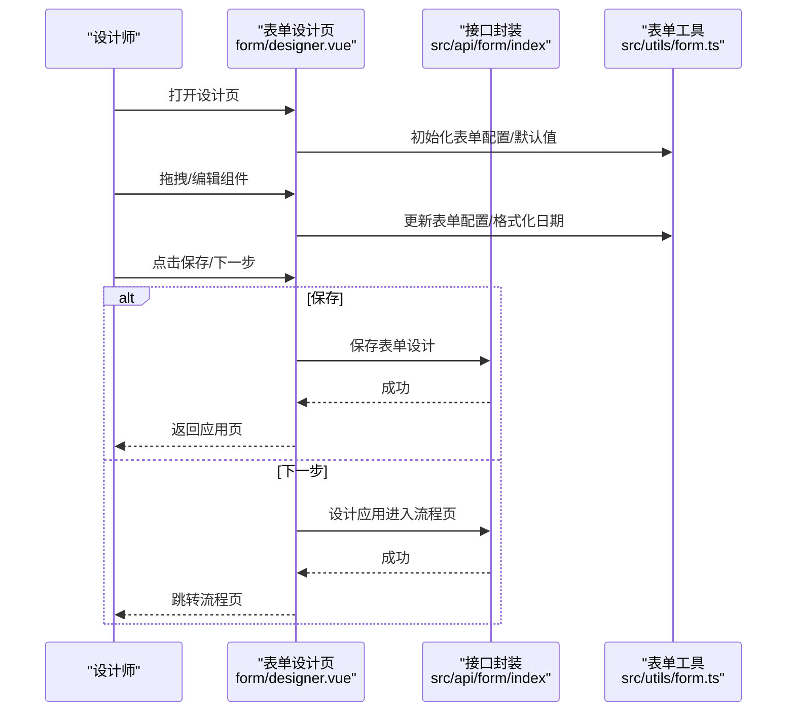
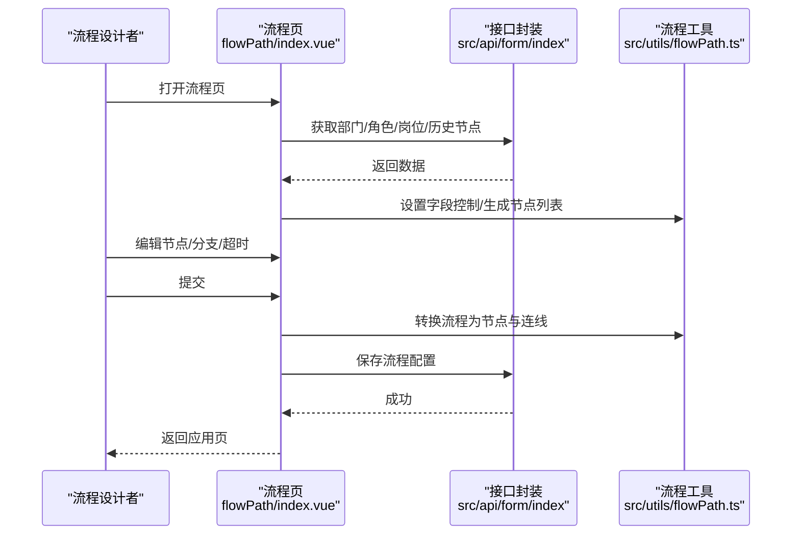
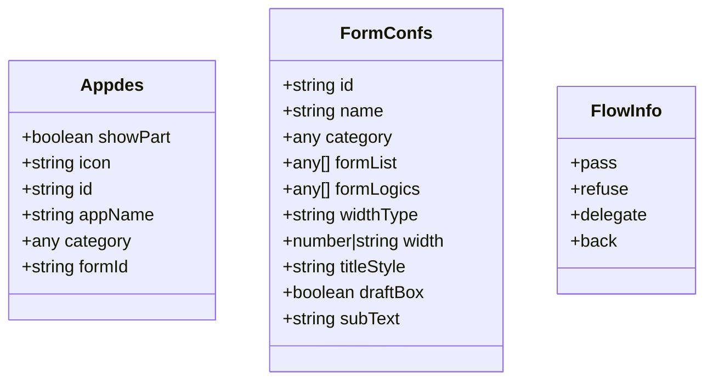
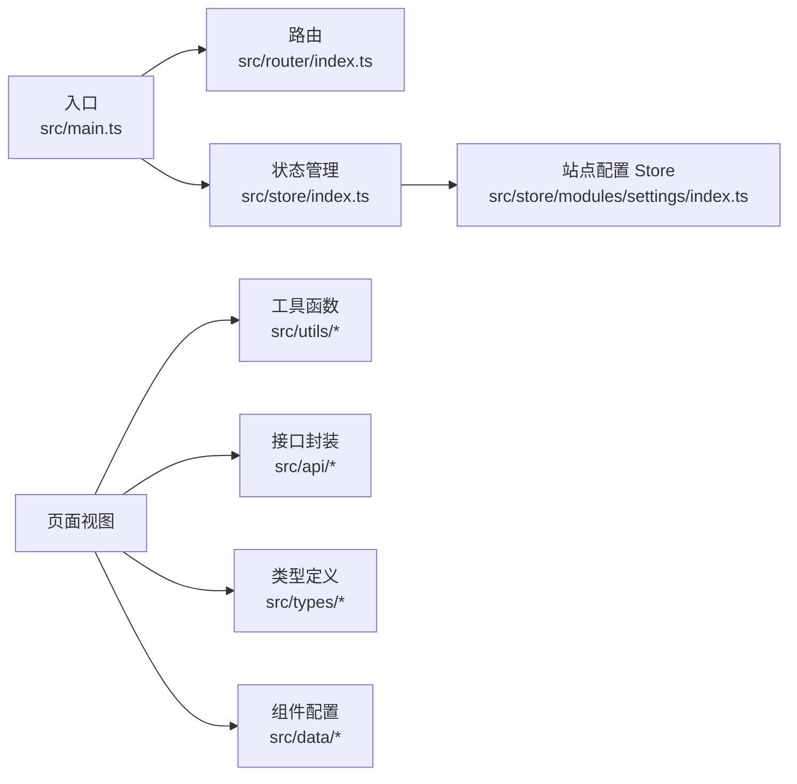

# 项目概述

<cite>
**本文引用的文件**
- [README.md](file://README.md)
- [package.json](file://package.json)
- [src/main.ts](file://src/main.ts)
- [src/App.vue](file://src/App.vue)
- [src/router/index.ts](file://src/router/index.ts)
- [src/store/index.ts](file://src/store/index.ts)
- [src/store/modules/settings/index.ts](file://src/store/modules/settings/index.ts)
- [src/api/user.ts](file://src/api/user.ts)
- [src/views/application/index.vue](file://src/views/application/index.vue)
- [src/views/form/designer.vue](file://src/views/form/designer.vue)
- [src/views/flowPath/index.vue](file://src/views/flowPath/index.vue)
- [src/utils/form.ts](file://src/utils/form.ts)
- [src/utils/flowPath.ts](file://src/utils/flowPath.ts)
- [src/types/form.ts](file://src/types/form.ts)
- [src/data/form.js](file://src/data/form.js)
</cite>

## 目录
1. [引言](#引言)
2. [项目结构](#项目结构)
3. [核心组件](#核心组件)
4. [架构总览](#架构总览)
5. [详细组件分析](#详细组件分析)
6. [依赖关系分析](#依赖关系分析)
7. [性能考量](#性能考量)
8. [故障排查指南](#故障排查指南)
9. [结论](#结论)
10. [附录](#附录)

## 引言
新工作台（Wornbench）是一个基于 Vue 3 + TypeScript + Vite 的企业级工作流管理系统。项目围绕“应用管理、表单设计、工作流引擎、任务管理、用户权限”五大核心能力构建，提供从表单配置到流程编排再到任务执行与监督的完整闭环。通过现代化前端技术栈与模块化架构，既满足初学者快速上手，也为资深开发者提供了清晰的扩展路径与高内聚低耦合的代码组织。

本项目旨在：
- 提供可视化表单设计器，支持丰富组件与数据联动
- 构建可演进的工作流引擎，覆盖分支、并行、超时与动态候选者
- 实现任务中心的待办、经办、监督与统计分析
- 统一站点配置与主题风格，提升企业级体验一致性

## 项目结构
项目采用“按功能域分层”的组织方式，核心目录与职责如下：
- src：应用源码
  - api：后端接口封装（按业务模块划分）
  - components：通用组件库（表单项、表达式、选择器、编辑器等）
  - data：表单组件元数据与默认配置
  - router：前端路由定义与导航守卫
  - store：状态管理（Pinia），含站点配置等模块
  - types：TypeScript 类型定义
  - utils：工具函数（表单处理、流程转换、ID生成等）
  - views：页面视图（应用、表单、流程、任务、设置等）
- public：公共资源（字体、配置等）

图表来源
- [src/main.ts:1-40](file://src/main.ts#L1-L40)
- [src/App.vue:1-52](file://src/App.vue#L1-L52)
- [src/router/index.ts:1-189](file://src/router/index.ts#L1-L189)
- [src/store/index.ts:1-9](file://src/store/index.ts#L1-L9)

章节来源
- [README.md:1-6](file://README.md#L1-L6)
- [package.json:1-62](file://package.json#L1-L62)

## 核心组件
- 应用运行时与插件注册
  - 在应用启动阶段完成 Arco Design、路由、状态管理、全局组件注册等初始化，确保页面渲染前具备统一的主题与状态能力。
- 路由系统
  - 定义登录、首页、应用管理、表单设计、流程编排、任务中心、权限与安全、系统设置等页面路由，并预留开发者与访客场景。
- 状态管理（Pinia）
  - 提供站点配置 Store，支持标题、Logo 的持久化与动态更新，便于统一门户风格。
- 接口封装
  - 对文件上传/下载、业务接口进行统一封装，便于在各页面复用。

章节来源
- [src/main.ts:1-40](file://src/main.ts#L1-L40)
- [src/router/index.ts:1-189](file://src/router/index.ts#L1-L189)
- [src/store/index.ts:1-9](file://src/store/index.ts#L1-L9)
- [src/store/modules/settings/index.ts:1-53](file://src/store/modules/settings/index.ts#L1-L53)
- [src/api/user.ts:1-16](file://src/api/user.ts#L1-L16)

## 架构总览
整体采用“前端单页应用 + 模块化路由 + 状态管理 + 工具函数库”的架构，强调：
- 分层清晰：视图层、工具层、接口层、状态层职责明确
- 可扩展：通过组件与配置驱动，降低硬编码耦合
- 企业级：统一站点配置、权限与流程控制，适配复杂业务场景

图表来源
- [src/views/application/index.vue:1-194](file://src/views/application/index.vue#L1-L194)
- [src/views/form/designer.vue:1-444](file://src/views/form/designer.vue#L1-L444)
- [src/views/flowPath/index.vue:1-192](file://src/views/flowPath/index.vue#L1-L192)
- [src/utils/form.ts:1-800](file://src/utils/form.ts#L1-L800)
- [src/utils/flowPath.ts:1-322](file://src/utils/flowPath.ts#L1-L322)
- [src/types/form.ts:1-45](file://src/types/form.ts#L1-L45)
- [src/data/form.js:1-800](file://src/data/form.js#L1-L800)
- [src/store/modules/settings/index.ts:1-53](file://src/store/modules/settings/index.ts#L1-L53)
- [src/router/index.ts:1-189](file://src/router/index.ts#L1-L189)

## 详细组件分析

### 应用页（表单展示与提交）
应用页负责加载应用描述、表单配置与流程配置，渲染动态表单并支持提交。其关键流程包括：
- 获取应用描述与表单配置
- 解析流程配置为树形结构并注入字段控制
- 初始化表单模型、默认值与校验规则
- 支持表达式计算与字段联动
- 提交时对复杂字段（如子表单、关联数据）进行序列化

图表来源
- [src/views/application/index.vue:28-158](file://src/views/application/index.vue#L28-L158)
- [src/utils/form.ts:452-577](file://src/utils/form.ts#L452-L577)

章节来源
- [src/views/application/index.vue:1-194](file://src/views/application/index.vue#L1-L194)
- [src/utils/form.ts:1-800](file://src/utils/form.ts#L1-L800)

### 表单设计页（可视化设计器）
表单设计页提供拖拽式表单构建能力，支持：
- 组件面板与画布交互
- 表单属性与字段联动配置
- 保存与下一步跳转（进入流程页）
- 动态 ID 生成与子表单嵌套处理

图表来源
- [src/views/form/designer.vue:67-287](file://src/views/form/designer.vue#L67-L287)
- [src/utils/form.ts:723-800](file://src/utils/form.ts#L723-L800)

章节来源
- [src/views/form/designer.vue:1-444](file://src/views/form/designer.vue#L1-L444)
- [src/utils/form.ts:1-800](file://src/utils/form.ts#L1-L800)

### 流程页（流程编排与提交）
流程页用于将表单字段映射到流程节点，配置候选者、分支条件与超时策略，并最终提交形成完整流程配置：
- 加载部门/角色/岗位列表与历史节点
- 将流程树转换为节点与连线集合
- 保存流程配置并返回应用页

图表来源
- [src/views/flowPath/index.vue:39-145](file://src/views/flowPath/index.vue#L39-L145)
- [src/utils/flowPath.ts:119-274](file://src/utils/flowPath.ts#L119-L274)

章节来源
- [src/views/flowPath/index.vue:1-192](file://src/views/flowPath/index.vue#L1-L192)
- [src/utils/flowPath.ts:1-322](file://src/utils/flowPath.ts#L1-L322)

### 数据模型与组件配置
- 类型定义：统一应用描述、表单配置、流程信息等结构，保证跨组件传递的一致性。
- 组件配置：内置丰富表单组件（输入、文本域、单选/多选、选择器、上传、富文本等），并提供属性面板与默认值模板，降低设计成本。

图表来源
- [src/types/form.ts:1-45](file://src/types/form.ts#L1-L45)

章节来源
- [src/types/form.ts:1-45](file://src/types/form.ts#L1-L45)
- [src/data/form.js:1-800](file://src/data/form.js#L1-L800)

## 依赖关系分析
- 技术栈
  - 前端框架：Vue 3、TypeScript、Vite
  - UI 组件：Element Plus、Arco Design
  - 状态管理：Pinia
  - 路由：Vue Router
  - 图表与编辑器：ECharts、wangEditor、Monaco Editor
  - 工具库：dayjs、crypto-js、xlsx、nanoid 等
- 关键依赖关系
  - 应用入口依赖路由与状态管理；页面依赖工具函数与接口封装；流程页依赖表单工具与流程工具；站点配置 Store 依赖本地存储。

图表来源
- [src/main.ts:1-40](file://src/main.ts#L1-L40)
- [src/router/index.ts:1-189](file://src/router/index.ts#L1-L189)
- [src/store/index.ts:1-9](file://src/store/index.ts#L1-L9)
- [src/store/modules/settings/index.ts:1-53](file://src/store/modules/settings/index.ts#L1-L53)

章节来源
- [package.json:13-42](file://package.json#L13-L42)

## 性能考量
- 按需加载与懒加载：路由采用异步组件加载，减少首屏体积
- 组件注册策略：通过扫描机制批量注册通用组件，避免重复导入
- 表单与流程工具：对复杂字段（子表单、关联数据）采用延迟计算与缓存策略，减少渲染压力
- 本地存储：流程与站点配置使用本地存储，降低重复请求

## 故障排查指南
- 登录与路由
  - 若访问任意路径后重定向至登录页，请检查路由守卫逻辑与鉴权状态
- 表单提交失败
  - 检查表单字段序列化逻辑与必填校验；关注子表单与关联数据的值格式
- 流程保存异常
  - 确认流程节点与连线转换是否正确；检查候选者与超时配置的数据结构
- 站点配置不生效
  - 确认 Store 中的配置写入与本地存储同步；检查页面标题与 Logo 的拼接参数

章节来源
- [src/router/index.ts:182-188](file://src/router/index.ts#L182-L188)
- [src/utils/form.ts:452-577](file://src/utils/form.ts#L452-L577)
- [src/utils/flowPath.ts:119-244](file://src/utils/flowPath.ts#L119-L244)
- [src/store/modules/settings/index.ts:42-49](file://src/store/modules/settings/index.ts#L42-L49)

## 结论
新工作台（Wornbench）以“表单即入口、流程即能力、任务即闭环”为核心理念，结合 Vue 3 + TypeScript + Vite 的现代技术栈，构建了面向企业级场景的可视化工作流平台。通过清晰的模块划分、完善的工具函数与统一的状态管理，既能帮助初学者快速理解业务闭环，也能为高级开发者提供稳定的扩展基座。建议在后续迭代中持续完善流程引擎的可视化与审计能力，并加强测试与监控体系，以进一步提升系统的稳定性与可观测性。

## 附录
- 业务价值
  - 降低表单与流程设计门槛，提升业务人员自服务能力
  - 通过流程编排实现跨部门协作与审批自动化
  - 统一站点配置与品牌风格，增强企业数字化形象
- 应用场景
  - 审批类应用（请假、报销、采购）
  - 项目管理与工单流转
  - 数据采集与报表生成
- 技术亮点
  - 可视化表单设计器与组件生态
  - 流程节点与字段双向映射
  - 子表单、关联数据与表达式联动
  - 站点配置与主题风格统一